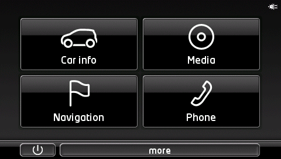

# 4NSF dev kit

Tools to understand, emulate and write software for the **Garmin / Navigon 4NSF**, the removable dashboard unit sold as:

- Volkswagen "maps + more" (up!)
- Seat "Portable System" (Mii)
- Skoda "Move&Fun" (Citigo)

The unit runs Windows CE 6 on ARM and was abandoned by its makers in 2020.



## What you get

After one setup command you have:

- **The unit's official software**, unpacked, to study or reverse engineer (`firmware/`)
- **An emulator** that runs that software, and your own, on your computer, with a simulated car behind it (`emulator/`)
- **A cross-compiler** for Windows CE on ARM, in a container (`sdk/`)
- **Documentation** of how the unit works, including its link to the car (`docs/`)

## Quick start

### Requirements

- a container runtime: Apple `container`, Docker or Podman
- `qemu-system-arm`, `python3`, `make`
- about 20 GB of free disk

Nothing else is installed on your machine: the compiler lives in the container, the Python packages in a local `.venv`.
Optional, only for `tools/decompile.py`: radare2 with the r2ghidra plugin.

### Build and run

```sh
make setup              # once: Python venv, dev container, firmware download (3.5 GB from VW), emulator disk
make run                # emulator window with the VW menu; RADIO=1 adds a simulated car
make deploy APP=hello   # compile apps/hello, install it into the emulator, start it
make stop
```

### Write your own app

1. Copy `apps/hello` to `apps/<name>` and rename what is called `hello` inside.
2. Run `make deploy APP=<name>`.
3. After the next `make run`, the app is also listed in the VW menu under "more".

Two more examples show the unit's services:

- `apps/cardata` reads live vehicle data.
- `apps/appcom` listens to (and sends) the messages between the unit's programs.

Full guide: [docs/apps/building-apps.md](docs/apps/building-apps.md).

## Status

**✅ Works**

- The emulator boots the VW shell and Navigon's menus.
- A simulated car radio feeds it vehicle data: trip computer, gauges, open doors.
- Your own programs compile, deploy, appear in the VW menu, start from it and read that vehicle data.

**🚧 Not yet**

- The radio's own functions (BAP protocol): sound source, station list, parking sensors.
- Bluetooth.
- Media playback.

## Repository layout

| Folder | Contents |
|---|---|
| `apps/` | Your programs. `hello/` is the template: source, `NgAppInfo.xml` (the entry in the VW menu) and icon. `cardata/` and `appcom/` are examples for vehicle data and for messages between programs; `include/` has the header they share. |
| `sdk/` | The dev container: CeGCC cross-compiler plus the tools the build scripts need. `sdk/run <command>` runs anything inside it. |
| `emulator/` | The test bench (QEMU): build it, start it, copy programs into it, feed it a GPS position and a simulated car. Start with [emulator/README.md](emulator/README.md). |
| `firmware/` | The scripts that download and unpack the official software (`make firmware`). The software itself is not part of the repository. See [firmware/README.md](firmware/README.md). |
| `tools/` | Scripts for studying the software by hand: program inspector, decompiler helper, extractors for the resource files, decoders for the messages between programs and for the car link. See [tools/README.md](tools/README.md). |
| `docs/` | How the unit works: one overview ([docs/architecture.md](docs/architecture.md)) and one document per subsystem. |

## Documentation

Start with **[docs/architecture.md](docs/architecture.md)**: the whole system on one page (programs, how they talk, the car link, what is still unknown) and an index of every document.

### The system

| Document | Topic |
|---|---|
| [device.md](docs/system/device.md) | Inventory: hardware, programs and DLLs, flash content, licence files, where personal data sits |
| [hardware-layer.md](docs/system/hardware-layer.md) | Board-support DLL, hidden flash, drivers, GPIOs, ROM registry |
| [boot-and-supervision.md](docs/system/boot-and-supervision.md) | Boot sequence, watchdog, crash handling, power states, update mechanism |
| [brand-and-pairing.md](docs/system/brand-and-pairing.md) | How the unit picks VW / Seat / Skoda, what it stores about the car, boot screens |
| [ui-framework.md](docs/system/ui-framework.md) | The data-driven UI toolkit and its resource files |
| [user-shell.md](docs/system/user-shell.md) | The main menu program: car screens, standby rules, settings |
| [media-audio.md](docs/system/media-audio.md) | Media player, picture viewer, and who may use the car speakers |
| [bluetooth.md](docs/system/bluetooth.md) | Bluetooth module, its host program, the phone app |
| [navigation.md](docs/system/navigation.md) | The navigation app's interfaces: GPS, traffic tuner, speech, licensing, how to replace it |
| [file-formats.md](docs/system/file-formats.md) | The Navigon resource container (`.nfs`, `.map`) and an index of every other file format |

### The car

| Document | Topic |
|---|---|
| [car-link.md](docs/car/car-link.md) | Serial protocol between the unit and the car radio: dock pins, framing, handshake |
| [can-signals.md](docs/car/can-signals.md) | Bit layout of the vehicle messages the radio forwards (speed, RPM, trip computer, doors, …) |
| [bap.md](docs/car/bap.md), [bap-functions.md](docs/car/bap-functions.md) | Volkswagen's BAP protocol as the unit speaks it: radio control, audio channel, parking sensors, clock, e-up! charging |
| [shared-memory.md](docs/car/shared-memory.md) | How vehicle data reaches the programs (C header: `apps/include/vwshm.h`) |

### Apps

| Document | Topic |
|---|---|
| [building-apps.md](docs/apps/building-apps.md) | Compiling, running in the emulator, installing on a real unit, using the unit's services and DLLs |
| [appcom.md](docs/apps/appcom.md) | The message system between the unit's programs (UDP on localhost): wire format and message catalogue |

## Related projects

- [jilleb/4nsf-toolbox](https://github.com/jilleb/4nsf-toolbox) and its fork [smn/4nsf-toolbox](https://github.com/smn/4nsf-toolbox): community tools, and the emulator approach this kit builds on.
- [hupog/seat-portable-system-revival](https://github.com/hupog/seat-portable-system-revival): boot analysis and an open-source navigation app on the unit.

## License

- **Code** (programs, scripts, build files, app templates): [Mozilla Public License 2.0](LICENSE).
- **Documentation** (`docs/`, the README files, pictures in `docs/img/`): [Creative Commons Attribution-ShareAlike 4.0](LICENSE-DOCS).

In short:

- ✅ Use it for anything, commercial use included.
- 🔁 If you publish a changed version of one of this project's files, publish that file's source under the same licence. Changed documents stay under CC BY-SA, with credit.
- ✅ Your own programs are yours: an app, or a whole replacement for a stock program (a different navigation app, say), can use any license, open or closed, even when it includes `apps/include/vwshm.h` or starts from `apps/hello`. Only the copied files themselves stay under the MPL.
- ✅ MPL code can be combined with GPL projects.

Files derived from MIT-licensed upstream code keep that notice; see [NOTICE.md](NOTICE.md).

## Credits

The emulator approach and several scripts come from [smn/4nsf-toolbox](https://github.com/smn/4nsf-toolbox) (a fork of [jilleb/4nsf-toolbox](https://github.com/jilleb/4nsf-toolbox), MIT); see [NOTICE.md](NOTICE.md). The Windows CE kernel image is from [Milek7/wince-qemu](https://github.com/Milek7/wince-qemu), the compiler from [ENLYZE's CeGCC build](https://github.com/enlyze/cegcc-build).

The unit's software belongs to Garmin, Navigon and Volkswagen; it is downloaded from Volkswagen's server and never redistributed here. This project is not affiliated with any of them.
