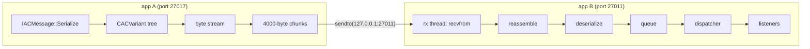

# AppCom — app-to-app IPC (UDP on 127.0.0.1)

AppCom is the Navigon framework that lets the unit's programs (shell, navigation, phone, media, …) send each other small typed messages, start/stop each other and find out who is in the foreground. It is a DLL (`ACAppCom.dll` / `NgAppCom.dll`) plus an XML app registry. Car data does **not** travel over AppCom (→ [shared-memory.md](../car/shared-memory.md)).

Legend: ✅ seen in disassembly/data (binary + VA) · ✅ emulator = observed running in the emulator (CE 7 guest, stubbed hardware; datagrams of the unit's own programs captured and sent there, §13) · 🟡 inferred / single source · ❓ unknown. Nothing tested on a real unit.
VAs: `AC` = `firmware/flash/VwUserShell/ACAppCom.dll`, `NG` = `firmware/flash/NAVIGON/NgAppCom.dll` (both image base `0x10000000`, ARM mode).
Related: [user-shell.md](../system/user-shell.md) · [media-audio.md](../system/media-audio.md) · [bluetooth.md](../system/bluetooth.md) · [navigation.md](../system/navigation.md) (what each program does with the messages) · [building-apps.md](building-apps.md) (own apps).

## 1. Overview



| Item | Value | Evidence |
|---|---|---|
| Transport | UDP, `AF_INET`/`SOCK_DGRAM`, destination always `127.0.0.1` | ✅ AC `0x1000d9c0` (`socket(2,2,0)` ×2), `0x1000b7d4` |
| Addressing | one UDP port per app, from the XML registry | ✅ AC `0x10004b30` |
| Own identity | the registry entry whose `<Exe>` equals the calling process' exe path | ✅ AC `0x10007194` |
| Byte order | little-endian everywhere (raw memory copies on ARM LE) | ✅ AC `0x100127e4` |
| Datagram | 8-byte header + ≤ 4000 payload bytes (max 4008) | ✅ AC `0x1000b7d4` |
| Message | variant list `[Int MsgID, payload]`; sync adds `[ticket, origin port]` | ✅ AC `0x1001250c`, `0x1000d3d0`, `0x1000c5f0` |
| Security | none (no auth, no checksum, no version field) | ✅ |

## 2. Datagram layout ✅, ✅ emulator for single datagrams (AC `0x1000b7d4` send, `0x1000d3d0` receive)

```c
struct ACDatagram {            /* all little-endian */
    int32_t  remaining;        /* number of datagrams still to follow for this message; 0 = last/only */
    int32_t  sender_port;      /* sender's own AppCom port (key for reassembly) */
    uint8_t  chunk[];          /* ≤ 4000 bytes of the serialized variant stream */
};
```

- Sender: `n = (int)(len * 0.00025f)` (= `len / 4000`); sends `n+1` datagrams with `remaining = n, n-1, … 0`; the first `n` carry exactly 4000 bytes (datagram = 4008), the last carries the rest (may be 0 bytes when `len` is a multiple of 4000).
- Nothing is sent (call still returns true) when the destination port is 0 or equals the sender's own port; nothing is sent and false is returned when the serialized length is 0.
- `sendto` failure: up to 51 retries, `Sleep(5)` between them.
- Receiver buffer: 4096 bytes (`0x1000`), one `recvfrom` per datagram. Chunks are collected per `sender_port`; when `remaining == 0` they are concatenated and deserialized. A single datagram with `remaining == 0` and no pending chunks is deserialized directly.
- No message id / sequence number in the header: two fragmented messages from the same sender interleave only if that sender sends from two threads at once.

## 3. `CACVariant` serialization ✅, ✅ emulator for Int, Binary, List (AC `0x10012644` size, `0x100127e4` write, `0x10012bcc` read)

Every variant = `uint32 type` followed by the type's body. Recursive, no padding except for binaries.

| Type | Name | Body | Size |
|---|---|---|---|
| 1 | Rect | 4 × `float32`: left, top, right, bottom | 4+16 |
| 2 | Point | 2 × `float32`: x, y | 4+8 |
| 3 | Pair | variant key, variant value | 4+… |
| 4 | List | `uint32 count`, then `count` variants | 4+4+… |
| 5 | second binary kind (🟡 "string"; only messages 1001/1002 use it) | `uint32 len`, `len` bytes, pad to a multiple of 4 | 4+4+pad4(len) |
| 6 | Binary (`BinData[` in the log) | same as 5 | 4+4+pad4(len) |
| 7 | Float | `float64` | 4+8 |
| 8 | Int | `int32` | 4+4 |
| 9 | Int64 | `int64` | 4+8 |
| other | — | serializer fails (type 0 = fresh, empty variant) | |

- **Strings**: there is no string type in practice. All apps put text into a type 6 Binary as **UTF-8 without terminator**, `len` = byte count (✅ `VolumeUI.exe` `0x2d9d8` writer, `0x15e34`/`0x15d30` UTF-16→UTF-8 conversion; same pattern in every message class with text).
- Pad bytes are whatever was in the sender's buffer (not cleared) → ignore them. ✅ emulator: the same 15-byte name arrived once padded with `00`, once with `41`.
- Booleans travel as Int 0/1. `Float` is a double; `Rect`/`Point` use 32-bit floats. `Pair`, `Point`, `Rect`, `Int64`, `Float` are supported by the DLL but (almost) unused by the shipped messages (`Float` is imported by `navigon.exe` only).
- The DLL treats types 5 and 6 identically; `SetBinaryDataPtr` accepts both (AC `0x10013188`).
- In memory a `CACVariant` is 0x48 bytes: `+0` type · `+4` `CACList{int count; ACNode *head}` · `+0xc` `ACPair{CACVariant *key, *value}` · `+0x14` `CACPoint{float x, y}` · `+0x1c` `CACBinaryData*` (`{uint len; uchar *data}`) · `+0x20` int · `+0x28` double · `+0x30` `CACRectangle{float[4]}` · `+0x40` int64 (✅ AC `0x10013afc`, `0x10013878`). List nodes (`ACNode`, 12 bytes: variant copy, prev, next) own a **copy** of the added variant.

Examples (hex, as on the wire):

| Variant | Bytes |
|---|---|
| Int 40 | `08 00 00 00 28 00 00 00` |
| Int −1 | `08 00 00 00 ff ff ff ff` |
| Float 2.5 | `07 00 00 00 00 00 00 00 00 00 04 40` |
| Int64 5 | `09 00 00 00 05 00 00 00 00 00 00 00` |
| Binary/string "ger-DEU" (7 bytes + 1 pad) | `06 00 00 00 07 00 00 00 67 65 72 2d 44 45 55 xx` |
| Point (1.0, 2.0) | `02 00 00 00 00 00 80 3f 00 00 00 40` |
| Rect (l=1, t=2, r=3, b=4) | `01 00 00 00 00 00 80 3f 00 00 00 40 00 00 40 40 00 00 80 40` |
| Pair (Int 1 → Int 2) | `03 00 00 00 08 00 00 00 01 00 00 00 08 00 00 00 02 00 00 00` |
| List [Int 2, Int 0] | `04 00 00 00 02 00 00 00 08 00 00 00 02 00 00 00 08 00 00 00 00 00 00 00` |

## 4. Message envelope ✅, ✅ emulator (2-element messages; one captured 4-element reply, §13)

`IACMessage::Serialize(CACVariant *out)` (AC `0x1001250c`): sets `out` to List, appends `Int(MsgID)`, then calls the message's own virtual serializer (vtable slot 0) which appends **exactly one** payload element: a bare `Int` for simple messages, a `List` of fields for the others (§9). A message that carries no data still appends `Int 0`.

| Top-level list | Meaning | Evidence |
|---|---|---|
| 2 elements `[Int MsgID, payload]` | normal (async) message → receive queue | ✅ AC `0x1000d3d0` |
| 4 elements `[Int MsgID, payload, Int ticket, Int origin_port]`, `origin_port` ≠ receiver's port | sync request → sync queue | ✅ AC `0x1000d3d0`, `0x1000c5f0` |
| 4 elements, `origin_port` == receiver's port | reply to the receiver's own sync request `ticket` | ✅ AC `0x1000d3d0` |
| any other count | dropped | ✅ |


## 5. Runtime behaviour (ACAppCom.dll; NgAppCom.dll is the same code, §8)

### 5.1 Objects

| Object | Getter | Fields used here | Evidence |
|---|---|---|---|
| App layer (`CACApplicationLayer`, name from NG log string) singleton | AC `0x100036f4` | `+0x08` `CACSystemInformation*` (registry) · `+0x0c` own exe directory · `+0x20` own exe base name · `+0x34` `ReadBufferSize` · `+0x38` `SyncTimeOut` · `+0x3c` listener vector · `+0x44` registered-message vector · `+0x50` critical section · `+0x70` HWND cursor for `GetWindowTop/Next` | ✅ |
| IPC connection (`CACIPCConnection`, NG log string) singleton | AC `0x1000b2b4` | `+0x08` signal "new data" · `+0x60` signal "new sync data" · `+0xb8` lock for sync sends · `+0xd8` serializer · `+0xdc` ticket counter · `+0xe0` open-ticket vector · `+0xe8` sync timeout (ms) · `+0xec` rx buffer size (`0x1000`) · `+0xf0` rx buffer | ✅ AC `0x1000d9c0` |

### 5.2 Start-up (app layer `Initialize`, AC `0x1000a7c0`; IPC `Initialize`, AC `0x1000d9c0`)

1. `GetModuleFileNameW(NULL)` → own directory + own base name (text between the last `\` or `/` and the last `.`) (AC `0x10006f30`, `0x1000639c`).
2. Load `<own exe dir>NgAppCom.xml`, then scan `\My Flash Disk\Apps\*\NgAppInfo.xml` (§6). Each exe therefore reads the copy of `NgAppCom.xml` in its own folder.
3. Own port = `<Port>` of the first registry entry whose `<Exe>` base name equals the own exe base name, case-insensitive (AC `0x10007194`). No match → port 0.
4. `WSAStartup(2)`, two UDP sockets: one for `sendto` (unbound), one `bind(127.0.0.1:own port)` for `recvfrom`. `bind` failure → no receive thread (sending still works 🟡).
5. `CreateThread` → receive loop (AC `0x1000d3d0`).

Consequences for a third-party program:

- Two processes started from the same exe name cannot both receive (same port).
- A program whose exe is not in the registry binds port 0 (= any free port) and puts `sender_port = 0` in its datagrams; receivers accept that (the field is only the reassembly key), but nobody can address it and it cannot get sync replies.
- Without the DLL, any process may `bind` a registered port that is free (app not running) or send to any port.

### 5.3 Sending

| Call | Target ports | Evidence |
|---|---|---|
| `SendMessageToApp(name, msg)` | port of the entry with `Name == name` (case-insensitive) | ✅ AC `0x100076dc` |
| `SendMessageToGroup(group, msg)` | every entry that lists `<Group>group</Group>` (case-insensitive); the sender itself is skipped by the "port == own port" rule | ✅ AC `0x10007a7c` |
| `BroadcastMessage(msg)` | every entry of the registry (entries without `<Port>` have port 0 → skipped) | ✅ AC `0x10004c24` |
| `SendSyncMessageToApp(name, msg, &reply)` | like `SendMessageToApp`, then blocks for the reply | ✅ AC `0x10007cdc`, `0x10007954` |

All go through `SendMessageToPort(port, msg)` (AC `0x10004b30`): `msg->Serialize()` → byte stream → datagrams (§2). There is no delivery check: a message to an app that is not running is lost silently, the call still returns true.

Group membership is purely local: the sender looks it up in its own copy of the registry. There is no subscribe message on the wire.

### 5.4 Receiving and dispatch

```
rx thread: recvfrom → reassemble → deserialize → by element count:
   2 → OnNewData      (AC 0x10007374)
   4, origin ≠ me → OnNewSyncData (AC 0x10007494)
   4, origin == me → store reply in ticket, set its event
OnNewData(v):  for p in registered: if p->ValidateData(v) { m = p->vtbl[1](p, v); break }
               for l in listeners: l->vtbl[1](l, m);   m->vtbl[2](m)
OnNewSyncData(v): same lookup; for l in listeners: l->vtbl[2](l, m, &reply);
               if reply: r = reply->Serialize(); must have 2 elements; append v[2], v[3]; send to port v[3]
```

- `ValidateData` = "element 0 is Int and equals the prototype's MsgID" (AC `0x100125bc`). A MsgID nobody registered with `RegisterMessage` is dropped; `RegisterMessage` refuses a second prototype with the same id (AC `0x1000954c`).
- Listeners run **on the receive thread**, inside the app layer's critical section (signal emit is a direct call, AC `0x10018ccc`). Every listener sees every registered message; filtering by MsgID is the listener's job.
- Sending a sync message from inside a listener callback cannot work: the reply would have to be read by the thread that is waiting 🟡.

### 5.5 Sync messages (AC `0x1000c5f0`)

1. Under the sync lock: ticket `{id = counter++, port = own port, event, reply}` is appended to the open-ticket vector.
2. `Int(ticket id)`, `Int(own port)` are appended to the message list → 4 elements → sent.
3. Wait on the ticket event for `SyncTimeOut` ms (`<SyncTimeOut>`, default 2000 when the key is missing, shipped value 4000, negative = infinite).
4. Timeout → returns false, `*reply = NULL`. Otherwise the reply variant is matched against the caller's registered prototypes and turned into an `IACMessage*` (`*reply`, caller frees it via `vtbl[2]`).

Only one sync call per process is in flight at a time (lock held while waiting). The reply's MsgID may differ from the request's; correlation is by `ticket` only.

### 5.6 Logger (AC `0x1000dbd8`, `0x10011cec`, `0x10010e04`)

| XML key (child of `<AppCom>`) | Effect | Evidence |
|---|---|---|
| `<AppComLogging>` | integer > 0 turns the log on | ✅ AC `0x1000a7c0` |
| `<AppComLogfilePath>` | directory/prefix for the log file | ✅ |

✅ emulator (shell): with `<AppComLogging>1</AppComLogging>` and `<AppComLogfilePath>\My Flash Disk\dev\</AppComLogfilePath>` (any existing folder, with the trailing backslash) in the shell's copy of `NgAppCom.xml`, the shell writes `VwUserShell_Log.txt` there = **path prefix + own application name + `_Log.txt`** (UTF-8 with BOM; the default name `AppComLog.txt` in the DLL was not used). Format:

```
############# AppComLog ###############
#### [768153 : 00:48:44 11/17/26] ###
General Logging enabled
CACVariant logging enabled
#######################################
[768436 : 00:48:44 11/17/26] GENERAL: SendMessageToGroup() called; MsgID[31], Group[Settings]
[768439 : 00:48:44 11/17/26] GENERAL: SENDING SendMessageToPort() called; MsgID[31] Port[27011]
[768442 : 00:48:44 11/17/26] VARIANT: ListData[IntData[31] IntData[13] ]
[1041212 : 00:51:27 11/17/26] GENERAL: RECEIVING OnNewData() message found; MsgID[40]
[1041216 : 00:51:27 11/17/26] GENERAL: FireNewMessage() called; MsgID[40]
```

- Prefix = `[GetTickCount : local time]`. Other line types ✅ strings: `SendMessageToApp() called; MsgID[%d], App[%s]`, `BroadcastMessage() called; MsgID[%d]`, `OnNewData() called`; variant dump with `ListData[` `IntData[` `Int64Data[` `FloatData[` `BinData[`.
- `BinData[…]` prints the UTF-8 bytes as if they were UTF-16 → strings are unreadable in the log; capture the datagrams if the text matters.
- A send to the own port is logged (`Port[27017]`) although nothing goes out (§2). Received 4-element (sync) messages leave no line in the AC build.
- One line per destination port: a group message to 7 members = 15 lines. The shipped `NgAppCom.xml` has neither key → logging off. The NG build also prints `CACIPCConnection::SendDataSync …` lines through a debug print.

## 6. App registry

### 6.1 Files

| File | Read by | Notes | Evidence |
|---|---|---|---|
| `<exe dir>\NgAppCom.xml` | every AppCom user at start | 6 identical copies shipped; all `<Application>` children are loaded | ✅ AC `0x1000a7c0` |
| `\My Flash Disk\Apps\<dir>\NgAppInfo.xml` | same, right after | one file per sub-directory (pattern `*`), only the **first** `<Application>` of each file; appended after the `NgAppCom.xml` entries | ✅ AC `0x10009ae8` |

The `Apps` scan only happens when `NgAppCom.xml` has at least one `<Application>`. A file that does not parse or has no `<AppCom>` root leaves an empty entry. Parser = TinyXML-style (error strings `Error reading Element value.` …).

### 6.2 Schema

```xml
<AppCom>
  <SyncTimeOut>4000</SyncTimeOut>          <!-- NgAppCom.xml only -->
  <ReadBufferSize>…</ReadBufferSize>       <!-- NgAppCom.xml only -->
  <AppComLogging>0</AppComLogging>         <!-- NgAppCom.xml only -->
  <AppComLogfilePath>…</AppComLogfilePath> <!-- NgAppCom.xml only -->
  <Application Name="…"> … </Application>
</AppCom>
```

| Key | In | Stored as / effect | Evidence |
|---|---|---|---|
| `Application@Name` | both | app name used by `SendMessageToApp`, `StartApplication`, … (case-insensitive) | ✅ |
| `Exe` | both | exe path. A value starting with `.` has that first character replaced by the directory of the *reading* exe (`.\..\NAVIGON\navigon.exe` → `<dir>\..\NAVIGON\navigon.exe`); other values are used as written. Also identifies "who am I" (base name) | ✅ AC `0x10002b0c`, `0x100072a0` |
| `ExeParameters` | both | string returned by `GetExeParameters(name)`; **not** added to the command line by the DLL | ✅ AC `0x100066bc` |
| `Version` | both | path, `GetVersionPath()` (same `.` rule) | ✅ |
| `Disclaimer` | both | path, `GetDisclaimerPath()` | ✅ |
| `WindowName`, `ClassName` | both | `FindWindowW(ClassName, WindowName)` in start/stop/is-running; `ClassName` also maps the foreground window back to an app name | ✅ |
| `Settings/File`, `Settings/Default` | both | paths, `GetSettingsPath()` / `GetDefaultSettingsPath()`; not used by the shipped XML | ✅ |
| `Port` | both | UDP port (`_wtol`); missing → 0 = no messages | ✅ |
| `Group` (0…n) | both | group names for `SendMessageToGroup` | ✅ |
| `IsVisible` | `NgAppInfo.xml` | `> 0` → `GetIsVisible()`; the shell lists the app under "more" (→ [building-apps.md](building-apps.md)) | ✅ parse; use 🟡 |
| `Autostart` | `NgAppInfo.xml` | `> 0` → `GetAutostart()`; acted on by the shell, not by the DLL | ✅ parse |
| `IconName` | `NgAppInfo.xml` | `GetIconName()` | ✅ |
| `AppName lc="xxx-XXX"` (0…n) | `NgAppInfo.xml` | language → display name pairs, `GetTranslatedName(lc)` (exact `wcscmp`) | ✅ AC `0x100016a8` |
| `AppNamesFile` | `NgAppInfo.xml` | text file (UTF-16LE, no BOM in the shipped `ManualReaderNames.lng`), one `lc=Name` per line; replaces the `AppName` elements when present | ✅ AC `0x10009ae8` |
| `SyncTimeOut` | `NgAppCom.xml` | ms; missing → 2000; negative → infinite | ✅ |
| `ReadBufferSize` | `NgAppCom.xml` | parsed (default 1024) but the receive buffer is fixed at 4096 | ✅ AC `0x1000d9c0` |

`IsVisible`, `Autostart`, `IconName`, `AppName`, `AppNamesFile` are **ignored in `NgAppCom.xml`** (only the `NgAppInfo.xml` loader reads them).

In-memory record (`CACApplicationInformation`, 100 bytes) ✅ from the exported getters: `+0x00` name · `+0x08` exe path · `+0x10` disclaimer · `+0x14` version · `+0x1c` window name · `+0x24` class name · `+0x2c` settings · `+0x34` default settings · `+0x3c` `wchar_t**` groups · `+0x40` group count · `+0x44` port · `+0x48` exe parameters · `+0x50` icon · `+0x58` autostart · `+0x59` visible · `+0x5c` language/name pair array (16 bytes each) · `+0x60` pair count. `CACSystemInformation` (16 bytes): vtable · `+4` entry count · `+8` entry array · `+0xc` number of entries that came from `NgAppCom.xml`.

### 6.3 Shipped registry

| Name | Port | Exe | Class / window | Groups |
|---|---|---|---|---|
| MobileNavigator | 27011 | `NAVIGON\navigon.exe` | Mobile Navigator | Bluetooth, Volume, Settings, StatusIndicators, Temperature |
| Bluetooth | 27015 | `BT\PhoneApplication.exe` | PhoneApplication | Bluetooth, Volume, Settings, StatusIndicators, Temperature |
| ManualReader | 27016 | `ManualReader\ManualReader.exe` (path does not exist) | ManualReaderClassNameNR / Manual_Reader | — |
| ScreenShot | — | `NAVIGON\ScreenShot.exe` | ScreenShotMaker | — |
| MMPMediaPlayer | 27018 | `MediaPlayer\MediaPlayer.exe` | MMPMediaPlayer | Settings, Volume, StatusIndicators, Temperature |
| MMPPictureViewer | 27019 | `PictureViewer\PictureViewer.exe` | MMPPictureViewer | Settings, StatusIndicators, Volume, Temperature |
| VwUserShell | 27017 | `VWUserShell\VwUserShell.exe` | VwUserShell | Bluetooth, Settings, Volume, StatusIndicators |
| VolumeUI | 27021 | `NAVIGON\VolumeUI.exe` | VolumeUIApp | Settings |
| Manual (`Apps\ManualReader\NgAppInfo.xml`) | 27103 | `\My Flash Disk\Apps\ManualReader\ManualReader.exe` | ManualReaderClassNameNR / Manual_Reader | — |

`ManualReader.exe` matches two entries (27016 and 27103); "own port" takes the first → 27016, while `SendMessageToApp("Manual", …)` targets 27103 🟡 (consequence of the lookup rules, not observed).

## 7. Starting, stopping and finding apps

| Call | What it does | Evidence |
|---|---|---|
| `StartApplication(name, cmdline, const bool &show)` | `h = FindWindowW(ClassName, WindowName)`. Found: `show` → `ShowWindow(h, SW_SHOW)` + `SetForegroundWindow(h)`, else `ShowWindow(h, SW_HIDE)`; `UpdateWindow(h)`. Not found: count running processes with the same exe file name (toolhelp snapshot); 0 → `CreateProcessW(exe path, cmdline, …)`; when `show` is false, poll `FindWindowW` every 100 ms for up to 20 s and hide the window. A process that runs but has no matching window is not started again | ✅ AC `0x10008664`, `0x10007f20` |
| `StopApplication(name)` (AC only) | `PostMessageW(FindWindowW(…), WM_CLOSE, 0, 0)` | ✅ AC `0x10006a40` |
| `IsApplicationRunning(name)` | `FindWindowW(ClassName, WindowName) != NULL` | ✅ AC `0x10006850` |
| `GetForegroundApplication(buf, n)` | class name of `GetForegroundWindow()` → app name of the entry with that `ClassName`; false (buffer = raw class name) when no entry matches | ✅ AC `0x10006bfc` |
| `IsForeGroundApplication()` (AC only) | foreground app name == own app name | ✅ AC `0x10009404` |
| `GetWindowTop(buf, n)` / `GetWindowNext(buf, n)` (AC only) | walk the z-order: `GetWindow(GetForegroundWindow(), GW_HWNDFIRST)`, then `GetWindow(prev, GW_HWNDNEXT)`; buffer = app name of the window's class or empty; false at the end | ✅ AC `0x10008c38`, `0x10009020` |
| `GetAppPath(name, &p)`, `GetExeParameters(name, &p)` | pointers into the registry | ✅ AC `0x10006528`, `0x100066bc` |
| `GetAppComWindowName()` | despite the name: the own entry's application name | ✅ AC `0x10006fc8` |

`cmdline` is passed through unchanged; the shell passes ` language=<lc> skin=<brand>` (→ [building-apps.md](building-apps.md)). The only window messages AppCom itself uses are `WM_CLOSE` and the show/hide calls above. Debug output goes to `NKDbgPrintfW` (`[%d] AppCom (MN8): CreateProcess '%s' with arguments '%s'` …).

## 8. `NgAppCom.dll` vs `ACAppCom.dll`

| | `NgAppCom.dll` ("MN7") | `ACAppCom.dll` ("MN8") |
|---|---|---|
| Used by | `navigon.exe`, `PhoneApplication.exe`, `VolumeUI.exe`, `ScreenShot.exe` | `VwUserShell.exe`, `MediaPlayer.exe`, `PictureViewer.exe` (+ copy in `VwBrandDevice/`) |
| Sockets | `WINSOCK.dll` | `WS2.dll` |
| Exports | 160 | 170: adds `StopApplication`, `IsForeGroundApplication`, `GetWindowTop`, `GetWindowNext`, `CACFileInfo` + `CACApplicationInformation::GetApplicationMetaData` (reads the exe's version resource), `CACVariant::operator==`/`!=`; `CACPoint`/`CACRectangle` getters are `const` (different mangled names) |
| Sync request handling | logs `OnNewSyncData() …` lines | same logic, no log lines |
| Wire format | identical | identical |

✅ Wire compatibility: the decompiled serializer, deserializer, size function, `IACMessage::Serialize/ValidateData`, datagram sender and socket init of the two DLLs are identical after address normalisation (AC `0x10012644/0x100127e4/0x10012bcc/0x1000b7d4/0x1000d9c0` vs NG `0x10011530/0x100116d0/0x10011ab8/0x1000a580/0x1000c7a8`); the receive loops differ only in formatting; `SendDataSync` only by NG's debug prints.

## 9. Message catalog

MsgIDs are not defined in the DLL. Each app links the same static library of message classes; the ids form one global enum (0…52), plus per-product ranges (1001…1004 media/shell, 110xx app-specific). The binaries carry no class names, so the **names below are descriptive labels made up for this document**. What is ✅ per row: the id, who registers it (= the only apps that can receive it; an unregistered id is dropped, §5.4) and who sends it where (direct call sites of `SendMessageTo*`/`BroadcastMessage`; sends through helpers with a run-time message object are not all listed). The payload shape comes from each class' serializer: field count and types ✅, read from a condensed decompilation (optional fields may be missing for some ids 🟡). The meaning is 🟡 unless a handler is cited. Meanings taken from the receiving / sending program's own doc carry that doc's tag and a link: `US` = [user-shell.md](../system/user-shell.md) §3.3 (received), §4, §6 (sent) · `MA` = [media-audio.md](../system/media-audio.md) §5, §10 · `BTH` = [bluetooth.md](../system/bluetooth.md) §8.3 · `NAV` = [navigation.md](../system/navigation.md) §8.1. The proof (handler addresses) is there, not repeated here.

How to read: `I` = Int, `S` = string (Binary, UTF-8), `[…]` = List. Payload = element 1 of the message list. Apps: `Sh` VwUserShell · `Nav` navigon · `BT` PhoneApplication · `MP` MediaPlayer · `PV` PictureViewer · `Vol` VolumeUI · `SS` ScreenShot. `→G:x` = `SendMessageToGroup("x")`, `→A:x` = `SendMessageToApp("x")`, `→*` = broadcast, `→A:(var)` = app name computed at run time.

Registration lists ✅ (one function per app registers a prototype of each): Sh `0x29e60` · Nav `0x381e1c` · BT `0x20ac0` · MP `0x14d68` · PV `0x11eec` · Vol `0x13f10`. `ScreenShot.exe` only sends; `ManualReader.exe`, `VwBrandDevice.exe`, `VwCommunicationExe.exe` do not import AppCom at all.

### 9.1 Application life cycle / window control

| Id | Payload | Registered by | Sent by → to | Meaning |
|---|---|---|---|---|
| 40 | `I 0` | Sh, Vol | Nav →* (`0x1bc84`, `0x3c9690`) | **"navigation is up"**, sent once at navigon's start ✅ NAV; ✅ emulator: a real broadcast (arrived on every registered port, also `Apps\` entries), sent after the first-start wizard, not at process start; a hand-made copy sent to the shell has the same effect. Shell: runs its start workflow — password check, EULA, autostart apps, starts MediaPlayer hidden ✅ US §3.3, §7.3. VolumeUI answers by broadcasting 21 ✅ (`VolumeUI.exe` `0x14208` → `0x13384`) |
| 21 | `[S appName]` | Sh, Nav, BT, MP | Vol →* · Sh/Nav/BT/MP/PV →G:Settings | "app `<name>` is up" (name = own registry name) ✅ emulator (seen from shell, MediaPlayer, navigon, phone app; the shell answers any 21, also from an unknown app, with 20). Shell reacts by sending 20 to MMPMediaPlayer, MobileNavigator, Bluetooth ✅ (`VwUserShell.exe` `0x93620`); navigon re-sends its own state (msgs 2, 22, 48 …) ✅ NAV |
| 20 | `I 0` | Sh, Nav, BT, MP | Sh →A:MMPMediaPlayer, MobileNavigator, Bluetooth (`0x93620`, `0x97d44`) | "radio connected / lost, re-check your state": sent by the shell on a valid F001, on link loss and as answer to 21 ✅ US §3.1, §6. navigon re-reads its docked volume ✅ NAV |
| 16 | `I event` | Sh, Nav, BT | Nav, BT →A:VwUserShell · Sh/MP/PV →G:Settings | sets / clears one of the shell's **priority flags** (who owns the screen): 0/1 `P_PIN` (flag 2), 2/3 `P_IS` (7), 4/5 `P_WM` (10), 6/7 `P_ISI` (0), 8/9 `P_TA` (12); even = on ✅ US §3.3, §4 (`VwUserShell.exe` `0x93620`). They are not status-bar icons |
| 8 | `I cmd` (0…11) | Nav, BT | SS →A:MobileNavigator (8 or 9, `ScreenShot.exe` `0x12684`) · Nav →A:"UserShell" (no such app → dropped) | command number, turned into a UI event by navigon ✅ NAV; 8/9 🟡 screenshot begin/end |
| 18 | `I 0` | Sh, Nav | Sh →A:MobileNavigator (`0x15038`) | low-fuel flag changed (KombiK1 bit 1) ✅ US §6; navigon then offers the filling-station search ✅ NAV |
| 41 | `I 0` | Nav | Sh →A:MobileNavigator (`0x149e8`) | e-up! battery warning ✅ US §6, NAV |
| 39 | `I value` | Nav | Sh →A:MobileNavigator (`0x18b7c`) | remaining range (−1 = invalid) → navigon's range warner ✅ US §6, NAV |
| 44, 49 | `I value` | Nav | Sh →A:MobileNavigator (`0x1890c`, `0x18654`) | energy values for the range warner: 44 = MotorEv1 value × 3600, 49 = HV power 🟡 US §6, NAV |
| 45 | `[I ×12]` | Nav | Sh →A:MobileNavigator (`0x27904`) | sent on ignition change ✅ emulator (with no car data: `[255, 65535, 255, 255, 255, 255, 255, 255, 0, 0, 65535, 0]`); navigon packs the 12 values into a 15-byte vehicle-status record for its core 🟡 NAV (e-vehicle consumption / charging data); field meaning ❓ |
| 51 | `[S, S, I]` | Sh, Nav | Sh →A:MobileNavigator (`0x1839c`) · Nav →A:(var) | text request and answer: the shell asks for a text (trip name), navigon answers with 51 to the asking app (position / destination description by mode 0…3) 🟡 US §3.3, NAV |
| 27 | `I 0` | Sh | Nav →A:VwUserShell (`0x34edc8`) | clears shell priority flag 9 `P_FE` = low-fuel prompt answered in the navigation ✅ US §3.3 |
| 52 | `[I, I, I]` flags | all but Vol | sender not found | developer switches `[DevModeState, ScreenShot, LIVE log]` ✅ NAV; shell: start `ScreenShot` app / close window `ScreenShotMaker` ✅ (`0x93620`) |
| 0, 1, 7 | `I 0` | Nav, BT | no call site found | navigon raises UI events `0x7FD`…`0x7FF` ✅ NAV; meaning ❓ |
| 5, 6 | `I 0` | Nav, BT | Nav →* (`0x371274`) | ❓ |
| 11 | `I value` | Nav, BT | no call site found | "show application": 0 = navigation, 1 = `MP3Player` (leftover) ✅ NAV |
| 13 | `I value` | BT | Nav →A:Bluetooth after `StartApplication` (`0x3451ac`) | 🟡 "show phone screen n" BTH |
| 19 | `I` (0…3) | Sh, Nav, MP | Sh →* and →A:MobileNavigator (`0x97d44`) | car state changed: 0 = ignition (broadcast ✅ emulator), 2 = gear (to navigon only) ✅ US §3.1; navigon: 0 → reads the ignition slot, 1…3 → UI events ✅ NAV |
| 42 | `I 0` | BT | Sh →A:Bluetooth (`0x97d44`) | steering-wheel phone key (CAN 0x5C1, relayed by the shell) ✅ US §5.2; handler in the phone app not traced ❓ BTH |

Show/hide/foreground itself is **not** a message: apps call `StartApplication(name, args, show)` (§7), which uses `FindWindow` + `ShowWindow`/`SetForegroundWindow`. Shutdown of an app = `StopApplication` → `WM_CLOSE`.

### 9.2 Group "Settings"

| Id | Payload | Registered by | Sent by → to | Meaning |
|---|---|---|---|---|
| 2 | `[I setting, (S value)]`, `setting` 0…39; the string is present only when `setting == 2` | all 6 | Sh, Nav, BT, MP, PV →G:Settings · Nav →A:Bluetooth · BT →A:MobileNavigator, →* · MP →G:Bluetooth | "setting `n` changed, reload it". `setting 2` = **language**, value = the unit's locale code such as `ger-DEU`, `eng-GBR` (the names of `language_files/<value>_480_272.lng`) ✅ (`VolumeUI.exe` `0x14128`); ✅ emulator: the shell switches its texts at once to the locale in the message; an unknown code (`deu-DEU`) leaves every label empty. Other numbers ❓ (constants at call sites: 0, 1, 3, 4, 5, 6, 10, 0x13, 0x1f; ✅ emulator, sent by navigon as `[n]`: 6 → group Settings; 8, 11, 12, 20, 23, 26, 29, 36 → Bluetooth; 36 right after the time-format step of the wizard) |
| 31 | `I value` | all but Vol | Sh, BT, MP, PV →G:Settings | **shell overlay state**: index 0…13 of the winning shell priority flag (13 = nothing special, 1 incoming call, 6 call, 12 traffic announcement …), sent by the shell on every change ✅ US §4; ✅ emulator: 13 idle, 5 door overlay, 1 / 6 after message 4 with state 7 / 5, 12 after message 16 value 8, 8 HMI-off screen, 0 while the navigation is in front. MediaPlayer keeps it for its pause / resume rule ✅ MA §5.2. Why the other apps have a send site ❓ |
| 38 | `[I 0…1, I 0…3, I 0…1]` | Sh, MP, PV | Nav →* · Sh, MP, PV →G:Settings | from the shell: **standby countdown** `(0, phase, 0)`, phase 0 = countdown shown, 1 = cancelled / normal, 2 = suspending ✅ US §5.1, ✅ emulator (`[0,0,0]`, `[0,1,0]`, `[0,2,0]` in the shell's log around the standby pop-up); MediaPlayer re-runs its pause / resume check on any phase ≠ 1 ✅ MA §10. navigon also broadcasts a triple (`0x345500`, three fields of one object); whether that is the same countdown state or a display mode ❓ (NAV reads it as day / night 🟡) |
| 36, 37 | `[I n, S appName]` ✅ emulator (not a bare Int) | MN8 apps 🟡, navigon ✅ emulator | Sh →G:Settings; answers from the others | **suspend / resume notice**: 36 just before the shell suspends the unit, 37 after resume ✅ US §3.3, §5.1; MediaPlayer answers the sender and raises its suspend / resume events ✅ MA §10. ✅ emulator: the shell sends 36 `[0, "VwUserShell"]` after the standby countdown and 37 `[0, "VwUserShell"]` followed 1 s later by `[4, "VwUserShell"]`; the pair of 37 also follows the EULA box, the end of the HMI-off screen and a language change, so 37 is more a "screen is back" notice than a pure resume notice 🟡. navigon answers with 36 `[1, "MobileNavigator"]` and 37 `[1 / 3, "MobileNavigator"]` |
| 21, 16 | see 9.1 | | →G:Settings | |

### 9.3 Group "Volume"

| Id | Payload | Registered by | Sent by → to | Meaning |
|---|---|---|---|---|
| 3 | `[I value, I flag, I type]`, `type` 0…5 | Nav, BT | Nav, BT →G:Volume (`navigon.exe` `0x3452fc` sends type 1, value 0) | volume request per audio type 🟡; handled only by navigon and the phone app (shared MN7 code), by none of the MN8 programs ✅ MA §10 |
| 29 | `[I prio, I soundType, I released, I audioSource, I extra]` (received once by the shell in the emulator, content not captured) | Sh, Nav, MP, PV | Nav, BT →G:Volume and →G:StatusIndicators · Sh, MP, PV →G:Volume | **sound-manager claim / release** ✅ MA §5 (owner of the audio policy): `prio` = sender's `SoundPrio` setting, lower wins · `soundType` 0 phone call, 1 voice dialog, 2 navigation advice, 3 multimedia · `released` 0 claim / 1 release · `audioSource` media source code as in msg 23 (−1 otherwise) · `extra` −1 ❓. The shell turns the winner into the radio source / audio channel request ✅ MA §5.1 |

`VolumeUI.exe` is not in group "Volume" and registers only 2 and 40: the on-screen volume bar is not driven by AppCom. The car radio's volume reaches it through shared memory (→ [shared-memory.md](../car/shared-memory.md), data ids 86/153). It only stays running on a unit branded as XL1 ([media-audio.md](../system/media-audio.md) §6.3).

### 9.4 Group "StatusIndicators"

| Id | Payload | Registered by | Sent by → to | Meaning |
|---|---|---|---|---|
| 22 | `[I state, S, I flag]`, `state` 0…2 | Sh, BT, MP, PV | Nav →G:StatusIndicators (`0x3c571c`, `0x3b86e4`) | **GPS status** ✅ NAV; ✅ emulator: a hand-made `[2, "DEU", 1]` puts the GPS icon into the shell's status bar; navigon without a fix sent `[0, "", 40]` to the phone app (third field is not a 0 / 1 flag there ❓): `state` 0…2 = receiver state (2 = time / fix valid 🟡), `S` = country code of the current position (`***` = unknown), `flag` = GPS data seen. Shell stores state + flag and, on `state == 2`, pushes GPS time and date to the car clock ✅ US §3.3 (`0x93620`); MediaPlayer uses the country for the station-logo lookup ✅ MA §8.5 |
| 48 | `[I]` | Sh, BT, MP, PV | Nav →G:StatusIndicators (`0x37ab88`) | ✅ emulator (navigon sends `[1]`, often; a hand-made `[3]` shows a red globe icon in the shell). LIVE (online services) status: 0 off, 1 enabled, 2 / 3 connected, 4 / 5 transfer active 🟡 NAV; shell stores the value for the status bar ✅ |
| 23 | `[I]` | Sh, Nav, BT, PV | MP →G:StatusIndicators (`0x12efc`) | **media source icon** ✅ MA §4, ✅ emulator (`[6]` → "FM" in the shell's status bar): 0 SD, 2 AUX, 4 BT audio, 5 CD, 6 FM, 7 AM, 8 DAB, 13 AM-TI, −1 none |
| 29 | see 9.3 | | | |

### 9.5 Group "Temperature"

| Id | Payload | Registered by | Sent by → to | Meaning |
|---|---|---|---|---|
| 34 | `[I, S]` | Nav, BT, MP, PV | Sh →G:Temperature (`VwUserShell.exe` `0xab3cc`) | outside temperature for the other apps' status bars ✅ US §3.1, NAV (shell builds it from its car data; source → [can-signals.md](../car/can-signals.md)). ✅ emulator: `[0, "25.0 °C"]`, later `[1, "10.0 °C"]` — the text is the formatted value (UTF-8, with unit); the Int is **not** the temperature: in the first pass (car data written by hand) 0 before the navigation's message 40 was handled (then re-sent every 2…8 s), 1 afterwards; with the simulated radio 1 from the start without any navigation, and 0 once at every loss of the radio link 🟡 a "value is current" flag. navigon shows the text in its own status bar |

### 9.6 Group "Bluetooth" and phone ↔ nav

| Id | Payload | Registered by | Sent by → to | Meaning |
|---|---|---|---|---|
| 4 | `[I state, I, I, S]` | Sh, Nav, BT, MP, PV | BT →* (`0x28614`), with 11007 →G:Bluetooth | ✅ emulator: the phone app broadcasts `[1, 0, 0, ""]` (no module) and 11007 `[-1]`, then `[1]`; hand-made state 7 / 5 / 2 → green / green / grey phone icon in the shell and message 31 = 1 / 6 / 13. **phone state** ✅ BTH (built at `PhoneApplication.exe` `0x27888` from the HFP state): 1 no HFP · 2 / 6 connected, idle · 4 / 8 outgoing call · 3 / 7 incoming call · 5 / 9 active call · 10, 11 special cases (the two families differ by a device attribute ❓). Shell: 7 → priority flag 1 `P_IC` (incoming call); 4, 5, 8, 9 → flag 6 `P_OC` (call); else both off ✅ US §3.3 (`0x93620`) |
| 30 | `[S, S]` | Sh, Nav | BT →G:Bluetooth (`0x28774`) | Bluetooth core version + module firmware version strings, for the product-info page ✅ BTH, US §3.3 |
| 11007 | `[I]` | BT | BT →G:Bluetooth, →A:(var) | same state value as msg 4, sent together with it ✅ BTH |
| 10 | `[I, S, S, I, I]` | Nav, BT | Nav →A:Bluetooth (10+ call sites) | nav → phone request with two texts 🟡 dial name / number BTH; navigon also sends it with value 3 at exit ✅ NAV. ✅ emulator: at start navigon sends `[8, "eng-GBR", "", 0, 0]` (sub-type 8 carries the language), `[22, "", "", 0, 0]`, `[19, …]`, `[13, …]` |
| 14 | `[I, S, S, I, I]` (same class layout as 10) | Nav, BT | BT →A:MobileNavigator, also as **sync** message (`0x12db8`, `0x12e7c`, `0x12f40`, `0x2aa28`) · Nav →A:Bluetooth | voice-dialog coordination between phone app and navigon 🟡 NAV (sync sub-types 2, 4, 6, 16 return a value / text from navigon's speech manager). ✅ emulator: navigon's reply to the phone app's sync sub-type 2 is `[14, [2, "\My Flash Disk\NAVIGON\/map\BasicPhonemeFetcher.nfs", "", 0, 1], ticket, 27015]` = path of the phoneme file; other sub-types ❓ |
| 43 | `[I]` | Nav, BT | BT → MobileNavigator, sync (`0x58e64`) | 🟡 "may the phone start a voice dialog?": navigon answers 0 while its speech manager is busy, else 1 NAV |
| 12 | `[I, S ×7]` | Nav, BT | BT →A:MobileNavigator (`0x5ac0c`, `0x5b298`) | contact address → navigon's navigate-to workflow ✅ NAV (handler), 🟡 field order |
| 47 `[I]`, 50 `[S]` | | BT | Nav →A:Bluetooth | 🟡 tethering control for the (dead) LIVE services BTH |
| 46 | `[I, I, I, S]` | Nav | BT →A:(var) | record handed to navigon's core ✅ NAV; meaning ❓ |
| 33 | `[I, I, S]` | Sh, BT, MP | BT →A:(var) | 🟡 BT audio device info for the media player MA §10 |
| 32 | `[S ×8]` | MP | BT →A:(var) | BT audio track texts (title / artist / album …) for the media player ✅ structure MA §10, BTH |
| 35 | `[I]` | MP | Nav, BT →A:MMPMediaPlayer | 🟡 notification to the media player BTH; ❓ |
| 11002 `[S, S]`, 11003 `[I, I, I]`, 11008 `[S]` | | BT | no call site found | ❓ |

The only users of `SendSyncMessageToApp` are in `PhoneApplication.exe` (ids 14 and 43, target MobileNavigator).

### 9.7 Media / picture viewer / shell shared lists

| Id | Payload | Registered by | Sent by → to | Meaning |
|---|---|---|---|---|
| 24 `[I, I]`, 25 `[I, I, S, I]`, 26 `[I]` | | 24, 25: BT, MP · 26: MP | Sh, MP, PV, BT →A:(var) · Nav →A:MMPMediaPlayer (26) | 24: MediaPlayer → phone app = BT audio control (→ AVRCP) 🟡 MA §10, BTH · 25: phone app → MediaPlayer = BT player state / metadata update 🟡 · 26: shell / navigon → MediaPlayer = player command (values 4, 6, 0x62 handled) ❓. The shell sends 24…26 to MediaPlayer to set the player mode before showing it ✅ US §6 |
| 28 | `[I 0…1]` | Sh, Nav, MP | Sh, MP, PV →* | **power key pressed** ✅ US §3.3: the app in front forwards it; the shell broadcasts 0 then 1 itself. Value 1 raises the shell's UI event 10001 (`0x2711`) → HMI-off / good-bye logic (US §5.1) |
| 1001 | `[I, T5]` | Sh, MP, PV | →G:SharedBitmapList | shared-list sync of the MN8 UI framework |
| 1002 | `[T5]` | Sh, MP, PV | →A:(var) | " |
| 1003 | `[I…]` | Sh, MP, PV | →G:SharedStatusList | " |
| 1004 | `[I, I…]` | Sh, MP, PV | →G:SharedWorkflowList | " |

### 9.8 Messages that go nowhere in this product ✅

`SendMessageToGroup` only reaches apps that list the group in the registry. No entry lists these groups, so these sends are no-ops on the shipped unit:

| Group | Id | Payload | Sender |
|---|---|---|---|
| `SpeedInfoCan` | 11013 | `[I, I, I]` | `VwUserShell.exe` `0x18f08` (car speed, at most once per second ✅ US §6). ✅ emulator: `[speed in 0.01 km/h, 1, 1]`, e.g. `[10000, 1, 1]` at 100 km/h |
| `SpeedInfoGps` | 11011 | `[I, I, I, I, S]` | `navigon.exe` `0x3bd8a4` (🟡 GPS speed info NAV) |
| `PositionInfo` | 11012 | list | `navigon.exe` `0x3bd548` (🟡 position NAV) |
| `SharedBitmapList`, `SharedStatusList`, `SharedWorkflowList` | 1001, 1003, 1004 | | shell, MP, PV |

An own app whose `Apps\<x>\NgAppInfo.xml` has a `<Port>` and `<Group>` lines is in the senders' registries (every app scans `Apps`, and `<Group>` is parsed there, §6) and gets the group's messages without touching a shipped file ✅ emulator: an app listing `SpeedInfoCan` and the five shipped groups (`apps/appcom` does) received 11013 as its only recipient, plus every Settings / Volume / StatusIndicators / Temperature / Bluetooth message of shell, navigon, MediaPlayer and phone app. `SpeedInfoGps` / `PositionInfo` (11011 / 11012): the app was a member, nothing arrived — navigon had no GPS fix and no map in that run, so "when navigon emits them" stays ❓. No 1001 / 1003 / 1004 arrived either (the app of the first pass also listed the three `Shared…List` groups). Same for app names that do not exist in the registry (`UserShell`, `MediaPlayer`, `MultimediaPlayer`, `MP3Player`, `TCPMP` in navigon/BT code): leftovers of other products.

## 10. Public API (both DLLs unless noted)

ABI: MSVC 2008 C++ for ARM, all functions `__cdecl` (on ARM: `this` in `r0`, then `r1…r3`, stack). Exports are mangled names → from C use `GetProcAddress(h, L"?SendMessageToApp@AppCom@@YA_NPB_WPAVIACMessage@1@@Z")`. Strings are `const wchar_t*`. `bool` returns in `r0`.

| Export (demangled, `AppCom::` omitted) | Purpose |
|---|---|
| `void Connect(IACMessageListener*)` / `Disconnect(…)` | add/remove a listener (§5.4) |
| `bool RegisterMessage(IACMessage*)` | add a prototype; AppCom keeps the pointer and uses it as factory for incoming messages of that id (allocate it once, do not free it) |
| `bool SendMessageToApp(name, IACMessage*)`, `SendMessageToGroup(group, msg)`, `BroadcastMessage(msg)` | §5.3. The caller keeps ownership of `msg` |
| `bool SendSyncMessageToApp(name, msg, IACMessage **reply)` | §5.5 |
| `bool StartApplication(name, cmdline, const bool &show)`, `StopApplication(name)`¹, `IsApplicationRunning(name)` | §7 |
| `bool GetForegroundApplication(wchar_t *buf, int n)`, `IsForeGroundApplication()`¹, `GetWindowTop(buf, n)`¹, `GetWindowNext(buf, n)`¹ | §7 |
| `bool GetAppPath(name, wchar_t **out)`, `GetExeParameters(name, wchar_t **out)`, `const wchar_t* GetAppComWindowName()` | registry lookups |
| `bool GetSystemInformation(CACSystemInformation**)`, `CACSystemInformation* GetACSystemInformation()` | whole registry (§6.2 layout) |
| `IACMessage::IACMessage(const int &id)`, copy ctor, `~IACMessage()` (protected virtual), `int GetID()`, `bool Serialize(CACVariant*)`, `bool ValidateData(CACVariant*)`, vtable `??_7IACMessage@AppCom@@6B@` | message base class, 8 bytes: `{vtbl, int id}` |
| `CACVariant`: ctor, copy, dtor, `=`, `==`¹, `!=`¹, `Set/GetACVariantType`, `Set/GetIntData`, `Set/GetInt64Data`, `Set/GetFloatData(double)`, `SetBinaryDataPtr(const CACBinaryData*)` (copies) / `GetBinaryDataPtr`, `Set/GetListData`, `AddListElement(CACVariant*)` (copies), `Set/GetPairData`, `Set/GetPointData`, `Set/GetRectData` | typed value, 0x48 bytes (§3). Setters only work after `SetACVariantType` set the matching type |
| `CACBinaryData`: ctor, copy, dtor, `=`, `SetBinaryData(uchar*, const uint &len)` (copies), `GetBinaryData`, `GetBinaryLength` | 8 bytes `{len, data}` |
| `CACList`: ctor, copy, dtor, `=`, `PushBackElement`, `PopBackElement`, `ClearList`, `NumberOfElements`, `IsListEmpty`, `ExistsElementAt(int)`, `FindElementAt(int)`, `Begin()`; `CACList::Iterator`: `++`, `--`, `==`, `!=`, `IsValid`, `GetValue` (node), `GetNodeValue` (variant) | doubly linked list, 8 bytes |
| `ACPair` (`Get/SetKey`, `Get/SetValue`), `CACPoint` (`Get/SetX/Y`, float), `CACRectangle` (`Get/SetLeft/Top/Right/Bottom`, `Get/SetA/B` corner points) | small value types |
| `CACApplicationInformation`: getters/setters for every §6.2 field, `GetTranslatedName(lc)`, `GetApplicationMetaData(path, CACFileInfo&)`¹ | registry record |
| `CACSystemInformation`, `CACLanguageNamePair`, `CACFileInfo`¹ (5 × `wchar_t[256]`: ProductName, CompanyName, BuildTime, ProductVersion, LegalCopyright) | containers |

¹ `ACAppCom.dll` only.

Objects a client must provide ✅ (layouts seen in `ScreenShot.exe` `0x2e710`, `VolumeUI.exe` `0x4a9c0` and the DLL's calls):

```c
struct IACMessageVtbl {                 /* base class slots are all _purecall */
    bool        (*SerializeData)(IACMessage *self, CACVariant *msgList); /* append ONE element: Int or List */
    IACMessage *(*Create)(IACMessage *self, CACVariant *msgList);        /* new instance filled from element 1 */
    void        (*Destroy)(IACMessage *self);                            /* DLL calls this to free a Create()d object */
    void       *(*DeletingDtor)(IACMessage *self, int flags);            /* MSVC scalar deleting destructor */
};
struct IACMessage { const struct IACMessageVtbl *vtbl; int id; /* own fields follow */ };

struct IACMessageListenerVtbl {
    void *(*DeletingDtor)(IACMessageListener *self, int flags);
    bool  (*OnNewMessage)(IACMessageListener *self, IACMessage *msg);                       /* rx thread! */
    bool  (*OnNewSyncMessage)(IACMessageListener *self, IACMessage *msg, IACMessage **reply);
};
```

Using the DLL from a C program (CeGCC) is therefore possible without a C++ ABI match 🟡 (not tried): load the DLL, resolve the mangled names, allocate `CACVariant` as 0x48 raw bytes and run the exported ctor/dtor on it, build `IACMessage` objects by calling the exported base ctor and then storing an own vtable pointer. Preconditions that follow from §5.2: the exe needs **its own copy of `NgAppCom.xml` in its folder** (otherwise the registry is empty and every call returns false) and an entry whose `<Exe>` base name equals the exe's name (in that copy or in its `Apps\…\NgAppInfo.xml`) to get a port. The DLL also needs `NgAlloc.dll`.

## 11. Worked example and how to interoperate

Datagram "navigation is up" (id 40) as **captured in the emulator** from navigon (port 27011 = `0x6983`) — identical to what the rules above predict:

```
00 00 00 00   remaining = 0 (single datagram)
83 69 00 00   sender port 27011
04 00 00 00 02 00 00 00      List, 2 elements
08 00 00 00 28 00 00 00      Int 40  = MsgID
08 00 00 00 00 00 00 00      Int 0   = payload
```

Language change (id 2, setting 2, "eng-GBR") captured from navigon, 56 bytes:

```
00 00 00 00 83 69 00 00  04 00 00 00 02 00 00 00  08 00 00 00 02 00 00 00
04 00 00 00 02 00 00 00  08 00 00 00 02 00 00 00  06 00 00 00 07 00 00 00  65 6e 67 2d 47 42 52 00
```

Outside temperature (id 34) captured from the shell (port 27017 = `0x6989`), text `25.0 °C` in UTF-8, 56 bytes:

```
00 00 00 00 89 69 00 00  04 00 00 00 02 00 00 00  08 00 00 00 22 00 00 00
04 00 00 00 02 00 00 00  08 00 00 00 00 00 00 00  06 00 00 00 08 00 00 00  32 35 2e 30 20 c2 b0 43
```

More captured messages: §13.

Codec: `tools/appcom.py` (all variant types, fragmentation, sync envelope). It decodes a capture (`tools/samples/appcom-capture.txt` = one of each different datagram of §13) and builds the datagrams of a message, as hex or from Python:

```sh
.venv/bin/python tools/appcom.py decode tools/samples/appcom-capture.txt
.venv/bin/python tools/appcom.py encode 27017 40 0                    # "navigation is up" with the shell as sender
.venv/bin/python tools/appcom.py encode 27017 2 '[2, "ger-DEU"]'      # language change (locale = name of a language file)
```

```python
import socket, sys
sys.path.insert(0, "tools")
import appcom                                 # int -> Int, str -> Binary (UTF-8), list -> List
def send(dst_port, src_port, msg_id, payload):
    s = socket.socket(socket.AF_INET, socket.SOCK_DGRAM)
    for datagram in appcom.datagrams(src_port, [msg_id, payload]):
        s.sendto(datagram, ("127.0.0.1", dst_port))
send(27021, 27017, 40, 0)                     # ask VolumeUI to announce itself (it broadcasts id 21)
send(27021, 27017, 2, [2, "ger-DEU"])         # switch VolumeUI's language
```

Notes for real use:

- Everything is bound to `127.0.0.1` **inside the device**. From the host of the emulator the ports are not reachable through a port forward (a forward arrives on the guest's network address, the sockets listen on loopback) 🟡; run the sender/receiver in the guest ✅ emulator: **`apps/appcom`** is that program (plain C with Winsock, no AppCom DLL). It writes every datagram it receives to `capture.txt` in the format `tools/appcom.py decode` reads, and `appcom.exe send PORT HEX…` sends what `tools/appcom.py encode` prints:

  ```sh
  make deploy APP=appcom        # then restart the emulator once, so that the other programs know its groups
  .venv/bin/python emulator/deploy.py get '\My Flash Disk\Apps\appcom\capture.txt' capture.txt
  .venv/bin/python tools/appcom.py decode capture.txt
  .venv/bin/python emulator/deploy.py run '\My Flash Disk\Apps\appcom\appcom.exe' send 27017 \
      $(.venv/bin/python tools/appcom.py encode 27112 2 '[2, "ger-DEU"]')          # the menu turns German
  ```
- To receive what a group gets, own a port that the senders' registry maps to that group: either take the port of an app that is not running (e.g. 27016 "ManualReader", but it has no groups) or add an `<Application>` with `<Port>` and `<Group>` lines to the `NgAppCom.xml` copies of the sending apps (changes files on the unit → emulator first). An `Apps\<x>\NgAppInfo.xml` entry is enough to be addressable by name and by group (`<Group>` is parsed there too) ✅ emulator. The entry must exist before the *senders* start (each reads the registry once).
- To receive, a raw socket program must reassemble by `sender_port` and should ignore unknown ids. To answer a sync request, send `[replyId, payload, ticket, origin_port]` (elements 2 and 3 copied from the request) to `origin_port` within the requester's `SyncTimeOut` (4000 ms).
- A replacement DLL has to reproduce: the registry loading rules (§6), own-port detection by exe name, the two sockets + receive thread, the list-size dispatch (2 / 4), listener calls on the receive thread, and the window helpers (§7).

## 12. Open questions

- ❓ Still open after the per-program docs (§9 now carries their meanings): the 40 values of the settings enum (id 2; only 2 = language is known); ids 0, 1, 5, 6, 7, 3, 26, 35, 46; field semantics of 10, 12, 14, 45; `extra` of 29; what navigon's own msg 38 means; ids 9, 15, 17 (never seen). Cheapest way: a listener app in the groups (§13) or `<AppComLogging>` (§5.6) in the emulator, and operate the UI.
- ❓ Senders of ids 0, 1, 7, 11, 52, 11002, 11003, 11008 (probably indirect calls through a common "send" helper with a run-time target).
- navigon has three listeners, not one: main `0x4dba94`, synchronous `0x371b84` (ids 14, 43), sound manager `0x5f8d64` (id 29) ([navigation.md](../system/navigation.md) §8.1).
- ❓ Type 5 vs type 6: which enum names the SDK used; what exactly 1001/1002 carry.
- Log file path rule: answered (§5.6).
- ❓ What happens on the real unit when `bind` fails or two instances run. In the emulator a program whose port was already bound by a listener app (MediaPlayer, phone app) kept sending with its registry port in the header; the phone app, which never got its sync reply that way, raised an exception (`0xC0008002`) about 100 s after its start 🟡 cause.
- 🟡 `ManualReader.exe` matches two registry entries (ports 27016/27103); irrelevant today because it does not use AppCom.

## 13. Verified in the emulator (2026-11-16)

Set-up, first pass (the tables below): a listener app — the predecessor of `apps/appcom`, registered as `AcListen` on port 27120 (the port in `tools/samples/appcom-capture.txt`) with groups Bluetooth, Volume, Settings, StatusIndicators, Temperature, SpeedInfoGps, PositionInfo, SpeedInfoCan, Shared*List — bound its port and, while those programs were not running, the ports of navigon, phone app, MediaPlayer, PictureViewer, VolumeUI and the manual reader, and wrote every datagram to a file; hand-made datagrams were sent from the guest; the shell ran with the logger of §5.6. The shell was restarted, navigon was started from the menu and taken through its first-start wizard (which started the phone app and BTCore). Car values were written into the shared memory ([shared-memory.md](../car/shared-memory.md) §10).

Second pass, with what is in the repository: `apps/appcom` (port 27112, started from the "more" menu) next to the simulated radio (`make run RADIO=1`, 80 km/h, 18.5 °C). Captured and decoded with `tools/appcom.py`: `[11013, [8000, 1, 1]]` about once a second (to 27112 only); `[34, [1, "18.5 °C"]]`; when the car link restarts, `[34, [0, …]]`, `[38, [0, 0, 0]]`, `[34, [1, …]]`, `[19, 0]`, `[38, [0, 1, 0]]` within about 0.1 s (radio lost → standby countdown → radio and ignition back). Sent with `appcom.exe send 27017 …`: `[2, [2, "ger-DEU"]]` → German menu, followed by the shell's `[37, …]` pair; `[4, [7, 0, 0, "x"]]` → green phone icon and `[31, 1]`; `[40, 0]` → EULA box.

Result for §2–§4: every one of 989 captured datagrams (982 with two elements, 7 sync replies with four) decodes with the documented header (`remaining = 0`, sender port), variant types 4 / 6 / 8 and envelope; none was fragmented; no other variant type occurred. Checked with `tools/appcom.py decode`; the 66 different datagrams are kept in `tools/samples/appcom-capture.txt`.

Captured (sender → ports that received it; `S` shown as text):

| From | Message | To |
|---|---|---|
| shell 27017 | `[31, 13]`, `[21, ["VwUserShell"]]` at start; `[31, n]` on every overlay change | all Settings members: 27011, 27015, 27018, 27019, 27021, 27120 |
| shell | `[34, [0, "25.0 °C"]]` … `[34, [1, "10.0 °C"]]` | Temperature members: 27011, 27015, 27018, 27019, 27120 |
| shell | `[20, 0]` after any 21, after the EULA, after HMI-off | 27018, 27011, 27015 |
| shell | `[37, [0, "VwUserShell"]]`, `[37, [4, "VwUserShell"]]`; `[36, [0, "VwUserShell"]]`; `[38, [0, 0…2, 0]]` (36 / 38 from the shell's log) | Settings members |
| shell | `[11013, [10000, 1, 1]]` | 27120 only |
| shell | `[19, 0]` broadcast, `[45, [12 Ints]]` → MobileNavigator (from the shell's log) | |
| MediaPlayer 27018 | `[21, ["MMPMediaPlayer"]]` | Settings members |
| navigon 27011 | `[40, 0]` | every port incl. 27103 and 27120 |
| navigon | `[21, ["MobileNavigator"]]`, `[2, [2, "eng-GBR"]]`, `[2, [6]]` | Settings members |
| navigon | `[48, [1]]` | StatusIndicators members |
| navigon | `[10, [8, "eng-GBR", "", 0, 0]]`, `[10, [22 / 19 / 13, "", "", 0, 0]]`, `[22, [0, "", 40]]`, `[2, [n]]` for n = 2 (with text), 6, 8, 11, 12, 20, 23, 26, 29, 36 | 27015 (Bluetooth) |
| navigon | `[14, [2, "\My Flash Disk\NAVIGON\/map\BasicPhonemeFetcher.nfs", "", 0, 1], 0, 27015]`, later tickets 1, 2 = **sync reply**: 4 elements, element 2 = ticket, element 3 = the asking app's port | 27015 |
| phone app 27015 | `[21, ["Bluetooth"]]` (Settings), `[4, [1, 0, 0, ""]]` (broadcast), `[11007, [-1]]`, `[11007, [1]]` (group Bluetooth) | |

Sent by hand to the shell (27017), with the visible effect:

| Datagram | Effect |
|---|---|
| `[40, 0]` | shell starts `MediaPlayer.exe` hidden (`-Mode=NOCONN -ShowWindow=0 -Language="eng-GBR"`), shows the EULA box, and from then on shows the door overlay and the status-bar clock / temperature ([user-shell.md](../system/user-shell.md) §7.3) |
| `[4, [7, 0, 0, "…"]]`, state 5, state 2 | phone icon green / green / grey; `[31, 1]`, `[31, 6]`, `[31, 13]` |
| `[22, [2, "DEU", 1]]`, `[23, [6]]`, `[48, [3]]` | GPS icon, "FM", red globe in the status bar |
| `[2, [2, "ger-DEU"]]`, `[2, [2, "eng-GBR"]]` | menu in German, back in English; `"deu-DEU"` → all labels empty |
| `[28, [1]]` | HMI-off screen (logo, clock, date, outside temperature); `[31, 8]` |
| `[16, 8]`, `[16, 9]` | `[31, 12]`, `[31, 13]` |
| `[21, ["AcListen"]]` (the listener's own name) | shell answers `[20, 0]` to media player, navigation, phone |
| the same 21, and a 22, as 4-element (sync) messages | no reply, no log line: the shell answers no sync message; the only sync traffic seen is phone app ↔ navigon |

Limits: fragmentation (> 4000 bytes), types 1 / 2 / 3 / 5 / 7 / 9 and the sync *request* were not seen; nothing from PictureViewer or VolumeUI (not started); MediaPlayer and the phone app could not receive (their ports were held by the listener), so their reactions are missing; CE 7 guest, no Bluetooth module, no audio, no GPS fix.
