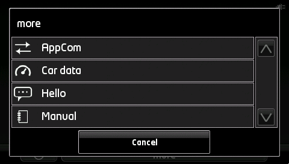
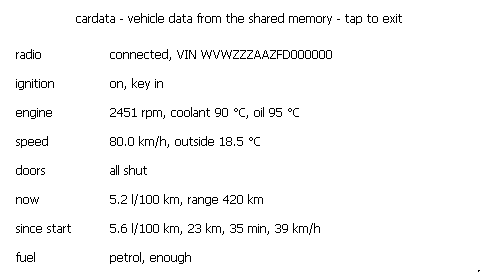

# Building apps

Everything is compiled inside the dev container (`sdk/`) with CeGCC, a GCC 9.3 port that targets Windows CE on ARM (`arm-mingw32ce`). You never install a compiler on your machine.

## The loop

```sh
make run                  # emulator with the VW menu (once per session; RADIO=1 adds a simulated car)
make deploy APP=hello     # compile -> install into the emulator -> start
make shot                 # screenshot -> emulator/work/shots/screen.png
emulator/emu click 240 136   # tap the screen
```

`make app APP=hello` only compiles. `make shell` opens a shell in the container (`arm-mingw32ce-gcc`, `-objdump`, `-dlltool`, … are on the PATH).

Debug output: there is no console. `OutputDebugStringW(L"...")` lands in `emulator/work/serial.log`; or write a file and fetch it with `.venv/bin/python emulator/deploy.py get '\My Flash Disk\Apps\hello\log.txt' log.txt`. `emulator/deploy.py ps` lists the running programs; `run PROGRAM ARGUMENTS…` starts one with a command line.

The apps in `apps/`:

| App | What it shows |
|---|---|
| `hello` | the template: a window, the command line the menu passes, tap to exit |
| `cardata` | live vehicle data read from the unit's shared memory (below: "Using the unit's services"); `cardata.exe set …` writes it |
| `appcom` | the messages the unit's programs send each other: records them for `tools/appcom.py`, sends hand-made ones |

`apps/include/` holds headers for the unit's services, shared by the apps (`-I../include` in the app's `Makefile`): `vwshm.h`, the layout of the vehicle data.

## What an app is

A folder in `\My Flash Disk\Apps\` on the unit. `apps/hello/` is the template:

| File | Role |
|---|---|
| `hello.c`, `Makefile` | the program: plain Win32 for Windows CE |
| `NgAppInfo.xml` | tells the VW menu about the app: name, program, icon |
| `hello.png` | icon for the menu: 38×31 pixels, white on transparent |

`make deploy APP=hello` compiles the program and copies it, the XML and the icon to `\My Flash Disk\Apps\hello\` in the emulator, then starts it.



How the VW menu uses `NgAppInfo.xml` (✅ seen in the emulator, which runs the unit's own menu program):

- It reads `\My Flash Disk\Apps\*\NgAppInfo.xml` **once, when it starts**, and lists every app with `<IsVisible>1` under **more**. A newly deployed app shows up there after the next `make stop` / `make run`.
- When the entry is tapped, the menu looks for a window with the class `<ClassName>` and title `<WindowName>`. If there is one, it comes to the front. If not, the menu starts `<Exe>` with the arguments ` language=eng-GBR skin=VW` (its current language, and the brand: `VW`, `Seat` or `Skoda`; the program receives exactly this string, leading blank included, as its command line). A program may ignore them.
- So the class and title in the XML must be the ones your program gives its main window; otherwise every tap starts another copy.
- `<Port>` is the app's address for messages from other apps (UDP on 127.0.0.1). It must be unique: 27011–27021 and 27103–27110 are taken by the unit, 27111–27113 by the apps here. A program that never listens on it is still listed and started.
- Only the **first** `<Application>` of each `NgAppInfo.xml` is read, one file per folder.

```xml
<?xml version='1.0' encoding='ISO-8859-1'?>
<AppCom>
  <Application Name="Hello">
    <Exe>\My Flash Disk\Apps\hello\hello.exe</Exe>        <!-- absolute path on the unit -->
    <WindowName>Hello4NSF</WindowName>                    <!-- title of the main window ... -->
    <ClassName>Hello4NSF</ClassName>                      <!-- ... and its window class -->
    <Port>27111</Port>
    <IsVisible>1</IsVisible>                              <!-- 1: listed under "more" -->
    <Autostart>0</Autostart>
    <IconName>\My Flash Disk\Apps\hello\hello.png</IconName>
    <AppName lc="eng-GBR">Hello</AppName>                 <!-- name in the menu, one line per language -->
    <AppName lc="ita-ITA">Ciao</AppName>
  </Application>
</AppCom>
```

Other keys the unit's software understands (✅ read in the parser, [appcom.md](appcom.md) §6.2; 🟡 not tried here, except `Group` ✅ emulator):

| Key | Effect |
|---|---|
| `Autostart` | `1`: the menu starts the app by itself at every boot (after the navigation has come up). Leave it `0` while developing: see "Rules of the house" |
| `AppNamesFile` | names in a separate text file instead of `AppName` lines: UTF-16LE, one `lc=Name` per line |
| `Group` (repeatable) | puts the app in an AppCom message group, so that group messages are also sent to its port ✅ emulator (the senders read the file when *they* start: reboot after installing) |
| `ExeParameters` | only stored (other programs can query it); it is **not** added to the command line |
| `Version`, `Disclaimer`, `Settings` (children `File`, `Default`) | paths other programs can query; unused by the menu |

`IsVisible`, `Autostart`, `IconName`, `AppName` and `AppNamesFile` only work in an `NgAppInfo.xml`, not in the unit's own `NgAppCom.xml`.

## A new app

1. Copy `apps/hello` to `apps/myapp`.
2. Rename: `hello.c` → `myapp.c`, `hello.png` → `myapp.png`, the two `hello` in the `Makefile`, and in `NgAppInfo.xml` the name, the three paths, the class, the title and the port. Use the same class and title in the source (`CLASS_NAME`, `TITLE`). `make deploy` expects the program to be named after its folder.
3. Write plain Win32 for Windows CE: `WinMain`, `RegisterClassW`, `CreateWindowExW`, GDI. The screen is 480×272, 16-bit colour, touch = mouse messages.
4. `make deploy APP=myapp`.

Rules of the platform (all in `apps/hello/Makefile` already):

- Unicode only: use the `W` functions and `L"..."` strings. `-DUNICODE -D_UNICODE -D_WIN32_WCE=0x600`.
- Link with `-static`: the unit has no GCC runtime DLLs.
- Do not pass `-mthumb`. The compiler emits ARM code (PE machine `0x1c0`); the unit's own programs carry `0x1c2` in the header (their code is ARM mode as well); the loader accepts both.
- C++ works (`arm-mingw32ce-g++ -std=gnu++17`); exceptions do not cross DLL boundaries.
- Headers present: `windows.h`, `winsock2.h` (link with `-lws2`), `commctrl.h`, `aygshell.h`, `mmsystem.h`, `pm.h`. Missing: Bluetooth (`ws2bth.h`, `bthapi.h`), `gpsapi.h`, DirectDraw, `ceddk.h` — declare what you need yourself.

Check what you built: `.venv/bin/python tools/peinfo.py apps/myapp/myapp.exe` (CPU type, subsystem, imports).

## Emulator vs real unit

The emulator runs Windows CE **7** on a generic board; the unit runs CE **6** on its own hardware. Program logic, UI and the unit's app-to-app messaging behave the same. Not available in the emulator: Bluetooth, audio, the graphics accelerator, the radio's own functions (BAP); vehicle data comes from a simulated radio ("Car data in the emulator" below). See [emulator/README.md](../../emulator/README.md).

## Installing on a real unit (untested by this project)

Reported by the community (jilleb/4nsf-toolbox): connect the unit over USB, copy the app's folder (program, `NgAppInfo.xml`, icon) into `\My Flash Disk\Apps\`, restart. No other file needs editing. The stock add-ons also ship `NgAlloc.dll` and `Png.dll` in their folder; a program that does not import them does not need them.

Back up the unit first (copy the whole USB volume). The unit shows up as a USB drive only when the cable is plugged in **before** it boots; plugging it into a computer while the software runs makes the unit reset into USB mode ✅ ([boot-and-supervision.md](../system/boot-and-supervision.md) §2.2).

Second way in, without changing anything on the unit (✅ read in the boot program, 🟡 **untested**): the unit's boot manager looks for `\Storage Card\AutoRunCE.exe` before the copy on its own flash and runs it without any check. An SD card with an `AutoRunCE.exe` (any Windows CE program, or the stock launcher + `MortScript.exe` + your own `autorunce.mscr` that ends with `Run("\My Flash Disk\autorunce.exe")` to continue the normal start) therefore runs your code at boot; remove the card and the unit is stock again. The card has to be readable within a few seconds after power-on. Never put files named `update.me`, `NK.nb0`, `*.bin` or `UpdateMe.exe` in the root of the card or of the flash: the boot loader treats them as a firmware update. Details and the other hooks (boot script, watchdog list): [boot-and-supervision.md](../system/boot-and-supervision.md) §8.1, §7.2.

### Rules of the house (✅ from the unit's software, nothing tested on a unit)

- **A crash reboots the unit.** The crash handler (`ErrorReporter.exe`) resets the device after an unhandled exception in any program that is not on its `[NoResetAfterException]` list in `\My Flash Disk\ErrorReporter.ini` — and yours is not. Catch your exceptions, or add your exe name to that list. With `<Autostart>1` a program that crashes at start becomes a reboot loop 🟡.
- **Menu apps are not supervised**: nothing restarts or watches a program started from "more". If you add your program to the watchdog's list instead (`Watchdog_HW.ini`), the contract is: the watchdog creates the named events listed in your ini (auto-reset, initially set); your program opens them by name and calls `SetEvent` on each at least once per timeout (stock value 30 s); a missed deadline or an exit triggers the configured action. Use action 0 (ignore) or 2 (restart) — the stock style, 1, turns every exit into a device reset ([boot-and-supervision.md](../system/boot-and-supervision.md) §3.3, §8.1).
- Do not rely on the clipboard: the Bluetooth stack uses it as a mailbox ([bluetooth.md](../system/bluetooth.md) §2).
- Do not change the master volume of the wave device (`waveOutSetVolume` with a device id): the menu rewrites it; set the volume on your own stream handle ([media-audio.md](../system/media-audio.md) §11.2).
- Anything that changes the boot script or the watchdog files can make the unit reboot in a loop; changed files are not detected by any checksum.

## Using the unit's own DLLs

Your program can load DLLs that ship on the unit. How practical that is depends on how they export their functions (✅ checked in the export tables; calling them is 🟡 untested, except `WolfSpecial.dll` and `HWLHardwareLayer.dll` ✅ emulator):

| DLL | Exports | From C (gcc) |
|---|---|---|
| `NgAlloc.dll` | 17 plain C names (`NgAlloc, NgFree, NgRealloc, NgHeap*…`) | Easy: `.def` → `arm-mingw32ce-dlltool -d NgAlloc.def -l libNgAlloc.a`. Not needed by own apps |
| `Png.dll` | libpng, 195 named C exports of 199 | Easy; use matching libpng 1.2-era headers (check `png_access_version_number`) |
| `SDL.dll` | 113 plain C names, audio/thread/timer only | Possible, pointless (use coredll `waveOut*` directly) |
| `HWLHardwareLayer.dll` | 49 exports, all MSVC-mangled **free functions** in `namespace HardwareLayer`, `__cdecl` (`…@@YA…`) | Callable: `GetProcAddress(h, L"?SetBrightness@HardwareLayer@@YA_NABM@Z")` or `.def` aliases. Args decode from mangling (e.g. `ReadFlash(ulong, uchar*, ulong)→bool`, `SetBrightness(const float&)`, `GetDeviceID(wchar_t*, uint)`). Reference parameters are pointers, `bool` results are valid only in the low byte. `Connect(IHWL*Listener*)` needs an MSVC-layout vtable (hand-written struct of fn pointers); `StringProxy<NgStringImpl>` args = avoid. Example and listener layout: [hardware-layer.md](../system/hardware-layer.md) §4.5 |
| `ACAppCom.dll` / `NgAppCom.dll` | 170 / 160 MSVC-mangled C++ **class** exports (`AppCom::CACVariant`, `CACList`, …) | Two options: (a) skip the DLL and speak the UDP wire protocol yourself — it is small and fully documented ([appcom.md](appcom.md) §2–§4, Python example §11); (b) call the DLL from C through `GetProcAddress` with hand-built vtables and raw 0x48-byte variant objects ([appcom.md](appcom.md) §10) 🟡. For (b) the exe needs **its own copy of `NgAppCom.xml` in its folder** and `NgAlloc.dll` |
| `Hardwarelayer.dll` (NAVIGON/BT) | 207 mangled exports: 122 global functions + `CNavTime…` classes | Functions callable like the row above; most are empty on this unit ([hardware-layer.md](../system/hardware-layer.md) §4.4) |
| `WolfSpecial.dll` (ROM, `\Windows`) | 36 plain C names (`ReadHiddenFlash`, `GetDeviceID`, `IsCradleStatusConnected`, `SetDeviceBrightness`, …) | Easiest: no C++ at all; prototypes in [hardware-layer.md](../system/hardware-layer.md) §2. In the emulator it is the project's stand-in (`emulator/stubs/`) |
| `nfBT.dll` (BT) | 113 plain C names (`RegisterCallBack`, `PowerOn`, `Dial`, …) | Callable; needs a message loop and care next to the stock phone app ([bluetooth.md](../system/bluetooth.md) §9.1) |

`HWLHardwareLayer.dll` full surface ✅: ActivateMic, CalibrateTouchscreen, ChangeStartupScreen, Connect/Disconnect × {Card, Cradle, PowerButton, Power, Proximity, SuspendResumeDevice, USB}Listener, Mount/DismountPartition, EnableAutoSwitchOn, GetBTVersion, Get/SetBrightness, GetBtMACAddr, GetCeVersion, Get/SetCradleDetectAutomaticSwitchOffInternalSpeakers, GetDeviceID, GetDriveFromPath, GetHWVersion, Get/SetMicVolume, Get/SetMuteDeviceSpeakers, GetPowerInfo, GetStorageCardId, IsCradleStatusConnected, IsNavigonChargerConnected, IsUSBPowerConnected, Read/WriteFlash, ResetDevice, ResetToFactorySettings, SetProximitySensor{Combo,Rate,Sensitivity,State}, Shutdown/SuspendDevice.
Several of these are **stubs** on this unit ✅ (return false / do nothing): `GetBrightness`, `ActivateMic`, `SetMicVolume`, `EnableAutoSwitchOn`, `Get/SetCradleDetectAutomaticSwitchOffInternalSpeakers`, all `SetProximitySensor*`; the USB and proximity listeners never fire. `ResetToFactorySettings`, `ResetDevice`, `ShutdownDevice`, `WriteFlash` and `ChangeStartupScreen` do exactly what they say — do not call them to "see what happens". Behaviour of every export: [hardware-layer.md](../system/hardware-layer.md) §4.1.
**No car data here**: vehicle data comes from `VwCommunicationExe.exe` through shared memory (next section).

Several versions of the same DLL coexist on the unit (`NAVIGON/SDL.dll` ≠ `BT/SDL.dll`): always take a DLL from the folder of the program that uses it.

## Using the unit's services from your app

None of this needs one of the C++ DLLs. Tried in the emulator (✅ emulator in the table; details in the linked documents' "Verified in the emulator" sections): vehicle data, AppCom messages, the hardware DLLs. Everything else is 🟡 untested (documented from the unit's software; Bluetooth and audio are missing in the emulator).

| You want | How | Document |
|---|---|---|
| Vehicle data (speed, RPM, temperatures, trip computer, doors, ignition, steering-wheel keys, radio state) ✅ emulator | open the named file mapping `VwSharedMemoryFileMapping`, copy a block under its named mutex, poll. Header: `apps/include/vwshm.h`; working example: `apps/cardata`. Do not wait on the `CAN_DATA_EVENT` events and do not clear notification bits: they belong to the stock programs | [shared-memory.md](../car/shared-memory.md) §8.1, §8.2; meaning of each byte: [can-signals.md](../car/can-signals.md), [bap-functions.md](../car/bap-functions.md) |
| Ask the car for something (radio source, sound settings, clock, charging timers) | write request fields into the BAP block and raise the request id | [shared-memory.md](../car/shared-memory.md) §8.3, [bap-functions.md](../car/bap-functions.md) §10 |
| Messages from / to the other programs (language change, phone state, GPS status, suspend notice) ✅ emulator | UDP datagrams on 127.0.0.1, your `<Port>`; add `<Group>` lines to receive group messages. `<Group>SpeedInfoCan</Group>` alone gets you the car speed once per second without touching the shared memory. Sending works too: a hand-made message changes the menu's language or status icons. Working example and capture tool: `apps/appcom` | [appcom.md](appcom.md) §9 (catalogue), §11 (how to), §13 (what was captured) |
| Play sound without fighting navigation prompts, calls and the radio | own `waveOut` stream + announce it with AppCom message 29 ("sound manager"); docked, nothing is heard until that claim makes the menu ask the radio for the audio channel | [media-audio.md](../system/media-audio.md) §11.2 |
| Brand, VIN, device id, cradle state, brightness, power source | `WolfSpecial.dll` or `HWLHardwareLayer.dll` (table above) ✅ emulator for `ReadHiddenFlash`, `ReadFlash`, `GetDeviceID`, `IsCradleStatusConnected` called from a C program (against an earlier build of the emulator's stand-in; load the DLLs by full path from `\My Flash Disk\VwUserShell\`, `NgAlloc.dll` and `cestub.dll` first); cradle and power events arrive as registered window messages | [hardware-layer.md](../system/hardware-layer.md) §4.5, §3.1 |
| GPS position | NMEA on `COM2:` 57600 8N1 (`$GPGGA`, `$GPRMC`) — but the navigation has that port open; whether a second program can open it too ❓. Alternative 🟡: AppCom group messages 11011 / 11012 (`SpeedInfoGps`, `PositionInfo`); in the emulator a member app received none while the navigation had no fix | [navigation.md](../system/navigation.md) §3.2, [appcom.md](appcom.md) §9.8 |
| Phone functions | drive the stock Bluetooth core through `nfBT.dll` or its window messages | [bluetooth.md](../system/bluetooth.md) §9.1 |
| Look like the stock screens | reuse the unit's bitmaps, fonts and texts | [ui-framework.md](../system/ui-framework.md) §11 |

### Car data in the emulator ✅ emulator

The emulator has no car, but a simulated radio: `make run RADIO=1` starts `emulator/radio.py`, which speaks the dock protocol to the unit's car-link program. The menu's car screens (trip computer, gauges) then show its values, and your app reads them from the shared memory like on the unit. Other values: stop it and start your own, e.g. `.venv/bin/python emulator/radio.py --rpm 3000 --speed 120 --outside -5 --doors 01` (`--help` lists the options, `--trace` prints the frames). `apps/cardata` shows what arrives:



- No BAP: the radio's own functions (sound source, station lists, parking sensors, clock) are not simulated ([car-link.md](../car/car-link.md) §10).
- The door overlay, like on the unit, needs a running navigation: one AppCom message 40 sent to port 27017 makes the menu believe it has started (`apps/appcom`, [appcom.md](appcom.md) §13).
- Without the radio, `cardata.exe set …` writes single messages into the shared memory ([shared-memory.md](../car/shared-memory.md) §8.5).

A crash of your program in the emulator only ends the program (exit code `0xC0000005`, a `Data Abort` line in `emulator/work/serial.log`): the unit's crash handler is not installed there, so the reboot described below does not happen.

How the pieces fit together: [architecture.md](../architecture.md).

## Other toolchains

- `ghcr.io/palian-tech/cegcc` — GCC 16 with `std::thread` and gdb (untested here; set the `FROM` line in `sdk/Containerfile`).
- Visual Studio 2008 with a CE 6 ARMV4I SDK — what the unit's software was built with, and the only way to link against its C++ class DLLs (`ACAppCom.dll`). Hard to obtain today.
