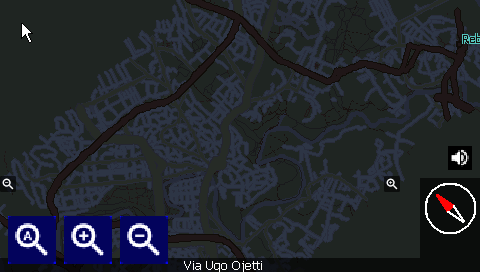

# Navit: open-source navigation with OpenStreetMap maps

[Navit](https://github.com/navit-gps/navit) is an open-source navigation program that also runs on Windows CE. `apps/navit/` turns it into an app of the VW menu: you find it under **more → Navit**, next to the unit's own navigation, which keeps working as before. The maps come from [OpenStreetMap](https://www.openstreetmap.org/): you build them on your computer, and each time Navit starts you choose which ones to load.

 

Status: works in the emulator ✅ (2026-11-17) and on a real unit in the car ✅ unit (2026-11-20). In the emulator Navit loads two maps at once, draws them, follows the GPS position while the unit's own navigation is running, finds an address and computes a route with turn-by-turn instructions. In the car (a map of Rome on the SD card) it got the GPS position next to the unit's own navigation, drew the map and computed routes fast enough to use, was usable by finger, switched between day and night colours, kept working after the unit's standby (ignition off and on again), and never crashed or restarted the unit; only the first start was a bit slow. Spoken directions (eSpeak, built into Navit) work in the emulator ✅ emulator, including the request that makes the VW menu switch the car radio to the unit for each announcement; heard on the car's speakers ❓ not yet tried.

The idea comes from [hupog/seat-portable-system-revival](https://github.com/hupog/seat-portable-system-revival), who first ran Navit on this hardware (a Seat Portable System), there as a *replacement* for the navigation.

## Try it in the emulator

```sh
make app APP=navit                    # the launcher, plus Navit itself (downloaded and configured)
make map MAP=roma BBOX=12.35,41.80,12.65,42.00   # a map of Rome (downloads Italy once, 2.2 GB)
make run GPS=1                        # emulator with a simulated GPS receiver
make deploy APP=navit MAPS="roma"     # Navit, the map and the launcher into the emulator
make stop && make run GPS=1           # the VW menu looks for new apps only when it starts
```

Then tap **more → Navit**, tick the maps, and tap **Start Navit**.

In the emulator Navit's window appears a few seconds after **Start Navit**, the map soon after. The simulated GPS starts in Wolfsburg; to drive around Rome instead, restart it with `.venv/bin/python emulator/gps.py --lat 41.9028 --lon 12.4964 --speed 30`.

## Using it

- **Choosing maps.** The first screen lists every map it finds, on the flash disk and on the SD card. Tick the ones you need: Navit uses all of them together, also for routes that cross from one to the next. Your choice is remembered for next time.
- **Navit's menu.** Tap the map. *Actions* is where you set a destination; *Settings → Maps* switches the loaded maps on and off; **Quit** ends Navit and takes you back to the VW menu.
- **Getting back to the VW menu.** The **house button** next to the zoom buttons shows the VW menu and leaves Navit running, route included ✅ emulator. **more → Navit** brings it back: the VW menu finds the running Navit and puts it in front instead of starting it twice.
- **The car's pop-ups.** The VW menu's overlays (open door, parking sensors, phone call, screen off) appear over Navit ✅ unit. When one ends, the VW menu shows its own main screen, not Navit ✅ unit; the launcher notices and puts Navit back in front about half a second later ✅ emulator (door picture).
- **Setting a destination.** *Actions → Town*. The country is already chosen: the one the car is in (its flag is left of the text field; tap it to pick another) ✅ emulator. Type the town, pick it, choose *Streets*, type part of the street name (any word of it, e.g. "castro" finds "Via Castro Pretorio"), pick it, and tap *Set as destination*. Navit computes the route and starts guiding: next turn top left, distance and arrival time top right; *Route → Description* lists every turn ✅ emulator (a 5.5 km route across Rome). House numbers work only where OpenStreetMap has them, and many Italian streets have none.
- **A street is not under its town?** Search the neighbourhood or village name instead. maptool (which builds the maps) files every street under the nearest `place` (city, town, village, suburb …); for Italy it does not use the comune's boundary as a town's area (its country table, `"3s5c78"` in `maptool/osm.c`, skips admin level 8). So in a large comune, streets far from the centre are filed under the local place: "Via Castronovo di Sicilia", 15 km east of the centre of Rome, is under "Prato Fiorito" (a village 0.3 km away), not under "Roma" 🟡 (from maptool's source and the OSM data; changing it means rebuilding maptool).
- **Typing is slow on a big map.** Navit searches again after every letter; with all of Italy loaded each search takes a while in the emulator, and further taps wait their turn (this looked like a hang once). Type a few letters, then wait for the list.
- **Spoken directions.** Navit speaks each turn with its built-in eSpeak voice, in the VW menu's language (the launcher sets it each time it starts Navit; Slovenian has no eSpeak voice and stays as it was). The loudspeaker icon on the right switches the voice off and on.
- **Menus in English.** Navit's own menus are always English: this Navit build ignores every language setting for them (it reports the Windows locale as "C"), so `fetch.sh` leaves the translations out. The unit's own navigation speaks independently: if both guide at the same time, both voices are heard.
- **Day and night.** Navit switches between light and dark map colours by itself, from the sun's position. If the map ever shows nothing but the route, *Settings → Display → Layout* is set to "Route" (a style that draws only the route line): choose "Car".

## Maps

`make map` builds a map from OpenStreetMap data. It downloads a region from [Geofabrik](https://download.geofabrik.de/), optionally cuts out a smaller area, keeps only what a car map needs, and converts the result into Navit's format. Without options it builds all of Italy.

```sh
make map                                          # all of Italy  -> apps/navit/maps/italy.bin
make map MAP=nordovest REGION=europe/italy/nord-ovest
make map MAP=roma BBOX=12.35,41.80,12.65,42.00    # a cut-out of Italy
make map MAP=italy-full FILTER=full               # keep everything (slower to draw)
```

| Option | Meaning |
|---|---|
| `MAP` | name of the map: the file is `apps/navit/maps/<MAP>.bin`, and the picker shows this name |
| `REGION` | the region to download, as it appears in Geofabrik's addresses (without `-latest.osm.pbf`). Italy is `europe/italy`; its parts are `europe/italy/nord-ovest`, `nord-est`, `centro`, `sud` and `isole`. Default: `europe/italy` |
| `BBOX` | optional: cut out a rectangle, `left,bottom,right,top` in degrees |
| `FILTER` | `roads` (default) keeps roads, ferries, turn restrictions, place names, water and borders, and drops buildings, shops, points of interest and land use, so the map loads and draws faster. `full` keeps everything |
| `MEMORY` | memory for the build container (default `8g`) |

The download is kept in `apps/navit/maps/src/` (Italy: 2.2 GB). Each region is downloaded only once, and again only when Geofabrik publishes a newer one; its checksum is verified.

Where to put the maps:

- **SD card** for large maps: `\Storage Card\Navit\maps\`. The flash disk is nearly full: the update package alone puts 3.5 GB on it ✅, most of it the stock maps (2.9 GB). Italy, for example, gives a 510 MB map.
- **Flash disk** for a city or a small region: `\My Flash Disk\Navit\maps\`.
- **Not larger than 2 GB** per file: this Navit build cannot read bigger ones. Split a big country into regions and tick them all.
- **In the emulator**, `make deploy … MAPS=` copies maps over an emulated serial line at about 60 KB/s (Rome: 2 minutes). For big maps stop the emulator and copy them straight into its disk: `make stop && make emulator MAPS="italy" && make run` (seconds; [emulator/README.md](../../emulator/README.md) step 9).

Map data © OpenStreetMap contributors, under the [ODbL](https://opendatacommons.org/licenses/odbl/). Navit does not show this on screen: if you share maps, say where the data comes from.

## Installing on a unit

Read [building-apps.md](building-apps.md) ("Rules of the house") and [boot-and-supervision.md](../system/boot-and-supervision.md) §8.1 first.

1. On your computer: `make app APP=navit`, and `make map …` for the maps you want.
2. Copy to the unit:
   - the folder `apps/navit/navit/` → `\My Flash Disk\Navit\`
   - `navit.exe`, `NgAppInfo.xml` and `navit.png` from `apps/navit/` → `\My Flash Disk\Apps\navit\`
   - the maps → `\Storage Card\Navit\maps\` (or `\My Flash Disk\Navit\maps\`)
3. Restart the unit: the VW menu looks for new apps when it starts.

### Keep a Navit crash from restarting the unit

On the stock system, a program that crashes **restarts the whole unit**, unless it is listed in `\My Flash Disk\ErrorReporter.ini` under `[NoResetAfterException]` ([boot-and-supervision.md](../system/boot-and-supervision.md) §4.1). Only the unit's own programs are listed there. To have a crash close only Navit, add Navit and its launcher after the eight existing lines:

```ini
[NoResetAfterException]
Application1 = \My Flash Disk\NAVIGON\navigon.exe
...
Application8 = \My Flash Disk\BT\BTCore.exe
Application9 = \My Flash Disk\Navit\navit.exe
Application10 = \My Flash Disk\Apps\navit\navit.exe
```

- Keep a copy of the original file first.
- Leave the other lines as they are, and keep the file's Windows line endings (CR LF).
- After a crash, a report is still written to `\My Flash Disk\NAVIGON\ErrorReporter\`; Navit is closed and not restarted.

### On a real unit

- **Tried** ✅ unit (2026-11-20, one drive, a city map of Rome from the SD card): see Status at the top. The two `[NoResetAfterException]` lines were in place, but Navit never crashed, so they were not put to the test.
- **Memory**: Navit reads its map files as it needs them instead of loading them. ✅ emulator (256 MB machine, 115 MB of it for programs; menu, phone and car link running): free RAM 94 MB before Navit, 81 MB with Navit and the whole of Italy (486 MB map), unchanged after two minutes; 93 MB again after Quit. On the unit the stock navigation runs as well and takes its share ❓; city map ✅ unit. Measure with `.venv/bin/python emulator/deploy.py mem` before and after starting Navit.
- **Speed**: fine with a city map and `FILTER=roads` ✅ unit. All of Italy: window after about 3 s, map drawn, ✅ emulator; on the unit ❓.
- **Speech on the car's speakers** ❓: whether the radio switches to the unit in time for the first word (`CLAIM_LEAD` in `navitsnd.c`, 300 ms) and lowers its own programme.
- **What Navit does not do here**: traffic messages, car data.

## How it works

### The pieces

| On the unit | Comes from | What it is |
|---|---|---|
| `\My Flash Disk\Apps\navit\navit.exe` | `apps/navit/navit.c` | the **launcher**: the map picker. This is what the VW menu starts |
| `\My Flash Disk\Apps\navit\NgAppInfo.xml`, `navit.png` | `apps/navit/` | the menu entry and its icon |
| `\My Flash Disk\Navit\` | `apps/navit/navit/`, made by `fetch.sh` | **Navit** itself: `navit.exe` (1.5 MB once `fetch.sh` has removed its debug information), its settings `navit.xml`, day and night map styles, icons, eSpeak's speech data `espeak-data\` (2.8 MB, every language). English menus only |
| `\My Flash Disk\Navit\navitsnd.dll` | `apps/navit/navitsnd.c` | announces Navit's speech to the VW menu, so the car radio plays it; gives Navit the default country (both below) |
| `\My Flash Disk\Navit\data\country.txt` | written by the launcher | the country the car is in, two letters |
| `\My Flash Disk\Navit\maps.xml` | written by the launcher | the maps ticked in the picker; Navit's settings include this file |
| `\My Flash Disk\Navit\navit.log`, `data\` | written by Navit | Navit's log; last position, bookmarks, recent destinations |

When you tap **Start Navit**, the launcher writes `maps.xml`, starts Navit, waits for its window and brings it to the front (otherwise the VW menu would stay on top). When Navit exits, so does the launcher.

The house button runs Navit's command `spawn("\\My Flash Disk\\Apps\\navit\\navit.exe","menu")` (in Navit's commands a backslash must be doubled). That second copy of the launcher only tells the running one, which brings the VW menu (window class `VwUserShell`) to the front and notes that the user left Navit on purpose.

While Navit runs, the launcher stays in the background and listens on its AppCom port (27114, group `Settings` in `NgAppInfo.xml`) for the VW menu's message 31, which tells which overlay the menu shows ([appcom.md](appcom.md) §9.2). If an overlay starts while Navit is in front, then when the value returns to 11 or 13 (nothing shown) and the VW menu holds the screen, the launcher brings Navit back to the front. This is needed because the menu, after an overlay, returns only to the programs it knows (navigation, phone, media player). After the house button Navit counts as "not in front", so an overlay then leaves you in the VW menu ✅ emulator. The menu entry names Navit's window (class `NAVGRA`, title `Navit`), which is how the VW menu finds a Navit that is already running.

### Navit's settings

`fetch.sh` downloads Navit 0.5.7 for Windows CE from Navit's GitHub page (the download is checked against a fixed SHA-256) and changes its `navit.xml` with `apps/navit/navit.xml.diff`:

| Change | Why |
|---|---|
| GPS from `COM4:` | `COM2:`, where the GPS normally is, belongs to the unit's navigation (next section) |
| maps and map styles loaded by full path | on Windows CE, Navit does not expand its path variables or wildcards (hupog found this first) |
| first position: Rome | Navit later remembers the last position in `data\center.txt`; delete that file to go back |
| full screen, larger text, icons and buttons; Navit's second, small pair of zoom buttons switched off | 480×272 touch screen, operated with a finger |
| a house button after the zoom buttons | back to the VW menu without quitting (above) |
| flat map, no automatic tilt | faster drawing |
| start zoom 96 instead of 256; auto-zoom on, showing the next 30 s of driving (`autozoom="30"`), between zoom 48 and 384 | Navit's default view is several kilometres wide on this screen. Zoom ≈ 16 × map units per pixel; at 50 km/h this gives roughly 800 m across. The A button switches auto-zoom off |
| speech with the built-in eSpeak, its data by full path | Navit's default speaks through a Windows desktop command that does not exist here |

Navit always reads `navit.xml` from its own folder.

### The GPS: why `COM4:`

The unit's GPS delivers its positions on the serial port `COM2:`. Only one program at a time can open that port, and the unit's navigation opens it at start-up and never lets go ✅. So Navit cannot read the GPS there.

But the GPS driver also copies every position message to a second, debugging port, `COM4:`, which nothing on the unit uses ✅. Navit reads that copy: same positions, no conflict with the navigation. Found by reading the driver's code, and ✅ unit: Navit gets its position there while the unit's navigation runs. Details and addresses: [hardware-layer.md](../system/hardware-layer.md) §6.5.

The emulator copies its simulated GPS to a `COM4:` in the same way, so Navit sees the same thing there as on the unit ([emulator/README.md](../../emulator/README.md)).

### Speech: why `navitsnd.dll`

Docked, the unit is heard only through the car radio, and the radio plays the unit only when the VW menu asks it to. Every program that wants to be heard announces it with AppCom message 29; the menu turns "navigation advice" into a request for the radio's announcement channel ([media-audio.md](../system/media-audio.md) §5). The unit's navigation sends it around every prompt ✅ unit ([appcom.md](appcom.md) §14). Navit does not know about it.

Navit's eSpeak keeps one sound stream (`waveOut`) open and writes to it only while it speaks. `fetch.sh` changes Navit's `navit.exe` so that its `waveOutWrite` comes from `navitsnd.dll` (`emulator/patches/redirect_imports.py --only waveOutWrite`; to make room for that it first removes Navit's debug information). The DLL then:

- before the first sound after a silence, sends `[29, [2, 2, 0, -1, -1]]` (claim, type 2 = navigation advice) to the programs of group `Volume`, waits 300 ms for the radio, and plays;
- one second after the last sound has played, sends `[29, [2, 2, 1, -1, -1]]` (release).

Priority 2, not the 4 of the unit's navigation: the receivers keep one entry per priority, so sharing 4 would let one navigation's release end the other's announcement. With 2, Navit wins over music (5) and loses to a phone call (1). ✅ emulator: the messages arrive in this form (captured with `apps/appcom` on port 27019), about one pair per spoken turn. The simulated radio does not answer the radio's own protocol (BAP), so in the emulator the menu never gets as far as asking the radio for the channel; that part is ❓ until tried in a car.

### Country and voice language

Navit asks for the country before a town search unless it has a default one, and the build `fetch.sh` downloads has no working way to set it: its `country_default()` only returns a cached value that nothing fills (the code that would read `LANG` is not in this build), and the country of the street under the car is not in the maps. The pieces that supply it:

- **Launcher**: listens on its AppCom port (group `SpeedInfoGps` in `NgAppInfo.xml`) for the unit's navigation's message 11011, which carries the country of the current GPS position about once a second ([appcom.md](appcom.md) §9.8), and keeps it, as two letters, in `\My Flash Disk\Navit\data\country.txt` (also while Navit runs). Before the first GPS position ever, it writes the country of the VW menu's language (`eng-GBR` → `GB`).
- **`navitsnd.dll`**, loaded inside Navit: checks that `country_default()` is exactly where expected in this `navit.exe` (address and code; the download is pinned by SHA-256), then fills its cache with that country and re-reads the file every 30 s, so a border crossing is followed. With any other `navit.exe` it does nothing.

The voice language comes from the VW menu: the menu starts the launcher with ` language=ita-ITA`, and the launcher writes `language="it"` into the `<speech>` line of `navit.xml` before it starts Navit.

✅ emulator: country file `GB` without GPS, `IT` after one message 11011 with "ITA"; town search opens with Italy chosen and finds Roma; `<speech … language="en">` with the menu in English.

The launcher's window-watching and this DLL use the same AppCom port, 27114 (`<Port>` in `NgAppInfo.xml`): the launcher listens on it, the DLL only writes it into its messages as the sender.

### Emulator details

- **Driving a route**: `.venv/bin/python emulator/gps.py --track emulator/tracks/roma-nomentana.gpx --speed 50` (stop the GPS that `make run GPS=1` started first: `kill $(cat emulator/work/gps.pid)`) drives 3.7 km north along Via Nomentana in Rome. Set a destination near its end (*Actions → Coordinates*: `41.93300N 12.53180E`, *Set as destination*) to see guidance to the end; one off to the side (`41.92000N 12.50000E`) to see re-routing. ✅ emulator: next manoeuvre and distances count down, five announcements (claim / release each), guidance ends on arrival; with the side destination the distance grows and Navit recalculates. Other roads: `osmium extract` a small box from the OSM download in `apps/navit/maps/src/`, `osmium tags-filter` the road by name, `osmium export` to GeoJSON, and chain its pieces into a GPX (Navit's demo vehicle does not start in this build).
- Navit prints to a console; the unit's settings send console output nowhere (`HKLM\Drivers\Console\OutputTo = -1` ✅), and the emulator's `launch.exe` sets the same, so no text windows appear ✅ emulator.
- Navit shows the Windows taskbar when it exits; the launcher hides it again. The unit has no taskbar.
- `navitsnd.dll` writes `NAVITSND: claim` / `NAVITSND: release` to `emulator/work/serial.log`. The emulator has a sound device, so the speech runs, but nothing is heard.
- The launcher writes `NAVIT: window after … ms`, `NAVIT: menu overlay state N` and `NAVIT: overlay ended, Navit back to the front` to `emulator/work/serial.log`; to see an overlay, open a door with the simulated radio (`emulator/radio.py --doors 01`, after one AppCom message 40, [building-apps.md](building-apps.md)); Navit's own log is `\My Flash Disk\Navit\navit.log` (fetch it with `.venv/bin/python emulator/deploy.py get`).

## Licences

Navit is GPL-2.0. It is downloaded by `fetch.sh` (its source code is on the same release page) and never stored in this repository. `fetch.sh` changes the downloaded `navit.exe` on your computer (debug information removed, one import redirected, see above); if you pass that copy on, the GPL applies to it like to the original. `apps/navit/navit.xml.diff` modifies Navit's own `navit.xml`, so it is GPL-2.0 as well. eSpeak's data, shipped with Navit, is GPL as well. The launcher and the scripts are MPL-2.0, like the rest of the kit. The maps are under the ODbL. See [NOTICE.md](../../NOTICE.md).
