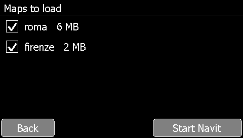

# Navit with OpenStreetMap maps

[Navit](https://github.com/navit-gps/navit) is an open-source navigation program with a Windows CE build. `apps/navit/` makes it an app in the VW menu (**more → Navit**), next to the unit's own navigation, which keeps running unchanged. Maps come from [OpenStreetMap](https://www.openstreetmap.org/) and are built on your computer; you choose which ones Navit loads each time it starts.

Status: ✅ emulator (2026-11-17): listed under "more", map picker, Navit 0.5.7 loads two maps at once (Rome, Florence), draws Rome and follows the simulated GPS fix (position, street name) **while the unit's navigation runs and holds the GPS port**, its menu works, Quit returns to the VW menu. Not tried: a real unit, routing, voice output.

Idea and first port to this hardware family: [hupog/seat-portable-system-revival](https://github.com/hupog/seat-portable-system-revival) (Seat Portable System; there Navit *replaces* the navigation).

 

## 1. Quick start (emulator)

```sh
make app APP=navit                    # launcher + Navit 0.5.7 (downloaded, configured) -> apps/navit/navit/
make map                              # all of Italy -> apps/navit/maps/italy.bin (see §3: time, size)
make map MAP=roma BBOX=12.35,41.80,12.65,42.00   # a small map, cut out of the same download
make run                              # if not running yet
make deploy APP=navit MAPS="roma"     # Navit, the chosen maps and the launcher into the emulator
make stop && make run                 # the menu lists new apps only when it starts
```

Then **more → Navit**, tick the maps, **Start Navit**. In the emulator Navit needs 2–3 minutes to appear (QEMU emulates the CPU; inside the guest it is about 7 s); the first touch on the map draws it. `make run GPS=1` (or `.venv/bin/python emulator/gps.py --lat 41.9028 --lon 12.4964 --speed 30`) gives it a position.

Tap the map → Navit's menu (Actions = destinations, Settings → Maps = switch loaded maps on and off, **Quit** = back to the VW menu). Navit fills the screen and has no button for the VW menu: Quit is the way back. If Navit still runs when its menu entry is tapped, the menu brings it to the front instead of starting it again.

## 2. What is where

| On the unit | From | What |
|---|---|---|
| `\My Flash Disk\Apps\navit\navit.exe` | `apps/navit/navit.c` | the launcher = map picker. The menu starts this one |
| `\My Flash Disk\Apps\navit\NgAppInfo.xml`, `navit.png` | `apps/navit/` | menu entry. `ClassName` / `WindowName` = Navit's window (`NAVGRA` / `Navit`), so the menu finds a running Navit |
| `\My Flash Disk\Navit\` | `apps/navit/navit/` (`fetch.sh`) | Navit: `navit.exe` (8 MB, ARM, only needs `COREDLL`), `navit.xml`, day and night map styles, icons. No voices, no translations (English menus) |
| `\My Flash Disk\Navit\maps\*.bin`, `\Storage Card\Navit\maps\*.bin` | `apps/navit/maps/` (`build_map.sh`) | maps |
| `\My Flash Disk\Navit\maps.xml` | written by the launcher | the ticked maps; `navit.xml` includes it |
| `\My Flash Disk\Navit\navit.log`, `data\` | written by Navit | log; last position (`center.txt`), bookmarks, destinations |

The launcher scans both map folders, ticks what `maps.xml` listed last time (everything on the first start), writes the new `maps.xml`, starts Navit and waits for it in the background: once Navit's window exists it is brought to the front (otherwise the VW menu stays above it; Navit is not made topmost, so the VW software can still show its own windows over it), and when Navit exits the launcher exits too. Navit always reads `navit.xml` from its own folder; it ignores a path on its command line that contains spaces.

`fetch.sh` downloads `navit-wince-v0.5.7.zip` from Navit's GitHub release (SHA-256 pinned) and applies `apps/navit/navit.xml.diff`:

| Change | Why |
|---|---|
| GPS `wince:COM4:` at 57600 (Navit's default: `COM2:` at 4800) | `COM2:` belongs to the unit's navigation (§4) |
| `maps.xml` and the two map styles included by absolute path | `$NAVIT_SHAREDIR` and wildcards are not expanded on Windows CE (as hupog found) |
| start position Rome (12.4964 41.9028) | used until Navit has saved a position (`data\center.txt` wins afterwards: delete it to reset) |
| full screen, larger menu font and icons (48 / 64 px), on-map buttons 48 px | 480×272 resistive touch screen |
| no automatic tilt (flat map) | drawing speed |

Navit switches between the day and night styles by itself (sun position from the GPS fix and the clock).

## 3. Maps

`make map` runs `apps/navit/build_map.sh` in the dev container (tools: `osmium-tool`, Navit's `maptool`, from Debian):

```sh
make map                                          # MAP=italy REGION=europe/italy (the defaults)
make map MAP=nordovest REGION=europe/italy/nord-ovest
make map MAP=roma BBOX=12.35,41.80,12.65,42.00    # REGION=europe/italy, cropped
make map MAP=italy-full FILTER=full               # everything, see below
```

| Variable | Meaning |
|---|---|
| `MAP` | output name: `apps/navit/maps/<MAP>.bin`; the picker shows this name |
| `REGION` | extract on [download.geofabrik.de](https://download.geofabrik.de/) without `-latest.osm.pbf`. Italy: `europe/italy`, or its parts `europe/italy/nord-ovest`, `nord-est`, `centro`, `sud`, `isole` |
| `BBOX` | optional cut-out: `left,bottom,right,top` in degrees |
| `FILTER` | `roads` (default): roads, ferries, turn restrictions, places, water, administrative borders. Buildings, shops, POIs and land use are dropped: hupog found the unit draws a full map far too slowly. `full`: keep everything |
| `MEMORY` | container memory (default `8g`; Apple `container` gives only 1 GB otherwise, too little for a country) |

The extract is downloaded once into `apps/navit/maps/src/` (Italy: 2.2 GB), checked against Geofabrik's MD5, and downloaded again only when Geofabrik has a newer one. Measured on an Apple-silicon Mac (container under Rosetta, 2026-11-17):

| Map | Size | Time |
|---|---|---|
| `italy` (whole country, `roads`) | 510 MB | 16.5 min (download already there) |
| `roma` (`BBOX=12.35,41.80,12.65,42.00`) | 6.5 MB | 13 min including the 2.2 GB download |
| `firenze` (`BBOX=11.15,43.72,11.35,43.82`) | 2 MB | 1.3 min |

The Italy map was not tried in Navit: it does not fit on the emulator's disk (below).

Limits:

- This Navit build cannot read map files larger than **2 GB** (its log says so at every start). Split a big country into regions; tick several in the picker: Navit uses all loaded maps together, also for routes across them.
- The flash disk is nearly full: the update package alone puts 3.5 GB on it (2.9 GB of that are the stock maps) ✅, of 4 GB 🟡. Country maps belong on the SD card (`\Storage Card\Navit\maps\`); the flash takes a city or a small region.
- In the emulator, `make deploy` copies maps over the emulated serial link at about 60 KB/s (Rome: 2 minutes), and its disk has as little room as the unit's flash: test with small maps.

Map data © OpenStreetMap contributors, [ODbL](https://opendatacommons.org/licenses/odbl/). Navit shows no attribution on screen: when you hand out maps, say where the data comes from.

## 4. GPS: why `COM4:`

The unit's GPS receiver is inside the SoC; the ROM driver `GPS.dll` runs the GPS engine and offers plain NMEA as `COM2:` ([hardware-layer.md](../system/hardware-layer.md) §5.3, §6.5). The unit's navigation opens `COM2:` at boot and keeps it open.

- `COM2:` is **exclusive** ✅ (static, `GPS.dll`): `COM_Open` (`0xc0a8bea8`) is the standard Microsoft serial driver code: a second open asking for read or write access fails with `ERROR_INVALID_ACCESS` while another handle owns the port, and `COM_Read` (`0xc0a8a904`) refuses handles opened without read access. So Navit cannot share it.
- `GPS.dll` **copies every sentence** it sends to `COM2:` into the message queue `TX_NMEA` ✅ (static): created unconditionally at init (`0xc0a8d8c4`: `CreateMsgQueue("TX_NMEA")`, 100 messages × 1518 bytes, write side), written without waiting by the NMEA output function (`0xc0a8cfc0`) right after the data goes to the `COM2:` readers. The same filter applies to both: only `$GPGGA` and `$GPRMC`, unless a flag lets every sentence through (🟡 set by the `fullnmea` files the driver looks for). Navit needs no more.
- `COM4:` serves that queue ✅ (registry): `HKLM\Drivers\BuiltIn\GPS_DEBUG_COM` loads `LoopbackCOM.dll` as `COM4:` with `RXQUEUE = TX_NMEA`. Meant for the ST test tool; nothing on the unit opens it.

→ Navit reads `COM4:` and gets the same fixes as the navigation, while the navigation keeps `COM2:`. 🟡 Not tried on a unit. The baud rate is irrelevant for these virtual ports. `COM4:` is exclusive too: one extra reader.

In the emulator the GPS is `COM1:` (host TCP 5555). `launch.exe` puts our `pl011poll.dll` in charge of it, which copies each line into `TX_NMEA` like `GPS.dll`, and serves `COM4:` from that queue with the unit's registry values ([emulator/README.md](../../emulator/README.md)). The unit's own `LoopbackCOM.dll` is not used there: the copy extracted from the ROM does not load (error 193).

## 5. On a real unit

Not tried. Read this first: [building-apps.md](building-apps.md) ("Rules of the house") and [boot-and-supervision.md](../system/boot-and-supervision.md) §8.1.

1. `make app APP=navit` and `make map …` on your computer.
2. Copy to the unit's flash disk (or SD card): `apps/navit/navit/` → `\My Flash Disk\Navit\`; `navit.exe`, `NgAppInfo.xml`, `navit.png` from `apps/navit/` → `\My Flash Disk\Apps\navit\`; maps → `\My Flash Disk\Navit\maps\` or `\Storage Card\Navit\maps\`.
3. Restart the unit (the menu reads `Apps\` at its start).

### A Navit crash restarts the unit

On the stock system **an unhandled exception in any program not listed in `\My Flash Disk\ErrorReporter.ini` → `[NoResetAfterException]` reboots the unit** ([boot-and-supervision.md](../system/boot-and-supervision.md) §4.1). Navit and its launcher are not listed. To have a crash only end Navit, add both programs to that section, numbered after the existing eight:

```ini
[NoResetAfterException]
Application1 = \My Flash Disk\NAVIGON\navigon.exe
...
Application8 = \My Flash Disk\BT\BTCore.exe
Application9 = \My Flash Disk\Navit\navit.exe
Application10 = \My Flash Disk\Apps\navit\navit.exe
```

- Keep the file's Windows line endings (CR LF) and its other lines unchanged; keep a copy of the original.
- The entries of the stock file are full paths. 🟡 Whether ErrorReporter compares the full path or only the file name is not checked: both programs are called `navit.exe`, so with file-name matching either line covers both.
- ErrorReporter still writes a crash report (`\My Flash Disk\NAVIGON\ErrorReporter\`) and ends the program; nothing restarts it.
- An official update may replace the file.

Other risks on the unit:

- Memory ❓: Navit runs next to the navigation, the menu, the phone and the media player. hupog's unit (same hardware family, with Navit *instead of* the navigation) only reported slow drawing with big maps. Start with a region, not a country.
- Speed ❓: map drawing on the 533 MHz CPU; keep `FILTER=roads`.
- Navit starts its own GPS handling, nothing else: no voice (it would need the unit's audio arbitration, [media-audio.md](../system/media-audio.md)), no traffic messages (TMC), no car data.

## 6. Emulator notes

- Navit opens Windows CE console windows for its standard output; in the emulator they appear behind it (and on the CE taskbar while Navit exits). The unit's registry sets `HKLM\Drivers\Console\OutputTo = -1` ✅ (`default.hv`), 🟡 which switches console output off there.
- Navit shows the CE taskbar when it exits; the launcher hides it again (the unit has none).
- `emulator/work/serial.log` gets `NAVIT: window after … ms` from the launcher; Navit's own log is `\My Flash Disk\Navit\navit.log` (`deploy.py get`).

## 7. Licences

Navit: GPL-2.0, downloaded by `fetch.sh` (source: the same GitHub release), never stored in this repository. `apps/navit/navit.xml.diff` changes Navit's `navit.xml` and is GPL-2.0 like it. The launcher and the scripts: MPL-2.0. Maps: ODbL (§3). See [NOTICE.md](../../NOTICE.md).
