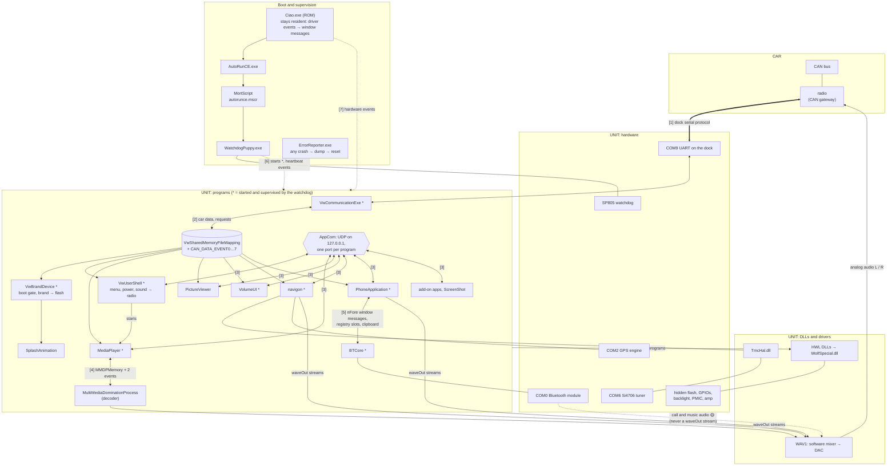

# Architecture — how the VW "maps + more" system works

Entry point of the documentation: the whole unit on one page, with a link to the document that specifies each part. Read this first; follow the links for byte-level detail.

Legend: ✅ verified in binary / config / data · ✅ emulator = observed running in the emulator (CE 7 guest, stubbed hardware) · 🟡 inferred or single source · ❓ unknown. Every statement is backed by the linked document and carries its tag there; where that tag is not ✅ it is repeated here. Almost everything comes from **static analysis** of the official software. Seen running in the emulator (2026-11-16): the app mechanism (§7.5), the shared memory with car data, AppCom traffic, the unit's side of the dock link against the simulated radio (`emulator/radio.py`), the branded start of `VwBrandDevice` — details in the "Verified in the emulator" sections of [shared-memory.md](car/shared-memory.md) §10, [appcom.md](apps/appcom.md) §13, [can-signals.md](car/can-signals.md) §9, [car-link.md](car/car-link.md) §10. Nothing was tested on a real unit or measured on a car.

## 1. The unit in five lines

- A removable 5" navigation device (Garmin / Navigon 4NSF) that clips into a dock on the dashboard of a VW up!, Seat Mii or Skoda Citigo. It is not a head unit: the car has a separate radio.
- Windows CE 6 on an ST Cartesio+ ARM SoC, 256 MB RAM, 4 GB flash, 480×272 resistive touch, own GPS, own FM / RDS traffic tuner, Bluetooth module, microphone, speaker, battery.
- Its only connection to the car is the dock: a UART to the radio, analog audio to the radio, 5 V. **There is no CAN in the unit**; the radio forwards selected CAN traffic over the UART.
- Software = a dozen cooperating Windows programs (menu, navigation, phone, media, car link) started and supervised by a watchdog; they talk through shared memory, UDP messages and window messages.
- The unit is tied to a make (VW / Seat / Skoda skin, chosen once from car data) but **not to a car**: no VIN lock, no unlock code ([brand-and-pairing.md](system/brand-and-pairing.md) §6).

## 2. Hardware blocks

| Block | Facts | Details |
|---|---|---|
| SoC, memory | ST STA2064 "Cartesio+" 533 MHz, 256 MB, internal MMC 4 GB (`\My Flash Disk`, `\MN Settings`, hidden registry volume, raw "hidden flash" sectors) | [device.md](system/device.md) §1, [hardware-layer.md](system/hardware-layer.md) §3, §5.4 |
| Dock | 11 pogo pins: GND, 5 V, UART (`COM9:`), audio L / R, "audio enable" (pin assignment 🟡, from a third-party photo); cradle detect on GPIO 18 | [car-link.md](car/car-link.md) §1 |
| GPS | ST engine inside the ROM driver, NMEA on `COM2:` | [navigation.md](system/navigation.md) §3 |
| TMC tuner | Si4706 on I²C, driver loaded at run time as `COM6:` | [navigation.md](system/navigation.md) §4 |
| Bluetooth | nFore module (CSR chip) on `COM0:`; runs all profiles and the call / music audio itself | [bluetooth.md](system/bluetooth.md) §1, §5, §7 |
| Audio | one PCM device `WAV1:` with a software mixer → DAC → dock line-out and built-in speaker (amplifier off while docked) | [media-audio.md](system/media-audio.md) §1, §7 |
| Board support | `WolfSpecial.dll` (ROM) over stream drivers: hidden flash, GPIOs, backlight, PMIC, SP805 watchdog, power key (GPIO 25) | [hardware-layer.md](system/hardware-layer.md) §2, §6 |

## 3. System map

| # | Channel | Mechanism | Document |
|---|---|---|---|
| 1 | Dock link | 19200 8N1 serial frames carrying `CAN id + data` and BAP; copyright handshake F001 / F002 | [car-link.md](car/car-link.md) |
| 2 | Car data | named file mapping (one fixed struct, `0x61B0` bytes), 28 named mutexes, 153 change ids, 8 notification events; requests to the car go back the same way | [shared-memory.md](car/shared-memory.md) |
| 3 | App messages | "AppCom": UDP datagrams with typed variants; app registry in XML; also starts / shows apps | [appcom.md](apps/appcom.md) |
| 4 | Decoder RPC | file mapping `MMDPMemory` + events `MMDPExecuteEvent` / `MMDPReturnEvent` | [media-audio.md](system/media-audio.md) §2 |
| 5 | Bluetooth | broadcast registered window messages `WM_NFORE_CORE_*` / `WM_NFORE_UI_*`, side channels in registry, clipboard and file mappings; clients use `nfBT.dll` | [bluetooth.md](system/bluetooth.md) §2 |
| 6 | Supervision | named auto-reset events each program must `SetEvent` in time; exit detection | [boot-and-supervision.md](system/boot-and-supervision.md) §3.3 |
| 7 | Hardware events | drivers → `Ciao.exe` → registered window messages (cradle, power key) → listener interfaces of the HWL DLLs | [hardware-layer.md](system/hardware-layer.md) §4.2–§4.3 |

## 4. Processes

| Process | Role | Started by | Talks to (mechanism) | Doc |
|---|---|---|---|---|
| `Ciao.exe` (ROM) | boot manager; afterwards relays driver events | `HKLM\init\Launch99` | drivers (private message `0x1122`), all programs [7] | [boot-and-supervision.md](system/boot-and-supervision.md) §2.2 |
| `AutoRunCE.exe` + `MortScript.exe` | boot script `autorunce.mscr` | Ciao (SD card copy first) | registry, marker files | [boot-and-supervision.md](system/boot-and-supervision.md) §2.4 |
| `WatchdogPuppy.exe` | starts and supervises 8 programs, feeds the hardware watchdog, checks the volumes | boot script | children [6]; `WolfSpecial.dll` | [boot-and-supervision.md](system/boot-and-supervision.md) §3 |
| `ErrorReporter.exe` | JIT debugger: crash dump, then device reset | CE kernel, on an unhandled exception | – | [boot-and-supervision.md](system/boot-and-supervision.md) §4 |
| `VwCommunicationExe.exe` | sole owner of the car link: framing, handshake, CAN parsers, BAP stack | watchdog (1st) | radio [1]; all clients [2] | [car-link.md](car/car-link.md), [shared-memory.md](car/shared-memory.md) §6, [bap.md](car/bap.md) |
| `VwBrandDevice.exe` | at every boot: brand selection if needed, boot images, splash; then exits | watchdog (2nd; the rest waits for it) | car data [2] (channel 1), hidden flash | [brand-and-pairing.md](system/brand-and-pairing.md) |
| `SplashAnimation.exe` | boot animation | VwBrandDevice | closed by the shell (`WM_QUIT`) | [brand-and-pairing.md](system/brand-and-pairing.md) §5.3 |
| `VwUserShell.exe` | main menu, car screens, standby policy, "who owns the screen", sound winner → radio; starts MediaPlayer and add-on apps | watchdog | car data + requests [2] (channel 1), AppCom port 27017 [3], HWL listeners [7] | [user-shell.md](system/user-shell.md) |
| `navigon.exe` | navigation, GPS, TMC, voice prompts | watchdog | AppCom 27011 [3]; car data read-only [2]; `COM2:`, `COM6:`; `waveOut` | [navigation.md](system/navigation.md) |
| `BTCore.exe` | host driver and data store of the Bluetooth module (not a stack) | watchdog | module (`COM0:`, BCSP); clients [5] | [bluetooth.md](system/bluetooth.md) §5 |
| `PhoneApplication.exe` | phone UI, voice dialing | watchdog (`-TSW_HIDE`) | BTCore [5]; AppCom 27015 [3]; car data read-only [2] | [bluetooth.md](system/bluetooth.md) §8 |
| `MediaPlayer.exe` | SD-card and Bluetooth music; remote control of the car radio (FM / CD / AUX, sound setup) | **the shell**, hidden, after navigon's message 40; the watchdog only adopts it | car data + requests [2] (channel 2); AppCom 27018 [3]; decoder [4] | [media-audio.md](system/media-audio.md) |
| `MultiMediaDominationProcess.exe` | Cidana decoder in its own process | MediaPlayer | [4]; `waveOut` | [media-audio.md](system/media-audio.md) §2–§3 |
| `PictureViewer.exe` | picture browser, locked from 6 km/h while docked | shell, on demand | car data [2] (channel 3); AppCom 27019 | [media-audio.md](system/media-audio.md) §9 |
| `VolumeUI.exe` | radio-volume overlay; quits at start unless the unit is branded for the XL1 | watchdog | car data [2] (channel 6); AppCom 27021 | [media-audio.md](system/media-audio.md) §6.3 |
| `Apps\<Name>\*.exe`, `ManualReader.exe`, `ScreenShot.exe` | add-on apps, manual, screenshot helper | shell menu (or `<Autostart>`) | optional AppCom | [building-apps.md](apps/building-apps.md), [navigation.md](system/navigation.md) §9 |

## 5. Life cycle

| Step | What happens | Doc |
|---|---|---|
| 1 | Boot loader (three stages; reflashes itself and the OS when it finds `update.me`) → CE kernel → `HKLM\init`: drivers, window system, no CE shell → **`Ciao.exe`** | [boot-and-supervision.md](system/boot-and-supervision.md) §2.1, §7.2 |
| 2 | Ciao decides once: factory / test branches → USB mass-storage mode if a computer is attached → updaters found on card or flash → **`AutoRunCE.exe` from the SD card, else from flash** → else "no software" picture | [boot-and-supervision.md](system/boot-and-supervision.md) §2.2 |
| 3 | `autorunce.mscr`: registry fix-ups, marker files, Bluetooth address copy, start `WatchdogPuppy.exe`, later the SD-card helper | [boot-and-supervision.md](system/boot-and-supervision.md) §2.4 |
| 4 | Watchdog child 1, `VwCommunicationExe`: opens `COM9:`, creates the shared memory, sends F002, starts BAP | [shared-memory.md](car/shared-memory.md) §6.1 |
| 5 | Watchdog child 2, `VwBrandDevice` = **branding gate**. Branded unit: install the brand's boot images, start the splash, exit after seconds (✅ emulator: exits after about 3 s). Unbranded unit (or a `BrandDevice.reg` file exists): wait for a car, with no timeout — nothing else starts | [brand-and-pairing.md](system/brand-and-pairing.md) §4.1 |
| 6 | Children 3…8: `VwUserShell` (110 start steps from its data files, closes the splash), `navigon` (90 s grace), `BTCore`, `PhoneApplication` (hidden), `MediaPlayer` (adopted only), `VolumeUI` | [boot-and-supervision.md](system/boot-and-supervision.md) §3.2 |
| 7 | navigon broadcasts AppCom message 40 → the shell runs password check and EULA, starts `<Autostart>` apps and MediaPlayer (hidden) — ✅ emulator (broadcast, EULA, MediaPlayer; autostart apps not tried) | [user-shell.md](system/user-shell.md) §7.3 |
| 8 | Docked with ignition on: the radio's F001 arrives → "radio connected" → car screens, radio control and car audio become available | [car-link.md](car/car-link.md) §3 |

Suspend and shutdown ([user-shell.md](system/user-shell.md) §5.1 owns the rules):

- The OS never idles or suspends by itself; the shell decides, with `SetSystemPowerState`. There is no orderly "close all programs" phase.
- Ignition off and (radio not operating or key removed) → 30 s good-bye pop-up → **suspend**; deferred during phone calls.
- External power lost → 30 s → suspend. On battery: warnings at 10 % and 5 %, suspend at 2 %.
- Power key: docked with a radio = "screen off" toggle; undocked = good-bye screen (standby / switch off); held 5 s = shutdown.
- Resets never come from the shell: they come from the watchdog (program exit or missed heartbeat), `ErrorReporter` (crash), Ciao (USB cable plugged into a computer) and the factory reset.

## 6. The car link in one page

| Layer | What | Key numbers | Status | Doc |
|---|---|---|---|---|
| Electrical | dock pins: UART, 5 V, GND, audio L / R, "audio enable", cradle detect | levels, polarity, pin roles | ❓ never measured | [car-link.md](car/car-link.md) §1, §8 |
| Serial framing | `C2\|C3 LEN PAYLOAD CRC16 C1`, ack `C4\|C5 C6`, escape `C0`, CRC-16/ARC, stop-and-wait | 19200 8N1 · retransmit 200 ms · keepalive 1500 ms · RX timeout 3000 ms | ✅ (51 captured frames check); ✅ emulator: the unit's frames decode, the simulated radio's frames are accepted | [car-link.md](car/car-link.md) §2, §10 |
| Handshake | radio → unit `F001`: copyright text, version 1.0, VIN, fuel type, line / sound flags; unit → radio `F002`: copyright text, version, device id | the unit first sends empty sync frames; once acknowledged, F002 unsolicited, repeated 6 × 1 s, and once more after each valid F001; raw CAN dropped until a valid F001 | ✅ unit side, ✅ emulator; radio side ❓ | [car-link.md](car/car-link.md) §3, §10 |
| Raw CAN | payload `id (LE16) + data`; 25 ids, receive only: engine, speed, temperatures, trip computer, doors, ignition, steering-wheel keys, e-up! values | ids 0x35B…0x669 | ✅ layouts; ✅ emulator for engine speed, coolant, speed, outside temperature, doors, trip computer; other scales and names 🟡 / ❓ | [can-signals.md](car/can-signals.md) |
| BAP | VW request / status protocol on CAN frames; unit = client of 6 function blocks (park distance, radio / audio, audio channel + sound, clock, e-up! charging, electric drive) | 4 TX ids, 6 RX ids, 108 functions; frame gap 50 / 80 ms; retry 5 × 600 ms | ✅ stack and payloads; several function names 🟡 | [bap.md](car/bap.md), [bap-functions.md](car/bap-functions.md) |
| Shared memory | `VwCommunicationExe` publishes decoded values; clients read under named mutexes and get change events; requests travel back as fields + request ids | `0x61B0` bytes · 26 raw blocks · 6 BAP blocks · 153 ids · 8 channels | ✅, ✅ emulator (layout, objects, write → screen) | [shared-memory.md](car/shared-memory.md) |
| UI | the shell (car screens, overlays, power policy) and MediaPlayer (radio screens) read through one client interface and draw data-defined screens | – | ✅ data; some algorithms 🟡 | [user-shell.md](system/user-shell.md), [media-audio.md](system/media-audio.md), [ui-framework.md](system/ui-framework.md) |

The unit never sends a raw CAN frame; everything it can change in the car is a BAP request: close the park-distance display, switch the radio source, claim an audio channel, radio remote control, sound settings, car clock, charging timers ([bap-functions.md](car/bap-functions.md) §1).

## 7. Data-flow walkthroughs

### 7.1 Engine speed, from CAN to the gauge

1. The radio forwards CAN id 0x35B (`GwMotor`) as one serial frame with payload `5B 03` + 5 data bytes; `VwCommunicationExe` checks the CRC and acks ([car-link.md](car/car-link.md) §2, §4).
2. The frame is dropped unless a valid F001 arrived before. Otherwise the parser extracts the 16-bit engine speed, applies a dead band and a low-pass filter ([can-signals.md](car/can-signals.md) §3.1; 0.25 rpm per bit ✅ emulator).
3. It stores the value in the `MessageGwMotor` block of the shared memory under `MessageGwMotorMutex`, clears the "invalid" bit, marks data id 2 for every subscribed channel and sets that channel's event ([shared-memory.md](car/shared-memory.md) §2.2, §4).
4. The shell's listener thread wakes on `CAN_DATA_EVENT1`, clears the bit for id 2 and raises UI event 16002 ([user-shell.md](system/user-shell.md) §3.1).
5. The gauge screen ("Tubes") re-evaluates its provider, which calls the client getter (slot 0x10: three times the `GwAnt2` engine-speed field if that is valid, else this value) and picks one of 401 pre-rendered needle frames ([user-shell.md](system/user-shell.md) §7.6, [ui-framework.md](system/ui-framework.md) §5).

### 7.2 The user picks a source: who gets the car speakers

1. The radio is the master of the audio source. The unit's own sound is source type 0x0F ("portable device") in the radio's source list ([media-audio.md](system/media-audio.md) §4).
2. MediaPlayer starts playing an SD-card file and announces it: AppCom message 29 `[prio 5, type 3 media, claim, source 0 SD, −1]` to group `Volume` ([media-audio.md](system/media-audio.md) §5).
3. The shell computes the winner of all claims and calls the client's "request audio" slot with (source 0x0F, channel 4) ([user-shell.md](system/user-shell.md) §4.1).
4. The client library writes the request into the BAP block and raises a request id; `VwCommunicationExe` sends BAP *StartResult* LSG 0x31 fct 0x23 (activate the source by its handle), waits for the radio's status, then *SetGet* LSG 0x2D fct 0x11 = channel 4 ([bap-functions.md](car/bap-functions.md) §4.4–§4.5; the claim `04` and release `FF` are visible in the forum capture, [car-link.md](car/car-link.md) §6).
5. For FM / CD / AUX the same path only asks the radio to select that source; MediaPlayer then shows the radio's station list and texts and sends remote-control commands ([media-audio.md](system/media-audio.md) §8.3). Whenever the radio reports another active source, MediaPlayer follows.
6. Loudness is always the radio's: it reports level and type; the unit never sets it ([media-audio.md](system/media-audio.md) §6.1).

### 7.3 A navigation prompt while media plays

1. navigon claims sound type 2 (advice; prio 4 🟡) with message 29, speaks through its own `waveOut` stream, then releases ([navigation.md](system/navigation.md) §5.1).
2. MediaPlayer sees the winner change from media to advice and **ducks** its stream to 40 % (SD) or 20 % (Bluetooth audio) within 200 ms; it does not pause ([media-audio.md](system/media-audio.md) §5.2).
3. The shell keeps the radio's source and claims **audio channel 8** (announcement); how the radio mixes it over its own programme 🟡 ([media-audio.md](system/media-audio.md) §5.1).
4. Docked, the prompt level is fixed (step 9 = 85 %) and the driver sets the loudness on the radio; undocked the user's volume step applies to the built-in speaker.
5. On release the previous winner returns: MediaPlayer fades up, the shell re-claims channel 4 or releases with `FF`.

### 7.4 A phone call

1. The Bluetooth module handles the call itself and reports state changes to `BTCore.exe` over `COM0:`; BTCore broadcasts window messages; `nfBT.dll` turns them into callbacks in `PhoneApplication.exe` ([bluetooth.md](system/bluetooth.md) §2, §5).
2. The phone app sends AppCom message 4 (phone state) to everybody and claims sound type 0 (prio 1) with message 29 ([bluetooth.md](system/bluetooth.md) §8.3).
3. The shell sets its "incoming call" / "call" priority flag (the winner is broadcast as message 31), asks the radio for source 0x0F + **channel 9**, and sets the wave master volume to 0 so that every `waveOut` stream is silent ([user-shell.md](system/user-shell.md) §4, §4.1).
4. Call audio never passes through Windows: module → audio hardware → dock line-out 🟡 wiring ([bluetooth.md](system/bluetooth.md) §7). MediaPlayer **pauses**; the standby countdown is deferred.
5. The steering-wheel phone key arrives as CAN 0x5C1 → shared memory → shell → AppCom message 42 → phone app ([user-shell.md](system/user-shell.md) §5.2).
6. At the end the phone app releases; media resumes 3 s later.

### 7.5 A third-party app is listed and started (✅ seen in the emulator)

1. The app is a folder `\My Flash Disk\Apps\<Name>\` with an exe, an icon and `NgAppInfo.xml` ([building-apps.md](apps/building-apps.md)).
2. At its start every AppCom user loads `NgAppCom.xml` from its own folder and then the first `<Application>` of every `Apps\*\NgAppInfo.xml` ([appcom.md](apps/appcom.md) §5.2, §6).
3. The shell's "more" list shows every entry with `<IsVisible>`, with its icon and the name for the current language ([user-shell.md](system/user-shell.md) §7.1).
4. On a tap: `FindWindow(ClassName, WindowName)` → bring to front; else `CreateProcess(Exe, " language=<lc> skin=<brand>")` ([appcom.md](apps/appcom.md) §7).
5. No message exchange is needed. The app is not supervised, but a crash in it resets the unit ([boot-and-supervision.md](system/boot-and-supervision.md) §4.1).

## 8. Extension points

Where own code can hook into the unit, from least to most invasive (nothing here was tried on a real unit):

| # | Hook | What it gives | Specified in |
|---|---|---|---|
| 1 | Folder under `Apps\` | own program in the menu ✅ emulator | [building-apps.md](apps/building-apps.md) |
| 2 | Shared-memory client | read every car value ✅ emulator; send BAP requests 🟡 (✅ emulator only: the car-link process picks the request up) | [shared-memory.md](car/shared-memory.md) §8.1–§8.3 |
| 3 | AppCom datagrams | events of the other programs (language, phone, GPS state, standby); join a message group ✅ emulator (incl. the car speed, group `SpeedInfoCan`); steer the shell's status bar and overlays ✅ emulator; the sound manager | [appcom.md](apps/appcom.md) §9, §11, §13, [media-audio.md](system/media-audio.md) §11.2 |
| 4 | `WolfSpecial.dll` / HWL DLL | brand, VIN, cradle, brightness, power, hidden flash (calling convention ✅ emulator, against the stand-in DLL) | [hardware-layer.md](system/hardware-layer.md) §4.5 |
| 5 | `nfBT.dll` or its window messages | phone functions of the stock Bluetooth core | [bluetooth.md](system/bluetooth.md) §9.1 |
| 6 | SD-card `AutoRunCE.exe` | own code at boot without changing the unit 🟡 untested | [boot-and-supervision.md](system/boot-and-supervision.md) §8.1 |
| 7 | Edit the UI data (`.kbi` in `.nfs`) | reskin, change screens; reading works (`tools/nfs_extract.py`, `tools/kbi_extract.py`: trees as text, bitmaps as PNG), writing needs repackers that do not exist yet | [ui-framework.md](system/ui-framework.md) §11–§12, [file-formats.md](system/file-formats.md) |
| 8 | Replace a program: navigation, shell, supervisor, or the car-link process | everything | [navigation.md](system/navigation.md) §10, [user-shell.md](system/user-shell.md) §10, [boot-and-supervision.md](system/boot-and-supervision.md) §8.2, [shared-memory.md](car/shared-memory.md) §8.4 |

Pitfalls:

- An unhandled exception in a program that is not on `ErrorReporter.ini`'s `[NoResetAfterException]` list **resets the unit** ([boot-and-supervision.md](system/boot-and-supervision.md) §4.1).
- Watchdog: exit or a missed heartbeat of shell, navigation, phone app or media player is a reset; a replacement must create the same window and set the same events ([boot-and-supervision.md](system/boot-and-supervision.md) §3.2, [navigation.md](system/navigation.md) §10).
- Shared memory: one consumer per notification channel — poll instead of waiting on the stock events; never hold two block mutexes ([shared-memory.md](car/shared-memory.md) §8.2).
- The Bluetooth stack uses the **clipboard** as a mailbox; a second client races with the phone app ([bluetooth.md](system/bluetooth.md) §2, §9.1).
- The shell rewrites the wave master volume; docked, nothing is audible without a sound-manager claim ([media-audio.md](system/media-audio.md) §11.2).
- Plugging USB into a computer resets the running unit; files named like update files in a volume root trigger the boot loader's updater ([boot-and-supervision.md](system/boot-and-supervision.md) §2.2, §7.2).
- Never write the hidden flash or create `BrandDevice.reg` unless re-branding is intended ([brand-and-pairing.md](system/brand-and-pairing.md) §8).
- The emulator differs: CE 7, vehicle data only from the simulated radio or when written by hand ([shared-memory.md](car/shared-memory.md) §8.5), no BAP, no Bluetooth, no audio, hidden flash = a file, no watchdog and no crash handler (a crashing program just ends) ([hardware-layer.md](system/hardware-layer.md) §7.1).

## 9. What is still unknown

Needs a measurement on hardware:

- UART level, polarity, pin directions on the dock — [car-link.md](car/car-link.md) §8
- Cradle-detect pin; whether "audio enable" is GPIO 19, its resting level, whether the radio uses it — [hardware-layer.md](system/hardware-layer.md) §8, [media-audio.md](system/media-audio.md) §12
- Audio line level; where the Bluetooth module's audio joins the output; module part number — [bluetooth.md](system/bluetooth.md) §10
- PMIC variant, speaker amplifier, DAC parts; GPIO 55 / 57 signals — [hardware-layer.md](system/hardware-layer.md) §8
- TMC antenna path; CPU core type — [device.md](system/device.md) §1

Needs a live capture (car, unit or emulator):

- Two-way trace of a cold start: the radio's half — what it sends first, its real F001, timing (the unit's half ✅ emulator) — [car-link.md](car/car-link.md) §8, §10
- Does the radio check the F002 device id, need the BAP start marker, accept BAP writes from another device — [car-link.md](car/car-link.md) §8, [brand-and-pairing.md](system/brand-and-pairing.md) §11, [bap.md](car/bap.md) §8
- CAN cycle times, which messages each model sends — [can-signals.md](car/can-signals.md) §6 (engine-speed scale and consumption unit codes: answered in the emulator)
- Real BAP-Config / HeartBeat values and error codes of the car's function blocks — [bap.md](car/bap.md) §8
- AppCom traffic of the programs the emulator cannot exercise (Bluetooth, media playback, guidance with a GPS fix); shell, navigon start-up and phone-app start-up are captured — [appcom.md](apps/appcom.md) §12, §13
- Bluetooth module protocol on the wire — [bluetooth.md](system/bluetooth.md) §10
- Everything still marked "untested": branding flow, SD-card autorun, a BAP request that reaches the wire — [brand-and-pairing.md](system/brand-and-pairing.md) §11, [boot-and-supervision.md](system/boot-and-supervision.md) §9, [shared-memory.md](car/shared-memory.md) §9

Needs more static analysis:

- BAP: names and fields of many functions, full source-change state table — [bap-functions.md](car/bap-functions.md) §11
- Shared memory: channel 7, ids without a setter, control-block fields — [shared-memory.md](car/shared-memory.md) §9
- CAN: several flags, e-up! fields — [can-signals.md](car/can-signals.md) §6
- AppCom: the settings enum, a dozen message ids, fields of message 45 — [appcom.md](apps/appcom.md) §12
- UI data: remaining node types and command ids; eco-trainer formulas; about half of the shell's classes — [ui-framework.md](system/ui-framework.md) §13, [user-shell.md](system/user-shell.md) §11
- Audio policy leftovers (message 29 `extra`, messages 3 and 26, radio mute flags 2 / 3) — [media-audio.md](system/media-audio.md) §12
- Navigation: key-store product table, map tables inside `.map`, route / favourites serializer — [navigation.md](system/navigation.md) "Open questions"
- Boot loader stages (strings only so far), who arms the hardware watchdog — [boot-and-supervision.md](system/boot-and-supervision.md) §9
- Branding: equipment-line codes 2…5, password "security code" — [brand-and-pairing.md](system/brand-and-pairing.md) §11
- Hardware: rest of the factory block, boot-argument page — [hardware-layer.md](system/hardware-layer.md) §8
- Files of unknown purpose: `Dat/MN.dat`, `Dat/BT.dat`, `GD*.dat`, `.pom`, `DD_Car.bin`; NgFs header words; no NgFs / `.kbi` repacker — [device.md](system/device.md) §9, [file-formats.md](system/file-formats.md)

## 10. Documentation index

| File | Content |
|---|---|
| [architecture.md](architecture.md) | this overview |
| **`system/` — the unit and its programs** | |
| [system/device.md](system/device.md) | inventory: hardware, programs and DLLs, flash and settings content, licence files, personal data |
| [system/hardware-layer.md](system/hardware-layer.md) | `WolfSpecial.dll`, hidden flash, HWL wrapper DLLs, drivers, GPIOs, ROM registry |
| [system/boot-and-supervision.md](system/boot-and-supervision.md) | boot manager, boot script, watchdog, crash handling, power states, update mechanism |
| [system/brand-and-pairing.md](system/brand-and-pairing.md) | brand selection, hidden-flash record, VIN use, password lock, boot screens, `.RGBFS` |
| [system/ui-framework.md](system/ui-framework.md) | the data-driven UI toolkit: `.kbi` stores, node trees, commands, `PNXF` bitmaps, `.res` |
| [system/user-shell.md](system/user-shell.md) | main menu program: events, priorities, standby rules, screens, settings |
| [system/media-audio.md](system/media-audio.md) | media player, decoder process, picture viewer, volume overlay, who may be heard |
| [system/bluetooth.md](system/bluetooth.md) | Bluetooth module, `BTCore.exe`, client DLLs, phone app |
| [system/navigation.md](system/navigation.md) | navigation app interfaces: GPS, TMC, speech, rendering, licensing, how to replace it; manual reader |
| [system/file-formats.md](system/file-formats.md) | NgFs container specification; index of all other formats |
| **`car/` — the link to the car** | |
| [car/car-link.md](car/car-link.md) | dock pins, serial protocol, handshake, what the radio forwards, decoded capture |
| [car/can-signals.md](car/can-signals.md) | bit layout of the 25 forwarded CAN messages and of F001 |
| [car/bap.md](car/bap.md) | BAP protocol stack: frames, tables, state machines, errors |
| [car/bap-functions.md](car/bap-functions.md) | meaning and payload of the BAP functions the unit uses |
| [car/shared-memory.md](car/shared-memory.md) | car-link process internals and the shared-memory block (C header) |
| **`apps/` — writing programs for the unit** | |
| [apps/appcom.md](apps/appcom.md) | app-to-app messages: wire format, registry, message catalogue, API |
| [apps/building-apps.md](apps/building-apps.md) | writing, building and installing an app; using the unit's services |
| `img/` | pictures used by the documents (dock pinout photo, emulator screenshots incl. three with data from the simulated radio) |

Tools to check or redo the analysis (`../tools/`, usage in [tools/README.md](../tools/README.md)): `peinfo.py`, `decompile.py` (programs) · `nfs_extract.py`, `kbi_extract.py`, `res_extract.py`, `rgbfs_extract.py`, `hive_dump.py` (files; all read-only) · `appcom.py`, `decode_frames.py`, `bap_tables.py` (messages and car link).
