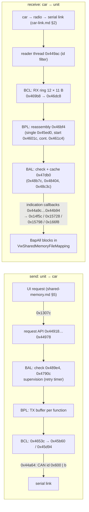
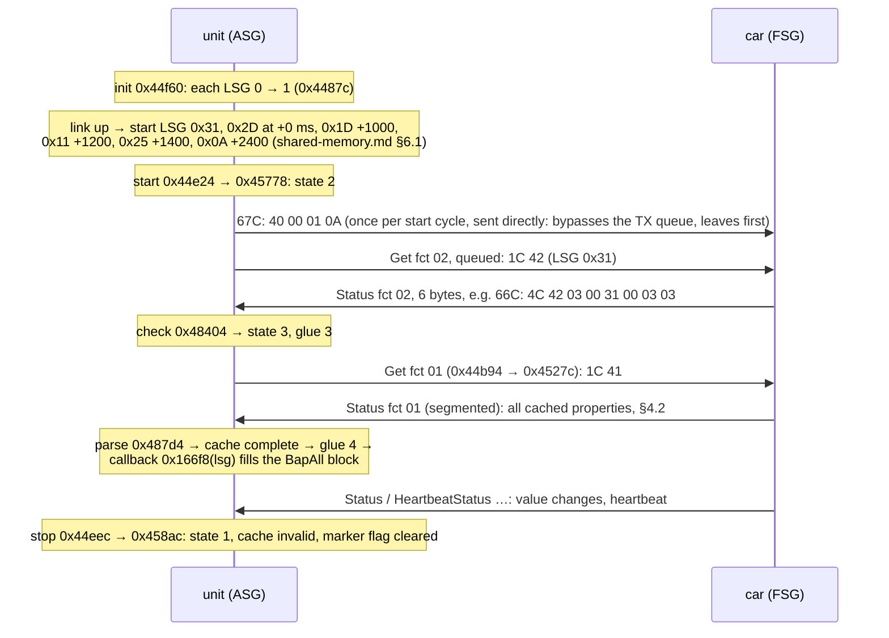

# BAP protocol stack of the 4NSF (`VwCommunicationExe.exe`)

BAP ("Bedien- und Anzeigeprotokoll") is the VW protocol the unit uses to read and control functions of car ECUs (radio, park distance, e-up! charging…) on top of CAN frames. The unit is the **ASG** (client); each car function block is an **FSG** (server), addressed by an **LSG id**.
This file documents the stack as built into the unit, so that an interoperable ASG (replacement device) or an FSG simulator (emulated radio) can be written.

Scope: transport, state machines, static configuration.
Related: [bap-functions.md](bap-functions.md) (meaning of each function's payload, identity of each LSG) · [car-link.md](car-link.md) §2 (serial frames that carry the CAN frames) · [shared-memory.md](shared-memory.md) (request channel, BapAll blocks) · [media-audio.md](../system/media-audio.md) (who uses the audio LSGs).

Legend: ✅ seen in disassembly/data (address given) · 🟡 inferred, or public BAP terminology · ❓ unknown. Static analysis only; nothing run on a unit or a car.
Addresses = VA in `firmware/flash/VwUserShell/VwCommunicationExe.exe` (image base `0x10000`, ARM code). File offset = VA − `0x11400` (`.rdata`) or VA − `0x10C00` (`.text`).
Layer and type names (BCL, BPL, BAL, "request", "indication") follow the public VW reference stack 🟡; the binary has no symbols.

## 1. Overview



| Layer | Job | Main functions |
|---|---|---|
| BCL (bus) | CAN id ↔ LSG, RX ring buffer, per-id TX gap timer | `0x449ac`, `0x469b8`, `0x46dc8`, `0x44a64`, `0x48e78` |
| BPL (protocol) | header, segmentation, 4 logical channels per CAN id | `0x46bf4`, `0x45ed0`, `0x4601c`, `0x461c4`, `0x46abc`, `0x45b60`, `0x45d94`, `0x4653c`, `0x48ebc` |
| BAL (application) | LSG state, opcode/size checks, cache, GetAll, retries, heartbeat | `0x47db0`, `0x489e4`, `0x4790c`, `0x4864c`, `0x487d4`, `0x47fd0`, `0x48404`, `0x47b4c`, `0x47ad0`, `0x47670` |
| Glue | start/stop per LSG, app state, callbacks | `0x44f60`, `0x44e24`, `0x44eec`, `0x44a9c`…`0x44c9c` |

Scheduling ✅ — one task function `0x4519c(flags)`, bits = sub-tasks:

| Bit | Sub-task | Called from |
|---|---|---|
| 0x01 | `0x47b4c` request supervision (retry timers) | main loop, on its 10 ms wait time-out |
| 0x02 | `0x47ad0` heartbeat supervision | same |
| 0x04 | `0x46dc8` drain RX ring → BPL | reader thread, after each received BAP frame (`0x44a54`, flags `0x0C`) |
| 0x08 | `0x47670` deliver completed messages / errors; `0x48ebc` segment timers | same |
| 0x10 | `0x48e78` gap timers + `0x4653c` send | main loop, every iteration (`0x13` on time-out, `0x10` after UI requests) |

- **Tick** = one main-loop iteration (`0x19448`, [shared-memory.md](shared-memory.md) §6.2) = 10 ms nominal ✅, longer under load 🟡. All times below are in ticks.
- Iterations woken by a UI request skip bits 1 and 2 (those timers stretch) ✅.
- The lock/unlock hooks of the stack are the empty function `0x262ec` ✅ → reader thread and main loop touch the same state without mutual exclusion.
- "BAP thread heartbeat": the main loop sets the event `VwCommunicationBapThreadAlive` every 51 iterations for WatchdogPuppy (30 s) — a process watchdog, unrelated to the BAP HeartBeat function.
- Work budget per task call: counter `0x8ef7a`, limit 500 (frame sent +40, message delivered +80 + length) ✅.
- The stack's debug facility (`0x46ea8…0x47438`, 8-byte status frame at `0x8ef80`) is inert: its send hook `0x11b10` returns 0 and the debug LSG id `0x8ee5c` is never written ✅.

## 2. Frame formats ✅

One BAP frame = one CAN frame (DLC 2…8, no padding: `0x45c58`). Header = 16 bits, big-endian bit order:

```
hdr0 = 0 ooo llll      o = opcode (3 bits), l = LSG id bits 5..2
hdr1 = ll ffffff       l = LSG id bits 1..0, f = function id (6 bits)

single        : hdr0 hdr1 | 0…6 data bytes
segment start : 1 0 cc nnnn | nnnnnnnn | hdr0 hdr1 | 0…4 data bytes    c = channel 0..3, n = total data length (12 bits)
segment cont. : 1 1 cc ssss | 1…7 data bytes                       s = sequence, first continuation = 0, +1 mod 16
```

| Rule | Evidence |
|---|---|
| Parser: `lsg = (hdr0 & 0x0F) << 2 \| hdr1 >> 6`, `fct = hdr1 & 0x3F`, `op = (hdr0 & 0x7F) >> 4` | `0x46bf4` |
| RX frame dropped when DLC < 2, DLC > 8, or `(b0 & 0xCF) == 0x8F && b1 == 0xFF` | `0x469b8` |
| RX ring: 12 frames; overflow → error 0x17, ring reset | `0x469b8`, `0x46dc8` |
| A function is either segmented or not, **fixed by configuration** (§3.4 "Seg"). RX: a segmented function is only accepted in start/continuation frames (even when it would fit in 6 bytes), an unsegmented one only as single frame; anything else is ignored | `0x463f8` (`mask & row.chmask == frame mask`) |
| Same on TX: segmented functions always go out as start frame (+ continuations) | `0x4653c` (`row+4`) |
| Start frame needs DLC ≥ 4; carries min(n, 4) data bytes; n ≤ 4 completes at once | `0x46c84`, `0x46130` |
| Continuation carries min(remaining, 7) bytes; shorter → error 0x16; wrong sequence → error 0x13, message dropped | `0x461c4` |
| n > configured size → error 0x15 (GetAll: truncated instead) | `0x46040`, `0x46118` |
| A new start frame on the same function restarts reassembly | `0x46090` |
| RX continuation is matched by (CAN id, channel) → up to 4 interleaved messages per id | `0x46334`, table `0x8ed70` |
| TX channel choice: channel last used by this function, else first free of 0…3 | `0x45d94` |
| Single frame RX: DLC − 2 ≥ min(size, 6), extra bytes ignored; a fixed-size function > 6 bytes without segmentation (FunctionList of LSG 0x0A, 0x2D) is zero-padded to its size | `0x45ed0` |
| Opcode 7 (Error): 1 data byte = error code; for segmented functions as start frame with n = 1 | `0x45ed0`, `0x4609c` |
| Max message: 12-bit length; largest configured 531 (RX), 137 (TX) | §3.4 |

Timing ✅ (ticks ≈ 10 ms):

| Timer | Value | Where |
|---|---|---|
| Gap between two frames on one TX id | 5 ticks (0x67C, 0x6C7, 0x67A), 8 ticks (0x69D) | channel table `0x632b8`, `0x45c90` |
| Frames per tick | ≤ 1 per scheduling list (4 lists) | `0x4653c` |
| RX inter-segment time-out | 50, counted in **received BAP frames** (any id), not in time: sub-task 0x08 only runs on RX; reloaded by each segment → error 0x14 | `0x46abc`, `0x48ebc` |
| Request supervision | 60 ticks × (1 + 4 retries); LSG 0x31 fct 0x16: 200 ticks × (1 + 2) | function row `+0x21/+0x22`, §4.3 |
| HeartBeat supervision | HeartBeat value × 50 ticks | §4.4 |

Worked examples (`tools/samples/dock-capture.txt`, unit → car only; payload after the 2-byte id):

| Line | CAN id | Bytes | Decoded |
|---|---|---|---|
| 4 | 0x67C | `1C 42` | single, op 1 Get, LSG 0x31, fct 0x02 BAP-Config |
| 12 | 0x67C | `1C 41` | Get, LSG 0x31, fct 0x01 GetAll |
| 44 | 0x67C | `2C 53 00` | op 2 SetGet, LSG 0x31, fct 0x13, data `00` (clear the unit's mute flag, [media-audio.md](../system/media-audio.md) §6.2) |
| 17 | 0x6C7 | `80 03 1B 51 00 00 01` | start, channel 0, n = 3, Get LSG 0x2D fct 0x11, data `00 00 01` (complete; segmented by configuration) |
| 48 | 0x6C7 | `80 04 2B 51 00 00 01 04` | start, n = 4, SetGet LSG 0x2D fct 0x11, data `00 00 01 04` |
| 18 + 20 | 0x67C | `80 05 1C 62 80 00 00 06` + `C0 00` | channel 0, n = 5, Get LSG 0x31 fct 0x22, data `80 00 00 06 00` |
| 19 + 21 | 0x67C | `90 05 1C 56 80 01 00 06` + `D0 00` | channel 1, Get LSG 0x31 fct 0x16; interleaved with the previous message on channel 0 |
| 3 | 0x67C | `40 00 01 0A` | start marker (§4.1) |

## 3. Static configuration (decoded)

All tables are constant data; RAM pointers inside are omitted. `.venv/bin/python tools/bap_tables.py firmware/flash/VwUserShell/VwCommunicationExe.exe` prints the tables of §3.1 and §3.4 straight from the program.

### 3.1 LSGs and CAN ids ✅

| LSG | BAP-Config row (`0x5f0f0`, 6 B each) | TX id (unit → car) | RX id (car → unit) | Functions |
|---|---|---|---|---|
| 0x0A | `03 00 0A 00 03 01` | 0x67A | 0x6DA | 16 |
| 0x11 | `03 00 11 00 04 01` | 0x69D | 0x6E7 | 15 |
| 0x1D | `03 00 1D 00 04 00` | 0x67A | 0x679 | 12 |
| 0x25 | `03 00 25 00 04 00` | 0x69D | 0x69C | 18 |
| 0x2D | `03 00 2D 00 03 00` | 0x6C7 | 0x6D8 | 19 |
| 0x31 | `03 00 31 00 03 03` | 0x67C | 0x66C | 28 |

- BAP-Config bytes 🟡 names: protocol version major, minor · LSG class, sub-class · data-definition version major, minor.
- TX id = `0x600 | bcl_row[0x11]`; RX id low byte = `bpl_row[0x1C]`; RX id list `6C D8 DA 9C E7 79` at `0x63354`.
- 0x67A and 0x69D are each shared by two LSGs; the answer id tells them apart.

### 3.2 Table layout ✅

```c
struct LsgRom {            /* 0x62f88, 6 rows x 0x34 */
  u8  lsg;                 /* +00 */
  u8  nConfig;             /* +01  = 1 */
  u8 *config;              /* +04  -> 6-byte BAP-Config row(s) */
  u8  functionList[8];     /* +08  bit for fct n = byte n>>3, mask 0x80>>(n&7); fct 1 not included */
  u16 *hbTime;             /* +10  RAM */
  u8  tickMs;              /* +14  = 10 🟡 */
  u8  hbFactor;            /* +15  = 5  🟡 */
  u8  nFct;                /* +16 */
  u32 nBpl; FctRom *fct; BplRxRom *bpl;   /* +18 +1C +20 */
  u8  padToDlc8;           /* +24  = 0 */
  LsgRam *ram;             /* +28 */
  u32 nBcl; BclTxRom *bcl; /* +2C +30 */
};
struct FctRom {            /* 108 rows x 0x38, 0x617e8…; sorted by fct per LSG (binary search 0x48e04) */
  u8  lsg, fct;            /* +00 +01 */
  u32 fctClass;            /* +04  0 Property, 1 Cache (GetAll), 2 Array, 3 Method */
  u8  txOpcodes;           /* +08  bit n = opcode n may be sent */
  u8  rxOpcodes;           /* +09  bit n = opcode n is accepted */
  u32 rxType; u32 rxSize;  /* +0C +10  0 void, 1 u8, 2 u16, 4 u32, 5 bytes <= size, 6 bytes == size */
  u32 txType; u32 txSize;  /* +14 +18 */
  Cache *cache;            /* +1C  NULL for Cache/Array/Method */
  u8  rsvd, retries; u16 retryTime;        /* +20 +21 +22 */
  BalRam *bal;             /* +24  { u16 timer; u32 flags: 0x40 pending, 0x80 sent, low 6 bits retries left } */
  u32 nTx; TxLink *tx;     /* +28 +2C  {u32 kind=0; BclTxRom*; TxBuf*; u16 size} */
  u32 nRx; RxLink *rx;     /* +30 +34  {u32 kind=0; BplRxRom*; RxBuf*} */
};
struct BplRxRom {          /* 108 rows x 0x24, 0x603a8 (file 0x4efa8) */
  u8 lsg, fct; u16 size;   /* +00 +01 +02 */
  u8 iface;                /* +04  = 1 */
  u32 channelMask;         /* +08  0x0F segmented, 0 not */
  u32 segTimeout;          /* +0C  50 or 0 */
  SegRx *seg; RxBuf *buf; u16 *timer;      /* +10 +14 +18 */
  u8 canIdLow;             /* +1C */
  void *owners;            /* +20 */
};
struct BclTxRom {          /* 108 rows x 0x1C, 0x5f118 (file 0x4dd18) */
  u8 iface;                /* +00  = 1 */
  u8 channelMask;          /* +04  0x0F segmented, 0 not */
  SegTx *seg; TxBuf *buf;  /* +08 +0C */
  u8 channel, canIdLow;    /* +10 +11  channel = index into the channel table */
  void *owners; FctRom *fct;               /* +14 +18 */
};
struct Channel {           /* 0x632b8, 4 rows x 0x14: 0x7C, 0xC7, 0x7A, 0x9D */
  u16 gapTicks; u8 canIdLow;               /* +00 +02  5,5,5,8 */
  void *lsgList; u32 nLsg;                 /* +04 +08 */
  BclTxRom **rows; u8 nRows; u8 iface;     /* +0C +10 +11 */
};
```

Other constants: segmented-RX function list `0x63308` (37 × `lsg fct`, one segment timer each) · start-frame byte per channel `80 90 A0 B0` (`0x6335c`).
Quirk ✅: the four `Channel.rows` pointers (`0x630c0`/28, `0x63130`/19, `0x6317c`/28, `0x631ec`/33) cut the 108-entry pointer array in a different order than it is laid out (by LSG 0x2D, 0x31, 0x11, 0x25, 0x0A, 0x1D). Every row is still visited once per tick and uses its own CAN id and gap timer, so only the round-robin grouping is affected.

### 3.3 Opcodes, requests, indications ✅

| Opcode | Property / Cache / Array | Method | Direction in this stack |
|---|---|---|---|
| 0 | Set (BAP-Config from FSG: Reset) | Start | TX (RX only for fct 0x02) |
| 1 | Get | Abort | TX |
| 2 | SetGet | StartResult | TX |
| 3 | HeartbeatStatus (Array: Changed) | Processing | RX |
| 4 | Status | Result | RX |
| 5 / 6 | StatusAck / Ack | – | not enabled for any function |
| 7 | Error (1 byte code) | Error | RX |

Opcode names 🟡 (public BAP); the grouping is ✅ from the three tables below.

| Table | Index | Content |
|---|---|---|
| request → opcode `0x63378` | `[class][request]` | Property/Cache/Array: request 0 → op 2, 1 → op 0, 2 → op 1, (Property only) 11 → op 6. Method: 5 → op 0, 6 → op 2, 7 → op 1. Others invalid |
| opcode → indication `0x63438` | `[class][opcode]` | Property: op 0 → 1, op 4 → 0, op 5 → 2. Cache: op 4 → 0. Array: op 3 → 5, op 4 → 0. Method: op 3 → 4, op 4 → 3. Others none (0x1F) |
| opcode → acknowledge `0x634a8` | `[class][opcode]` | TX confirmation codes; the confirmation callback is the empty function → unused |

Request numbers as used by the callers of the API (§5): **0 = SetGet, 1 = Set, 2 = Get, 5 = Start, 6 = StartResult, 7 = Abort**.
Indication numbers passed to the callbacks: **0 = data (Status), 1 = reset, 3 = method result, 4 = method processing, 5 = array changed**.

### 3.4 Function table (108 rows) ✅

Columns: `TXop`/`RXop` = allowed opcodes (digits) · data = `u8`, `u16`, `B=n` (exactly n bytes), `B<=n` (up to n) · `Seg`: `R` = received segmented, `T` = sent segmented · `Cache` = value kept and included in GetAll · `Retry` = retries × time-out in ticks.
Standard functions 🟡: 01 GetAll, 02 BAP-Config, 03 FunctionList, 04 HeartBeat, 0E FSG-Setup, 0F FSG-OperationState. Only 01…04 get special treatment in the stack ✅.

<!-- TABLE:BEGIN -->
```
LSG Fct Class TXop RXop  RX data  TX data  Seg  Cache Retry
0A  01  Cache 1    347   B<=38    -        R-   -     4x60
0A  02  Prop  1    0347  B=6      -        --   yes   4x60
0A  03  Prop  1    347   B=8      -        --   yes   4x60
0A  04  Prop  1    347   u8       -        --   yes   4x60
0A  0E  Prop  1    347   B=3      -        --   yes   4x60
0A  0F  Prop  1    347   u8       -        --   yes   4x60
0A  10  Prop  12   347   B=2      B=2      --   yes   4x60
0A  11  Prop  12   347   B=2      B=2      --   yes   4x60
0A  12  Prop  1    347   B=4      -        --   yes   4x60
0A  13  Prop  1    347   B=4      -        --   yes   4x60
0A  14  Prop  12   347   B=2      B=2      --   yes   4x60
0A  15  Prop  12   347   u8       u8       --   yes   4x60
0A  16  Prop  12   347   u8       u8       --   yes   4x60
0A  17  Prop  12   347   u8       u8       --   yes   4x60
0A  18  Prop  1    347   u8       -        --   yes   4x60
0A  19  Prop  12   347   u8       u8       --   yes   4x60
11  01  Cache 1    347   B<=75    -        R-   -     4x60
11  02  Prop  1    0347  B=6      -        --   yes   4x60
11  03  Prop  1    347   B<=8     -        R-   yes   4x60
11  04  Prop  1    347   u8       -        --   yes   4x60
11  0E  Prop  1    347   u8       -        --   yes   4x60
11  0F  Prop  1    347   u8       -        --   yes   4x60
11  10  Prop  12   347   B=3      B=3      --   yes   4x60
11  11  Prop  12   347   B=3      B=3      --   yes   4x60
11  14  Prop  12   347   B=2      B=2      --   yes   4x60
11  18  Prop  12   347   B=6      B=6      --   yes   4x60
11  1A  Prop  12   347   B=6      B=6      --   yes   4x60
11  1B  Prop  12   347   B<=7     B<=7     RT   yes   4x60
11  1C  Prop  12   347   B<=7     B<=7     RT   yes   4x60
11  1D  Prop  12   347   B<=7     B<=7     RT   yes   4x60
11  1E  Prop  12   347   B<=7     B<=7     RT   yes   4x60
1D  01  Cache 1    347   B<=28    -        R-   -     4x60
1D  02  Prop  1    0347  B=6      -        --   yes   4x60
1D  03  Prop  1    347   B<=8     -        R-   yes   4x60
1D  04  Prop  1    347   u8       -        --   yes   4x60
1D  0D  Prop  1    347   u8       -        --   yes   4x60
1D  0E  Prop  1    347   u8       -        --   yes   4x60
1D  0F  Prop  1    347   u8       -        --   yes   4x60
1D  10  Prop  1    347   B=2      -        --   yes   4x60
1D  11  Prop  1    347   u8       -        --   yes   4x60
1D  12  Prop  1    347   u8       -        --   yes   4x60
1D  13  Prop  1    347   u16      -        --   yes   4x60
1D  14  Prop  1    347   B=2      -        --   yes   4x60
25  01  Cache 1    347   B<=89    -        R-   -     4x60
25  02  Prop  1    0347  B=6      -        --   yes   4x60
25  03  Prop  1    347   B<=8     -        R-   yes   4x60
25  04  Prop  1    347   u8       -        --   yes   4x60
25  0D  Prop  12   347   u8       u8       --   yes   4x60
25  0E  Prop  1    347   B=6      -        --   yes   4x60
25  0F  Prop  1    347   u8       -        --   yes   4x60
25  10  Prop  12   347   B=2      B=2      --   yes   4x60
25  11  Prop  1    347   B<=9     -        R-   yes   4x60
25  12  Prop  1    347   B<=7     -        R-   yes   4x60
25  13  Prop  12   347   B=2      B=2      --   yes   4x60
25  14  Prop  12   347   B<=8     B<=8     RT   yes   4x60
25  15  Prop  12   347   B<=8     B<=8     RT   yes   4x60
25  16  Prop  12   347   B<=8     B<=8     RT   yes   4x60
25  17  Prop  12   347   B<=8     B<=8     RT   yes   4x60
25  18  Meth  2    347   u8       B=2      --   -     4x60
25  19  Array 12   347   B<=333   B<=86    RT   -     4x60
25  1A  Array 12   347   B<=531   B<=137   RT   -     4x60
2D  01  Cache 1    347   B<=24    -        R-   -     4x60
2D  02  Prop  1    0347  B=6      -        --   yes   4x60
2D  03  Prop  1    347   B=8      -        --   yes   4x60
2D  04  Prop  1    347   u8       -        --   yes   4x60
2D  0D  Prop  12   347   u8       u8       --   yes   4x60
2D  0E  Prop  1    347   B=2      -        --   yes   4x60
2D  0F  Prop  1    347   u8       -        --   yes   4x60
2D  11  Array 12   347   B<=5     B<=5     RT   -     4x60
2D  12  Array 12   347   B<=15    B<=15    RT   -     4x60
2D  13  Prop  12   347   u8       u8       --   yes   4x60
2D  15  Meth  12   347   u8       B<=7     -T   -     4x60
2D  16  Prop  1    347   B=4      -        --   yes   4x60
2D  17  Array 12   347   B<=5     B<=5     RT   -     4x60
2D  18  Array 12   347   B<=5     B<=5     RT   -     4x60
2D  19  Array 12   347   B<=5     B<=5     RT   -     4x60
2D  1A  Array 12   347   B<=5     B<=5     RT   -     4x60
2D  1B  Array 12   347   B<=5     B<=5     RT   -     4x60
2D  1E  Array 12   347   B<=5     B<=5     RT   -     4x60
2D  26  Meth  12   347   u8       u8       --   -     4x60
31  01  Cache 1    347   B<=506   -        R-   -     4x60
31  02  Prop  1    0347  B=6      -        --   yes   4x60
31  03  Prop  1    347   B<=8     -        R-   yes   4x60
31  04  Prop  1    347   u8       -        --   yes   4x60
31  0E  Prop  1    347   u8       -        --   yes   4x60
31  0F  Prop  1    347   u8       -        --   yes   4x60
31  10  Prop  1    347   B=4      -        --   yes   4x60
31  11  Prop  1    347   B<=49    -        R-   yes   4x60
31  12  Prop  1    347   B=2      -        --   yes   4x60
31  13  Prop  12   347   u8       u8       --   yes   4x60
31  14  Prop  12   347   u8       u8       --   yes   4x60
31  15  Prop  1    347   B<=150   -        R-   yes   4x60
31  16  Array 1    347   B<=319   B<=5     RT   -     2x200
31  17  Meth  12   347   u8       B=3      --   -     4x60
31  18  Prop  12   347   u8       u8       --   yes   4x60
31  19  Prop  1    347   B<=35    -        R-   yes   4x60
31  1A  Prop  1    347   B<=32    -        R-   yes   4x60
31  1B  Meth  12   347   u8       -        --   -     4x60
31  1C  Prop  1    347   u8       -        --   yes   4x60
31  1D  Prop  1    347   u8       -        --   yes   4x60
31  1F  Meth  12   347   u8       u8       --   -     4x60
31  20  Meth  12   347   u8       B=4      --   -     4x60
31  21  Meth  12   347   u8       u8       --   -     4x60
31  22  Array 1    347   B<=401   B<=5     RT   -     4x60
31  23  Meth  12   347   u8       u16      --   -     4x60
31  24  Prop  12   347   B=3      B=3      --   yes   4x60
31  25  Prop  1    347   B=3      -        --   yes   4x60
31  26  Prop  1    347   B<=194   -        R-   yes   4x60
```
<!-- TABLE:END -->

## 4. State machines

### 4.1 LSG life cycle ✅

Stack state (`LsgRam[0]`): 0 not initialised · 1 stopped · 2 started, waiting for BAP-Config · 3 running.
Glue state (`0x8e680[lsg index]`): 1 stopped · 2 started · 3 config OK, GetAll requested · 4 cache complete · 5 failed.



| Step | Detail | Evidence |
|---|---|---|
| Start marker | Raw frame `40 00 01 0A` on 0x67C, once after the first start that follows init or any stop (flag `0x8ee54`). Reads as op 4, LSG 0, fct 0, data `01 0A`; meaning ❓ | `0x45854`, `0x458c0` |
| Start retry | `0x44e24` waits up to 30 × 100 ms for glue state 1 | `0x44e24` |
| Requests before state 3 | refused with 0x35 (only the stack's own Get BAP-Config is sent in state 2) | `0x489e4`, `0x45778` |
| RX before state 2 | frames of that LSG are ignored | `0x46d50` |
| BAP-Config check | For the received 6 bytes `r` and the row `c` (§3.1): `r[0] == c[0]` and `r[1] <= c[1]`, else error 0x32; `r[2] == c[2]` and `r[4] == c[4]`, else error 0x33. `r[3]`, `r[5]` not compared. Applies to opcodes 0, 3, 4 | `0x48404` |
| BAP-Config Reset (op 0) | state 2, cache invalidated, all timers cleared, then the check; if compatible → state 3 and the glue sends Get BAP-Config again, then GetAll | `0x484f8`, `0x44b94` |
| FunctionList (fct 03, also inside GetAll) | Effective list = own list AND received list. Received function unknown to the unit: above the unit's highest function id → tolerated; below it → error 0x33 | `0x47fd0` |
| Requests for a function missing in the effective list | refused (0x37); RX of it dropped | `0x485f4` |

### 4.2 Cache and GetAll ✅

- Every Property has a cache entry `{state, value/length, data}`: 0 invalid · 1 valid · 2 valid, refresh requested.
- **GetAll Status payload** = concatenation, in ascending function id, of the Status payload of every Property with id ≥ 2 that is in the effective function list. `B<=n` values are preceded by a 2-byte little-endian length; all other types have their fixed size. Arrays and Methods are not included (`0x487d4`). Cross-check: for each of the 6 LSGs the sum equals the configured maximum of fct 01 (38, 75, 28, 89, 24, 506).
- While parsing: fct 04 sets the heartbeat time, fct 03 updates the effective list (and so decides which later functions are expected). Wrong total length → error 0x34, cache invalidated; the glue asks GetAll again.
- "Cache complete" = all those properties valid → one void indication (fct 01, indication 0) → glue state 4 → `0x166f8`. Supervision of the GetAll request is cancelled (`0x4822c`).
- Status / HeartbeatStatus of a Property updates its cache. Status is always indicated. HeartbeatStatus is indicated (as data) only when the cache was valid and the value changed (`0x48c3c`, `0x4815c`).
- **Get on a Property with a valid cache sends nothing**: the cached value is indicated at once. Get GetAll with a complete cache likewise (`0x4864c`).
- Cache is invalidated on: stop, BAP-Config Reset, heartbeat time-out (`0x48370`).

### 4.3 Request supervision ✅

```
request(lsg, fct, opcode, data)                       0x4790c
  pending on this function?  → return 0x23 (busy)      except Method Abort
  copy into the function's single TX buffer, mark "to send"          (overwrites an unsent older request)
  opcode 1 or 2 (Get, SetGet, StartResult):  pending = 1, retries = row.retries, timer = row.retryTime
  opcode 0 (Set, Start), Abort when idle:    not supervised
each frame of it sent → timer = row.retryTime, "sent" = 1             0x4784c op 0x1D
first frame of a segmented answer → timer stopped                     op 0x1E
answer op 4 (Status/Result) → pending = 0
answer op 3: Method → retries = 0, timer reloaded; others → timer reloaded, still pending
Error (op 7) → pending = 0, error indicated
transport error 0x12…0x15 while pending → timer = 1 (retry on next tick), error not indicated          0x47d24
every tick (0x47b4c): timer-- ; at 1:
  retries left → retries--, resend same buffer, timer = row.retryTime
  none left    → pending = 0, error 0x22 (was sent) or 0x24 (never sent)
```

With 60 ticks × 5 transmissions a silent FSG costs about 3 s per request; GetAll is then requested again by the glue, endlessly; a failed Get BAP-Config is not repeated by the stack (§4.5).

### 4.4 HeartBeat supervision ✅

- Armed when a non-zero HeartBeat value (fct 04; Status, HeartbeatStatus or inside GetAll) arrives: `time = value × (hbFactor × 100 / tickMs) = value × 50` ticks (`0x47ce0`, `0x49110`). 🟡 Reading: value in 100 ms units, tolerance factor 5.
- Reloaded by **every frame** addressed to that LSG while it is started, continuation frames included (`0x46bf4` → `0x47db0` op 0x1C).
- Expiry (`0x47ad0`): error 0x21 on fct 04, cache invalidated, LSG marked failed (§4.5).
- The unit never sends anything cyclic on BAP; it only sends requests.

### 4.5 Errors ✅

Codes produced by the stack (names descriptive; 🟡 where they follow the reference stack):

| Code | Cause | Source |
|---|---|---|
| 0x13 | wrong sequence number in continuation | `0x46234` |
| 0x14 | inter-segment time-out | `0x48f40` |
| 0x15 | announced length > configured size | `0x46070` |
| 0x16 | frame too short for its content | `0x45ff4`, `0x460e4`, `0x462e4`, `0x46c9c` |
| 0x17 | RX ring overflow | `0x46e20` |
| 0x21 | HeartBeat time-out | `0x47b28` |
| 0x22 / 0x24 | no answer after all retries (request sent / never sent) | `0x47c70`, `0x47c84` |
| 0x23 | request while one is pending (return value only) | `0x47960` |
| 0x32 | BAP-Config: protocol version incompatible | `0x48404` |
| 0x33 | BAP-Config: class / data version incompatible; FunctionList incompatible | `0x48404`, `0x47fd0` |
| 0x34 | GetAll payload inconsistent; cache read while invalid (return value) | `0x489c8`, `0x4554c` |
| 0x35 / 0x36 / 0x37 | wrong state / no cache / bad argument (return values) | `0x489e4`, `0x4554c` |
| ≥ 0x40 | error code received from the FSG in an Error message (meaning: FSG specification ❓) | `0x45f3c` |

Path: lower layer → `0x47d24` → `0x45a70` (drops errors of functions outside the effective list; drops 0x22 on GetAll when the cache is complete; 0x21 invalidates the cache) → glue `0x44c9c`:

| Class | Codes | Glue action |
|---|---|---|
| soft | 0x00, 0x13, 0x16, 0x17, 0x22, 0x24, 0x34, 0x36, 0x37, 0x41, 0x42, 0x43, 0x45, 0x50 | error callback `0x192a4(lsg, fct, code)`; if fct = 01: request GetAll again |
| hard | everything else (0x14, 0x15, 0x21, 0x32, 0x33, other FSG codes…) | error callback, glue state 5, "LSG failed" callback `0x18534(lsg, 1)` |

Application reaction (`0x192a4`, `0x19004`): LSG 0x11, 0x1D, 0x25 — on `(fct 02, 0x22)` restart the LSG after 20 s; on 0x21 restart at once (stop + start). LSG 0x0A, 0x2D, 0x31 — the error is only stored in the BapAll block 🟡 (no restart found; next start happens with the next link-up).

## 5. Request API and arrays

| Function | Signature | Checks |
|---|---|---|
| `0x44918` | `(lsg, fct, request)` no data | request 0, 1, 5, 6, 7, 11 → send; 2 (Get) → cache shortcut §4.2, not for Arrays |
| `0x44938` | `(lsg, fct, request, u8)` | 1 data byte |
| `0x44958` | `(lsg, fct, request, u16)` | 2 bytes, little-endian (`0x4859c`) |
| `0x44978` | `(lsg, fct, request, ptr, len)` | bytes; request 2 with data only for Arrays |

- Return 1 = accepted. Common checks (`0x489e4`): LSG running, function in effective list, opcode allowed by `txOpcodes`, length fits `txType`/`txSize` (types 0/1/2/4: exact; 5: ≤ size; 6: = size, `0x47f20`).
- Integers on the wire are little-endian (`0x485ac`, `0x485cc`).
- Callers: UI request handler `0x1307c` ([shared-memory.md](shared-memory.md) §5.2 — its "op" column is this request number) and the glue.
- Cache read API for the application: `0x44dc4(lsg, fct, &u8)`, `0x44de4(…, &u16)`, `0x44e04(lsg, fct, &ptr, &len)`.

Array header ✅ (header class `0x40850…0x40c08`: parser `0x40870`, used for Status and Changed of **every** Array function; builder `0x40990` for requests; requests in the capture have the same shape):

```
byte 0 : bit 7 = 16-bit positions, bits 6..4 = three mode flags, bits 3..0 = record address
bit 7 = 0 : start (u8),  elements (u8)                 → 3-byte header
bit 7 = 1 : start (u16 LE), elements (u16 LE)          → 5-byte header
then, in Status / SetGet: the element data
```

- Flag names 🟡 (public BAP): bit 4 shift, bit 5 direction, bit 6 transmit position. Record address = which fields of an element are transferred.
- Examples: `80 00 00 06 00` = 16-bit, start 0, 6 elements · `90 06 00 06 00` = same with bit 4, start 6 · `00 00 01` (LSG 0x2D) = 8-bit, start 0, 1 element · `00 00 01 04` = SetGet of that element with value `04`.
- VwCom **does** build these headers ✅: the UI writes separate request fields (start, shift, direction, elements) into the BapAll block and VwCom assembles the header with the builder `0x40990` (call sites e.g. `0x33f44` = LSG 0x31 fct 0x22, `0x3320c`, `0x32644`, `0x30820` = LSG 0x25 arrays) before calling the request API. Field offsets and element layouts → [bap-functions.md](bap-functions.md) §4.3, §4.4, §5, §8.3.
- A Changed (op 3) with more than 32 elements makes the unit drop its whole list (`0x3c1e8`).

## 6. Hand-off to the rest of the system ✅

Callback table = 14 pointers built in `0x19448`, stored at `0x8e67c`:

| Offset | Called by | Target | Purpose |
|---|---|---|---|
| +0x18 | `0x44a9c` | `0x11b10` (returns 0) | void indication: ignored |
| +0x1C | `0x44b34` | `0x14f5c(lsg, fct, indication, u8)` | 1-byte values |
| +0x20 | `0x44b54` | `0x15728(lsg, fct, indication, u16)` | only LSG 0x1D fct 0x13 |
| +0x24 | `0x44b74` | `0x11b10` | 32-bit values: none configured |
| +0x28 | `0x44b94` | `0x15798(lsg, fct, indication, ptr, len)` | byte sequences (fct 02 is consumed by the glue) |
| +0x2C | `0x44a9c` | `0x166f8(lsg)` | cache complete: reads every cached property through the cache API |
| +0x30 | `0x44c9c` | `0x192a4(lsg, fct, code)` | errors |
| +0x34 | `0x44c9c` | `0x18534(lsg, 1)` | LSG failed |

Each handler switches on (lsg, fct), takes the write guard of that LSG's BAP block, calls the block's setter and releases the guard, which raises the data ids for the clients ([shared-memory.md](shared-memory.md) §3–§4). Delivery runs in the thread that received the frame (sub-tasks 0x04/0x08; reader thread 🟡); answers served from the cache run in the caller of the request API. Methods and Arrays use the indication number (3/4, 0/5) to tell result from progress and data from change notice.

Quirk ✅: the byte-sequence handler `0x15798` checks a hard-coded length per function that does not always match §3.4: for fct 0x0E it expects 4 bytes on LSG 0x0A (configured `B=3`) and 3 bytes on LSG 0x25 (configured `B=6`). A live Status of these two functions is therefore dropped by the application; their values reach the block only through the cache-complete path `0x166f8` ([bap-functions.md](bap-functions.md) §2).

## 7. How to reimplement / interoperate

Replacement ASG (talk to the car):

1. Bring the serial link up and answer F001 with F002 ([car-link.md](car-link.md) §2–§3).
2. Per LSG: send `40 00 01 0A` once on 0x67C 🟡 (necessity ❓), then Get fct 02 on the LSG's TX id. Repeat every 600 ms until answered.
3. Check the 6 answer bytes (§4.1), then Get fct 01; parse the answer with §4.2 and the table of §3.4.
4. Keep ≥ 50 ms between frames on one CAN id (80 ms on 0x69D). Send segmented functions as start frame even when short. Use one channel per message in flight.
5. Track Status / HeartbeatStatus per function; treat the HeartBeat value × 0.5 s without any frame as "LSG gone" and restart at step 2. Handle BAP-Config with opcode 0 as "start over".
6. Requests: only the opcodes of `TXop`; one outstanding Get/SetGet/StartResult per function.

FSG simulator (emulated radio, for the emulator's COM3 → TCP 5557 plan):

1. Use the RX id of §3.1 for each LSG you simulate; ignore the start marker.
2. Answer Get fct 02 with Status = the exact row of §3.1 (`r[1]` must be 0).
3. Answer Get fct 01 with one segmented Status built per §4.2. Include FunctionList (fct 03) equal to, or a subset of, the unit's list: bits for the functions of §3.4 except 01; no unknown ids below the highest one. Include HeartBeat (fct 04) ≠ 0 only if you then send a frame at least every value × 0.5 s; 0 switches supervision off.
4. Send every function in the frame type of its `Seg` column (R → start/continuation frames, otherwise single). Unsegmented FunctionList (LSG 0x0A, 0x2D): 6 bytes are enough.
5. Continuations: sequence from 0, same channel; do not let 50 other BAP frames pass between two segments.
6. Answer Get/SetGet with Status (op 4), StartResult with Result (op 4, optionally Processing op 3 first); or Error (op 7, 1 byte). Unsolicited Status updates the unit at any time.
7. Opcode checks apply (`RXop`): StatusAck/Ack are dropped.

```python
def bap_header(op, lsg, fct):            # → 2 bytes
    return bytes([(op << 4) | (lsg >> 2), ((lsg & 3) << 6) | fct])

def bap_frames(op, lsg, fct, data, segmented, channel=0):
    hdr = bap_header(op, lsg, fct)
    if not segmented:
        return [hdr + data[:6]]
    out = [bytes([0x80 | channel << 4 | len(data) >> 8, len(data) & 0xFF]) + hdr + data[:4]]
    for seq, i in enumerate(range(4, len(data), 7)):
        out.append(bytes([0xC0 | channel << 4 | seq & 0x0F]) + data[i:i + 7])
    return out
```

## 8. Open questions

1. Meaning of the start marker `40 00 01 0A` and whether the radio needs it ❓.
2. Real tick length under load, and whether the radio tolerates the 50/80 ms frame gap as designed (no timed capture exists).
3. FSG error codes ≥ 0x40: only the unit's soft/hard split is known.
4. Names of array mode bits 4…6 and of BAP-Config bytes: from public BAP material, not from this binary 🟡.
5. What the car actually sends: no car → unit capture exists. HeartBeat values, BAP-Config answers, which LSGs exist in which car are unverified (identities ✅ in [bap-functions.md](bap-functions.md) §1: 0x25 = e-up! charging, 0x1D = electric-drive status, 0x11 = car clock used for the charging timers → 🟡 e-up!-only).
6. LSG 0x0A / 0x2D / 0x31 after a BAP-Config time-out: no restart path found besides a new link-up 🟡.
7. Thread safety: reader thread and main loop share the stack without locks; real-world effect unknown.

Tools: `tools/bap_tables.py` reads the structures of §3.2 from the executable and prints §3.1 and the table of §3.4 (its output is identical to the 108 rows above); `tools/decode_frames.py` decodes BAP headers and segmentation in a serial capture.
