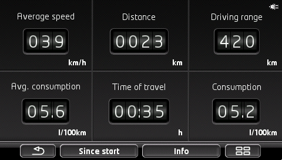
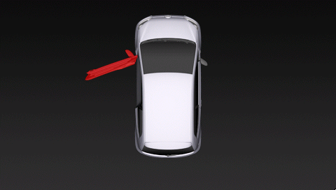

# Raw CAN messages forwarded by the radio — signal decoding (static RE)

What: bit-level layout of the 25 raw (non-BAP) CAN messages the radio forwards to the unit over the dock UART, plus the `0xF001` handshake fields.
Why: needed to (a) feed the unit from a simulated radio, (b) read the car from another device on the same dock, (c) re-write the UI.

Sources (ARM code, image base `0x10000`):

- `firmware/flash/VwUserShell/VwCommunicationExe.exe` = **VwCom**: one parser per message (raw frame → shared memory). VAs without prefix are VwCom.
- `firmware/flash/VwUserShell/VwUserShell.exe` = **Shell**: getters, scaling and UI use. VAs prefixed `S:`.
- Public PQ DBC (`commaai/opendbc`, `vw_pq.dbc`) for names only — always 🟡.

Legend: ✅ seen in disassembly/data (VA given) · ✅ emulator = observed running in the emulator (CE 7 guest, stubbed hardware; values written into the shared memory or sent by the simulated radio `emulator/radio.py`, §9) · 🟡 inferred / single source / public DBC · ❓ unknown. Nothing measured on a car.
Related: transport + handshake [car-link.md](car-link.md) §2–4 · where the decoded bytes live [shared-memory.md](shared-memory.md) §2.2 · change-notification ids [shared-memory.md](shared-memory.md) §4.3.

## 1. Conventions

- **Bit numbering** = DBC "Intel": bit `n` = bit `n % 8` (LSB = 0) of payload byte `n / 8`; `start` = LSB of the signal. Every multi-byte signal is little-endian ✅ (all parsers build `lo | hi << 8`).
- `byte N` = CAN data byte N (0-based) = serial payload byte N+2 ([car-link.md](car-link.md) §2).
- **DLC** = minimum length the parser accepts ✅; shorter frames are ignored, extra bytes ignored.
- **shm** = where the parser stores the signal in the message's `data[]` in `VwSharedMemoryFileMapping` (offsets of each message: [shared-memory.md](shared-memory.md) §2.2). `raw` = same byte/bit position as on CAN (the block is a copy of the payload, updated field by field); `d[i]` = repacked position.
- **Invalid**: listed values make the parser set the invalid bit of the signal's `data` byte instead of storing ✅ → readers see "no value". All data starts invalid.
- **id** = data id raised when the stored value changes ([shared-memory.md](shared-memory.md) §4). A parser stores/raises only on change or when the byte was invalid.
- **Slot** = offset of the getter in the shell's client interface vtable (`S:0x2fb880`, object from `S:0xad9b0`) ✅. It links a signal to its UI consumer (what each consumer does: [user-shell.md](../system/user-shell.md)).
- Raw frames are dropped until a valid `0xF001` arrived ✅ (`0x12604`). The unit never sends a raw CAN frame ✅.

## 2. Overview

| CAN id | Class | DLC | Parser | shm | Content | UI consumer |
|---|---|---|---|---|---|---|
| 0x35B | MessageGwMotor | 5 | 0x2ec7c | 4, repacked | engine speed, coolant temp, 2 engine flags | Tubes, ThinkBlue |
| 0x367 | MessageGwAnt1 | 8 | 0x25290 | 8, raw | longitudinal / lateral acceleration, 1 byte | Cupra Sport, ThinkBlue |
| 0x369 | MessageGwAnt2 | 6 | 0x2727c | 8, repacked | gear, recommended gear, lever position, alt. engine speed | Tubes (gear shift), ThinkBlue |
| 0x470 | MessageBsgKombi | 2 | 0x2d420 | 2, raw | doors, hood, boot, reverse light | Car (doors), OPS |
| 0x527 | MessageGwKombi | 6 | 0x2dda4 | 12, repacked | speed, outside temp, distance integrator | Trip, Tubes, speed-dependent logic |
| 0x529 | MessageMfa4 | 6 | 0x2afc8 | 6, raw | trip memory "since refuel" | Trip |
| 0x52D | MessageMfa6 | 8 | 0x2a37c | 9, raw + counter | electric range + 3 consumption parts | Trip / Electro |
| 0x52F | MessageMfa7 | 8 | 0x29534 | 8, raw | like Mfa6, 2nd memory | Trip / Electro |
| 0x532 | MessageMfa8 | 8 | 0x28ab0 | 8, raw | like Mfa6, 3rd memory | Trip / Electro |
| 0x555 | MessageMotor7 | 8 | 0x267c4 | 2, repacked | oil temp, boost pressure | Tubes |
| 0x571 | MessageBsg2 | 1 | 0x2ccb8 | 1, raw | 1 byte (🟡 battery voltage) | no caller found |
| 0x575 | MessageBsg3 | 1 | 0x2f084 | 1, raw | key-in (S contact), ignition (terminal 15) | everywhere ("I: on") |
| 0x591 | MessageZke4 | 3 | 0x26424 | 1, repacked | 1 central-locking bit | gate of the door overlay ([user-shell.md](../system/user-shell.md) §7.2) |
| 0x5AC | MessageHvem2 | 8 | 0x2553c | 8, raw | HV energy management (e-up!) | Electro |
| 0x5C1 | MessageMflTasten | 1 | 0x26ca8 | 7, repacked | steering-wheel key code → press counters | key handling |
| 0x61A | MessageMotorEv1 | 8 | 0x284fc | 8, raw | EV drive values (e-up!) | Electro, battery warning |
| 0x621 | MessageKombiK1 | 1 | 0x2cac8 | 1, raw | 2 cluster bits (bit 1 = low-fuel flag 🟡) | low-fuel prompt |
| 0x629 | MessageMfa1 | 7 (8) | 0x2c518 | 8, raw | current consumption, range, odometer, 2nd range | Trip, ThinkBlue |
| 0x62B | MessageMfa2 | 8 | 0x2bd24 | 8, raw | trip memory "since start" | Trip |
| 0x62D | MessageMfa3 | 8 | 0x2b69c | 8, raw | trip memory "long-term" | Trip |
| 0x651 | MessageSysteminfo1 | 4 | 0x2cfb8 | 3, repacked | vehicle class / brand / derivative, RHD, 4-door | brand, doors |
| 0x653 | MessageGateway3 | 3 (4) | 0x27a8c | 6, repacked | 6-bit code, 1 byte, flags | settings / locale |
| 0x65F | MessageFzgIdent | 8 | 0x2e27c | 17, repacked | VIN (3-frame mux) | 🟡 ThinkBlue storage; **not** branding or the home-car check (both use the F001 VIN, [brand-and-pairing.md](../system/brand-and-pairing.md) §3) |
| 0x668 | MessageReichweite1 | 8 | 0x26000 | 7, repacked | 3 ranges + unit | Trip (hybrid) |
| 0x669 | MessageReichweite2 | 8 | 0x25c14 | 5, repacked | 2 ranges + unit | Trip (hybrid) |
| 0xF001 | MessageRadioInit | 0x36 (0x39) | 0x28330 | 20, repacked | handshake, VIN, fuel type, line / sound-system flags | branding, home-car check, fuel type |

Class names ✅ (ASCII block-name strings from which the mutex names are built, [shared-memory.md](shared-memory.md) §3; the binary has no RTTI); they equal VW PQ message names (`mGW_Motor`, `mMFA_1`, `mBSG_Kombi`, …). Only `BSG_Kombi` (same id 0x470) is in the public DBC; `Systeminfo_1`, `Motor_7`, `Kombi_2`, `BSG_3` exist there under other (powertrain-bus) ids with matching layouts — see §5.

## 3. Per-message signals

### 3.1 0x35B GwMotor ✅ `0x2ec7c`

Parser keeps bytes 1…4 (mask `0x1E`).

| Signal | start | len | Scale, offset | Unit | Invalid | shm | id | Slot / use |
|---|---|---|---|---|---|---|---|---|
| EngineSpeed | 8 | 16 | 0.25 ✅ emulator (see below) | rpm | – | `d[0..1]`, filtered | 2 | 0x10: Tubes RPM, ThinkBlue |
| CoolantTemp | 24 | 8 | 0.75, −48 ✅ `0x2eb14`, ✅ emulator | °C | 0xFF | `d[2]` | 25 | 0x18 (°C), 0x1C (°F): Tubes coolant |
| CoolantCurveSel | 38 | 1 | – | – | – | `d[3]` bit 6 | 25 | selects gauge curve |
| EngineFlag35 | 35 | 1 | – | – | – | `d[3]` bit 3 | 28 | 0x20: ThinkBlue `S:0x3c324` |
| EngineFlag32 | 32 | 1 | – | – | – | `d[3]` bit 0 | 29 | 0x24: ThinkBlue state machine (6 callers) |

- EngineSpeed filter ✅ (`0x2edb0…0x2ee58`): if a value is stored and `|new − old| < 200` raw → ignored. Else stored = `0.3·new + 0.7·old` (doubles `0x5ee3c`, `0x5ee34`); if that equals `old`, step ±1 toward `new`. The shared value lags the bus.
- Slot 0x10 ✅ (`S:0xade44`): returns `3 × GwAnt2.EngineSpeed12` (§3.3) if that is valid, else this value. Both are used without further scaling as "rpm vs. gauge maximum" (`S:0x906b4`: `value·100 / max`).
- Scale ✅ emulator: **0.25 rpm/bit** on the shell's RPM gauge (stored 3000 → needle at 750, 6464 → ~1600, 16000 → 4000; no GwAnt2 value present). It is the PQ convention (`Motor_1.Motordrehzahl`). What the ×3 of GwAnt2.EngineSpeed12 then means (12 bit × 3 × 0.25 → 0…3071 rpm) ❓. The gauge maximum comes from UI layout data (property 0x66, not traced).
- EngineFlag32 / 35: used by the ThinkBlue driving-state logic (state names in the shell: `OVERRUN FUEL CUTOFF…`, `FREE WHEEL WITH CLUTCH…`, `…WITH BRAKE`) 🟡 → overrun cut-off / clutch; which is which ❓.
- Coolant gauge linearisation ✅ (`0x2e3ec`, CoolantCurveSel = 0; floats at `0x5edd0…0x5edf0`): `≤ 50 → 50`; `50…75 → 1.6·t − 30`; `75…107 → 90` (plateau); `107…124 → 2·t − 124`; `124…130 → t`; `> 130 → 130`. `CoolantCurveSel = 1` → second curve (`0x2e4fc`, plateau up to 115). °F variants `0x2e604` / `0x2e738` (122…266). This mimics the cluster needle; the true temperature is `0.75·x − 48`. ✅ emulator: raw `0xB8` (90 °C) → needle at 90, `0xE0` (120 °C) → ~116, `0x88` (54 °C) → ~56.

### 3.2 0x367 GwAnt1 ✅ `0x25290`

| Signal | start | len | Scale, offset | Unit | Invalid | shm | id | Slot / use |
|---|---|---|---|---|---|---|---|---|
| Ant1_Byte2 | 16 | 8 | raw | ❓ | – | raw | 37 | 0x1C4: `S:0x68a34` |
| LatAccel 🟡 | 32 | 8 | 0.01, −1.27 ✅ `S:0xaf158` | g 🟡 | 0xFF, or LatAccel_Err | raw | 36 | 0x1C0: Cupra Sport, `S:0x2e95c` |
| LongAccel 🟡 | 40 | 10 | 0.03125, −16 ✅ `S:0xaf0c0` | m/s² 🟡 | 0, 0x3FF, or LongAccel_Err | raw | 36 | 0x1BC: same callers |
| LatAccel_Err | 50 | 1 | – | – | – | not stored | – | |
| LongAccel_Err | 51 | 1 | – | – | – | not stored | – | |

Names 🟡: scale pairs equal PQ `Querbeschleunigung` (0.01 g, −1.27) and `Laengsbeschleunigung` (0.03125 m/s², −16); the shell has a ` m/s^2` label.

### 3.3 0x369 GwAnt2 ✅ `0x2727c`

| Signal | start | len | Meaning ✅ parser / 🟡 name |
|---|---|---|---|
| Gear_Err | 0 | 1 | 1 → `d[1..4]` invalidated |
| EngineSpeed12_Err | 1 | 1 | 1 → EngineSpeed12 invalid |
| EngagedGear_Valid | 6 | 1 | gates the "engaged gear" update (type 0xF) |
| Display_Valid | 7 | 1 | gates display-type updates |
| Source | 8 | 1 | 1 = values from engine ECU ("MSG", manual gearbox), 0 = from gearbox ECU ("GSG") ✅ debug text `S:0x70714` |
| AltSet | 9 | 1 | Source = 1 only: 0 → use nibbles of byte 2, 1 → use nibbles of byte 5 |
| DispType / CurGear | 16 | 4 | Source 1: current gear. Source 0: display type (table below) |
| DispValue / RecGear | 20 | 4 | Source 1: recommended gear. Source 0: lever position / gear |
| EngagedGear | 24 | 4 | Source 0 and DispType = 0xF: gear = value − 1 for 2…10, else 0 |
| EngineSpeed12 | 28 | 12 | ×3 → same unit as GwMotor.EngineSpeed; invalid 0xFFF; `d[6..7]`; id 2 |
| CurGear_Alt / RecGear_Alt | 40 / 44 | 4 | used when AltSet = 1 |

Stored struct (id 7):

| shm | Content | Slot |
|---|---|---|
| `d[1]` bit 0 / bit 1 | Source / AltSet | 0x28 / 0x3C |
| `d[2]` | Source 1: `0x10`. Source 0: DispType (or 10) | 0x38 |
| `d[3]` | Source 1: current gear. Source 0: engaged gear (DispType 0xF) | 0x2C |
| `d[4]` | Source 1: recommended gear. Source 0, DispType 0xA: DispValue − 1 (2…10 → 1…9) | 0x30 |
| `d[5]` | Source 0, other DispType: DispValue (lever position) | 0x34 (with `d[2]`) |
| `d[6..7]` | EngineSpeed12 | 0x10, 0x14 |

- Display types ✅ (debug text `S:0x70a58`): 0 `5-Gang`, 1 `PRND`, 2 `4-Gang`, 3 `ASG`, 6 `PRNDS`, 8/9/0xC/0xD `Tiptronic 4/5/6/7-Gang`, 0xF `Eingelegter Gang`.
- Lever position ✅ (`0x26f74`, slot 0x34): `(type, value) → code`: type 1: 2…6 → 2…6; type 3: 2 → 7, 3…5 → 3…5; type 6: 2…5 → 2…5, 6 → 7. Meaning of codes 2…7 ❓ (🟡 P/R/N/D/S/manual).
- Settings `Car/Gear` (`UserSettingsCar.default`) and `GearBoxType` are separate, persisted values.

### 3.4 0x470 BsgKombi ✅ `0x2d420`

| Signal | start | len | id | Slot / use | DBC `BSG_Kombi` 🟡 |
|---|---|---|---|---|---|
| ReverseLight | 5 | 1 | – | 0x84: `S:0x36150` | `Rueckfahrlicht` |
| DoorDriver | 8 | 1 | 1 | 0x88, 0x90/0x94 | `Fahrertuer_geoeffnet` |
| DoorPassenger | 9 | 1 | 1 | 0x8C, 0x90/0x94 | `Beifahrertuer_geoeffnet` |
| DoorRearLeft | 10 | 1 | 1 | 0x98 | `Tuer_hinten_links_geoeffnet` |
| DoorRearRight | 11 | 1 | 1 | 0x9C | `Tuer_hinten_rechts_geoeffnet` |
| Hood | 12 | 1 | 1 | 0xA4 | `Motorhaube_geoeffnet` |
| Boot | 13 | 1 | 1 | 0xA0 | `Heckdeckel_geoeffnet` |

✅ emulator: byte 1 = `01` driver (left) door, `22` passenger door + boot, `14` hood drawn in the shell's car outline (3-door picture, so no rear doors); the overlay needs the Zke4 bit and a started navigation ([user-shell.md](../system/user-shell.md) §7.2).
Stored raw. Slots 0x90 / 0x94 ✅ (`S:0xae3e8`, `S:0xae51c`) = front-left / front-right door: they swap DoorDriver and DoorPassenger when `Systeminfo1.RightHandDrive` = 1 → confirms bits 8/9 and the RHD flag. Callers `S:0x1edfc`, `S:0x5f874` (door picture; `doors` / `doors_cupra` controls).

### 3.5 0x527 GwKombi ✅ `0x2dda4`

Parser keeps bytes 0, 1, 2, 5 (mask `0x27`).

| Signal | start | len | Scale, offset | Unit | Invalid | shm | id | Slot / use |
|---|---|---|---|---|---|---|---|---|
| OutsideTemp_Err | 1 | 1 | – | – | – | `d[0]` bit 1 (debounced) | 22 | – |
| Speed_Err | 2 | 1 | – | – | – | `d[0]` bit 2 | 145, 21 | – |
| Speed | 9 | 15 | 0.01 ✅, ✅ emulator (stored 50.00 / 100.00 / 150.00 km/h → AppCom message 11013 carries 5000 / 10000 / 15000) | km/h | Speed_Err = 1 | `d[1..2]`, same bit position | 145, 21 | 0x74 (19 callers) |
| OutsideTemp | 40 | 8 | 0.5, −50 ✅ `0x2da4c`, ✅ emulator (`0x8C` → 20, `0x50` → −10, `0x96` → 25.0 °C on gauge, status bar and in message 34) | °C | 0xFF; getter also rejects 0 | `d[3]` | 22 | 0x7C: Tubes, status bar; 0x80 = "raw ≠ 0" |

- Speed scale ✅: `UserSettingsTrip.default` compares the value with `VelocityRange` "in km/h * 100"; DBC `Kombi_1.Geschwindigkeit` is the same 15-bit 0.01 km/h format 🟡.
- Distance integrator ✅ (`0x2dc4c`): each frame with Speed_Err = 0 adds raw Speed to a 64-bit sum in `d[4..11]`; getter (`0x2dbe0`, slot 0x78, 17 call sites: Cupra chrono, ThinkBlue) returns `sum × 0.000555556` (double `0x5ed94` = 1/1800). 0.01 km/h × 0.2 s = 1/1800 m → **metres, assuming one frame every 200 ms** 🟡. A simulator with another period makes distances wrong.
- Temperature error debounce ✅ (`0x2df10…`): with OutsideTemp_Err set, a counter (`d[0]` bits 4…7) counts frames; the stored error bit is set after 4 consecutive frames; before that the last temperature stays.

### 3.6 Trip computer: MFA family ✅

Pattern: value + one-hot **unit flags**; a value is stored only if exactly one flag is set (Mfa6: at most one) and it is not an invalid marker. All stored raw.

**0x629 Mfa1** `0x2c518` (DLC 7, byte 7 optional), id 14:

| Signal | start | len | Unit flags | Invalid | Slot / use |
|---|---|---|---|---|---|
| CurConsumption | 0 | 12 | – | 0xFFF | 0xF4: Trip, ThinkBlue. 0xFFE = overflow: passed on as 0xFFD only for unit codes 2, 4, 7 (`0x2c468`) |
| CurConsumption_Unit | 12 | 4 | – | – | 0x104 (codes ✅ emulator, below) |
| Range | 16 | 14 | 30, 31 | 0x3FFF, 0x3FFE | 0x10C: range (fuel types 1…4) |
| Odometer 🟡 | 32 | 22 | 54, 55 | 0x3FFF | 0x118: distance field in trip mode `0x3E81` |
| Range2 | 56 | 8 | – | 0xFE, 0xFF | 0x124: secondary-fuel range (CNG/LPG): primary = Range − Range2 ✅ `S:0xc3520` |

**0x62B Mfa2** `0x2bd24` (id 15), **0x62D Mfa3** `0x2b69c` (id 16), DLC 8, identical layout:

| Signal | start | len | Unit flags | Invalid | Slot (Mfa2 / Mfa3) |
|---|---|---|---|---|---|
| AvgConsumption | 0 | 12 | – | 0xFFF, 0xFFE | 0x128 / 0x158 |
| AvgConsumption_Unit | 12 | 4 | – | – | 0x138 / 0x168 |
| Distance | 16 | 14 | 30, 31 | 0x3FFF | 0x13C / 0x16C |
| DrivingTime | 32 | 14 | – | 0x3FFF | 0x148 / 0x178; minutes ✅ (shown as h:mm, `S:0x8f4d4`) |
| AvgSpeed | 48 | 14 | 62, 63 | 0x3FFF, 0x3FFE | 0x14C / 0x17C |

**0x529 Mfa4** `0x2afc8` (DLC 6, no id raised):

| Signal | start | len | Unit flags | Invalid | Slot |
|---|---|---|---|---|---|
| AvgConsumption | 0 | 12 | 12, 13, 14 (+ free bit 15) | 0xFFF, 0xFFE | 0x188 |
| Distance | 16 | 14 | 30, 31 | 0x3FFF | 0x19C |
| AvgSpeed | 32 | 14 | 46, 47 | 0x3FFF, 0x3FFE | 0x1A8 |

**0x52D Mfa6** `0x2a37c` (id 18), **0x52F Mfa7** `0x29534` (id 19), **0x532 Mfa8** `0x28ab0` (id 20), DLC 8:

| Signal | start | len | Unit flags | Invalid | Slot (Mfa6) / use |
|---|---|---|---|---|---|
| ERange | 0 | 14 | 14, 15 | Mfa6: 0x3FFF, 0x3FFE | 0x30C: range for fuel type 5 (electric) |
| ConsA | 16 | 12 | 28, 29, 30 | 0xFFF, 0xFFE | 0x318 |
| ConsB | 32 | 12 | 44, 45, 46 | 0xFFF, 0xFFE | 0x32C |
| ConsC | 48 | 12 | 60, 61, 62 | 0xFFF, 0xFFE | 0x340 |

- Mfa6 keeps a saturating frame counter in shm `d[8]` ✅ (`0x2a31c`).
- Electric consumption ✅ (`S:0x3539c`, `S:0xa721c`): `ConsA + ConsB − ConsC`; for unit codes `0x12` / `0x14` the same on reciprocals (`1 / (1/A + 1/B − 1/C)`). 🟡 drive + auxiliaries − recuperation.
- Unit code of a 3-flag field ✅ (`0x29444`…): `0x10 + flags` → `0x11`, `0x12`, `0x14`. 🟡 kWh/100 km, km/kWh, mi/kWh (the two reciprocal ones are 0x12, 0x14).
- Mfa7 / Mfa8 are read with the same getters when the trip mode is `0x3E82` / `0x3E83` (`S:0x4515c`, `S:0x8d97c`).

Trip modes ✅ (`S:0x8eba4`, `S:0x8ac2c`, `S:0x8c150`): UI code `0x3E81` → Mfa1 (+ Mfa6), `0x3E82` → Mfa2 (+ Mfa7), `0x3E83` → Mfa3 (+ Mfa8), `0x3E84` → Mfa4. Setting `ActiveTrip`: "0 = gesamt, 1 = trip, 2 = seit Tanken" → 🟡 Mfa3 = long-term, Mfa2 = since start, Mfa4 = since refuel.
2-flag unit fields ✅ emulator: first flag (lower bit) = km, km/h; second flag = mi, mph (`S:0x8ae00`).
Consumption unit code (4 bits, Mfa1 / Mfa2 / Mfa3) ✅ emulator, as labelled by the trip computer: `1` l/100km · `2` km/l · `4` mpg · `5` kg/100km · `6` kg/h · `7` mpkg · `8` l/h (current consumption only; the average shows no value) · `0`, `3` no value. Codes above 8 not tried. The three "distance per fuel" codes 2, 4, 7 are the ones with the overflow rule above.
Trip modes ✅ emulator: the screen lists "Since start" = Mfa2 and "Long term" = Mfa3 (average speed, distance, time, average consumption) and always takes range and current consumption from Mfa1; "since refuel" (Mfa4) was not offered for the emulated petrol car.
Scale of consumption values ✅: tenths of the unit (`UserSettingsTrip.default`: "consumption in l/100km * 10"). Distance, range, speed, time: shown as integers.

### 3.7 0x555 Motor7 ✅ `0x267c4`

Parser keeps bytes 0, 4, 7 (mask `0x91`).

| Signal | start | len | Scale, offset | Unit | Invalid | shm | id | Slot / use |
|---|---|---|---|---|---|---|---|---|
| OilTemp_Err | 4 | 1 | – | – | – | not stored | – | |
| BoostPressure | 32 | 8 | 0.02 ✅ `S:0xaf03c` | bar 🟡 | 0xFF | `d[1]` | 35 | 0x1B8: Cupra `BoostPressure` tube (bar / psi) |
| OilTemp | 56 | 8 | 1, −60 ✅ `0x26758` / `S:0xb92a4` | °C | 0xFF, 0, 1, or OilTemp_Err | `d[0]` | 24 | 0x1B4: Tubes oil temp |

Oil gauge linearisation ✅ (`0x264f8`): clamp 50…150, plateau at 100 between 80 and 120, slope 5/3 outside.

### 3.8 Small body / cluster messages ✅

| Msg | Signal | start | len | Invalid | shm | id | Slot / use | Name source |
|---|---|---|---|---|---|---|---|---|
| 0x571 Bsg2 `0x2ccb8` | Bsg2_Byte0 | 0 | 8 | 0xFF | raw | 23 | 0xE8, no caller found | 🟡 battery voltage `5 + 0.05·x` V (PQ convention) |
| 0x575 Bsg3 `0x2f084` | KeyIn (terminal S) | 0 | 1 | – | raw | 4 | 0x08: `S:0x97d44`, `S:0xcd528` | 🟡 DBC `BSG_3` |
| 0x575 Bsg3 | Ignition (terminal 15) | 1 | 1 | – | raw | 3 | 0x0C: 19 callers | ✅ debug text `I: on` / `I: off` (`S:0x7087c`) |
| 0x591 Zke4 `0x26424` | Zke4_Bit19 | 19 | 1 | – | `d[0]` bit 3 | – | 0xC8: `S:0xcb9f8` | 🟡 central-locking state (setting `IgnoreCentralLocking`); ✅ use: the door overlay is shown only while it is set ([user-shell.md](../system/user-shell.md) §7.2) |
| 0x621 KombiK1 `0x2cac8` | K1_Bit1 | 1 | 1 | – | raw | 8 | 0xEC: `S:0x15038` | ✅ use: sets the shell's low-fuel flag `P_FE` and AppCom msg 18 → navigation offers the filling-station search ([user-shell.md](../system/user-shell.md) §4, §6; [navigation.md](../system/navigation.md) §8.1); name "low fuel" 🟡 |
| 0x621 KombiK1 | K1_Bit2 | 2 | 1 | – | raw | – | 0xF0, no caller found | ❓ |

Bsg3 is the only raw message that is invalidated on link loss / suspend ([shared-memory.md](shared-memory.md) §2.2). Bsg3 id 3 also triggers an AppCom broadcast in the shell (msg 19 with value 0, [user-shell.md](../system/user-shell.md) §3.1); ignition and key contact drive the standby rules ([user-shell.md](../system/user-shell.md) §5.1).

### 3.9 0x5AC Hvem2 ✅ `0x2553c` (e-up!)

| Signal | start | len | Invalid | Slot / use |
|---|---|---|---|---|
| Hv_Val12 | 0 | 12 | 0xFFE, 0xFFF | – |
| Hv_Val3 | 12 | 3 | 6, 7 | – |
| Hv_Power 🟡 | 15 | 9 | 0x1FE, 0x1FF | 0x3E0 ✅ ×50 (`S:0xb39ac`), Electro `S:0x18654` |
| Hv_Byte3 | 24 | 8 | 0xFE, 0xFF | – |
| Hv_Val11 | 32 | 11 | 0x7FD…0x7FF | – |
| Hv_Val2 | 49 | 2 | 2, 3 | – |
| Hv_Val5 | 51 | 5 | 0x1E, 0x1F | – |
| Hv_Bit63 | 63 | 1 | – | – |

Stored raw, id 34. Only Hv_Power has a getter in the shell; the other fields are parsed but unused.

### 3.10 0x5C1 MflTasten ✅ `0x26ca8`

Byte 0 = key code; DLC 1. The radio is expected to repeat the code while the key is held and send another code (🟡 0) on release.

| Code | Effect ✅ | id | Name |
|---|---|---|---|
| 0x02 | `d[1]` += 1 | – (79 on long press) | 🟡 right arrow (ini key `UseRightArrowAsPhoneButton` sets the phone code to 2, [shared-memory.md](shared-memory.md) §6.5) |
| 0x03 | `d[2]` += 1 | – (79 on long press) | 🟡 left arrow |
| 0x32 | `d[3]` += 1 | 79 | ❓ |
| 0x1A | `d[4]` += 1 | 31 | 🟡 phone key (default phone code, ctor `0x269e4`) |
| = `d[5]` (if ≠ 0x1A) | additionally `d[4]` += 1 | 31 | configurable phone key (slot 0x308 → `0x26980`) |
| other (incl. 0) | counters unchanged | 79 | release / unknown key |

Stored struct: `d[0]` last code, `d[1..4]` press counters, `d[5]` phone-key code, `d[6]` repeat counter.

- Repeat ✅ (`0x26a9c`): same code as the previous frame → `d[6]`++ (only 0x02 / 0x03 keep counting). When `d[6]` exceeds 5, counters that are non-zero become `0xFF` = **long press**, id 79 raised.
- New code after a long press (`d[6]` > 4) also turns non-zero counters into `0xFF`; otherwise counters saturate at 0xFF.
- Readers ✅: slot 0x1C8 (`S:0xb02e4`) returns `d[1], d[2], d[3]`, slot 0x1CC (`S:0xb036c`) returns `d[4]`; both can clear what they read (read-and-reset). So the UI sees "n presses" or "long press" per key, not key-down / key-up.
- Volume keys etc. are not handled here (🟡 the radio handles them itself).
- Consumers ✅: id 31 (phone key) → the shell relays it as AppCom msg 42 to the phone app ([user-shell.md](../system/user-shell.md) §5.2); id 79 (arrows) → MediaPlayer, next / previous / fast forward for its local sources ([media-audio.md](../system/media-audio.md) §8.4).

### 3.11 0x61A MotorEv1 ✅ `0x284fc` (e-up!)

| Signal | start | len | Scale | id | Slot / use |
|---|---|---|---|---|---|
| Ev_Bit13 | 13 | 1 | – | 26 | – |
| Ev_Bit14 | 14 | 1 | – | 26, 27 | 0x3DC: `S:0x149e8` (battery warning) |
| Ev_Val2 | 24 | 2 | – | 26 | – |
| Ev_Val3a | 28 | 3 | – | 26 | 0x1DC: `S:0x3b94c` (ThinkBlue) |
| Ev_Val3b | 44 | 3 | – | 26 | 0x3D4, 0x3D8 |
| Ev_Val9 | 47 | 9 | 0.1 ✅ `S:0xb3788` | 26 | 0x3CC: Electro `S:0x1890c` (then × 3600) |
| Ev_Soc 🟡 | 56 | 8 | 0.5 ✅ `S:0xb380c` | 26 | 0x3D0: compared with `BatteryWarningThresholds` (default 25) → 🟡 state of charge % |

Stored raw; no invalid markers.

### 3.12 0x651 Systeminfo1 ✅ `0x2cfb8`

Parser keeps bytes 1, 2, 3 (mask `0x0E`). id 13.

| Signal | start | len | shm | Slot / use | DBC `Systeminfo_1` 🟡 |
|---|---|---|---|---|---|
| VehicleClass | 8 | 4 | `d[0]` low | 0xA8 | `Fahrzeug_Klasse` (✅ branding list: 0 `A000 (XL1)`, 1 `A00 (up, mii, citygo)`, 2 `A0 (Polo, Ibiza, Fabia)` — [brand-and-pairing.md](../system/brand-and-pairing.md) §2) |
| VehicleBrand | 12 | 4 | `d[0]` high | 0xAC | `Fahrzeug_Marke_2` (🟡 0 VW, 1 Audi, 2 Seat, 3 Skoda, 4 VWN: order of the shell's debug list `S:0x5b618`) |
| VehicleDerivative | 16 | 4 | `d[1]` low | 0xB0: `S:0x54bb8`, BAP code | `Fahrzeug_Derivat` = body type stored at branding (0 Kurzheck … 9 Sonstige, [brand-and-pairing.md](../system/brand-and-pairing.md) §2) |
| VehicleGeneration | 20 | 4 | `d[1]` high | no getter | `Fahrzeug_Generation` |
| RightHandDrive | 28 | 1 | `d[2]` bit 4 | 0x90 / 0x94 (door swap) ✅ | `Rechtslenker` |
| FourDoor | 29 | 1 | `d[2]` bit 5 | 0xC4 | `Viertuerer` |

### 3.13 0x653 Gateway3 ✅ `0x27a8c`

| Signal | start | len | Note | shm | Slot |
|---|---|---|---|---|---|
| Gw3_Code6 | 0 | 6 | accepted only if bit 7 = 1 and bit 6 = 0, else all bytes invalidated | raw | 0x40 / 0x44 (validity only) |
| Gw3_Byte1 | 8 | 8 | | raw | – |
| Gw3_Bit21 | 21 | 1 | accepted only if bit 23 = 1 and bit 22 = 0 | raw | 0x48: `S:0xcd3fc` |
| Gw3_Bit24 | 24 | 1 | only if DLC ≥ 4 | `d[3]` bit 0 | 0x4C |
| Gw3_Bit25, Gw3_Bit26 | 25, 26 | 1 | only if DLC ≥ 4 | `d[3]` bits 1, 2 | – |

id 30. shm `d[4]` = frames seen (1…3), `d[5]` = bits 24…26 latched during the first three frames ✅ (`0x27d60`). Meaning ❓ (🟡 PQ `mGateway_3`: country / language / unit variant).

### 3.14 0x65F FzgIdent ✅ `0x2e27c`

| Signal | start | len | Note |
|---|---|---|---|
| Mux | 0 | 2 | 0, 1, 2 (3 ignored) |
| VIN[0..2] | 40 | 24 | mux 0: bytes 5…7 |
| VIN[3..9] | 8 | 56 | mux 1: bytes 1…7 |
| VIN[10..16] | 8 | 56 | mux 2: bytes 1…7 |

ASCII, byte order = string order. Parts are collected in a staging buffer (`0x2e1ac`); when all three were seen, the 17 characters are copied to shm `d[0..16]` if different or still invalid, and all invalid bits cleared ✅ (`0x2e330`). No id raised; the staging "seen" mask is never reset. Constructor fills `d` with `0x88`.

### 3.15 0x668 Reichweite1 ✅ `0x26000`, 0x669 Reichweite2 ✅ `0x25c14`

| Msg | Signal | start | len | Invalid | shm | id | Slot / use (fuel type 6) |
|---|---|---|---|---|---|---|---|
| 0x668 | Rw1_Total | 29 | 11 | 0x7FD…0x7FF | `d[0..1]` | 32 | 0x1D0: total range `S:0xc3418` |
| 0x668 | Rw1_B | 40 | 11 | 0x7FF | `d[2..3]` | 32 | no getter |
| 0x668 | Rw1_Unit | 51 | 2 | – | `d[4]` | 32 | no getter |
| 0x668 | Rw1_Primary | 53 | 11 | 0x7FD…0x7FF | `d[5..6]` | 32 | 0x1D4: primary range `S:0xc3520` |
| 0x669 | Rw2_Secondary | 40 | 11 | 0x7FD…0x7FF | `d[3..4]` | 33 | 0x1D8: secondary range `S:0xc36f8` |
| 0x669 | Rw2_Unit | 51 | 2 | – | `d[2]` | 33 | no getter |
| 0x669 | Rw2_C | 53 | 11 | 0x7FD | `d[0..1]` | 33 | no getter |

Ranges are used as integers (🟡 km or miles per the unit field; the shell takes the unit from Mfa1 / Mfa6 flags instead).

### 3.16 0xF001 RadioInit ✅ `0x28330` (not CAN; extends [car-link.md](car-link.md) §3)

| Payload offset | len | Content | shm |
|---|---|---|---|
| 0x00 | 35 | `VW BCR copyright 2009 Volkswagen AG` (compared with `0x5d0c4`) | – |
| 0x23 | 1 | version major, must be 1 | – |
| 0x24 | 1 | version minor, must be 0 | – |
| 0x25 | 17 | the car's **VIN**, ASCII (slot 0x50) ✅ — branding stores it, shell and navigon compare it with the stored one ([brand-and-pairing.md](../system/brand-and-pairing.md) §3, §6.1). Not a "radio id"; the shell's `Navigon Mambo Kurt Radio` string is an unused test command, unrelated | `d[0..16]`, id 11 |
| 0x36 | 1 | FuelTypeFlags (only if length ≥ 0x39) | `d[0x11]` |
| 0x37 | 1 | line bits + sound-system flag (only if length ≥ 0x39) | `d[0x12]` |

- Text or version wrong → invalid bit 0 set (handshake not accepted; raw CAN frames stay dropped). F002 does not depend on it: the unit sends F002 unsolicited at link-up and repeats it up to 6 times while no valid F001 arrived ([shared-memory.md](shared-memory.md) §6.1, §6.3).
- **FuelTypeFlags** ✅ one-hot → fuel type (`0x27f04`, slot 0xE0 `S:0xb08d8`): `0x01 → 1`, `0x02 → 2`, `0x04 → 3`, `0x08 → 5`, `0x10 → 6`; anything else = no value, then the shell derives the type from its vehicle-info store. Fuel type enum ✅ (`S:0xad5a4` + debug texts `S:0x5b7a0…`): 1 petrol, 2 diesel, 3 CNG, 4 LPG, 5 electric, 6 hybrid (electric + other).
- Byte 0x37 ✅ (`0x27f64`, `0x28244`): bit 6 (`0x40`) = boolean (slots 0xBC/0xC0) = **sound system present** ("Fender" screens); other bits one-hot → `0x01 → 0 … 0x20 → 5` (slots 0xB4/0xB8) = **equipment line**, 1 (`0x02`) = Cupra — meanings ✅ from the branding program ([brand-and-pairing.md](../system/brand-and-pairing.md) §3); line codes 2…5 ❓. Callers `S:0xc93a8`, `S:0xcae30` (BAP/audio code).

Fuel type selects the range source ✅ (`S:0xc3418`, `S:0xc3520`, `S:0xc36f8`): 1, 2 → Mfa1.Range; 3, 4 → Mfa1.Range / Range2; 5 → Mfa6.ERange; 6 → Reichweite1 / 2.

## 4. Validity and timing ✅

- No receive timeout per message, no timestamps: values stay until overwritten. Only the handshake and Bsg3 are invalidated on link loss / suspend ([shared-memory.md](shared-memory.md) §2.2).
- Cycle-time assumptions baked into the code: GwKombi 200 ms (distance integrator, §3.5) 🟡; MFL long press = 6 identical frames in a row (§3.10).
- Filters: EngineSpeed low-pass + dead band (§3.1); outside-temp error debounce of 4 frames (§3.5); Gateway3 latches its first 3 frames (§3.13); FzgIdent needs all 3 mux frames (§3.14).

## 5. Cross-check with the public PQ DBC 🟡

`vw_pq.dbc` (opendbc) covers the PQ35/46 powertrain bus. The radio forwards gateway/infotainment-bus messages, so only layouts can be compared.

| Our message | DBC message | Result |
|---|---|---|
| 0x470 BsgKombi | `BSG_Kombi` 0x470 | **agrees**: door/hood/boot bits 8…13, reverse light bit 5 |
| 0x651 Systeminfo1 | `Systeminfo_1` 0x5D0 | **agrees** bit for bit (class 8, brand 12, derivative 16, generation 20, RHD 28, 4-door 29) |
| 0x555 Motor7 | `Motor_7` 0x588 | positions agree (boost 32, oil temp 56); **differs**: boost scale 0.02 here vs 0.01 in DBC; bit 4 is "free" in DBC, an oil-temp error flag here |
| 0x35B GwMotor | `Motor_2` coolant, `Motor_1` rpm | coolant scale agrees (0.75, −48); rpm 0.25 in DBC, unknown here |
| 0x527 GwKombi | `Kombi_1` speed, `Kombi_2` outside temp | scales agree (0.01 km/h 15 bit; 0.5, −50) |
| 0x555 oil temp | `Kombi_2.Oeltemperatur` | agrees (1, −60) |
| 0x575 Bsg3 | `BSG_3` (terminal bits) | bit 1 = terminal 15 agrees |
| 0x367 GwAnt1 | PQ acceleration signals | scale pairs agree (0.01/−1.27, 0.03125/−16); positions not comparable |
| MFA, Reichweite, GwAnt2, Gateway3, MFL, Hvem2, MotorEv1, FzgIdent, KombiK1, Zke4, Bsg2 | not in the public DBC | no check possible |

## 6. Open questions

1. EngineSpeed unit: answered, 0.25 rpm/bit (§3.1). Open: what EngineSpeed12 × 3 is on combustion cars.
2. Consumption unit codes and km / miles flag order: answered for codes 0…8 (§3.6). Open: codes 9…15, electric unit codes on the screen.
3. Meaning of EngineFlag32/35, KombiK1 bit 2, exact Zke4 bit 19 semantics, Bsg2 byte, Gateway3 fields, Ant1_Byte2, F001 line codes 2…5, MFL code 0x32, lever-position codes 2…7.
4. e-up! fields: Hvem2 (all but one unused), MotorEv1 names and units, Mfa6/7/8 component names.
5. Real cycle times and whether the radio sends a release code (0) after MFL keys — needs a capture ([car-link.md](car-link.md) §8).
6. Whether the radio forwards every message on every car (e.g. Hvem2 / MotorEv1 only on e-up!, Motor7 boost only on turbo engines).

## 7. How to reimplement / interoperate

Reading (other device on the dock): after the F001/F002 handshake, parse `id(LE16) + data` frames with the table in §8; treat a signal as absent when it carries an invalid marker or its error flag; apply the filters of §4 only if you want the unit's exact behaviour.

Radio simulator — minimum set to light up the UI. `emulator/radio.py` ✅ emulator sends the rows marked ●, with values from its command line:

| Send | Content | Period 🟡 (no timeout in the binary) |
|---|---|---|
| ● 0xF001 | copyright text, `01 00`, 17-byte VIN (not all characters equal), FuelTypeFlags, line / sound byte, total ≥ 0x39 bytes ([brand-and-pairing.md](../system/brand-and-pairing.md) §7) | once at start; again after link restart |
| ● 0x575 | `02` (ignition on) or `03` | 100…200 ms; needed first: most screens check slot 0x0C |
| ● 0x35B | `00 lo hi temp flags` | 100 ms |
| ● 0x527 | `00 lo hi 00 00 temp` with speed `<< 1` in bytes 1…2 | **200 ms** (distance maths) |
| ● 0x555 | byte 0 = 0, byte 4 = boost, byte 7 = oil + 60 | 200 ms…1 s |
| 0x369 | byte 0 = `0x80`, byte 1 = `0x01`, byte 2 = `rec << 4 \| cur`, bytes 3…4 = `F0 FF` (no EngineSpeed12) | 100…200 ms |
| ● 0x470 | byte 1 = door bits | on change + 1 s |
| ● 0x651 | byte 1 = brand/class, byte 2 = derivative, byte 3 = RHD/4-door | 1 s |
| ● 0x65F | 3 mux frames with the VIN | 1 s |
| ● 0x629, ● 0x62B, ● 0x62D, 0x529 | trip values with exactly one unit flag per field | 1 s |
| 0x5C1 | key code while pressed, then `00` | 100 ms while pressed (6 repeats = long press) |
| 0x653, ● 0x621, 0x571, ● 0x591 | optional (0x591 bit 19 is needed for the door overlay) | 1 s |
| 0x52D, 0x52F, 0x532, 0x5AC, 0x61A, 0x668, 0x669 | only for electric / hybrid fuel types | 1 s |

Example frames (payload after the 2 id bytes): 2000 rpm at 0.25 rpm/bit, 90 °C → `0x35B: 00 40 1F B8 00`; 50.00 km/h, 20 °C → `0x527: 00 10 27 00 00 8C`; driver door open → `0x470: 00 01`.

Constant values ✅ emulator: the parsers report only changes (§1), and the shell blanks its car screens when the link restarts — a simulator whose values never change must send them once with another value after every handshake, or the screens stay blank (`emulator/radio.py` does).

Stand-in for VwCom (writing the shared memory directly; `apps/cardata`'s `set` command does it, [shared-memory.md](shared-memory.md) §8.5): store values exactly as the "shm" columns say and raise the listed id; the shell reads only through the slots named here.

## 8. Machine-friendly summary

`id, name, start, len, factor, offset, unit` — Intel bit order, unsigned. `?` = unknown factor (raw). Mux and gating rules are in §3.

```
0x35B, EngineSpeed, 8, 16, 0.25, 0, rpm
0x35B, CoolantTemp, 24, 8, 0.75, -48, degC
0x35B, EngineFlag32, 32, 1, 1, 0,
0x35B, EngineFlag35, 35, 1, 1, 0,
0x35B, CoolantCurveSel, 38, 1, 1, 0,
0x367, Ant1_Byte2, 16, 8, ?, 0,
0x367, LatAccel, 32, 8, 0.01, -1.27, g
0x367, LongAccel, 40, 10, 0.03125, -16, m/s2
0x367, LatAccel_Err, 50, 1, 1, 0,
0x367, LongAccel_Err, 51, 1, 1, 0,
0x369, Gear_Err, 0, 1, 1, 0,
0x369, EngineSpeed12_Err, 1, 1, 1, 0,
0x369, EngagedGear_Valid, 6, 1, 1, 0,
0x369, Display_Valid, 7, 1, 1, 0,
0x369, Source, 8, 1, 1, 0,
0x369, AltSet, 9, 1, 1, 0,
0x369, DispType_CurGear, 16, 4, 1, 0,
0x369, DispValue_RecGear, 20, 4, 1, 0,
0x369, EngagedGear, 24, 4, 1, -1,
0x369, EngineSpeed12, 28, 12, ?, 0, rpm
0x369, CurGear_Alt, 40, 4, 1, 0,
0x369, RecGear_Alt, 44, 4, 1, 0,
0x470, ReverseLight, 5, 1, 1, 0,
0x470, DoorDriver, 8, 1, 1, 0,
0x470, DoorPassenger, 9, 1, 1, 0,
0x470, DoorRearLeft, 10, 1, 1, 0,
0x470, DoorRearRight, 11, 1, 1, 0,
0x470, Hood, 12, 1, 1, 0,
0x470, Boot, 13, 1, 1, 0,
0x527, OutsideTemp_Err, 1, 1, 1, 0,
0x527, Speed_Err, 2, 1, 1, 0,
0x527, Speed, 9, 15, 0.01, 0, km/h
0x527, OutsideTemp, 40, 8, 0.5, -50, degC
0x529, AvgConsumption, 0, 12, 0.1, 0, unit by flags 12-14
0x529, Distance, 16, 14, 1, 0, unit by flags 30-31
0x529, AvgSpeed, 32, 14, 1, 0, unit by flags 46-47
0x52D, ERange, 0, 14, 1, 0, unit by flags 14-15
0x52D, ConsA, 16, 12, 0.1, 0, unit by flags 28-30
0x52D, ConsB, 32, 12, 0.1, 0, unit by flags 44-46
0x52D, ConsC, 48, 12, 0.1, 0, unit by flags 60-62
0x52F, (same layout as 0x52D)
0x532, (same layout as 0x52D)
0x555, OilTemp_Err, 4, 1, 1, 0,
0x555, BoostPressure, 32, 8, 0.02, 0, bar
0x555, OilTemp, 56, 8, 1, -60, degC
0x571, Bsg2_Byte0, 0, 8, ?, 0,
0x575, KeyIn, 0, 1, 1, 0,
0x575, Ignition, 1, 1, 1, 0,
0x591, Zke4_Bit19, 19, 1, 1, 0,
0x5AC, Hv_Val12, 0, 12, ?, 0,
0x5AC, Hv_Val3, 12, 3, 1, 0,
0x5AC, Hv_Power, 15, 9, 50, 0,
0x5AC, Hv_Byte3, 24, 8, ?, 0,
0x5AC, Hv_Val11, 32, 11, ?, 0,
0x5AC, Hv_Val2, 49, 2, 1, 0,
0x5AC, Hv_Val5, 51, 5, ?, 0,
0x5AC, Hv_Bit63, 63, 1, 1, 0,
0x5C1, KeyCode, 0, 8, 1, 0, enum 0x02 0x03 0x1A 0x32
0x61A, Ev_Bit13, 13, 1, 1, 0,
0x61A, Ev_Bit14, 14, 1, 1, 0,
0x61A, Ev_Val2, 24, 2, 1, 0,
0x61A, Ev_Val3a, 28, 3, 1, 0,
0x61A, Ev_Val3b, 44, 3, 1, 0,
0x61A, Ev_Val9, 47, 9, 0.1, 0,
0x61A, Ev_Soc, 56, 8, 0.5, 0, %
0x621, K1_Bit1, 1, 1, 1, 0,
0x621, K1_Bit2, 2, 1, 1, 0,
0x629, CurConsumption, 0, 12, 0.1, 0, unit by code
0x629, CurConsumption_Unit, 12, 4, 1, 0,
0x629, Range, 16, 14, 1, 0, unit by flags 30-31
0x629, Odometer, 32, 22, 1, 0, unit by flags 54-55
0x629, Range2, 56, 8, 1, 0,
0x62B, AvgConsumption, 0, 12, 0.1, 0, unit by code
0x62B, AvgConsumption_Unit, 12, 4, 1, 0,
0x62B, Distance, 16, 14, 1, 0, unit by flags 30-31
0x62B, DrivingTime, 32, 14, 1, 0, min
0x62B, AvgSpeed, 48, 14, 1, 0, unit by flags 62-63
0x62D, (same layout as 0x62B)
0x651, VehicleClass, 8, 4, 1, 0,
0x651, VehicleBrand, 12, 4, 1, 0,
0x651, VehicleDerivative, 16, 4, 1, 0,
0x651, VehicleGeneration, 20, 4, 1, 0,
0x651, RightHandDrive, 28, 1, 1, 0,
0x651, FourDoor, 29, 1, 1, 0,
0x653, Gw3_Code6, 0, 6, 1, 0,
0x653, Gw3_Code6_Valid, 6, 2, 1, 0, must be 2
0x653, Gw3_Byte1, 8, 8, 1, 0,
0x653, Gw3_Bit21, 21, 1, 1, 0,
0x653, Gw3_Bit21_Valid, 22, 2, 1, 0, must be 2
0x653, Gw3_Bits24, 24, 3, 1, 0,
0x65F, Mux, 0, 2, 1, 0,
0x65F, VIN_0_2, 40, 24, 1, 0, mux 0 ASCII
0x65F, VIN_3_9, 8, 56, 1, 0, mux 1 ASCII
0x65F, VIN_10_16, 8, 56, 1, 0, mux 2 ASCII
0x668, Rw1_Total, 29, 11, 1, 0,
0x668, Rw1_B, 40, 11, 1, 0,
0x668, Rw1_Unit, 51, 2, 1, 0,
0x668, Rw1_Primary, 53, 11, 1, 0,
0x669, Rw2_Secondary, 40, 11, 1, 0,
0x669, Rw2_Unit, 51, 2, 1, 0,
0x669, Rw2_C, 53, 11, 1, 0,
```

Method: the shell's client-interface vtable was listed (slot → message class + getter) together with the shell functions calling each slot; the slot numbers and addresses quoted above are enough to find them again with `tools/decompile.py`.

## 9. Verified in the emulator (2026-11-16)

Method: the unit's own shell running in the emulator, fed in two ways: values written straight into the shared memory ([shared-memory.md](shared-memory.md) §8.5 b), and serial frames from the simulated radio `emulator/radio.py` through `VwCommunicationExe` (so its parsers ran). No car: this checks what the unit's software does with a value, not what a car sends.

| Signal | Stored / sent | Shown by the shell |
|---|---|---|
| F001 (VIN placeholder, fuel `01`) | RadioInit valid, id 11 | car screens come alive; with ignition off the standby countdown starts |
| 0x575 ignition + key | `03` / `00` | values shown / 30 s standby pop-up (cancelled by `03`) |
| 0x35B engine speed | 3000, 6464, 16000 | 750, ~1600, 4000 rpm → 0.25 rpm/bit |
| 0x35B coolant | `B8`, `E0`, `88` | 90, ~116, ~56 on the gauge = linearised 90, 120, 54 °C |
| 0x527 outside temperature | `8C`, `50`, `96`, `78` | 20, −10, 25, 10 °C (gauge, status bar "10.0 °C", HMI-off screen, AppCom message 34) |
| 0x527 speed | 5000, 10000, 15000 (× 0.01 km/h) | AppCom message 11013 with the same number |
| 0x470 doors | `01`, `22`, `14`, `00` | driver door, passenger door + boot, hood, overlay closes |
| 0x629 / 0x62B / 0x62D trip | consumption 65 / 58 / 61, range 432, distance 123 / 2345, time 95 / 2000 min, speed 47 / 52 | 6.5, 5.8, 6.1 · 432 · 123, 2345 · 01:35, 33:20 · 47, 52; units per §3.6 |
| Radio: `--rpm 2500 --speed 80`, defaults otherwise | `0x35B: 00 10 27 B8 00`, `0x527: 00 80 3E 00 00 89`, `0x575: 03`, `0x555: … 9B`, Mfa1 / Mfa2 / Mfa3 | gauges 2500 rpm, 90 °C, outside 18.5 °C; trip computer "Since start": 5.6 l/100km, 23 km, 00:35 h, 39 km/h, range 420 km, consumption 5.2; AppCom message 11013 `[8000, 1, 1]`, message 34 `"18.5 °C"` |
| Radio: `--doors 01` (0x470 `00 01`, 0x591 `00 00 08`, 0x651 `00 01 00 00`) | after AppCom message 40 | outline of a 3-door up! with the driver's door open; `--doors 00` closes it |
| Radio: 0x555 oil `9B`, 0x621 `02` (`--low-fuel`) | read back with `apps/cardata` | oil 95 °C, low-fuel flag set (no reaction of the shell without a running navigation) |




Not tried: 0x369, 0x5C1, 0x653, 0x529, what is stored for 0x65F (the radio sends it), e-up! and hybrid messages, °F and Cupra variants, the parsers' error and invalid-marker paths.
