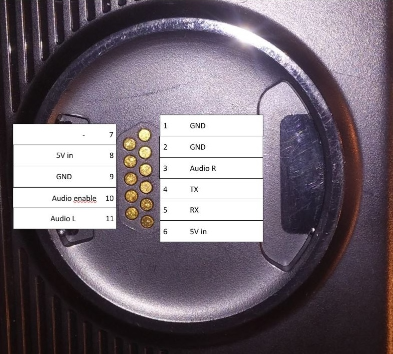

# Dock link — the serial transport between the unit and the car radio

What: the wire between the 4NSF ("PID") and the radio in the dashboard: dock pins, serial framing, timers, the copyright handshake, and which CAN / BAP traffic the radio lets through.
Why: it is the only path between the unit and the car. A replacement device on the dock, or a simulated radio for the emulator, has to speak exactly this.

Scope: transport only. What the frames mean is in the owning docs: raw CAN signals → [can-signals.md](can-signals.md) · BAP stack → [bap.md](bap.md) · BAP functions → [bap-functions.md](bap-functions.md) · how the data reaches the apps → [shared-memory.md](shared-memory.md) · hardware side (UART, GPIOs) → [hardware-layer.md](../system/hardware-layer.md). Overview of the whole system: [architecture.md](../architecture.md).

Legend: ✅ verified in binary / config (evidence given) · ✅ emulator = observed running in the emulator (CE 7 guest, stubbed hardware; the unit's `VwCommunicationExe` on an emulated serial port, §10) · 🟡 inferred / single source · ❓ unknown. Nothing measured on a car or a unit.
Addresses = VA, image base `0x10000`, file `firmware/flash/VwUserShell/VwCommunicationExe.exe` ("VwCom").
Tools: `tools/decode_frames.py` (frame decoder and encoder), `tools/samples/dock-capture.txt` (forum capture, 2016), `emulator/radio.py` (the radio's side of this link, for the emulator).

## 0. Verdict

"No CAN transceiver in the unit; a UART over the dock pins to the radio; the radio bridges to CAN" → **supported**.

- ✅ All car communication = one serial port, `COM9:` 19200 8N1 (VwCom `0x4391c`, `VwCommunicationManager.ini: ComPort=9`).
- ✅ Serial payload = `CAN id (16 bit, little-endian) + CAN data`. The unit never opens a CAN driver: VwCom imports only COREDLL, NgAlloc, HWLHardwareLayer. The `vxlapi.dll` / `xl*` names belong to a PC bench transport (port 10, §2).
- ✅ The radio filters: the unit **receives** a fixed list of 25 raw CAN ids + 6 BAP ids and **sends** only 4 BAP ids + its handshake (§4, §5).
- ❓ Electrical layer (levels, polarity, which pin is which direction): not derivable from software → must be measured (§8).

## 1. Dock pins and electrical side



Pin labels as published by the owners' community (🟡 unverified, never measured):

| Pin | Label | Notes |
|---|---|---|
| 1, 2, 9 | GND | |
| 3 / 11 | Audio R / Audio L | 🟡 analog line-out to the radio. Always driven by the unit's DAC ✅ ([media-audio.md](../system/media-audio.md) §7) |
| 4 / 5 | TX / RX | 🟡 the `COM9:` UART. Naming (unit- or radio-centric) ❓ |
| 6, 8 | 5V in | supply from the radio / cradle. 🟡 = the PMIC's "second input" → power source 3 ([hardware-layer.md](../system/hardware-layer.md) §6.4) |
| 7 | – | ❓ (🟡 candidate for cradle detect) |
| 10 | Audio enable | 🟡 = GPIO 19, `SetExternalAudioMutePin`. ✅ **No shipped program ever drives it** ([media-audio.md](../system/media-audio.md) §7) → role and level ❓ |

What the software side shows ✅ ([hardware-layer.md](../system/hardware-layer.md) §2.4, §5.3, §6.1, §7.2):

| Signal | Software view |
|---|---|
| UART | `COM9:` = SoC UART at physical `0x101FE000` (`uart_driver.dll`, registry key `Serial3`). Line settings come from VwCom, nothing is fixed in the registry |
| Cradle detect | GPIO 18, input, **low = docked**, both edges → `IsCradleStatusConnected`, window message `CRADLE_DETECTION_STATE_CHANGED_MESSAGE`, `IHWLCradleListener`. VwCom registers a cradle listener but its handler is empty ([shared-memory.md](shared-memory.md) §6.2); the shell uses the event only to mute / un-mute the built-in speaker ([user-shell.md](../system/user-shell.md) §5.1) |
| External audio mute | GPIO 19, output: `SetExternalAudioMutePin(1)` drives **low**, `(0)` high. Never called (above) |
| Built-in speaker | amplifier GPIOs 13 / 22; the driver refuses to switch it on while GPIO 18 says "docked" |
| Audio source switch | not a pin: negotiated with the radio over BAP (§5, [media-audio.md](../system/media-audio.md) §5.1) |

No CAN, no microphone and no video on the dock: the microphone is inside the unit ([bluetooth.md](../system/bluetooth.md) §8.2), and phone audio reaches the car speakers through the analog line-out (there is no Bluetooth link to the radio, [bluetooth.md](../system/bluetooth.md) §7).

## 2. Serial link layer (✅ unless noted)

Port open — `0x4391c(port, baud, cb1, cb2)`, called from `0x43464` with `baud = 0x4B00`:

- Device name `COMx:` (template at `0x89e10`), x = '0' + port, port 1…9 → **`COM9:`**. Port 0 → no port. Port 10 → alternate transport `0x43738` = Vector XL CAN interface for a PC bench: loads `vxlapi.dll`, application `PID_DEMO`, the dock byte stream is tunnelled in CAN ids `0x121` / `0x111` 🟡 ([shared-memory.md](shared-memory.md) §6.6). Dead code on the unit.
- `CreateFileW(GENERIC_READ|WRITE, OPEN_EXISTING)`, `SetupComm(0x1000)`, DCB: **19200 baud, 8 data bits, no parity, 1 stop bit**, `fBinary`, DTR_CONTROL_ENABLE, RTS_CONTROL_ENABLE, no flow control. Timeouts: ReadInterval 0, ReadTotal 1·n + 10 ms, WriteTotal 1·n + 10 ms. `PurgeComm(0xF)`, `SetCommMask(0x84)`.
- Reader thread `0x437b8` (reads 1…200 bytes at a time); watchdog heartbeat event `VwCommunicationReaderThreadAlive` (30 s, [boot-and-supervision.md](../system/boot-and-supervision.md) §3.2).
- Open failure → `Sleep(3000)` and retry for ever ([shared-memory.md](shared-memory.md) §6.1).

Framing — TX state machine `0x429b0`, RX state machine `0x42d0c`:

```
data frame : START  LEN  PAYLOAD[LEN]  CRC_HI  CRC_LO  C1
             START = C2 | seq      (seq 0/1, toggles per acked frame, per direction)
ack        : (C4 | seq)  C6        (acks the peer's frame with that seq)
escape     : byte in C0..C6 inside LEN/PAYLOAD/CRC → C0, (byte − C0)     e.g. C3 → C0 03
CRC        : CRC-16/ARC (poly 0x8005 reflected = 0xA001, init 0, no xorout)
             over START + LEN + PAYLOAD (unescaped); sent high byte first
```

- CRC: table generated at run time (`0x43528`, constants `0xC001`, `0x40`, `0x80`), table in BSS `0x8e350`; update `crc = tbl[(b ^ crc) & 0xFF] ^ (crc >> 8)`. Independently brute-forced: 51/51 frames of the capture match.
- Reserved bytes: `C0` escape, `C1` end of data, `C2/C3` start, `C4/C5` ack, `C6` end of ack.
- Stop-and-wait ARQ: after `C1` the sender waits for the ack; after **200 ms** (`0xC8` at `0x42ae8`) it retransmits with the same seq. The receiver acks every good frame and delivers it only if seq == expected (duplicate suppression), then toggles.
- LEN ≤ 0xFF; payload ≤ 253 data bytes after the 2-byte id (`0x42688`). TX queue: 50 entries × 260 bytes (`0x8ae20`).
- Payload: `ID_LO ID_HI DATA…` (`0x4272c` RX, `0x42668` TX).
  - `ID < 0x800` → CAN identifier, DATA = CAN data (BAP: one CAN frame per serial frame).
  - `0xF001` radio → unit handshake, `0xF002` unit → radio handshake (§3).
  - LEN 0 (no id) = "sync" ✅ emulator: the first thing the unit sends after opening the port (`C2 00 60 51 C1`), repeated every ~205 ms until the peer acknowledges it; the acknowledgement is what makes the link "up". Sent again whenever the unit restarts the link; sequence numbers start at 0 again in both directions. LEN 1, data `00`: periodic keepalive (`0x42910`, byte at `0x5ef68`) ✅ emulator (`C3 01 00 AC F1 C1`).

Timers ✅ (`0x426ec`: `t[6] = timeout; t[8] = timeout >> 1`; link opened with `0x44f60(port, 3000, callbacks)`; [shared-memory.md](shared-memory.md) §6.1):

| Timer | Value | Effect |
|---|---|---|
| Retransmit | 200 ms | same frame again |
| Keepalive | **1500 ms** (half the RX timeout) | LEN 1 frame `00` |
| RX timeout | **3000 ms** without a frame | link down: port closed and reopened (`0x4318c`, `0x431a4`); shared memory: data id 38 raised, handshake + ignition block invalidated. The counter is cleared by every accepted data frame **and by every acknowledgement** of an own frame (`0x428a4`, `0x42878`) — so a peer that only acknowledges keeps the link alive ✅ emulator |
| Tick | 50 ms | link timer thread `0x43280` |

On suspend VwCom closes the port; on resume it reopens it and runs the start sequence again ([shared-memory.md](shared-memory.md) §6.2, §6.3).

## 3. Handshake ("copyright" exchange) ✅

Radio → unit, id `0xF001` ("MessageRadioInit"), parser `0x28330`. Field owner: [can-signals.md](can-signals.md) §3.16.

| Payload offset | Len | Content |
|---|---|---|
| 0x00 | 35 | **`VW BCR copyright 2009 Volkswagen AG`** (compared with `0x5d0c4`) |
| 0x23 | 2 | version `01 00` (1.0), checked |
| 0x25 | 17 | the car's **VIN**, ASCII (not a "radio id") — used for branding and the "home car" check, [brand-and-pairing.md](../system/brand-and-pairing.md) §3, §6.1 |
| 0x36 | 1 | fuel type, one-hot: `01` petrol · `02` diesel · `04` CNG · `08` electric · `10` hybrid (only read if length ≥ 0x39) |
| 0x37 | 1 | equipment line, one-hot (`02` = Cupra) + bit `0x40` = sound system ("Fender" screens) (only if length ≥ 0x39) |

Minimum length 0x36; text or version wrong → handshake not accepted. Getters of the stored fields: `0x28140`, `0x28298`; sound-system bit `0x40` tested at `0x28270`.

Unit → radio, id `0xF002`, builder `0x11a50`: 54 bytes = **`VW PID copyright 2009 Volkswagen AG`** (35) + `01 00` + device id string (`HardwareLayer::GetDeviceID`: decimal digits of a 32-bit factory number, 10 digits in the capture) + zero padding.

Sequence ✅ code ([shared-memory.md](shared-memory.md) §6.1, §6.3), ✅ emulator (§10):

1. The unit sends the empty sync frame until it is acknowledged (§2). No F002 before that.
2. Link "up" → the unit sends F002 **unsolicited** (`0x12114` → builder `0x11a50`), then starts the six BAP devices (§5).
3. While no valid F001 has arrived, F002 is repeated every 1000 ms, up to 6 times (`0x12dcc`); then data id 39 ("no radio") is raised.
4. Every valid F001 is answered with **one more F002** (`0x125fc`: the dispatcher stores the "handshake valid" flag `0x8ad41` and, if it is set, calls the same builder); the 1 s repeats then stop.
5. **Raw CAN frames are dropped until a valid F001 was parsed** (flag `0x8ad41`, dispatcher `0x12558`).
6. A valid F001 sets "radio connected" (data id 11): the shell's condition for everything car-related ([user-shell.md](../system/user-shell.md) §5).

- Both earlier readings were right: F002 is sent at link-up without waiting for the radio, **and** as the answer to F001. The builder has exactly these three callers ✅ (`0x1211c`, `0x12de8`, `0x125fc`).
- There is no challenge, key or code in the exchange ✅. Whether the radio stores or validates the device id, and whether it forwards CAN before it has seen F002 ❓ (§8).
- For a replacement device 🟡: send a well-formed F002 and expect F001; for a simulated radio ✅ emulator: acknowledge the sync frame, then send F001 with sequence 0 ([brand-and-pairing.md](../system/brand-and-pairing.md) §7, §10 here).

## 4. Raw CAN messages forwarded by the radio (receive only) ✅

Dispatcher `0x12558` (switch on id) → one parser per message → shared memory. Class names = block-name strings in the binary (file `0x4d6f0…`; no RTTI); they equal VW PQ-platform message names. Bit layouts, scaling, validity rules and UI use of every signal: **[can-signals.md](can-signals.md)** (owner; summary table §2, machine-readable list §8).

| CAN id | Class | Content |
|---|---|---|
| 0x35B | GwMotor | engine speed, coolant temperature, 2 engine flags |
| 0x367 | GwAnt1 | longitudinal / lateral acceleration |
| 0x369 | GwAnt2 | gear, recommended gear, lever position, alternative engine speed |
| 0x470 | BsgKombi | doors, hood, boot, reverse light |
| 0x527 | GwKombi | speed, outside temperature, distance |
| 0x529 / 0x52D / 0x52F / 0x532 | Mfa4 / Mfa6 / Mfa7 / Mfa8 | trip memory "since refuel" / electric range and consumption sets (e-up!) |
| 0x555 | Motor7 | oil temperature, boost pressure |
| 0x571 | Bsg2 | one byte (🟡 battery voltage; no reader found) |
| 0x575 | Bsg3 | key in (S contact), ignition (terminal 15) |
| 0x591 | Zke4 | one central-locking bit |
| 0x5AC | Hvem2 | HV energy management (e-up!) |
| 0x5C1 | MflTasten | steering-wheel key code |
| 0x61A | MotorEv1 | EV drive values (e-up!) |
| 0x621 | KombiK1 | 2 cluster bits (🟡 low-fuel flag) |
| 0x629 / 0x62B / 0x62D | Mfa1 / Mfa2 / Mfa3 | current consumption, range, odometer / trip "since start" / "long-term" |
| 0x651 | Systeminfo1 | vehicle class, brand, derivative, right-hand drive, 4-door |
| 0x653 | Gateway3 | units / locale flags |
| 0x65F | FzgIdent | VIN (3-frame multiplex) |
| 0x668 / 0x669 | Reichweite1 / 2 | ranges (hybrid, CNG) |

- ✅ The unit never transmits a raw (non-BAP) CAN frame: `serial_send` `0x4229c` has only two callers, the F002 builder and the BAP transmit path.
- Door-open display comes from 0x470 (gated by the 0x591 bit); the parking-sensor picture from BAP LSG 0x0A ([user-shell.md](../system/user-shell.md) §7.2).
- Cycle times and what each car model really sends ❓ (no radio → unit capture exists).

## 5. BAP (VW "Bedien- und Anzeigeprotokoll") — summary

The unit is the ASG (client); six function blocks of the car (FSG, addressed by LSG id) are served through the radio. One BAP frame = one CAN frame = one serial frame. Stack, frame formats, state machines, tables: **[bap.md](bap.md)**. Meaning of every function: **[bap-functions.md](bap-functions.md)**.

```
single frame : [0|op(3)|lsg_hi(4)] [lsg_lo(2)|fct(6)] data(≤6)
long start   : [1 0 ch(2) len_hi(4)] [len_lo] hdr0 hdr1 data(≤4)
long cont.   : [1 1 ch(2) seq(4)] data(≤7)
```

| LSG | What it is ✅ | Unit → car (TX) | Car → unit (RX) | Functions |
|---|---|---|---|---|
| 0x0A | park distance (OPS) | 0x67A | 0x6DA | 16 |
| 0x11 | car clock (date / time, settable) | 0x69D | 0x6E7 | 15 |
| 0x1D | electric-drive status (read-only) | 0x67A | 0x679 | 12 |
| 0x25 | e-up! charging (timers, profiles, night rates) | 0x69D | 0x69C | 18 |
| 0x2D | audio channel claim + sound settings | 0x6C7 | 0x6D8 | 19 |
| 0x31 | audio / radio (source, lists, texts, volume, remote control) | 0x67C | 0x66C | 28 |

- TX id = `0x600 | low byte` (`0x44a64`, `0x44a7c`; low bytes `7C C7 7A 9D`); RX id filter `0x449ac` → BAP stack `0x469b8`; everything else → raw dispatcher. 0x67A and 0x69D are each shared by two LSGs; the answer id tells them apart.
- Standard functions: 01 GetAll, 02 BAP-Config, 03 FunctionList, 04 HeartBeat, 0E FSG-Setup, 0F FSG-OperationState; ≥ 0x10 specific.
- Opcodes ✅: unit sends 0 Set / Start, 1 Get / Abort, 2 SetGet / StartResult; car sends 3 HeartbeatStatus / Processing, 4 Status / Result, 7 Error, and 0 on function 02 = Reset. Opcodes 5 / 6 (StatusAck / Ack) are enabled for no function.
- Static tables ✅ ([bap.md](bap.md) §3.2): function table 108 rows × 56 bytes at VA `0x617e8`; LSG table 6 × 52 bytes at `0x62f88`; per-function RX segmentation rows 108 × 36 bytes at file `0x4efa8` (channel mask `0x0F`, timeout 50); TX rows 108 × 28 bytes at file `0x4dd18`; channel table at `0x632b8`; BAP-Config rows at `0x5f0f0` (file `0x4dcf0`).
- At BAP start the unit sends one fixed frame `40 00 01 0A` on 0x67C; meaning ❓ ([bap.md](bap.md) §4.1).
- Timing: ≥ 50 ms between frames on one id (80 ms on 0x69D), requests retried 5 × 600 ms ([bap.md](bap.md) §2).
- The unit's writes (complete list in [bap-functions.md](bap-functions.md) §1): OPS display acknowledge, radio source switch + audio channel claim, radio remote control, sound settings, car clock, charging timers / profiles.

## 6. `tools/samples/dock-capture.txt` decoded

Run: `.venv/bin/python tools/decode_frames.py tools/samples/dock-capture.txt`.

- ✅ All 51 data frames: length + CRC valid. 2 ack frames (`C4 C6`, `C5 C6`).
- ✅ **Every data frame is unit → radio** (ids 0x67C / 0x6C7 / 0x67A / 0x69D / 0xF002 only). The two acks are the unit acking radio frames. The file shows what the unit sends; no radio answer was captured.
- 🟡 Not a contiguous trace: seq bits do not strictly alternate (lines 9–11, 14–16) → deduplicated / unordered collection. Lines 1–36 ≈ one start, 37+ ≈ a restart.
- ✅ The requests after the GetAlls are exactly the unit's start-up requests found in the code ([bap-functions.md](bap-functions.md) §2).

| Lines | Meaning |
|---|---|
| 1 | LEN 0 link sync |
| 2, 7 | acks (seq 0, seq 1) to radio frames |
| 3, 39 | 0x67C `40 00 01 0A` BAP start marker |
| 6 | 0xF002 handshake: `VW PID copyright 2009 Volkswagen AG`, version 1.0, 10-digit device id, padding |
| 4/8, 5/9, 10/33, 11/15, 14/30, 16/34 | Get BAP-Config (fct 02) for LSG 0x31, 0x2D, 0x1D, 0x11, 0x25, 0x0A |
| 12/40, 13/41 | GetAll (fct 01) of LSG 0x31, LSG 0x2D |
| 17, 45 | LSG 0x2D Get fct 0x11 `00 00 01`: read the **audio channel** the unit holds (one-element array) |
| 22–29, 31, 32 | LSG 0x2D Get fct 0x17…0x1B `00 00 01`: read the **sound settings** (0x17 balance, 0x18 fader 🟡, 0x19 bass, 0x1B treble; 0x1A unused) |
| 48–51 | LSG 0x2D SetGet fct 0x11 `00 00 01 04`, then `00 00 01 FF`: **claim audio channel 4** (entertainment from the unit), then release |
| 18+20, 46 | LSG 0x31 Get fct 0x22 `80 00 00 06 00` (segmented, channel 0): **source list**, 6 elements from 0 |
| 19+21, 35+36, 42, 52, 53 | LSG 0x31 Get fct 0x16 `80 01 00 06 00` / `90 06 00 06 00` / `80 00 00 06 …` (channel 1): **station / track list** of the current source |
| 44, 47 | LSG 0x31 SetGet fct 0x13 `00`: clear the unit's **mute flag** |
| 37, 38 | keepalive (LEN 1, `00`) |

## 7. How the data reaches the apps

- ✅ `VwCommunicationExe.exe` is the sole owner of `COM9:`. It publishes everything in the named file mapping **`VwSharedMemoryFileMapping`** (`0x61B0` bytes, one fixed struct): 26 raw-message blocks, 6 BAP blocks, a control block.
- ✅ Locks: one named mutex per block (`<Name>Mutex`, 28 in all; the ids `0xFFFE` BapAll / `0xFFFD` Notifications key **mutexes** in a process-local map, not sections). Change notification: 153 data ids, 8 channels, events `CAN_DATA_EVENT0…7`.
- ✅ Seven programs link the same client library: VwUserShell, VwBrandDevice, MediaPlayer, PictureViewer, VolumeUI, navigon, PhoneApplication.
- ✅ UI → car: a client writes request fields into a BAP block and raises a request id on channel 0; VwCom's main loop sends the BAP request. There is no command thread (`COMMAND_THREAD_WAKEUP_EVENT` and `TIMEOUT_MUTEX_NAME` are private to VwCom).
- Layout, C header, reader example, rules for third-party apps: **[shared-memory.md](shared-memory.md)**. AppCom ([appcom.md](../apps/appcom.md)) is separate: app-to-app messages, no car data. The `VwLog*` keys of `VwCommunicationManager.ini` are inert (strings absent from the binary).

## 8. Open questions (need hardware or a live capture)

Measure on a real dock (logic analyser / scope, radio powered):

1. UART electrical: voltage (3.3 / 5 V), polarity, idle level, which of pins 4 / 5 is the unit's TX; confirm 19200 8N1.
2. Cradle-detect mechanism (pin 7? a grounded pin? 5 V presence?) for GPIO 18; "Audio enable" pin: is it GPIO 19, its resting level, does the radio look at it; audio line level.
3. Full two-way trace of a cold start: the unit's half is known (✅ emulator, §10: it starts with LEN-0 sync frames and does not wait for the radio); open: what the radio sends first, content of its F001, real timing.
4. Does the radio validate the F002 device id, and does it need F002 or the `40 00 01 0A` marker before it forwards CAN.
5. Cycle times of the forwarded raw CAN messages; which messages / LSGs each car model sends; BAP-Config and HeartBeat values of the real FSGs.
6. Does the radio accept the unit's BAP writes from another device (source switch, audio channel, remote control) — the real control surface for a replacement.

Everything that needs only more static analysis is listed in [architecture.md](../architecture.md) ("What is still unknown").

## 9. Code map (VwCom, link layer)

ARM code, image base `0x10000`, functions from `.pdata`, no symbols.

| Address | What |
|---|---|
| `0x4391c` / `0x43b40` / `0x43be0` / `0x437b8` | serial open / close / write / reader thread |
| `0x429b0` / `0x42d0c` / `0x43528` | TX framer / RX deframer / CRC-16 table |
| `0x4229c` / `0x42668` / `0x4272c` | send(id, len, data) / frame build / RX deliver |
| `0x42834` (`0x426ec`) / `0x428d8` / `0x43280` | timer init / timer tick (keepalive + RX timeout) / timer thread |
| `0x449ac` / `0x44a64` | RX id router (BAP vs raw) / BAP CAN TX (`0x600 \| id`) |
| `0x12558` | raw CAN dispatcher (id → message parser; parser addresses `0x25290…0x2f084` in [can-signals.md](can-signals.md) §2; scaling constants near file `0x4d798`, `0x4d9d0`) |
| `0x45854` / `0x45bc0` / `0x469b8` | BAP start marker / BAP segmented TX / BAP RX entry |
| `0x11a50` / `0x28330` | F002 builder / F001 parser |
| `0x12114` / `0x12ff0` | link-up callback (F002 + BAP start) / link-down callback (direction 🟡 by content) |
| `0x24e38` / `0x23e5c` / `0x2438c` | creation of the named block mutexes (not "sections") |

BAP and shared-memory addresses: [bap.md](bap.md) §1, [shared-memory.md](shared-memory.md).
COREDLL ordinals resolved from call semantics (VwCom): 168 CreateFileW, 170 ReadFile, 171 WriteFile, 108 ClearCommError, 113 GetCommState, 114 GetCommTimeouts, 115 PurgeComm, 117 SetCommMask, 118 SetCommState, 119 SetCommTimeouts, 120 SetupComm.

## 10. Verified in the emulator (2026-11-16)

Set-up: the emulator build sets `ComPort=3`, so the unit's own `VwCommunicationExe` talks on the guest's `COM3:` = host TCP 5557, where `emulator/radio.py` plays the radio (`--trace` prints every frame, decoded by `tools/decode_frames.py`). The first three rows are from an earlier pass with a cut-down radio. All frames below were sent by the unit's program and decode with a good CRC.

| Radio | Unit's behaviour |
|---|---|
| silent | only `C2 00 60 51 C1` (sync), every ~205 ms; nothing else, no F002 |
| acknowledges, sends keepalives, never F001 | 2 ms after the ack: F002; then `40 00 01 0A` on 0x67C; *Get BAP-Config* (`1B 42` on 0x6C7 = LSG 0x2D, `1C 42` on 0x67C = LSG 0x31) at once and again every ~0.7 s; LSG 0x1D (0x67A) from +1.0 s, 0x11 (0x69D) +1.2 s, 0x25 (0x69D) +1.4 s, 0x0A (0x67A) +2.4 s; F002 again at +1.0, +2.0, +3.0 s … |
| same + F001 (placeholder VIN, fuel `01`) after the first F002, then 0x575 / 0x35B / 0x527 / 0x470 | F001 accepted: a second F002 10…120 ms later, no further repeats; the CAN values reach the shell's screens ([can-signals.md](can-signals.md) §9) |
| `emulator/radio.py`: F001 right after acknowledging the sync, then 15 different CAN messages in a 100 ms / 200 ms / 1 s rhythm, BAP frames acknowledged but not answered | handshake accepted; every message acknowledged within a few ms; trip computer, gauges and door overlay follow the values; the BAP start marker and *Get BAP-Config* requests are repeated (LSG restarts after 20 s, [bap.md](bap.md) §4.5) without disturbing the raw messages |
| radio killed and a new one connected at once | the new one must **not** acknowledge the frames of the old link: acknowledgements alone keep the unit's RX timer quiet, so it never sends a sync and no handshake happens. Staying silent makes the unit restart the link after 3 s |

F002 as sent by the emulated unit (device id = the stand-in's made-up `1234567890`; an earlier build of the stand-in returned the text `EMU0000001`, sent the same way):

```
C2 38 02 F0  56 57 20 50 49 44 20 63 6F 70 79 72 69 67 68 74 20 32 30 30 39 20 56 6F 6C 6B 73 77 61 67 65 6E 20 41 47
01 00  31 32 33 34 35 36 37 38 39 30 00 00 00 00 00 00 00  4A 58 C1
```

Also seen: a frame with the wrong sequence number is acknowledged but not delivered (an F001 sent with seq 1 right after a sync was ignored); the unit's keepalive `C3 01 00 AC F1 C1`; the sync frame arriving two or three times in a row at a link start (each restarts the numbering).

Emulator artefact, now avoided ✅: with QEMU's default clock the guest's tick count jumped ahead by 1…4 s several times a minute (measured with a guest program reading `GetTickCount` in a loop). VwCom's timer thread then saw more than 3000 ms pass at once and declared the link dead — keepalive and sync left in the same millisecond — about every 10…40 s. `emulator/emu` now starts QEMU with `-icount shift=auto`: no jump in 2 minutes of the same measurement, one link restart in 6 minutes. This was the "link restarts every few seconds" of the first pass; it says nothing about the real unit.

Limits: no BAP answers, so nothing beyond *Get BAP-Config* was exchanged; emulated UART, no real baud rate, so the retransmit / keepalive values of §2 were seen only roughly (205 ms retransmit).
