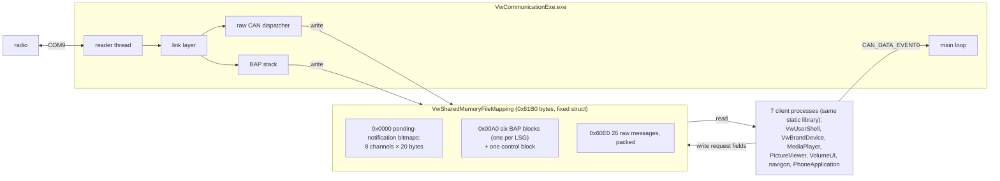
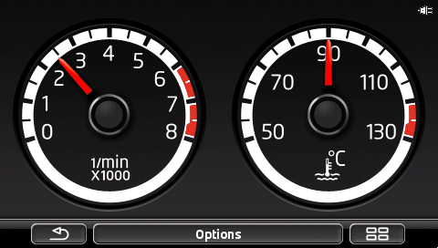

# VwCommunicationExe internals + `VwSharedMemoryFileMapping` IPC (static RE)

What: how `VwCommunicationExe.exe` ("VwCom", owner of the car link on `COM9:`) is built, and how it shares car data with the UI processes.
Why: a third-party app on the unit can read car data (and ask for BAP requests) without touching the serial port; a replacement of VwCom (or an emulator stand-in) must publish the same block.

Legend: ✅ seen in disassembly/data (address given) · ✅ emulator = observed running in the emulator (CE 7 guest, stubbed hardware) · 🟡 inferred · ❓ unknown. Static analysis, plus runs in the emulator (§10). Nothing run on a unit.
Addresses = VA in `firmware/flash/VwUserShell/VwCommunicationExe.exe` (ARM, image base `0x10000`, functions from `.pdata`) unless prefixed with another binary.
Related: [car-link.md](car-link.md) (serial framing, handshake) · [can-signals.md](can-signals.md) (payload of each message) · [bap.md](bap.md) / [bap-functions.md](bap-functions.md) (BAP stack, content of the BAP blocks) · [user-shell.md](../system/user-shell.md) (main consumer).

## 1. Overview



- locks: one named mutex per block, `<Name>Mutex` (28)
- wake: named auto-reset events `CAN_DATA_EVENT0` … `CAN_DATA_EVENT7`

Key facts (all ✅):

- The mapping is **one fixed C++ struct**: no header, no magic, no version, no directory. Offsets are compile-time constants, identical in all 8 binaries (same size constant `0x61B0`, byte-identical subscription table).
- What looks like "sections keyed by id" is a process-local `map<u16 id, named mutex>` ([car-link.md](car-link.md) §7). The id (CAN id, `0xFFFE` BapAll, `0xFFFD` Notifications) selects a **mutex**, not an offset.
- Change notification: 153 numbered "data ids". Each of 8 channels subscribes to a fixed id set. A writer ORs the ids it changed into the channel's pending bitmap (in the mapping) and sets the channel's event.
- UI → VwCom commands use the same mechanism in reverse: the UI writes request fields into a BAP block, ids 116…144 are subscribed by channel 0, VwCom's main loop waits on `CAN_DATA_EVENT0`. There is no command queue in shared memory.
- `COMMAND_THREAD_WAKEUP_EVENT` is not the UI channel: it wakes VwCom's private delayed-command scheduler. `TIMEOUT_MUTEX_NAME` (literal string, an unexpanded macro name) guards VwCom's private timer table.

## 2. The mapping

| Item | Value | Evidence |
|---|---|---|
| Name | `VwSharedMemoryFileMapping` (UTF-16) | string `0x5d6f0`, pointer global `0x89358` |
| Create | `CreateFileMappingW(INVALID_HANDLE_VALUE, NULL, PAGE_READWRITE, 0, 0x61B0, name)` | `0x11e38`, `0x19de4` |
| View | `MapViewOfFile(h, FILE_MAP_WRITE, 0, 0, 0x61B0)` | same |
| Size | `0x61B0` = 25008 bytes (constant returned by `0x20cfc`; same getter found in all 7 clients). ✅ emulator: a view of `0x61B0` bytes maps, `0x61B1` fails | |
| Who creates | whoever starts first. Client attach `0x19de4`: if `GetLastError() != ERROR_ALREADY_EXISTS` → construct (`0x11c1c`) + invalidate all (`0x23610`), else use as is | |
| VwCom start | calls the client attach, then `0x11e38`, which maps again and **always re-runs the constructor** → the block is reset on every VwCom (re)start | `0x110bc` |

### 2.1 Block map

Offsets ✅ from constructor `0x11c1c` and the accessor getters `0x21404…0x23488`; size = distance to the next block.

| Offset | Size | Block | Mutex | Notes |
|---|---|---|---|---|
| 0x0000 | 0xA0 | `pending[8]`, 20 bytes each | `NotificationsMutex` | §4 |
| 0x00A0 | 0x2C | BAP LSG 0x0A | `BapAllMutex` | ✅ LSG from request handler (id 116 → `BAP(0x0A, 0x14)`) |
| 0x00CC | 0x1064 | BAP LSG 0x31 | `BapAllMutex` | ✅ ids 117…126 |
| 0x1130 | 0xAC | BAP LSG 0x2D | `BapAllMutex` | ✅ ids 127…136 |
| 0x11DC | 0x24 | BAP LSG 0x1D | `BapAllMutex` | ✅ `0x12e50`, `0x19004` |
| 0x1200 | 0x94 | BAP LSG 0x11 | `BapAllMutex` | ✅ ids 137, 138 |
| 0x1294 | 0x4DCC | BAP LSG 0x25 | `BapAllMutex` | ✅ ids 139…143 |
| 0x6060 | 0x80 | control block (state machines + timer requests) | `BapAllMutex` | §5.3 |
| 0x60E0 | 0xD0 | 26 raw messages | one mutex each | §2.2 |

Content of the BAP blocks: [bap-functions.md](bap-functions.md). All seven share one mutex.

### 2.2 Raw messages

Generic layout ✅ (constructors `0x263b0`, `0x27060`, …; helpers `0x262f0` test / `0x2635c` clear / `0x280ac` set):

```c
struct Message<N> {
    uint8_t data[N];             // constructor fills with 0xFF (FzgIdent: 0x88; MflTasten data[5] = 0x1A)
    uint8_t invalid[(N + 7) / 8]; // bit b = 1 → data byte b not valid. Constructor: all 0xFF
};
```

- `data` is not always the raw CAN payload: the parser keeps selected payload bytes (`0x250a8` compacts by a byte mask) and updates them per signal. Byte/bit meaning: [can-signals.md](can-signals.md). ✅ emulator: bits that belong to no signal keep the constructor's `1` (e.g. BsgKombi after frames `00 01` reads `DF C1`), so always mask.
- A parser writes a signal only if the value changed **or** its byte was invalid; then it clears the invalid bit and marks the signal's data id dirty (§4). So an event means "changed", not "received".
- No timestamps, no counters, no per-message receive timeout ✅ (none in the layout; the only invalidation paths are below).
- Invalidation ("timeout handling"): `0x23610` sets all invalid bits of all messages (at block creation); `0x124ec` invalidates RadioInit + Bsg3 at start and when the link goes down/suspend (`0x12ff0`). Other messages keep their last value when the link drops ✅ emulator (after the simulated radio stopped: Bsg3 and RadioInit bytes 0…16 invalid again, GwMotor / GwKombi / BsgKombi unchanged; RadioInit bytes 0x11 / 0x12 stay valid).
- Raw CAN frames are dropped until a valid `0xF001` handshake was parsed (flag `0x8ad41`, dispatcher `0x12558`) ✅.

| Offset | data+invalid | Class | Key (CAN id) | Mutex name |
|---|---|---|---|---|
| 0x60E0 | 1+1 | MessageBsg3 | 0x575 | `MessageBsg3Mutex` |
| 0x60E2 | 4+1 | MessageGwMotor | 0x35B | `MessageGwMotorMutex` |
| 0x60E7 | 17+3 | MessageFzgIdent | 0x65F | `MessageFzgIdentMutex` |
| 0x60FB | 12+2 | MessageGwKombi | 0x527 | `MessageGwKombiMutex` |
| 0x6109 | 2+1 | MessageBsgKombi | 0x470 | `MessageBsgKombiMutex` |
| 0x610C | 3+1 | MessageSysteminfo1 | 0x651 | `MessageSysteminfo1Mutex` |
| 0x6110 | 1+1 | MessageBsg2 | 0x571 | `MessageBsg2Mutex` |
| 0x6112 | 1+1 | MessageKombiK1 | 0x621 | `MessageKombiK1Mutex` |
| 0x6114 | 8+1 | MessageMfa1 | 0x629 | `MessageMfa1Mutex` |
| 0x611D | 8+1 | MessageMfa2 | 0x62B | `MessageMfa2Mutex` |
| 0x6126 | 8+1 | MessageMfa3 | 0x62D | `MessageMfa3Mutex` |
| 0x612F | 6+1 | MessageMfa4 | 0x529 | `MessageMfa4Mutex` |
| 0x6136 | 9+2 | MessageMfa6 | 0x52D | `MessageMfa6Mutex` |
| 0x6141 | 8+1 | MessageMfa7 | 0x52F | `MessageMfa7Mutex` |
| 0x614A | 8+1 | MessageMfa8 | 0x532 | `MessageMfa8Mutex` |
| 0x6153 | 8+1 | MessageMotorEv1 | 0x61A | `MessageMotorEv1Mutex` |
| 0x615C | 20+3 | MessageRadioInit | 0xF001 | `MessageRadioInitMutex` |
| 0x6173 | 6+1 | MessageGateway3 | 0x653 | `MessageGateway3Mutex` |
| 0x617A | 8+1 | MessageGwAnt2 | 0x369 | `MessageGwAnt2Mutex` |
| 0x6183 | 7+1 | MessageMflTasten | 0x5C1 | `MessageMflTastenMutex` |
| 0x618B | 2+1 | MessageMotor7 | 0x555 | `MessageMotor7Mutex` |
| 0x618E | 1+1 | MessageZke4 | 0x591 | `MessageZke4Mutex` |
| 0x6190 | 7+1 | MessageReichweite1 | 0x668 | `MessageReichweite1Mutex` |
| 0x6198 | 5+1 | MessageReichweite2 | 0x669 | `MessageReichweite2Mutex` |
| 0x619E | 8+1 | MessageHvem2 | 0x5AC | `MessageHvem2Mutex` |
| 0x61A7 | 8+1 | MessageGwAnt1 | 0x367 | `MessageGwAnt1Mutex` |

End = 0x61B0 ✅. RadioInit `data`: bytes 0…16 = 17 bytes of the F001 frame after the copyright text + version (`0x28330`: `payload+0x25`) = the car's **VIN** ([brand-and-pairing.md](../system/brand-and-pairing.md) §3), bytes 0x11/0x12 = F001 payload bytes 0x36/0x37 (only if len ≥ 0x39) = fuel type (one-hot) / line bits + `0x40` sound system ([can-signals.md](can-signals.md) §3.16); invalid bit 0 = handshake text/version wrong.

## 3. Locks

| Fact | Evidence |
|---|---|
| Name = ASCII block name widened + `L"Mutex"`; `CreateMutexW(NULL, FALSE, name)` | `0x23e5c` |
| 28 mutexes created in one go and stored in a map keyed by u16: 26 messages (key = CAN id), `BapAll` → `BapAllMutex` (key `0xFFFE`), `Notifications` → `NotificationsMutex` (key `0xFFFD`) | `0x24530` |
| Every wait is `WaitForSingleObject(h, INFINITE)`; return value ignored (an abandoned mutex counts as acquired) | `0x21348`, `0x21404`, `0x1243c` |
| Read guard = block mutex only; release = `ReleaseMutex` | getters `0x21404`, `0x22dec`, … |
| Write guard = block mutex + private 20-byte dirty bitmap; release = `ReleaseMutex(block)`, **then** `Wait(NotificationsMutex)`, publish dirty ids (§4), `ReleaseMutex(NotificationsMutex)` | `0x21348`, `0x1243c` |
| The two mutexes are never held together → no lock-order problem | `0x1243c` |

Two getters exist per block (read at `0x21404 + k`, write right after it, e.g. Bsg3 `0x21404` / `0x21478`); each hard-codes `base + offset`.

## 4. Change notification

### 4.1 Mechanism ✅

```c
uint8_t pending[8][20];                 // mapping offset 0; bit id → pending[ch][id >> 3] & (1 << (id & 7)); valid ids 1..153
static const uint32_t subscribed[8][154]; // per binary, .rdata 0x5d778 in VwCom; 0-terminated id lists; identical in all 8 binaries

// writer, on release of a write guard (0x1243c → 0x354bc → 0x24fec)
lock(NotificationsMutex);
for (ch = 0; ch < 8; ch++) {
    hit = dirty & mask(subscribed[ch]);
    pending[ch] |= hit;
    if (hit) SetEvent(event[ch]);       // 0x3e1ac: EventModify(h, EVENT_SET)
}
unlock(NotificationsMutex);

// reader of channel ch (VwCom 0x1307c, shell VwUserShell 0x97d44)
wait(event[ch]);
for each id of interest:
    lock(NotificationsMutex); was = test_and_clear(pending[ch], id); unlock(NotificationsMutex);   // 0x25050(ptr, id, 1)
    if (was) read the block under its own mutex;
```

- Events: `CreateEventW(NULL, FALSE /*auto-reset*/, FALSE, name)`, name = `"CAN_DATA_EVENT"` + decimal channel (`CAN_DATA_EVENT0` … `CAN_DATA_EVENT7`) ✅ `0x3e6c8` (number formatter `0x3e25c`, base 10, no prefix). Every process creates all 8 (notifier object `0x35574`).
- The **writer's** copy of `subscribed[]` decides who is woken. A channel with an empty list (4, 5) never gets events.
- Auto-reset event + per-channel bitmap → one consumer per channel. Two processes on one channel steal each other's wake-ups and bits. ✅ emulator: while an earlier emulator build kept `VwBrandDevice` running next to the shell (both channel 1), now and then a notification reached the screen only after the next one.

### 4.2 Channels

| Ch | Listener | Evidence | Subscribed ids |
|---|---|---|---|
| 0 | VwCommunicationExe (requests from UIs) | `0x19940` → `0x3e6c8(obj, 0, 0)` | 116…144 |
| 1 | VwUserShell; VwBrandDevice (runs before the shell, then exits) | VwUserShell `0x97cb8`, VwBrandDevice `0x16ee8`: listener ctor with index 1 | 1…45, 49…75, 82, 83, 85 |
| 2 | MediaPlayer | MediaPlayer `0x1bda4`: index 2 | 11, 38, 49, 52, 53, 78…80, 82…100, 103…115 |
| 3 | PictureViewer | PictureViewer `0x14900`: index 3 | 11, 38, 145 |
| 4, 5 | – | empty lists | – |
| 6 | VolumeUI | VolumeUI `0x12938`: index 6 | 11, 86, 153 |
| 7 | ❓ none in this firmware: navigon.exe and PhoneApplication.exe link the library but lack the test-and-clear function, so they cannot consume ids. 🟡 The id set equals the three ids VwBrandDevice consumes ([brand-and-pairing.md](../system/brand-and-pairing.md) §3), but its listener is built with index 1 ✅ (VwBrandDevice `0x16ef0`: `mov r1, 1`) | callers of the `0x25050` twin: only VwUserShell (52 ids) and VolumeUI (id 153) besides the listeners above | 13, 18, 30 |

Listener object (clients): a thread waiting on `{CAN_DATA_EVENTn, stop event}` (`WaitForMultipleObjects`, wrapper returns 1 timeout / 2 data / 3 stop, `0x3e1fc`). In the shell each set bit is turned into a UI event code (id 1 → `0x3E81`, 2 → `0x3E82`, 3 → `0x3E84` + an AppCom broadcast, …; VwUserShell `0x97d44`; full id → event table: [user-shell.md](../system/user-shell.md) §3.1). MediaPlayer's and PictureViewer's reactions: [media-audio.md](../system/media-audio.md) §8.2, §9.

### 4.3 Data ids

One id = one data item (signal or BAP property), set by its setter through `0x24f40(dirty, id, 1)`. Owner found by scanning all 152 call sites; BAP owners 🟡 by code region, anchored ✅ by the request ids of §5.

| ids | Owner block |
|---|---|
| 1 BsgKombi · 2, 7 GwAnt2 (id 2 = engine speed: also raised by the dispatcher after each GwMotor frame, `0x27044`) · 3, 4 Bsg3 · 8 KombiK1 · 13 Systeminfo1 · 14 Mfa1 · 15 Mfa2 · 16 Mfa3 · 18 Mfa6 · 19 Mfa7 · 20 Mfa8 · 21, 22, 145 GwKombi · 23 Bsg2 · 24, 35 Motor7 · 25, 28, 29 GwMotor · 26, 27 MotorEv1 (26: constant setter in the parser `0x284fc`) · 30 Gateway3 · 31, 79 MflTasten · 32 Reichweite1 · 33 Reichweite2 · 34 Hvem2 · 36, 37 GwAnt1 | raw messages (per-signal names: [can-signals.md](can-signals.md)) |
| 11 | RadioInit: valid F001 stored (`0x28298`); also raised alone as "no radio yet" 1 s after start/resume (`0x12f98`) |
| 38 | link down / suspend (`0x12ff0`); no data change |
| 39 | F002 sent 6 times, 1 s apart, without a valid F001 (`0x12dcc`); no data change |
| 41…45 | LSG 0x0A status |
| 49, 51…53, 80, 82…97, 99, 100, 153 | LSG 0x31 status (82 / 83 = source-change machine done / failed; per-function ids: [bap-functions.md](bap-functions.md) §4) |
| 54…59 | LSG 0x1D status |
| 60…63 | LSG 0x11 status |
| 64…68, 70…73 | LSG 0x25 status |
| 74, 104…106, 108, 111…115 | LSG 0x2D status |
| 116…144 | requests UI → VwCom (§5) |
| 5, 6, 9, 10, 12, 17, 40, 46…48, 50, 69, 75…78, 81, 98, 101…103, 107, 109, 110, 146…152 | no constant setter found ❓ (some setters take the id in a register: RadioInit) |

## 5. Command channel UI → VwCom

### 5.1 Protocol ✅

1. Client takes a write guard on the BAP block (`BapAllMutex`), writes the request parameters and a "request pending" flag into fixed fields, marks the request id (116…144) dirty.
2. On release the id lands in `pending[0]` and `CAN_DATA_EVENT0` is set.
3. VwCom main loop (`0x19448`): `wait(CAN_DATA_EVENT0, 10 ms)`; when signalled runs `0x1307c`: for each id below, test-and-clear in `pending[0]`, read the parameters under the block mutex, call the BAP request API.
4. The answer arrives later as normal status ids on the client's channel.

✅ emulator (steps 2–3): with VwCom's main loop running, a bit set in `pending[0]` + `SetEvent(CAN_DATA_EVENT0)` was cleared within 1 ms. The BAP frame itself was not seen on the serial line (function block not started: the simulated radio does not speak BAP).

Example (id 116, VwCom's copy of the client setter `0x37e8c`, reader `0x3529c`): block 0x00A0, `+0x14` = second byte sent, `+0x15` = first byte sent, `+0x16` = pending flag (set to 1). VwCom does **not** clear the flag after sending ✅ (it only tests it; the one exception is the LSG 0x25 timer request mode, cleared at `0x14860` / `0x148f8` / `0x149e0`); the flags are cleared by the block reset on stop / suspend. The data id is what triggers a request, so a stale flag is harmless ([bap-functions.md](bap-functions.md) §2).

### 5.2 Request ids (handler `0x1307c`)

BAP API: `0x44918(lsg, fct, req)` no data · `0x44938(…, u8)` · `0x44958(…, u16)` · `0x44978(…, ptr, len)`. `req` = **request number** of the stack, not the wire opcode ✅ ([bap.md](bap.md) §3.3, §5): **0 SetGet · 1 Set · 2 Get · 5 Start · 6 StartResult · 7 Abort**. Only 0, 2, 6 and 7 occur below.

| id | Block read | BAP request (LSG / fct / request number, data) |
|---|---|---|
| 116 | LSG 0x0A | 0x0A / 0x14 / 0, 2 bytes |
| 117 | LSG 0x31 (`+0x5F…+0x61` three flags → bits 0…2, pending `+0x62`) | 0x31 / 0x13 / 0, 1 byte |
| 118 | LSG 0x31 (`+0x67`, pending `+0x68`) | 0x31 / 0x14 / 0, 1 byte |
| 126 | LSG 0x31 | 0x31 / 0x18 / 0, 1 byte |
| 119 | LSG 0x31 + control block | 0x31 / 0x16 / 2, 5 bytes (list fetch; variants by control-block state) |
| 120 | LSG 0x31 | 0x31 / 0x17 / 6, 3 bytes — or request 7 (Abort) without data |
| 121 | – | 0x31 / 0x1B / 6, no data |
| 123 | LSG 0x31 | 0x31 / 0x20 / 6, 4 bytes |
| 124 | LSG 0x31 | 0x31 / 0x22 / 2, 5 bytes |
| 125 | LSG 0x31 | 0x31 / 0x23 / 6, u16 |
| 127, 128 | LSG 0x2D | 0x2D / 0x11, 0x12 / 0 or 2, n bytes |
| 132…136 | LSG 0x2D | 0x2D / 0x17…0x1B / 0 or 2, n bytes |
| 137, 138 | LSG 0x11 | 0x11 / 0x10, 0x11 / 0 with data, or 2 without |
| 139 | LSG 0x25 | 0x25 / 0x0D / 0, 1 byte |
| 141 | LSG 0x25 | 0x25 / 0x13…0x16 / 0 with ≤ 8 bytes, or 2 without |
| 142, 143 | LSG 0x25 | 0x25 / 0x19, 0x1A / 0 or 2, n bytes |
| 144 | control block | no BAP frame: reload VwCom's timers (§5.3) |
| 122, 129…131, 140 | – | subscribed, no handler |

### 5.3 Control block (0x6060) and timers

- Holds client-side state machines (state `+0x68`, flag bits `+0x6A`, …) that run in whichever process writes the block (same library code everywhere): OPS display handshake, list fetch, seek, source change — [bap-functions.md](bap-functions.md) §3.2, §4.3…§4.5. Remaining fields ❓.
- Five timer slots `{ uint16_t ms; uint16_t cmd; }` at `+0x04`, `+0x0C`, `+0x1C`, `+0x6C`, `+0x74` ✅ (`0x2f408…0x2f4d8`, setter `0x2f4b8`): `cmd` 1 = arm with `ms`, 2 = cancel.
- Only VwCom has a tick. On id 144 it copies the slots with `cmd != 0` into a private table (`0x8ad74`: 5 limits + 5 elapsed counters) under the mutex named `TIMEOUT_MUTEX_NAME` ✅ (`0x14ea0`).
- The link timer thread calls `0x18ffc(elapsed_ms)` every 50 ms; an expired slot feeds a "timeout" input into the matching state machine through a write guard (`0x18c04`), which notifies the clients. Command 1000 (§6.3) expires all slots at once.
- `TIMEOUT_MUTEX_NAME` is created by VwCom only and never opened by a client ✅ (string absent from the 7 clients).

## 6. VwCom process architecture

### 6.1 Start-up ✅

`WinMain 0x11000`: `new App` (`0x110a0`) → `Init 0x110bc` → `Run 0x11600` (never returns).

| Step | What | Evidence |
|---|---|---|
| 1 | App ctor: create `CAN_DATA_EVENT0`; register HWL suspend/resume + cradle listeners; read device id (`HardwareLayer::GetDeviceID`, 17 wchar) for F002; start scheduler thread | `0x19940` |
| 2 | Init: attach mapping (§2), create/reset block, 28 mutexes, notifier with 8 events; invalidate RadioInit + Bsg3; zero timer table; create `TIMEOUT_MUTEX_NAME` | `0x19de4`, `0x18eec`, `0x11e38` |
| 3 | Run: read ini next to the exe (§6.5) | `0x11600` |
| 4 | Open link: `0x44f60(port, 3000, callbacks)`; on failure `Sleep(3000)` and retry forever. ✅ emulator: with `ComPort=9` (no such port in the guest) VwCom stays here — block, mutexes and events exist, but no heartbeat events, no main loop, requests are not consumed. The emulator build therefore sets `ComPort=3` | `0x19448` |
| 5 | Schedule command 3 (+1000 ms); start power thread; create heartbeat event; enter main loop | `0x19448` |
| 6 | Link layer reports "up" (= the peer acknowledged the empty sync frame) → callback `0x12114`: send F002, then schedule: cmd 2 (+1000 ms, resend F002), BAP start of LSG 0x31 (+0), 0x2D (+0), 0x1D (+1000), 0x11 (+1200), 0x25 (+1400), 0x0A (+2400 ms). ✅ emulator: exactly this order and timing on the wire (§10) | `0x12114` |

Link parameters ✅ (also in [car-link.md](car-link.md) §2): RX timeout = **3000 ms**, keepalive period = timeout / 2 = **1500 ms** (`0x426ec`: `t[6] = arg2; t[8] = arg2 >> 1`), timers ticked every 50 ms.

### 6.2 Threads ✅

| Thread | Entry | Priority (CE: 0 highest) | Job |
|---|---|---|---|
| Main | `0x19448` loop | 2 | `wait(CAN_DATA_EVENT0, 10 ms)`: timeout → BAP task `0x4519c(0x13)`; signalled → requests `0x1307c`, BAP TX `0x449a4`, `Sleep(10)`. Heartbeat every 51 loops |
| Scheduler | `0x197b8` | default (sets itself to 2 on command 1000 🟡) | delayed commands (§6.3) |
| Power | `0x1227c` | 1 | `CreateMsgQueue` + `RequestPowerNotifications(q, 3)`; suspend (`0x200000`) → commands 1, 1000, 1001; on (`0x10000`) → command 4 |
| Link timer | `0x43280` | 2 | every 50 ms: retransmit / keepalive / RX timeout (`0x43130`), UI timer slots (`0x18ffc`) |
| Serial reader | `0x437b8` | 2 | `ReadFile` 1…200 bytes → RX deframer. Heartbeat every 51 reads. Exits on error 5/6 or close |
| Vector RX | `0x43cac` | 0 | port 10 only (§6.6) |

Callbacks given to the link/BAP layer (14-entry table built in `0x19448`, passed on by `0x44f60` → `0x423e0`): raw frame → `0x12558` ✅; link up → `0x12114`, link down → `0x12ff0` (raise id 38, invalidate RadioInit + Bsg3, commands 1 + 1000) 🟡 direction by position and content; tick → `0x18ffc` ✅; BAP indications → `0x14f5c`, `0x15728`, `0x15798`, `0x166f8`; BAP errors → `0x192a4`.

HWL listeners: suspend/resume `0x18b6c` (resume → command 3 after 1 s; suspend → reset LSG 0x31 block and control block). The cradle listener is registered but its handler is an empty function (`0x262ec`) ✅.

### 6.3 Delayed-command scheduler ✅

Private list guarded by a critical section; `0x12008(cmd, delay_ms, arg)` inserts `{u32 type; u16 delay; u8 fresh; u32 arg}` and sets the event `COMMAND_THREAD_WAKEUP_EVENT` (auto-reset, created lazily). Thread `0x197b8` waits on it (max 5000 ms), ages the entries with `GetTickCount`, runs the expired ones in `0x19694`.

| Type | Action |
|---|---|
| 1 | not queued: removes all queued entries with type < 999 |
| 2 (arg n) | if no valid F001 yet: send F002; n < 6 → again in 1000 ms with n+1; else raise id 39 |
| 3 | if no valid F001 yet: raise id 11 |
| 4 | reopen link (`0x45094(port, 3000, …)`) + start sequence `0x12114` |
| 10…15 | start BAP LSG 0x31, 0x2D, 0x1D, 0x11, 0x25, 0x0A (`0x44e24`) |
| 20 (arg lsg) | LSG 0x11 / 0x1D / 0x25 still in state 3 → stop + start it again; queued 20 s after a BAP error (`0x19004`) |
| 1000 | stop all 6 LSGs (`0x44eec`), reset the 6 BAP blocks, expire all timer slots |
| 1001 | mark link down (`0x12ff0`) and close the port (`0x43408(-1)`) |

### 6.4 Named objects

| Name | Type | Used by | Purpose |
|---|---|---|---|
| `VwSharedMemoryFileMapping` | file mapping | all 8 | data |
| `<Block>Mutex` ×28 | mutex | all 8 | §3 |
| `CAN_DATA_EVENT0…7` | auto-reset event | all 8 | §4 |
| `COMMAND_THREAD_WAKEUP_EVENT` | auto-reset event | VwCom only | scheduler wake-up |
| `TIMEOUT_MUTEX_NAME` | mutex | VwCom only | timer table |
| `VwCommunicationBapThreadAlive` | auto-reset event, initially set | VwCom → WatchdogPuppy | main-loop heartbeat, every 51 loops (≥ 0.5 s). ✅ emulator: exists only once the port is open (both heartbeat events) |
| `VwCommunicationReaderThreadAlive` | auto-reset event, initially set | VwCom → WatchdogPuppy | reader heartbeat, every 51 reads; created at port open (`0x4391c`) |

Watchdog side (`Watchdog_VWCom.ini`, see [boot-and-supervision.md](../system/boot-and-supervision.md) §3.2): 30 s timeout on both events; restarted in place up to 3 times, then device reset.

Shutdown: the main loop has no exit; the App destructor (`0x11084`: disconnect listeners, close timer mutex, drop mapping) is unreachable in normal operation 🟡. The process ends by power-off or watchdog kill; the reader thread ends when the port is closed on suspend.

### 6.5 `VwCommunicationManager.ini`

Path = exe directory + `/VwCommunicationManager.ini` (`0x11600`). Section `[VwCommunicationManager]`.

| Key | Effect |
|---|---|
| `ComPort` | ✅ read. 1…9 → `COMn:`; 10 → Vector CAN transport; 0 → no port; other → open fails, retried every 3 s. Default when key/file missing = 9 (byte at `0x5d768`). ✅ emulator: `ComPort=3` (set by `emulator/build.sh`) makes VwCom talk on the guest's `COM3:` (host TCP 5557, `emulator/radio.py`). The running process keeps the ini open: stop it before replacing the file |
| `UseRightArrowAsPhoneButton` | ✅ read; non-zero → virtual call on the client API object (slot `+0x308`) with argument 2 = sets the configurable phone-key code of MflTasten (`d[5]`) to `0x02`, so the right-arrow key also counts as phone key ([can-signals.md](can-signals.md) §3.10; key names 🟡) |
| `VwLogTime`, `VwLogVerbositySerial/Can/Bap`, `VwLogPathCE`, `VwLogPathPC` | ✅ **inert**: these strings do not exist in the binary |

Also inert: strings `ThreadStackLength`, `ThreadPriorities` (and `highest … lowest`) have no code reference.

### 6.6 Port 10 = PC bench transport (Vector XL) 🟡

- `0x43738` → `0x43f40`: `LoadLibrary("vxlapi.dll")`, resolve 16 `xl*` functions by name (`0x445c0`), open application `PID_DEMO`, start RX thread `0x43cac`.
- The dock **byte stream is tunnelled in CAN frames**: received id `0x121` → data-byte callback, id `0x111` → second callback (🟡 ack path); transmit builds an XL event with id `0x100` (`0x43ec8`).
- No `vxlapi.dll` exists for the unit → dead code there.

## 7. Clients

- ✅ All 7 clients contain the same library: mapping name, `CAN_DATA_EVENT`, `BapAll`, `Notifications`, `Mutex`, all `MessageXxx` names, the size getter (`mov r3,#0x6100; orr r0,r3,#0xB0`) and a byte-identical 8×154 subscription table (VwUserShell `0x2fbd40`, VwBrandDevice `0x242230`, MediaPlayer `0x279308`, PictureViewer `0x2c1ba0`, VolumeUI `0x700c8`, navigon `0x9732b8`, PhoneApplication `0x2ccc80`).
- ✅ They attach with the same create-or-open code (VwUserShell `0xada20`), create the same 28 mutexes and 8 events, and read through the same guard classes. Event-driven (listener thread, §4.2); values are read on demand under the block mutex.
- ✅ navigon.exe and PhoneApplication.exe contain the attach code but neither a listener nor the pending-bit test function → they can only read on demand. navigon does ✅ (84 call sites, [navigation.md](../system/navigation.md) §8.2): radio connected, ignition, VIN, fuel type, low-fuel flag, consumption, ranges, one MotorEv1 value — no speed, no reverse gear, and it never calls a request slot (sends nothing to the car). PhoneApplication: what it reads ❓ ([bluetooth.md](../system/bluetooth.md) §8.3).
- Request slots (source / audio channel, sound values, clock, charging) are called by the shell and MediaPlayer ([user-shell.md](../system/user-shell.md), [media-audio.md](../system/media-audio.md) §8.2); navigon: none ✅; PhoneApplication ❓.

## 8. How to reimplement / interoperate

### 8.1 C header

The layout as a C struct, ready to include: **[`apps/include/vwshm.h`](../../apps/include/vwshm.h)** (single source; `VwSharedMemory`, one `VwMessageN` type per message size, `VW_BYTE_VALID(message, byte)`, name and size of the mapping; a compile-time check pins `sizeof` to `0x61B0`). Field names are the class names of §2.2 with a lower-case first letter (`gwMotor`, `radioInit`, …), so the mutex of a field is `"Message" + Name + "Mutex"`; the BAP blocks are plain byte arrays (`bapLsg31[]`, …; fields in [bap-functions.md](bap-functions.md)). A complete program that uses it: [`apps/cardata`](../../apps/cardata/cardata.c) ✅ emulator.

### 8.2 Minimal reader (third-party app on the unit) ✅ emulator

```c
#include "vwshm.h"

HANDLE h = CreateFileMappingW(INVALID_HANDLE_VALUE, NULL, PAGE_READWRITE, 0, VWSHM_SIZE, VWSHM_NAME);
if (GetLastError() != ERROR_ALREADY_EXISTS) { /* VwCom not up yet: close, retry later; do not use an unconstructed block */ }
VwSharedMemory *shm = MapViewOfFile(h, FILE_MAP_WRITE, 0, 0, VWSHM_SIZE);   /* FILE_MAP_READ is enough to read */
HANDLE mx = CreateMutexW(NULL, FALSE, L"MessageGwMotorMutex");

for (;;) {                                  /* poll, e.g. every 100 ms */
    VwMessage4 copy;
    WaitForSingleObject(mx, INFINITE);
    copy = shm->gwMotor;                    /* hold the mutex only for the copy */
    ReleaseMutex(mx);
    if (VW_BYTE_VALID(copy, 0)) use(copy.data);
    Sleep(100);
}
```

Rules:

- **Poll.** Do not wait on `CAN_DATA_EVENT1…7` and do not clear `pending[]` bits: both belong to the stock listener of that channel. Channels 4/5 are free but never signalled unless the subscription table inside the *writer* (VwCom, file offset `0x4C378`, 8 × 154 u32) is patched 🟡.
- Never hold two of the mutexes at once; never block while holding one (VwCom's reader path waits `INFINITE`).
- Check RadioInit invalid bit 0 first: while it is set no car data is flowing.

### 8.3 Sending a BAP request from a third-party app 🟡 (✅ emulator only up to "VwCom consumes the id", §5.1)

```c
lock(BapAllMutex);   write parameters + pending flag into the request fields (§5.1, bap-functions.md);   unlock;
lock(NotificationsMutex);   shm->pending[0][id >> 3] |= 1 << (id & 7);   unlock;
SetEvent(CAN_DATA_EVENT0);
```

### 8.4 Replacing VwCom (other device, or emulator stand-in)

- Create the mapping, construct it (data `0xFF`, invalid `0xFF`, `pending` zero, BAP blocks as in [bap-functions.md](bap-functions.md)), create the 28 mutexes and 8 events.
- On each change: update data byte, clear its invalid bit, OR the data id into `pending[ch]` for every subscribed channel (table §4.2), set that channel's event.
- Serve channel 0 (§5.2) and the timer slots (§5.3), or the UI state machines stall.
- Signal the two heartbeat events (§6.4) or WatchdogPuppy restarts the process.
- For the emulator this is a second way to feed "Car info" besides the simulated radio on the serial port: a guest program that fills the block. ✅ emulator, both ways: §8.5.

### 8.5 Feeding car data in the emulator ✅ emulator

**(a) The simulated radio** — the normal way: `make run RADIO=1`, or `.venv/bin/python emulator/radio.py --rpm 3000 --speed 50 …` next to a running emulator. It speaks the dock protocol on host TCP 5557 = the guest's `COM3:`, where the emulator build points VwCom (`ComPort=3`); VwCom parses the frames and fills the block itself, exactly as with a car. What it sends: [can-signals.md](can-signals.md) §7; no BAP.

**(b) Write the block from a guest program** — no radio needed, VwCom only has to be running so that the block exists. `apps/cardata` does it with its `set` command: message name = data bytes in hex (the `data[]` layout of §2.2 / [can-signals.md](can-signals.md) "shm" columns, not the CAN payload); it writes them under the message's mutex, clears their invalid bits and raises the message's data ids on channel 1 (the shell). Order matters: "radio connected" first, then ignition, then values.

```sh
make deploy APP=cardata          # once; then, from the host:
.venv/bin/python emulator/deploy.py run '\My Flash Disk\Apps\cardata\cardata.exe' set \
    RadioInit=5756575A5A5A41415A46443030303030300100 Bsg3=03 GwMotor=1027B800 GwKombi=00401F89
#   valid F001: placeholder VIN, petrol, line 0 · key in + ignition on · 2500 rpm, 90 °C · 40.00 km/h, 18.5 °C
```

- Only channel 1 is notified; a listener on another channel (media player, …) sees the bytes when it next reads them. Raise an id only on channels that subscribe to it (§4.2), otherwise the bit stays set for ever.
- The shell shows the door overlay only after the navigation announced itself (AppCom message 40; `apps/appcom` can send one, [appcom.md](../apps/appcom.md) §11) and on the next door change or radio connect.
- Ignition off (`Bsg3=00`) while "radio connected" starts the shell's 30 s standby countdown; write `03` again to cancel it. Do not let it expire.
- A restart of VwCom resets the block (§2); the shell keeps its mapping. With the radio running, VwCom overwrites what you set at the next change of that signal.
- When the link restarts, the shell blanks its car screens and VwCom reports only *changes* (§2.2): a value that comes back unchanged stays blank on screen. `emulator/radio.py` therefore sends its first round after each handshake one step off.

## 9. Open questions

1. Channel 7 (ids 13, 18, 30) has a subscription but no listener in the 8 binaries (app not in the package, e.g. `VWPaint`? ❓). What PhoneApplication.exe actually reads (navigon: answered in [navigation.md](../system/navigation.md) §8.2).
2. Data ids without a constant setter (list in §4.3). Names of the other ids: [can-signals.md](can-signals.md) §3 (raw), [bap-functions.md](bap-functions.md) (BAP), [user-shell.md](../system/user-shell.md) §3.1 (id → UI event).
3. Control-block fields beyond the state-machine / timer fields shown (BAP block fields: [bap-functions.md](bap-functions.md); "request pending" flags: answered in §5.1).
4. Key names behind `UseRightArrowAsPhoneButton` (effect answered in §6.5; "right arrow" / "phone" are 🟡 names of codes 0x02 / 0x1A).
5. Whether messages other than RadioInit/Bsg3 are really never invalidated after link loss (static reading only).
6. Vector transport details (bit rate, ack id) — bench only, low value.
7. Answered in the emulator (§10). Still open there: who raises data id 11 again after an injected F001 (it reappears in `pending[]` of channels 1, 2, 3, 6); a request that ends in a BAP frame (needs a BAP-speaking radio simulator). Answered: the link restarts seen every few seconds were an emulator artefact (the guest's clock jumped ahead by whole seconds and tripped the 3 s RX timeout; fixed in `emulator/emu`, [car-link.md](car-link.md) §10).

## 10. Verified in the emulator (2026-11-16)

CE 7 guest, the unit's own `VwCommunicationExe`, `VwUserShell`, `VwBrandDevice`, at times `navigon`, `MediaPlayer`, `PhoneApplication`. Two passes: first with values written straight into the mapping by a guest program (the method that became `cardata.exe set`, §8.5 b), then with `emulator/radio.py` and `apps/cardata` as they are in the repository.

| Claim | Observed |
|---|---|
| Mapping, size (§2) | exists while VwCom runs; view of `0x61B0` maps, `0x61B1` does not |
| Layout (§2.1, §2.2) | dump without radio: `pending` all zero; every `invalid` byte `0xFF`; data `0xFF` except FzgIdent `0x88`, MflTasten `data[5] = 0x1A`, GwKombi `data[4..11] = 0` (distance sum); control-block timer slots `{0, cmd 2}`; BAP blocks mostly `0xFF` with `0x00` flags |
| Named objects (§3, §4, §6.4) | 28 of 28 `<Name>Mutex`, `CAN_DATA_EVENT0…7`, `COMMAND_THREAD_WAKEUP_EVENT`, `TIMEOUT_MUTEX_NAME` exist. Heartbeat events: `VwUshAppThreadAlive` exists; `VwCommunicationBapThreadAlive` / `…ReaderThreadAlive` only after the port opened (not with `ComPort=9`) |
| Injection (§8.4, §8.5 b) | values written under the block mutex + pending bit + `SetEvent(CAN_DATA_EVENT1)` appear in the shell: gauges, trip computer, door overlay, standby countdown, status bar, AppCom messages 34 and 11013 ([can-signals.md](can-signals.md) §9 has the scaling results). `cardata.exe set RadioInit=… Bsg3=03 GwMotor=1027B800`: shell gauges at 2500 rpm / 90 °C, no radio running |
| "Radio connected" | RadioInit bytes valid + id 11 is enough for the shell; no other flag is needed |
| Request path (§5.1) | id 116 raised on channel 0 → bit cleared by VwCom in < 1 ms (main loop running, `ComPort=3`) |
| VwCom start-up (§6.1) | on `COM3:`: empty sync frame `C2 00 60 51 C1` every ~205 ms until acknowledged; then F002, the BAP marker `40 00 01 0A` on 0x67C, *Get BAP-Config* for LSG 0x2D and 0x31 at once, 0x1D after 1.0 s, 0x11 after 1.2 s, 0x25 after 1.4 s, 0x0A after 2.4 s; F002 again every 1.0 s while no F001 came ([car-link.md](car-link.md) §10) |
| Simulated radio (§8.5 a) | `emulator/radio.py` → block filled by VwCom → trip computer, gauges, door overlay show its values; `apps/cardata` reads the same values from the mapping (header of §8.1); data id 39 seen pending after six unanswered F002 |
| Reader (§8.2) | `apps/cardata`, started from the "more" menu: radio connected + VIN, ignition, 2500 rpm (stored value settles within 50 rpm of the sent one: dead band of the filter, [can-signals.md](can-signals.md) §3.1), 90 / 95 °C, 80.0 km/h, 18.5 °C, doors, trip values, low-fuel flag — all as sent |



Limits: CE 7 kernel objects, not CE 6; no watchdog (nothing checks the heartbeat events); no real radio, so no BAP answer, no real timing.
