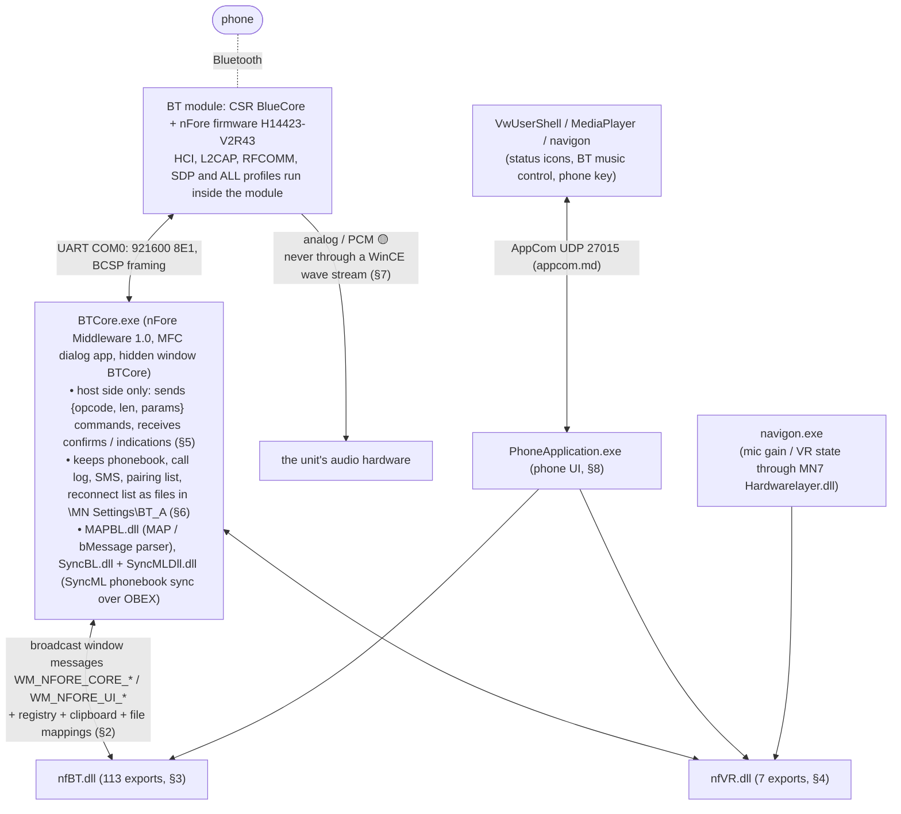

# Bluetooth / phone subsystem (static RE)

What: how the 4NSF does Bluetooth (hands-free, phonebook, SMS, music streaming) — chip, nFore stack (`BTCore.exe`), client DLLs (`nfBT.dll`, `nfVR.dll`), phone UI (`PhoneApplication.exe`).
Why: reuse the existing stack from a custom app, or know what a replacement device must provide.

Static analysis only (r2 + r2ghidra, strings, PE tables). Nothing run on a unit.
Legend: ✅ seen in disassembly/data/config (binary + VA given) · 🟡 inferred / single source · ❓ unknown.
Files are in `firmware/flash/BT/` unless stated. VAs: `BTCore.exe`, `PhoneApplication.exe` image base `0x10000`; `nfBT.dll` base `0x100000`; `nfVR.dll`, `MAPBL.dll`, `SyncBL.dll` base `0x10000000`. All code is ARM mode (not Thumb).

Related: [appcom.md](../apps/appcom.md) (AppCom wire format), [media-audio.md](media-audio.md) (audio priority policy), [hardware-layer.md](hardware-layer.md) (WolfSpecial, hidden flash, UART/GPIO), [user-shell.md](user-shell.md) (status icons), [boot-and-supervision.md](boot-and-supervision.md) (watchdogs), [shared-memory.md](../car/shared-memory.md) (car data, MFL keys).

## 1. Components



| Binary | Role | Evidence |
|---|---|---|
| `BTCore.exe` (349 KB; older 319 KB build in ROM `firmware/rom/modules/`) | host driver + data store for the nFore module. Version string `1.1.102.105`. Named object `Global\{182F2004-099A-452d-81EB-BDE50FA5662D}` (🟡 single-instance guard), class tag `CBTCoreApp` | ✅ strings at `0x161a4`, `0x4a388` |
| `nfBT.dll`, `nfVR.dll` | thin client stubs: post messages, deliver events to callbacks | ✅ §3, §4 |
| `MAPBL.dll` (9 exports `MAP_*`), `SyncBL.dll` (11 exports `Sync_*`), `SyncMLDll.dll` (150 exports `sml*`, SyncML toolkit) | statically imported by `BTCore.exe` only | ✅ import table |
| `APBTDll.exe` | nFore's own MFC test UI for `nfBT.dll` (buttons for DTMF, AVRCP test, MAP mode, NF test; can launch `\BTCore.exe`). Not started by any watchdog ini or script | ✅ strings |
| `ReadWriteBTAddress.exe` | boot-time BT address sync (§6.3) | ✅ |
| `PhoneApplication.exe` | Garmin/Navigon phone UI (MN7 framework), loads `nfBT.dll` + `nfVR.dll` | ✅ §8 |

Start-up order ✅ (`autorunce.mscr`, watchdog inis; details in [boot-and-supervision.md](boot-and-supervision.md)):

1. `ReadWriteBTAddress.exe` (`RunWait`, before the watchdog starts).
2. `WatchdogPuppy` starts `BTCore.exe` (no heartbeat event, restart on exit after 1 s, unlimited) and, 30 s grace, `PhoneApplication.exe -TSW_HIDE` (heartbeat event `ResyLightBtMainLoop`, 30 s, reset on timeout). `BT/Settings/ApplicationSettingsPathes.xml` also names `./BTCore.exe` (`<BTCoreExe>`): the phone app can start the core itself 🟡.
3. `BTCore` `OnInitDialog` (`0x3f618`…`0x3fe5c`): create `\MN Settings\BT_A\[setup\]`, read `BTEnv.txt`, `BTSystem.txt`, call log, contacts, `sms.dat`; open `WAV1:`; init SyncML + MAP libraries; load `reconnect.dat`; `WolfSpecial.dll!ResetBTChip` (GPIO 20 pulse, [hardware-layer.md](hardware-layer.md)); post `WM_NFORE_UI_POWER_STATE(2)`.
4. 🟡 Client calls `PowerOn` → BCSP link on `COM0:` (`HCI_OpenConnection` is reached only through a pointer; trigger not traced) → module reports `ProfilesInitOk` (ind 0x81) → paired list (ind 0xB9) → `WM_NFORE_UI_INITIAL_COMPLETE`.

## 2. IPC between `BTCore.exe` and its clients ✅

No sockets, no COM, no exported functions in `BTCore.exe`. Everything is **broadcast registered window messages** plus four side channels for data that does not fit in `wParam`/`lParam`.

| Mechanism | Direction | Details | Evidence |
|---|---|---|---|
| Registered window message | both | `PostMessageW(HWND_BROADCAST, RegisterWindowMessageW(L"WM_NFORE_CORE_…"), wParam, lParam)` for requests; `WM_NFORE_UI_…` for events. Async, no return value | nfBT `0x10e1fc`/`0x10e1ec` thunks, every export |
| Registry string slots | client → core | `HKCU\software\nFore\BTAP\DataCore`, values `Data_01`…`Data_50` (ring counter). String written, slot number sent as `lParam` | nfBT `0x101c00` |
| Registry string slots | core → client | `HKCU\software\nFore\BTAP\DataUI`, `Data_%02d`; slot number arrives as `lParam`; fields separated by `\n` | nfBT `0x101d84`, split `0x105874(…, '\n', …)` |
| **Clipboard** | both | `CF_UNICODETEXT` used as a string mailbox (`OpenClipboard(0)`, `EmptyClipboard`, `SetClipboardData(13, …)` / `GetClipboardData(13)`). Used for PIN code (client→core) and inquiry names, call-log rows, phonebook rows, SSP data (core→client) | nfBT `0x101ef0` (put), `0x101fac` (get); nfVR `0x10001000` |
| Byte buffer via messages | both | `…_BUFFER_CLEAR` (zero 0x400-byte buffer), then one `…_BUFFER_DATA` message **per byte** (`wParam`=offset, `lParam`=value). `WM_NFORE_UI_TEMP_INT` (`wParam`) = one spare integer | nfBT wndproc `0x10aeb8`; `SppSend` `0x1030a0` |
| Named file mappings | core → client | `DeviceInfoShareMemory` (0x400), `MAPShareMemory` (0x200A), `AvrcpExtShareMemory_%d` (0x400, `%d` = AVRCP event code) — layouts in §2.2 | nfBT `0x10aeb8` |
| Registry lists | core → client | `HKCU\software\nFore\BTAP\PairedDeviceAP` (`Total`, `DeviceName_%d`, `DeviceAdd_%d`, `DeviceCod_%d`), `…\ServiceSearch`, `…\SppBuffer`, `…\BTAP` (`AutoPowerOn`, `LogBin`) | nfBT `GetPairedDeviceAt` `0x102658` |

Consequences:

- Any process can drive the stack without `nfBT.dll`: register the same message names and post to `HWND_BROADCAST`. Any process with a top-level window also *receives* every event.
- Several clients can coexist (PhoneApplication + a custom app), but they share the clipboard, the `Data_xx` slots and the byte buffer → races. 🟡
- The clipboard is clobbered by the BT stack at run time (side effect for any app using copy/paste).

### 2.1 Client windows

| DLL | Hidden window class | WndProc | Created |
|---|---|---|---|
| `nfBT.dll` | `RT5544564546_CE` | `0x10aeb8` | `DllMain(PROCESS_ATTACH)` → `0x10de2c` (`RegisterClassW` + `CreateWindowExW`, no parent, not visible) |
| `nfVR.dll` | `RT5544564547_CE` | `0x100010b4` | same pattern, `0x10001450` |

The wndproc compares the message id against `RegisterWindowMessageW(name)` for each known name (linear chain) and calls the registered callback.

### 2.2 Shared-memory layouts (as read by `nfBT.dll`)

```c
// "DeviceInfoShareMemory", 0x400 bytes — valid when WM_NFORE_UI_CONNECTED_DEV arrives   (nfBT 0x10bc48…)
struct DeviceInfo {
    uint8_t  name_len;        // +0x00  clamped to 0x80
    char     name[0x80];      // +0x01  device name, 8-bit chars (converted with MFC CString(LPCSTR))
    uint8_t  bd_addr[6];      // +0x81
    uint8_t  cod[4];          // +0x87  class of device
};

// "MAPShareMemory", 0x200A bytes — valid on WM_NFORE_UI_SMS_DATA_S / WM_NFORE_UI_NEW_SMS_DATA   (nfBT 0x10c014, BTCore 0x1a9xx)
struct MapShare {
    uint32_t len;             // +0x00  number of UTF-16 units in text
    uint8_t  bd_addr[6];      // +0x04  phone the SMS came from (filled only for NEW_SMS_DATA)
    wchar_t  text[0x1000];    // +0x0A  (unaligned) fields separated by '\v' (0x0B): field0 \v field1 \v body… \v lastField
};                            //        writer accepts up to 0x1FF5 characters although only 0x1000 fit 🟡 (latent overflow)

// "AvrcpExtShareMemory_<event>", 0x400 bytes — valid on WM_NFORE_UI_AVRCP_STATE(wParam=event)
struct AvrcpExt {
    uint8_t  unused;          // +0x00
    uint8_t  len;             // +0x01
    uint8_t  data[len];       // +0x02  raw AVRCP 1.3 response PDU; DLL turns it into "XX:XX:…" hex text and parses it
};
```

## 3. `nfBT.dll` API (export name `BTDLL.dll`, 113 exports) ✅

All functions are `__cdecl`, return immediately (they only post a message); results come back through the callbacks of §3.3. "str" = `LPCWSTR`. `addr` = `BYTE[6]` passed as pointer; it is packed into `wParam` high word (2 bytes) + `lParam` (4 bytes).

### 3.1 Requests

| Export (VA) | Prototype (recovered) | Message `WM_NFORE_CORE_…` (wParam, lParam) | Purpose |
|---|---|---|---|
| `RegisterCallBack` 0x1020d4 | `void (fn0 … fn58)` — 59 function pointers | — | §3.3 |
| `GetCoreVersion` 0x1022dc | `void()` | `VERSION` (0,0) | → cb1 |
| `PowerOn` 0x102308 / `PowerOff` 0x102344 | `void()` | `POWER_ON` / `POWER_OFF` | radio on/off (core logs "Power off not support" in one path 🟡) |
| `PowerAutoOn` 0x102370 | `BOOL(BOOL query, BOOL on)` | `POWER_SET_AUTO` (on,0); query reads reg `AutoPowerOn` | power on at core start |
| `CloseBTCore` 0x102428 | `void()` | `APP_CLOSE` | ask core to exit |
| `GetPowerStatus` 0x102454 | `void()` | `POWER_GET_STATE` | → cb2 |
| `GetLocalDeviceStatus` 0x102480 | `void()` | `GET_LOCAL_DEV_STATE` | → cb3 (10 state bytes) |
| `GetFWVersion` 0x1024ac / `GetLocalDeviceName` 0x1024ec | `void()` | `GET_LOCAL_DEV_INFO` (sets pending bit 2 / 1) | → cb4 / cb5 |
| `SetLocalDeviceName` 0x10252c | `void(str)` | `SET_LOCAL_DEV_NAME` (0, slot) | |
| `InquiryDevice` 0x102580 | `void(int start)` | `INQUIRY` (start,0) | 1 start / 0 stop 🟡 |
| `PairRemoteDevice` 0x1025b0 | `void(int inquiryIdx)` | `PAIR_REMOTE_DEVICE` (idx,0) | pair + connect an inquiry result |
| `GetPairedDeviceTotal` 0x1025e0 | `int()` | — (reads reg `PairedDeviceAP\Total`) | |
| `GetPairedDeviceAt` 0x102658 | `void(int i, wchar_t* name, wchar_t* addrText, BYTE* cod)` | i==0xFF → `GET_PAIRED_DEVICE` (0xFF,0) = refresh registry; else reads reg | |
| `EstablishSLCPairedDeviceAt` 0x10286c | `void(int i, int profile)` | `PAIRED_ESTABLISH_SLC` (i, profile) | connect paired device |
| `DeletePairedDeviceAt` 0x1028a0 | `void(int i)` | `DELETE_PAIRED_DEVICE` (i,0) | core: special value = delete all |
| `Disconnect` 0x1028d0 | `void(int option, BYTE* addr)` | `DISCONNECT_SLC` (option \| addr[4..5]<<16, addr[0..3]) | |
| `SetVisibility` 0x102938 | `void(int)` | `VISIBILITY` | discoverable on/off |
| `AudioTransfer` 0x102968 | `void(int)` | `AUDIO_TRANSFER` | SCO to phone / to unit |
| `Answer` 0x102998 / `Reject` 0x1029c4 / `Terminate` 0x1029f0 / `ReDial` 0x103134 | `void()` | `ANSWER` / `REJECT` / `TERMINATE` / `REDIAL` | call control |
| `Dial` 0x102a1c | `void(str number)` | `DIAL` (0, slot) | |
| `DTMF` 0x102a70 | `void(int ch)` | `DTMF` (ch,0) | |
| `SetVolume` 0x102aa0 / `GetVolume` 0x102ad0 | `void(int)` / `void()` | `SET_HFP_VOLUME` / `GET_HFP_VOLUME` | → cb27 |
| `Mute` 0x102afc | `void(int)` | `MIC_MUTE` | → cb36 |
| `GetPhoneBookTotal` 0x102b2c | `void()` | `PB_GETS` (0,1) | → cb14 |
| `GetPhoneBookDataAt` 0x102b68 | `void(int i)` | `PB_GETS` (i,i) | → cb15 |
| `GetPhoneBookDatas` 0x102b98 | `void(int from, int to)` | `PB_GETS` (from,to) | → cb16 (≤1000 rows) |
| `GetPhoneBookDownLoad` 0x102bcc | `void(int mode)` | `PB_DOWNLOAD` (mode,0) | start/stop download from phone |
| `GetPhoneBookSearch` 0x102bfc | `void(str number)` | `PB_SEARCH_NUM` (0, slot) | number → name, → cb19 |
| `PhoneBookClear` 0x102c50 | `void(int)` | `PB_CLEAR` | |
| `GetCallHistoryTotal` 0x102c80 | `void()` | `GET_CALLLOG_SUM` | → cb20 |
| `GetCallHistoryDataAt` 0x102cac | `void(int, int)` | `GET_CALLLOG_AT` | → cb21 |
| `CallHistoryDownload` 0x102ce0 | `void(int)` | `CALLLOG_DOWNLOAD` | |
| `CallHistoryClear` 0x102d10 | `void(int, int)` | `CALLLOG_CLEAR` | |
| `SetPinCode` 0x102d44 | `void(str pin)` | pin → clipboard, then `PIN_CODE` (0,0) | legacy pairing reply (core: text `reject` = refuse 🟡) |
| `SetPinCodeAuto` 0x102d94 | `void(int)` | `SET_AUTO_PIN_CODE` | fixed PIN auto-reply |
| `SSPconfirmation` 0x1038f4 | `void(int accept)` | `SSP_CONFIRMATION` | Secure Simple Pairing numeric-comparison reply |
| `GetSMSTotal` 0x102dc4 / `GetSMSDataAt` 0x102e00 | `void()` / `void(int)` | `SMS_GETS` | → cb25 / cb26 |
| `SMSDownload` 0x1031e4 | `void(int type, int count, int action, BOOL* accepted)` | `SMS_DOWNLOAD` (type \| action<<16, count); type 4 is sent as 5 | action 1 start (sets busy flag), 2/3 only when idle/busy |
| `SMSClear` 0x1033d4 | `void()` | `SMS_CLEAR` | |
| `SendSMS` 0x102e30 | `void(str number, str text)` | `CSTRING_QUEUE` (0, slot) → `Sleep(10)` → `SMS_SEND` (0, slot) | |
| `MAPSetNotification` 0x103374 / `MAPSetDLType` 0x1033a4 | `void(int)` | `SET_MAP_NOTIFICATION` / `SET_MAP_DL_TYPE` | new-SMS push on/off; download by MAP vs AT |
| `SetAutoReconnect` 0x102ecc | `void(int)` | `SET_AUTO_RECONNECT` | |
| `SetReconnectionDuration` 0x103744 / `SetPageTime` 0x103778 | `BOOL(int)` | `SET_RECONNECTION_DURATION` / `SET_PAGE_TIME` | DLL itself sends `SET_PAGE_TIME(0x2000)` after `INITIAL_COMPLETE` |
| `SetRingToneLevel` 0x102efc | `void(int, int)` | `SET_RING_TONE_LEVEL` | → cb28 |
| `SetDspParam` 0x1037ac | `BOOL(int)` | `SET_DSP_PARAM` | echo/noise DSP preset (§5) |
| `AVRCPCmd` 0x103014 | `void(int cmd, int a, int b)` | `AVRCP_CMD` (cmd, a \| b<<16); cmd 0x13: first `AVRCP_CMD_INTERVAL` (b,0) | pass-through + AVRCP 1.3 metadata (§3.4) |
| `ShowA2DPService` 0x103314 / `ShowAVRCPService` 0x103344 | `void(int)` | `SHOW_A2DP_SRV_RESPONSE` / `SHOW_AVRCP_SRV_RESPONSE` | expose/hide SDP record 🟡 |
| `GetA2DPSupport` 0x1037e0 / `GETAVRCPSUPPORT` 0x103820 | `BOOL(int)` / `int()` | `GET_A2DP_SUPPORT` | |
| `SetActiveDevice` 0x103280 | `void(int profile, BYTE* addr)` | `SET_ACTIVE_DEVICE` | multi-device: choose active phone per profile |
| `GetAllActiveDevice` 0x1032e8 | `void()` | `GET_ALL_ACTIVE_DEVICE` | → cb44 |
| `GetCurrentCalls` 0x103960 | `void()` | `GET_CURRENT_CALLS` | AT+CLCC → cb34 |
| `ServiceSearch` 0x103924 | `void(int)` | `SERVICE_SEARCH` | SDP query → cb50/cb53 |
| `SppSend` 0x1030a0 | `void(int len<256, BYTE* data)` | `BUFFER_CLEAR`, len × `BUFFER_DATA`, `SPP_SEND` (len,0) | serial-port profile TX |
| `SppSendDataCmd` 0x103830 | `void(int len, BYTE* data)` | reg `SppBuffer` + `SPP_BUFFER` | same, via registry |
| `AddModem` 0x103160 / `AddRasEntry` 0x104a0c / `GPRSConnect` 0x10318c / `GPRSHandup` 0x1031b8 | `void()` / `void(str, str)` | `ADD_MODEM` / `ADD_RAS_ENTRY` / `CONNECT_GPRS` / `HANGUP` | DUN dial-up through the phone (Unimodem + RAS) |
| `LogBin` 0x102f30 | `BOOL(int)` | `LOG_BIN`; 0xFF = query reg `LogBin` | binary packet log to `\MN Settings\BTlogBin.txt` — cheap way to capture the module protocol on a live unit 🟡 |
| `NFTest` 0x103400 / `NFTest02` 0x103430 | `void(int)` | `NF_TEST` | factory test |

### 3.2 AVRCP 1.3 helpers (local, no message unless `SendCmd_…`)

`GetAvrcp*` exports return data cached from the last `AvrcpExtShareMemory_%d` event: `GetAvrcpSongLength/Pos/State` (ints), `GetAvrcpElementAttrCount`, `GetAvrcpElementAttrByIndex_(i, int* attrId, int* charset, int* len, CString* text)`, `GetAvrcpAppAttrList`, `GetAvrcpAppValueList`, `GetAvrcpExtensionCapability[Count]`, `GetAvrcpExtensionSetNotification[Count]`; 11 C++ exports `CString GetAvrcp<X>()` return the raw hex text of each PDU. `SendCmd_GetAvrcpSongInfo` = `AVRCP_CMD(0x11)`, `SendCmd_GetAvrcpElementAttr` = `AVRCP_CMD(0x12)`, `SendCmd_SetAvrcpNotification(a,b)` = `AVRCP_CMD(0x13,a,b)`, sent only when the remote reported AVRCP 1.3 support (event 0x1A with `TEMP_INT==1`; the DLL then sends `AVRCP_CMD(0x10)` = get capabilities).

### 3.3 Callbacks = events ✅

`RegisterCallBack` takes 59 pointers (4 in registers + 55 on stack) and stores them in a table at `0x1162b0`. Index = argument position (0-based). NULL is allowed. Names = log strings of `PhoneApplication.exe`'s wrapper class `CBTMDLLAccess` (matched by event and argument list 🟡). Callbacks run on the thread that owns the hidden window (the thread that loaded the DLL must pump messages).

| # | Name (PhoneApplication log) | Event `WM_NFORE_UI_…` | Callback arguments | Meaning |
|---|---|---|---|---|
| 0 | `OnRequestError` | `REQUEST_ERROR` | `(int code)` | request rejected |
| 1 | `OnCoreVersion` | `VERSION` | `(str)` | core version |
| 2 | `OnPowerStatus` | `POWER_STATE` | `(int)` | |
| 3 | `OnLocalDeviceStatus` | `DEV_STATE` | `(BYTE* state10)` | 10 local-state bytes |
| 4 / 5 | `OnFWVersion` / `OnLocalDeviceName` | `DEV_INFO` | 4: `(str fwVersion)` · 5: `(str name, BYTE addr[6])` | which one fires depends on the pending request |
| 6 | `OnInquiryAdd` | `INQUIRY` | `(BYTE idx, BYTE addr[6], DWORD* cod)` | one device found |
| 7 | `OnInquiryName` | `INQUIRY_NAME` | `(int idx, str name)` | name resolved |
| 8 | `OnInquiryEnd` | `INQUIRY_END` | `()` | |
| 9 | `OnPairStatus` | `PAIRED_STATUS` | `(int)` | 0 ok / 1 fail (core strings) |
| 10 | `OnConnectedDevice` | `CONNECTED_DEV` | `(int wParam, str name, BYTE addr[6], BYTE cod[4])` | from `DeviceInfoShareMemory` |
| 11 | `OnDisconnectDevice` | `DISCONNECT_DEV` | `(BYTE id, BYTE addr[6])` | |
| 12 | `OnDeletePairedDevice` | `DELETE_PAIRED_DEVICE` | `(int, int)` | |
| 13 | `OnOppDownload` | `OPP_DL` | `(int)` | OPP object received |
| 14 / 15 / 16 | `OnPhoneBookTotal` / `OnPhoneBookData` / `OnPhoneBookDatas` | `PB_DATA_S` | 14: `(int total)` · 15: one row by value · 16: `(int n, int tempInt, Row* rows)` | phonebook rows; `Row` = 0x124 bytes |
| 17 | `OnPhoneBookDownloading` | `PB_DLING` | `(str "", int progress)` | download progress |
| 18 | `OnPhoneBookDownloadEnd` | `PB_DL_END` | `(int)` | |
| 19 | `OnPhoneBookSearched` | `CORE_PB_SEARCH` (reply) | `(str)` | name for number |
| 20 | `OnCallHistoryTotal` | `CALLLOG_SUM` | `(int)` | |
| 21 | `OnCallHistoryData` | `CALLLOG_DATA` | `(int type, str, str, str)` | type from text `out`=0 / `in`=1 🟡 / `miss`=2 |
| 22 | `OnFileAccess` | `FILE_ACCESS` | `(int)` | storage error |
| 23 | `OnPairing` | `PIN_CODE` | `(str name, BYTE addr[6], DWORD* cod)` | PIN requested |
| 24 | `OnCallerID` | `CALLER_ID` | `(str, str)` | number, name |
| 25 / 26 | `OnSMSTotal` / `OnSMSDataAt` | `SMS_DATA_S` | 25: `(int total)` · 26: `(str f0, str f1, str body, int wParam)` | from `MAPShareMemory` |
| 27 | `OnVolume` | `HFP_VOLUME` | `(int)` | |
| 28 | `OnRingToneVolume` | `RING_TONE_LEVEL` | `(int)` | |
| 29 | `OnInitialComplete` | `INITIAL_COMPLETE` | `()` | stack ready |
| 30 | `OnAVRCPState` | `AVRCP_STATE` | `(int event, int lParam)` | |
| 31 | `OnA2DPStreamState` | `A2DP_STREAM_STATE` | `(int)` | play / pause-stop |
| 32 | `OnDUNState` | `DUN_STATE` | `(int)` | |
| 33 | `OnSppData` | `SPP_DATA` | `(int len, BYTE* buf)` | |
| 34 | `OnCurrentCalls` | `CURRENT_CALLS` | `(str, str, int wParam, int tempInt)` | |
| 35 | `OnRasConnectStatus` | `RAS_CONNECT_STATUS` | `(int)` | |
| 36 | `OnMicMuteState` | `MIC_MUTE_STATE` | `(int)` | |
| 37 | `OnRasHangupResponse` | `RAS_HANGUP_RESPONSE` | `(int)` | |
| 38 | `OnSMSNewData` | `NEW_SMS_DATA` | `(str f0, str f1, str body, BYTE addr[6])` | incoming SMS (MAP notification) |
| 39 | `OnSmsDownload` | `SMS_PDU_DATA` | `(int)` | |
| 40 | `OnSmsDownloadEnd` | `SMS_PDU_END`, `SMS_DOWNLOAD_RESPONSE` (low byte ≠ 0) | `()` | SMS download finished |
| 41 | `OnDeviceState` | `PROFILE_STATE` | `(BYTE profile, BYTE addr[6], BYTE state)` | profile ∈ {1,2,3,4,5,6,9,0xE,0xF} |
| 42 | `OnChangeActiveDevice` | `ACTIVE_DEVICE` | `(BYTE profile, BYTE addr[6])` | |
| 43 | `OnSetActiveDeviceResponse` | `SET_ACTIVE_DEVICE_RESPONSE` | `(int lParam, int wParam)` | |
| 44 | `OnAllActiveDevice` | `TABLE_ACTIVE_DEVICE_START/DATA/END` | `(BYTE n, BYTE profile[14], BYTE addr[14][6])` | all connections |
| 45 / 46 | `OnShowA2DPServiceResponse` / `OnShowACRCPServiceResponse` | `SHOW_A2DP_SRV_RESPONSE` / `SHOW_AVRCP_SRV_RESPONSE` | `(int)` | |
| 47, 48 | 🟡 `OnNFTestState`, `OnAVRCPStateExt` | — | never called by the DLL | |
| 49 | `OnSppSendDataCmd` | `SPP_BUFFER` | `(int)` | |
| 50 / 53 | 🟡 `OnGetA2DPSupport` / `OnServiceSearch` | `SERVICE_SEARCH` | 50: `(int, int, int)` · 53: `(WORD, BYTE addr[6])` | SDP result |
| 51 | `OnSPPConfirmation (sic)` | `SSP_CONFIRMATION` | `(int)` | |
| 52 | `OnSPPNumericValue (sic)` | `SSP_NUMERIC_VALUE` | `(int, BYTE addr[6], int, str, BYTE* )` | show 6-digit code |
| 54 / 55 / 56 | `OnHFPSignal` / `OnHFPRoam` / `OnBatteryCharging` | `HFP_SIGNAL` / `HFP_ROAM` / `HFP_BATTCHG` | `(int devId, int level 0..5)` | phone indicators |
| 57 | `OnAudioTransfer` | `AUDIO_TRANSFER` | `(int)` | SCO state |
| 58 | `OnCloseBTCore` | `CLOSE_BTCORE` | `(int)` | core exiting |

Events with no callback: `HFP_STATE`, `AG_STATE`, `PAIRED_NAME`, `SMS_PDU_START`.

## 4. `nfVR.dll` API (export name `BTDLL.dll`, 7 exports) ✅

Same mechanism, separate hidden window. Loaded by `PhoneApplication.exe` and by `navigon.exe` (copy in `NAVIGON/`, identical; third copy in ROM).

| Export | Message | Purpose |
|---|---|---|
| `RegisterCallBack(onRequestError, onVRState, onVoiceOutPath, onMicVol)` 0x10001310 | — | events `WM_NFORE_UI_REQUEST_ERROR(int)`, `…_VR_STATE(int)`, `…_VOICE_OUT_PATH(int,int)`, `…_MIC_VOL(int,int)` |
| `VRState(int)` 0x10001360 | `WM_NFORE_CORE_VR_STATE` | phone voice-recognition (HFP `AT+BVRA`) on/off/query |
| `VoiceOutPath(int)` 0x10001390 | `WM_NFORE_CORE_VOICE_OUT_PATH` | select call audio output path |
| `MicVol(int)` 0x10001330 | `WM_NFORE_CORE_MIC_VOL` | set / get microphone gain |
| `SetMicBias(int)` 0x100013f0 | `WM_NFORE_CORE_SET_MIC_BIAS` | mic bias on/off |
| `SetSpeakerAmpPower(int)` 0x100013c0 | `WM_NFORE_CORE_SET_SPEAKER_AMP_PWR` | internal speaker amplifier |
| `SetEarphoneAmpPower(int)` 0x10001420 | `WM_NFORE_CORE_SET_EARPHONE_AMP_PWR` | line/earphone amplifier |

## 5. `BTCore.exe` ↔ Bluetooth module ✅

Key point: **`BTCore.exe` is not a Bluetooth host stack.** It contains no L2CAP/RFCOMM/SDP/profile code. The module firmware does everything; the host sends short commands and gets events. A replacement host needs only this protocol (and the BCSP framing) to reuse the module.

### 5.1 Transport

| Item | Value | Evidence |
|---|---|---|
| Port | `COM0:` (`uart_driver.dll`, UART @ `0x101FD000`, see [hardware-layer.md](hardware-layer.md)) | static init `0x4a5e8`; `HCI_OpenConnection` `0x44958` |
| Line settings | from `<exe dir>\BTSystem.txt` (text, `KEY=value` lines: `BAUDRATE`, `BYTESIZE`, `PARITY`, `STOPBITS`, `NF_TEST_SIZE`). **File is not shipped** → defaults set in `OnInitDialog`: **921600 baud, 8 data bits, even parity, 1 stop bit**. Log text says "rate 115200" but that number is a constant in the log call, not the DCB | parser `0x26bb8`; defaults `0x63724=0xE1000`, `0x63732=8`, `0x63733=2 (EVENPARITY)`, `0x63734=0`; DCB filled at `0x44958` |
| DCB extras | `XonChar 0x11`, `XoffChar 0x13`, `XonLim/XoffLim 100`, flow-control bits cleared; `SetupComm(0x400C, 0x400C)`; read timeout: interval `MAXDWORD`, total constant 1000 ms | `0x44958` |
| Framing | CSR **BCSP** (SLIP-like framing, sequence/ack, link establishment "sync/conf") implemented in the exe: two worker threads `0x42ca0` / `0x442a8` (one is `BCSPWriteThread`), link establishment `0x438b8` | strings `[BCSP] …`, `0x44958` |
| Chip reset | `\Windows\WolfSpecial.dll!ResetBTChip` (`LoadLibrary` + `GetProcAddress`) | `0x19094` |
| Firmware / PSKEY download | none found. BCCMD is used only to enable/resize CSR "Fast Pipe" (bulk data for PAN) | strings `[Fast Pipe] bccmd…` |

Receive demultiplexing (`RxThread` `0x3112c`, `HCI_ReadPacket` `0x43aa0` returns BCSP channel + payload):

| BCSP channel | Payload | Goes to |
|---|---|---|
| 6 | 4-byte header: `hdr[0..1]` = u16 LE length in 16-bit words incl. header = `(n+1)/2 + 2`, `hdr[2]` = sub-channel, `hdr[3]` = 2 for even `n`, 1 when one pad byte was added (odd `n`); then `n` payload bytes. Same header on TX (`0x17bc4` → `HCI_WritePacket(6, …)` `0x43f9c`) | sub-channel **1** = command/event stream (reassembled until `len+2` bytes, queued, `PostMessage(dlg, 0x8002)`); **3** → `0x238a4` 🟡 SPP data; **4** → written to `COM14` (log text; virtual serial port 🟡 PAN/SPP); **8** → written to `COM12` (🟡 DUN modem data; `VSP8:` is opened for DUN) |
| 7 | 5 × u16 header + data | Fast Pipe / ACL-style data (PAN) 🟡 |
| 2 | BCCMD reply | Fast Pipe set-up |

### 5.2 Command / event packet

```
host → module : OP LEN PARAM[LEN]        (builders: CBtAdapter methods 0x14198…0x16008, packet at this+0x109; send 0x17bc4)
module → host : OP LEN STATUS/DATA…      OP < 0x80 = confirm of the command with the same OP (STATUS 0 = ok)
                                         OP ≥ 0x80 = unsolicited indication
dispatcher 0x140a4: two tables {opcode, handler thunk} — confirms 0x61698 (55 rows), indications 0x61bc0 (63 rows);
thunks call virtual methods of the dialog's adapter object (vtable 0x55bd0).
```

Commands (✅ opcode + parameter bytes from the builder; meaning from the log string at the call site, 🟡 where marked):

| OP | Params | Meaning | Sent for |
|---|---|---|---|
| 0x12 | – | get local device info (name, address, fw `H%d-V%dR%d`) | `GET_LOCAL_DEV_INFO` |
| 0x13 | – | get local device state (10 bytes) | `GET_LOCAL_DEV_STATE` |
| 0x16 | name bytes | set local device name | `SET_LOCAL_DEV_NAME` |
| 0x17 | mode | visibility / connectable | `VISIBILITY` |
| 0x1C | `00 1C 10` start · `01 05 06` stop 🟡 | inquiry | `INQUIRY` |
| 0x1D | addr[6] | SDP service search | `SERVICE_SEARCH` |
| 0x1E | addr[6] | remote name request | during inquiry |
| 0x20 | PIN bytes | PIN reply | `PIN_CODE` |
| 0x21 | 0/1 | pairing accept / reject | `PIN_CODE` (`reject`) |
| 0x22 | addr[6] | pair with device | `PAIR_REMOTE_DEVICE` |
| 0x23 | – | read paired-device list from module | `GET_PAIRED_DEVICE`, start-up |
| 0x24 | index (0xFF 🟡 = all) | delete paired device | `DELETE_PAIRED_DEVICE` |
| 0x25 | profile, [addr] | connect profile (establish SLC) | `PAIRED_ESTABLISH_SLC`, auto-reconnect |
| 0x26 | option, addr[6] | disconnect | `DISCONNECT_SLC` |
| 0x29 / 0x2A / 0x2B | – | answer / terminate 🟡 / reject call (three adjacent builders; exact pairing of 0x2A/0x2B ❓) | `ANSWER`, `TERMINATE`, `REJECT` |
| 0x2C | digits | dial | `DIAL` |
| 0x2E | – | redial | `REDIAL` |
| 0x30 | 0/1 | audio transfer (SCO to phone / to unit) | `AUDIO_TRANSFER` |
| 0x31 | char | DTMF | `DTMF` |
| 0x32 | level | HFP speaker volume | `SET/GET_HFP_VOLUME` |
| 0x33 | level | microphone volume | `MIC_VOL` |
| 0x38 | – | list current calls (CLCC) | `GET_CURRENT_CALLS` |
| 0x3B | key, hi, lo | AVRCP pass-through / A2DP volume (`FB`/`FD` = volume up/down) | `AVRCP_CMD` |
| 0x3D | sub, … | AVRCP 1.3 metadata commands (sub = PDU id 0x10…) | `AVRCP_CMD` 0x10–0x18 |
| 0x3E | a, b, 0 | phonebook / call-list download start/stop | `PB_DOWNLOAD`, `CALLLOG_DOWNLOAD` |
| 0x44 | n | read SMS | `SMS_GETS` 🟡 |
| 0x45 | text | send SMS | `SMS_SEND` |
| 0x4A | data | SPP send | `SPP_SEND` |
| 0x4E | data | factory test | `NF_TEST` |
| 0x4F | 1/0 | mic mute / unmute | `MIC_MUTE` |
| 0x52 | addr[6] + 4 | 🟡 store link / device attributes after pairing | after `PairingStatus ok` |
| 0x53 | a, b | ring-tone level | `SET_RING_TONE_LEVEL` |
| 0x54 | … | OBEX command (`Adapter::SetOBEXCmd`: action, more-data flag, package) — carries SyncML packets | SyncML phonebook sync |
| 0x57 | n | phone voice recognition on/off/query | `VR_STATE` |
| 0x58 | n | voice (audio) output path | `VOICE_OUT_PATH` |
| 0x5B | 96 bytes | EQ / DSP coefficient block; sent only if `\parameters.dat` exists (hex text, 8 bytes per line; not shipped) | `0x262c0` |
| 0x5E | hi, lo | DSP parameter (echo cancel / noise reduction preset) | `SET_DSP_PARAM` |
| 0x5F | n | SSP numeric-comparison reply | `SSP_CONFIRMATION` |
| 0x60 | sub, … | misc: `01`+addr set active device · `02` get active devices · `50 x` show A2DP service · `51 x` show AVRCP service · `52`, `53` ❓ · `54 hi lo` page time | several |
| 0x61 | sub, … | MAP client: `01 x` notification on/off · `04 x` ❓ · `20 …` get message | `SET_MAP_NOTIFICATION`, SMS download by MAP |

Events (✅ opcode → handler; names = the stack's own log strings):

| OP | Handler | Name / effect |
|---|---|---|
| 0x81 | 0x24ff0 | `OnIndProfilesInitOk` — module ready → host asks device info |
| 0x82 | 0x1bb5c | `OnIndPairingRequest` (addr, COD) → `WM_NFORE_UI_PIN_CODE` |
| 0x83 | 0x25070 | `OnIndPairingStatus` 0 ok / 1 fail → `UI_PAIRED_STATUS` |
| 0x85 | 0x25298 | `OnIndSCOState` → audio path switch (§7) |
| 0x89 | 0x317e8 | `OnIndCallerId` → phonebook lookup → `UI_CALLER_ID` |
| 0x8D / 0x8E / 0x8F | 0x1c96c / 0x1ca48 / 0x1cb24 | HFP signal / roam / battery (0…5) |
| 0x93 | 0x3474c | `OnIndCurrentCalls` |
| 0x95 / 0xB6 | 0x1fea0 / 0x1ff74 | A2DP sink / source state |
| 0x96 | 0x1fd80 | A2DP stream play / pause-stop → `UI_A2DP_STREAM_STATE` |
| 0x97 / 0xB7 | 0x20048 / 0x2011c | AVRCP controller / target state |
| 0xB8 | 0x20860 | AVRCP command **from the phone** (vol up/down, play, stop, pause, forward, rewind) |
| 0xE2 | 0x188e8 | AVRCP 1.3 response → `AvrcpExtShareMemory_%d` + `UI_AVRCP_STATE` |
| 0x98 / 0x99 | 0x201f0 / 0x202a0 | SPP state / SPP data in |
| 0x9B / 0x9C / 0x9D | … | OPP server start / data / complete → `UI_OPP_DL` (vCard push from phone) |
| 0xA2–0xA5 | 0x1cbf8… | PBAP client: state, start (SIM / ME / missed / received / dialed), data (vCard chunks), complete |
| 0xA8 | 0x2a760 | DUN client state |
| 0xA9 / 0xAA / 0xAB | … | AT-command phonebook (`AT+CPBR` style) start / entry / complete — fallback when PBAP is missing |
| 0xAC | 0x1c48c | `OnIndNewConnection` (profile id, addr, name) → `DeviceInfoShareMemory` + `UI_CONNECTED_DEV` |
| 0xBB | 0x17f00 | disconnected → `UI_DISCONNECT_DEV`, may start reconnect |
| 0xBE | 0x1c918 | `OnIndLinkLoss` → multi-reconnect |
| 0xB9 | 0x267f4 | `OnIndPairedDeviceListComplete` → `UI_INITIAL_COMPLETE` |
| 0xC0 | 0x25370 | `OnIndNewSms` (AT `+CMT` path) |
| 0xC5 | 0x1e3ac | AG state |
| 0xC6 | 0x29bf0 | OBEX data for SyncML (`SyncCBK_*`) |
| 0xC7 | 0x1faec | `OnSpkAmpMute` (module asks to mute/unmute the speaker amp; only logged) |
| 0xC8 | 0x1f578 | SSP numeric value → `UI_SSP_NUMERIC_VALUE` |
| 0xD3 | 0x3f2ec | phonebook session status (start/end phonebook / call log) |
| 0xD9 | 0x1e47c | phone voice-recognition state |
| 0xDA | 0x338cc | `OnIndProfileState` (profile, state, addr) → `UI_PROFILE_STATE`; drives auto call-log download and audio |
| 0xDB / 0xDC | 0x1e52c / 0x1e72c | active device / table of active devices |
| 0xDD–0xE0 | 0x1e860… | SMS PDU list (`AT+CMGL` path): start, header, PDU, complete |
| 0xE1 | 0x1ed40 | MAP client data (local/remote message start / data / complete) |

### 5.3 Enums ✅

| Enum | Values | Evidence |
|---|---|---|
| Profile id (`PROFILE_STATE`, `CONNECTED_DEV`, `EstablishSLCPairedDeviceAt`, `SetActiveDevice`) | 1 HFP · 2 A2DP sink · 3 AVRCP controller · 4 SPP · 5 A2DP source · 6 AVRCP target · 9 "AG" 🟡 · 0xE MAP · 0xF PAN (0xD ❓) | `OnIndNewConnection` `0x1c48c`, `0x338cc` |
| HFP state (profile 1) | 1 `HFP_READY` · 2 `HFP_CONNECTING` · 3 `HFP_CONNECTED` · 4 `HFP_OUTGOING_CALL` · 5 `HFP_INCOMING_CALL` · 6 `HFP_ACTIVE_CALL` | `0x33a80…0x33e24` |
| Other profiles | state 3 = connected (MAP: "Support MAP CMD"); A2DP 5 = streaming 🟡 | `0x33f3c`, `0x33e90` |
| Power state | 2 = core started, radio not yet on (posted at end of `OnInitDialog`); others ❓ | `0x3fe5c` |
| Pairing status | 0 ok, 1 fail | `0x25070` |
| Call-log type text | `out`, `in` 🟡, `miss` | nfBT `0x10b660` |

### 5.4 Profiles and roles

| Profile | Role of the unit | Evidence |
|---|---|---|
| HFP (+ headset fallback "Profile is HEADSET") | hands-free unit; indicators signal/roam/battery, CLCC, voice recognition, DTMF, in-band audio transfer | ind 0x8D–0x93, 0xD9 |
| A2DP | sink (phone → unit); source role exists in the module (state event) but no host feature uses it | ind 0x95 / 0xB6 |
| AVRCP | controller (1.0 pass-through + 1.3 metadata/notifications) and target (phone volume keys) | ind 0x97 / 0xB7 / 0xB8 / 0xE2 |
| PBAP | client (phonebook `SIM`/`ME`, call lists) | ind 0xA2–0xA5 |
| SyncML over OBEX | client, tried first for phonebook ("SyncML first" / "Skip SyncML" switches) | `SyncBL.dll`, cmd 0x54 |
| AT phonebook / AT SMS | fallback over the HFP RFCOMM link | ind 0xA9–0xAB, 0xDD–0xE0 |
| MAP | client (inbox list, get message, new-message notification) | cmd 0x61, ind 0xE1, `MAPBL.dll` |
| OPP | server (receive vCards) | ind 0x9B–0x9D |
| SPP | both (`SPPClient`/`SPPServer` write paths) | strings, cmd 0x4A |
| DUN | client: registers a Unimodem "Bluetooth Modem" + RAS entry `BT Connection`, `AT+cgdcont=1,"ip","<apn>"` (defaults `internet`, `cmnet`) | `0x43848`, `AddRasEntry` |
| PAN | client via NDIS miniport queues `RX_MINIPORT` / `TX_MINIPORT` + CSR Fast Pipe | `InitPAN` `0x28e54` |

DUN/PAN/SPP are present in the stack but 🟡 unused by `PhoneApplication` on this product (no LIVE services modem: `ConConf.ini Modem Internal=0`).

## 6. Storage

### 6.1 Files written by `BTCore.exe` (`\MN Settings\BT_A\`) ✅

| File | Format (structure only) | Code |
|---|---|---|
| `BTEnv.txt` | UTF-16 text, one `key=value` per line: `AutoConnect=%d`, `DeviceCount=%d`, then per device `DeviceName_%d=%s`, `DeviceAdd_%d=%s` (address text), `DevicePrimary_%d=%d`, `DeviceAutoConnect_%d=%d`, `DeviceCod_%d=%02X %02X %02X %02X`. Rewritten after every pairing change; failure → `WM_NFORE_UI_FILE_ACCESS(0)`, success `(1)` | write `0x2110c`, read `0x20ba4` |
| `reconnect.dat` | binary list for the multi-device auto-reconnect manager: records {BT address, profile mask, state}; fixed-size buffer ("Reconnect File larger more than default Memory buffer") | `0x127fc`, `SaveReconnectDevInf` |
| `CallLog.txt` | serialized call log (MFC `CFile`), sorted (`CallLogSort`), with backup/restore during download | `0x2ede4`, `0x2f30c` |
| `contacts3.txt` | serialized phonebook (`PhoneBookSave`); row fields: names + up to several numbers with type (`CELL`, `HOME`, `WORK`, `VOICE`, `PREF`, `MAIN`, `PAGER`, `MODEM`, `ISDN`, `VIDEO`) + two addresses (`St/FS/Zp/Ct`) | `0x30020`, `0x3f2d8` |
| `sms.dat` | serialized SMS store | `0x46f5c`, `0x471dc` |
| `setup\` | directory created at start, use ❓ | `0x3fea8…` |
| `\MN Settings\BTCorelog.txt`, `BTlogBin.txt` | text log / binary log of every command and event packet (`0x16de8`), only when logging is switched on (`LogBin`, hidden dialog buttons "Show Log"/"Stop Log") | `0x16e78`, `0x16f68` |

The host array for paired devices has room for 500 rows of 20 bytes (`0x645b0`: name, address text, primary, auto-connect, COD); the real pairing limit is inside the module ❓. The same list is mirrored to `HKCU\software\nFore\BTAP\PairedDeviceAP` for the client DLL (`PairedDeviceAPSync`).

Link keys are **not** stored by the host: no file or registry value holds them → they live in the module's own persistent store 🟡.

### 6.2 Files of `PhoneApplication.exe` (`\MN Settings\BT\`)

See §8.4.

### 6.3 Bluetooth address provisioning (`ReadWriteBTAddress.exe`) ✅

1. `WolfSpecial[API].dll!ReadBTAddressFromHF(buf, 6)` → "BTAddress from OS" (factory block of the hidden flash, [hardware-layer.md](hardware-layer.md) §3.2).
2. If the six bytes are **not all equal** (i.e. already provisioned) → exit (`0x11178`).
3. Else: start `\My Flash Disk\BT\BTCore.exe` if no window "BTCore" exists, load `nfBT.dll`, `RegisterCallBack`, `PowerOn` (retried every 100 ms, max 600 times), `GetLocalDeviceName` → callback 5 delivers the module's address ("BTAddress from BT"); if valid → `WriteBTAddressToHF`; then `CloseBTCore`.

So the **module owns the address**; the hidden-flash copy is only a cache for `GetBtMACAddr` (About screen). A replacement module brings its own address.

Device name: set by the phone app with `SetLocalDeviceName` (module cmd 0x16); default text ❓ (see §8).

## 7. Audio paths

| Path | Finding | Evidence |
|---|---|---|
| Call audio (SCO) and BT music (A2DP) | ✅ never pass through `BTCore.exe` as samples: the exe imports no `waveIn*/waveOut*` and no audio codec code; SBC decoding and SCO are inside the module. 🟡 The module's audio output/input is wired to the unit's audio hardware (analog or PCM) and mixed **after** the SoC's `WAV1:` stream. This is why call audio survives the shell's `waveOutSetVolume(0,0)` during calls ([media-audio.md](media-audio.md) §5) | import table; RxThread has no audio channel |
| "Audio device on/off" | On `OnIndSCOState` (ind 0x85) and on HFP/A2DP profile-state changes the core calls `SetWavIOCtrl(1/0)` = `DeviceIoControl(hWAV1, 0x1D0FA8, {…, on}, 0x14, …)` ("Other Device Using Audio Path, Keep Audio Path ON", "A2DP: no audio activated, turn off audio device"). ✅ In this ROM's `wavedev2.dll` IOCTL `0x1D0FA8` only validates the argument (0/1) and returns — **a no-op**. A second helper sends wave message 9000 (`IOCTL_WAV_MESSAGE 0x1D000C`, param 1) to `WAV1:` when HFP enters `OUTGOING_CALL` / `INCOMING_CALL` (`0x33d08`, `0x33d3c`); its twin with param 0 (`0x110b4`) has no direct caller. `wavedev2.dll` has no case for message 9000 🟡 (other audio DLLs not checked) | BTCore `0x1fb50`, `0x11000`, `0x110b4`; `wavedev2.dll` `WAV_IOControl` |
| Call volume | module cmd 0x32 (HFP volume, also synchronised with the phone), mic gain cmd 0x33, mic mute 0x4F | §5.2 |
| Music volume | module cmd 0x3B (`A2dpVol`), i.e. AVRCP volume keys; MediaPlayer's own BT volume setting → phone app → this | `0x1fc9c` |
| Echo cancel / noise reduction | inside the module DSP. Host knobs: `SetDspParam(n)` → cmd 0x5E (16-bit preset), optional 96-byte block from `\parameters.dat` → cmd 0x5B ("SetEQ") | `0x14998`, `0x262c0` |
| Speaker / earphone amplifier, mic bias | `nfVR.dll` `SetSpeakerAmpPower`, `SetEarphoneAmpPower`, `SetMicBias` → core handlers only log and answer (`QuerySpeakerAmpPower`) 🟡; real amplifier GPIOs are driven by WolfSpecial ([hardware-layer.md](hardware-layer.md) §6.2) | strings `0x47fb8…` |
| Voice output path | `VoiceOutPath(n)` → cmd 0x58 → confirm `OnSetAudioOutMode` → `WM_NFORE_UI_VOICE_OUT_PATH` | `0x1d93c` |
| Ring tone | in-band ring from the phone, or a local ring played by the phone app (`SDL.dll` audio → `WAV1:`); module "ring tone level" cmd 0x53 | §8 |
| Priority vs navigation / media | not in the BT stack. The phone app claims sound type 0 (call) / 1 (voice dialog) with AppCom msg 29; the shell then asks the radio for source 0x0F + channel 9 / 10 and mutes `WAV1:`; MediaPlayer pauses. See [media-audio.md](media-audio.md) §5 | |
| Car | no BT link to the radio. All unit audio (incl. module audio 🟡) leaves through the dock line-out; the radio must be switched to the unit by BAP ([bap-functions.md](../car/bap-functions.md)) | |

## 8. `PhoneApplication.exe`

3.2 MB, MN7 GUI framework (same as `navigon.exe`, see [ui-framework.md](ui-framework.md)), resources in `PhoneApplication.res` (+ `skin_SEAT/`, `skin_SKODA/`), texts in `language_files/*.lng`. AppCom name `Bluetooth`, port 27015, window/class `PhoneApplication`. Started by the watchdog with `-TSW_HIDE` (start hidden; the shell brings it to front with `StartApplication("Bluetooth")`, [user-shell.md](user-shell.md)).

Language: no setting of its own (`UserSettingsLanguage.default` is empty, nothing written to `\MN Settings\BT\`). At start it loads `language_files/ger-DEU_480_272.lng` (hard-coded, `0x74d28`) and switches when AppCom msg 2 `[2, "<locale>"]` arrives ✅ emulator; on the unit navigon sends it (and msg 10 `[8, "<locale>"]`, [appcom.md](../apps/appcom.md) §9). Without navigon the phone stays German ✅ emulator → the emulator's `launch.exe` sends msg 2 in navigon's place.

### 8.1 Internal structure ✅ (class names from log strings)

| Class | Job |
|---|---|
| `CBTMDLLAccess` | `LoadLibrary("nfBT.dll")` + `GetProcAddress` for **78** exports (name table at `0x2e6…`; `SetDspParam` at `0x1a9b80`); registers the 59 callbacks (`OnXxx` names of §3.3). Error text "Could not load BT DLL". Not resolved, hence unused by the phone app: `ReDial`, `AddModem`, `AddRasEntry`, `GPRSConnect`, `GPRSHandup`, `MAPSetNotification`, `MAPSetDLType`, `SetReconnectionDuration`, `SppSendDataCmd`, `NFTest02` (no such name strings in the exe) |
| `CBTMStateManagerImpl` + states `Default`, `Ready`, `Pairing`, `Connected`, `OutgoingCall`, `CallActive`, `PBDownload`, `SmsDownload`, `RebootBluetooth` | application state machine. `RebootBluetooth` = close and restart `BTCore.exe` (`Settings/BTCoreExe` = `./BTCore.exe`, `BTCoreCloseMaxRetryCount` 3, timeouts `InitBT`/`ReinitBT` 20 s) |
| `CBTMConnectionManagerImpl` | trusted-device list, auto-reconnect (`AutomaticReconnectTimeSpan` 10 000 ms, `DefaultMaxConnectionAttempt` 3, `A2DPMaxConnectionAttempt` 5, `ConnectingTimeout` 5120 → `SetPageTime`) |
| `CBTMBluetoothManagerImpl` | power, visibility, name, volumes, ring-tone level |
| `CBTMMultimediaManagerImpl` | A2DP/AVRCP device ("park"/"unpark" multimedia device, stored stream state, `AudioAutoplay`) |
| `CBTMTetheringManagerImpl` | "tethering" phone for Navigon LIVE (`ACBT_TETHERING_CONTROL_ACTION_DO_CONNECT_1/2`, `…DISCONNECT`, `…STOP_DOWNLOAD` arriving by AppCom); the DUN functions of `nfBT.dll` are not resolved → 🟡 dead feature on this product |

### 8.2 Features

| Feature | How | Evidence |
|---|---|---|
| Pairing / device list | inquiry (`TimeOuts/Inquiry` 60 s), PIN or SSP dialog (`Pairing` 25 s). Limits ✅ `TrustedDevices`: **4 phones, 1 headset, 1 radio, 1 portable media player**; a connection from a device that is not in the history is dropped ("we do not have this device in History => disconnecting"), an extra one rejected ("one device too much") | `ApplicationSettings.xml`, strings |
| Local name | `<DeviceName>Car Phone</DeviceName>` → `SetLocalDeviceName` 🟡 (brand-specific override not found) | settings |
| Dialer, call handling | `Dial`, `Answer`, `Reject`, `Terminate`, `DTMF`, `AudioTransfer` (private mode), `GetCurrentCalls`; preset numbers per country: breakdown ("Emergency") and customer-care numbers for FRA, ITA, ESP, GBR, DEU, PRT in `ApplicationSettings.xml <Presets>` | settings |
| Phonebook / call lists | `GetPhoneBookDownLoad`, `GetPhoneBookDatas`, `CallHistoryDownload` (`PhonebookDL` 1000 s, `RecentCallDL` 180 s timeouts); own cache per phone (§8.4); name order setting | strings |
| SMS | `SMSDownload`, `GetSMSDataAt`, `SendSMS`; keeps `SmsCount` = 15; new-SMS announcement by TTS (`VoiceRecognition/AnnounceSms`) | settings |
| Voice dialing | Nuance VoCon 3200 (`vocon3200_*.dll`, `vocon_ext_*`): fixed command grammar per language `VoiceRecognition/<LNG>_BTA_Control_Context.kbi`, contact grammar built from the phonebook (`Template_<LNG>_ID_Phonebook.ctx` → `PhoneBook.ctx`, G2P data `acmod3_*`, `ddg2p_*`, `BasicPhonemeFetcher.nfs` from the navigation folder); prompts by `vautov5.dll` TTS; cue sounds `BEEPREADY.WAV`, `BEEPRECOGNIZED.WAV`, `BEEPFAIL.WAV`, `BEEP.WAV`. Mic gain `MicroGain` 15 (range 10…31) through `Hardwarelayer.dll!SetMicVolume` → `nfVR.dll!MicVol`. 16 languages shipped | file list, settings |
| Music streaming | AVRCP control + metadata; shown and controlled from MediaPlayer's "BT audio" source through AppCom ([media-audio.md](media-audio.md) §4, §10) | |
| Navigate to contact | contact address → AppCom msg 12 to `MobileNavigator` | [appcom.md](../apps/appcom.md) |
| Echo / noise settings | `/Settings/DspParam/*` → one 16-bit word for `SetDspParam` (below) | `0x201d8` |

`SetDspParam` word ✅ (`0x201d8`; keys are absent from the shipped XML → code defaults):

| Bits | Key | Default |
|---|---|---|
| 15:14 | `NsLevel` (noise suppression level 0…3) | 1 |
| 13:12 | `NsRsp` | 2 |
| 11:10 | `DtLevel` (double-talk level) | 1 |
| 9:8 | `SpkHfp` | 3 |
| 7 | `SpkDlEn` | 0 |
| 1 | `MicDlEn` | 1 |
| – | `MicVol` (<32) → `SetMicVolume` instead | 10 |

Default word = `0x6702`.

### 8.3 AppCom messages (ids and payload layouts: [appcom.md](../apps/appcom.md) §9) 

| Id | Dir | Meaning from the phone side |
|---|---|---|
| 4 | BT → all (broadcast) | phone state `[state, flag, int, text]`. ✅ `state` is built at `0x27888` from the HFP state of the active device (§5.3) and a two-valued attribute `x` of that device object (virtual `+0xc`; meaning ❓): no HFP → 1 · connected idle → 2 (`x`=1) / 6 · outgoing call → 4 / 8 · incoming call → 3 / 7 · active call → 5 / 9 · 10 = special case of `x`=1 · 11 = sent alone on internal event 3 (`0x28614`). The shell uses 7 as "incoming call" and 4, 5, 8, 9 as "call" ([user-shell.md](user-shell.md)) |
| 11007 | BT → group `Bluetooth` | same state value, sent together with 4 (BT-internal echo) |
| 30 | BT → group `Bluetooth` | two strings: Bluetooth core version and module firmware version (for the product-info page) |
| 29 | BT → group `Volume` | sound-manager claim/release with priority `/Settings/SoundPrio/Bluetooth` (=1), sent when the "call audio active" flag toggles (`0x341b4`); policy in [media-audio.md](media-audio.md) §5 |
| 3 | BT → group `Volume` | volume value (shared MN7 code) |
| 42 | Shell → BT | steering-wheel phone key (from CAN 0x5C1 `MflTasten`, relayed by the shell; [shared-memory.md](../car/shared-memory.md), [user-shell.md](user-shell.md)). Handler not traced ❓ (expected: answer / hang up / open phone screen) |
| 20 | Shell → BT | radio connected / lost, and the shell's answer to 21 ([user-shell.md](user-shell.md) §3.1) |
| 21 | BT → group `Settings` | "application up" |
| 2 | both | setting changed (language etc.) |
| 10, 13, 47, 50 | Nav → BT | navigation asks the phone app: dial a number (10: two texts), show a screen (13) 🟡, tethering control (47/50) 🟡. navigon also sends 10 with value 3 when it exits ([navigation.md](navigation.md) §1.6) |
| 14, 43 | BT → Nav (also synchronous) | voice-dialog coordination 🟡: 43 = "may the phone start a voice dialog?" (navigon answers 0 while its speech manager is busy, else 1), 14 = dialog state / values from navigon's speech manager ([navigation.md](navigation.md) §8.1); content ❓ |
| 12 | BT → Nav | contact address → navigon's navigate-to workflow (handler ✅ [navigation.md](navigation.md) §8.1) |
| 16 | BT → Shell | sets / clears one of the shell's priority flags (0/1 `P_PIN`, 2/3 `P_IS`, 4/5 `P_WM`, 6/7 `P_ISI`, 8/9 `P_TA`; [user-shell.md](user-shell.md) §3.3) ✅ receiver; which values the two call sites `0x59dc4`, `0x12b40c` send ❓ |
| 24 | MP → BT | BT audio control (play/pause/next… → `AVRCPCmd`) 🟡 |
| 25, 32, 33, 35 | BT → MP | player state, 8 track strings (title/artist/album…), device info, notification |
| 31 | group `Settings` | shell overlay state = index of the winning shell priority flag ([user-shell.md](user-shell.md) §4), received by the phone app; why the phone app also has a send site ❓ |
| 34 | Shell → BT | outside temperature for the status bar |
| 11002, 11003, 11008 | – | registered, no sender found |

Status display: the phone app does not draw the shell's status icons; the shell derives them from msg 4 ([user-shell.md](user-shell.md), var 16006). Signal/battery levels (`OnHFPSignal`, `OnBatteryCharging`) are shown only inside the phone app 🟡.

Car data: `PhoneApplication.exe` links the car shared-memory client ([shared-memory.md](../car/shared-memory.md)) and reads `HFPVolumeVWConnected` (=10) — 🟡 fixed HFP volume when docked to the radio (the radio's volume knob is then the only control).

### 8.4 Settings and data files

| File | Content |
|---|---|
| `BT/Settings/ApplicationSettings.xml` (read-only defaults) | limits, timeouts, VoCon parameters, volume steps, `DeviceName`, `SoundPrio`, presets (§8.2) |
| `BT/Settings/ApplicationSettingsPathes.xml` | path map: user settings `/MN Settings/BT/`, device history `/MN Settings/BT/Phones/`, core exe, VR data, sounds (shared with navigation: `../NAVIGON/Sounds`), core log names |
| `BT/Settings/UserSettings.default` → `\MN Settings\BT\UserSettings.xml` | `BTSettings/{BTPower, BTVisibility, BTConnectable, BTAutoReconnect}` (all 1), `HFSettings/{BTHandsFreeVolumePhone 8, BTHandsFreeVolumeRingtone 3}`, `HFPVolumeDialing 5`, `PhoneBook/Nameorder`, `VoiceRecognition/{TTSVolume 80, AnnounceSms 1, MicroGain 15, LogPath, LogLevel}`, `Clock/DateFormat`, `ProcessSharing` |
| `\MN Settings\BT\Phones\<address>\device.dat`, `PhoneBook.dat`, `Presets.dat` | per-phone history record, phonebook cache, presets (binary, MN7 serializer; layout ❓) |
| `BT/Settings/FactoryReset.xml` | factory reset deletes `/MN Settings/BT_A` and `/MN Settings/BT` (pairing list on the host side; 🟡 module-side link keys are removed with `DeletePairedDeviceAt`) |
| `BT/Settings/OutlookCountries.xml` | country / dialing-prefix table for number formatting |
| `BT/VoiceRecognition/ITISessionData.dat` (created at run time) | VoCon session/adaptation data |

## 9. How to reimplement / reuse

### 9.1 Drive the existing stack from a custom app (on the unit or in the emulator with a stub)

```c
// 1. make sure BTCore.exe runs (FindWindow(NULL, L"BTCore")), else CreateProcess(L"\\My Flash Disk\\BT\\BTCore.exe")
HMODULE h = LoadLibrary(L"\\My Flash Disk\\BT\\nfBT.dll");        // creates hidden window RT5544564546_CE on this thread
typedef void (*REG)(void *cb0, ... /* 59 pointers, order of §3.3 */);
((REG)GetProcAddress(h, L"RegisterCallBack"))(onError, onVersion, onPower, /* …NULL allowed… */ onCloseCore);
((void(*)(void))GetProcAddress(h, L"PowerOn"))();                 // → callback 29 OnInitialComplete when the module is up
// 2. connect a paired phone (list: GetPairedDeviceTotal / GetPairedDeviceAt, or callback 10 when it connects by itself)
((void(*)(int,int))GetProcAddress(h, L"EstablishSLCPairedDeviceAt"))(0, 1 /* profile 1 = HFP */);
// 3. wait for callback 41 OnDeviceState(profile 1, addr, state 3 = HFP_CONNECTED), then
((void(*)(const wchar_t*))GetProcAddress(h, L"Dial"))(L"+49123456789");
// 4. callback 41 reports 4 (outgoing) → 6 (active); callback 57 = audio (SCO) state; hang up with Terminate()
// the thread must run a GetMessage/DispatchMessage loop: every event is a window message
```

- Without the DLL: `PostMessage(HWND_BROADCAST, RegisterWindowMessage(L"WM_NFORE_CORE_DIAL"), 0, slot)` after writing the number to `HKCU\software\nFore\BTAP\DataCore\Data_<slot>` (§2); listen for `WM_NFORE_UI_*` on any top-level window.
- Do not run next to `PhoneApplication.exe` without care: both would answer PIN requests and share the string mailboxes. Either stop the phone app (its watchdog resets the unit when the heartbeat `ResyLightBtMainLoop` stops → the watchdog ini must be changed too, [boot-and-supervision.md](boot-and-supervision.md)) or only observe events.
- To be audible in the car a call also needs the sound claim (AppCom msg 29, type 0) so that the shell switches the radio to the unit ([media-audio.md](media-audio.md)).

### 9.2 Reuse only the module with new host software

Needed: UART 921600 8E1, BCSP (public CSR protocol; open implementations exist in BlueZ `hci_bcsp`), then the nFore command set of §5.2 on BCSP channel 6 / sub-channel 1. Minimal sequence 🟡 (order taken from the handlers, never observed on the wire): reset pulse on GPIO 20 → BCSP link establishment → wait ind 0x81 → cmd 0x12 (device info) → cmd 0x23 (paired list) → ind 0xB9 → cmd 0x17 (visibility) → cmd 0x25 (connect HFP) → ind 0xDA state 3 → cmd 0x2C (dial). Audio needs no host code (module ↔ audio hardware).

### 9.3 Replacement device (e.g. Pi in the dock)

| Function | What to provide |
|---|---|
| HFP + phonebook + SMS | any Linux stack (BlueZ + oFono/PipeWire): HFP-HF, PBAP-PCE, MAP-MCE |
| Music | A2DP sink + AVRCP controller (metadata) |
| Audio | own mic + echo cancellation (the original does it in the module DSP); route call / music audio to the dock line-out and request radio source 0x0F with channel 9 (phone) / 10 (voice) / 4 (media) over BAP ([bap-functions.md](../car/bap-functions.md), [media-audio.md](media-audio.md)) |
| Steering-wheel phone key | CAN 0x5C1 via the dock link ([can-signals.md](../car/can-signals.md)) |
| Limits to mirror (optional) | 4 phones + 1 media player trusted, 15 SMS |

## 10. Open questions

1. Module identity (nFore part number, BlueCore generation) and how its audio is wired to the codec/amplifier (analog vs PCM, mixing point) — hardware inspection or schematic needed.
2. Wire-level details never seen live: exact parameter semantics of several commands (0x1C, 0x25, 0x26, 0x3E, 0x52, 0x60 sub 0x52/0x53, 0x61 sub 4), event payload layouts beyond the fields used above.
3. Where link keys live and the module's own pairing limit; what `DeletePairedDeviceAt(all)` erases.
4. `PowerOff` behaviour ("Power off not support"), remaining power-state values, meaning of the 10 `LocalDevState` bytes.
5. Call-audio switch: is anything besides the (no-op) `WAV1:` IOCTL needed — e.g. amplifier GPIOs set by the phone app through `Hardwarelayer.dll` during a call when undocked.
6. PhoneApplication: handler of msg 42 (phone key), meaning of the device attribute behind the two state families of msg 4, layouts of `device.dat` / `PhoneBook.dat` / `Presets.dat`, formats of `CallLog.txt` / `contacts3.txt` / `sms.dat` / `reconnect.dat` (MFC serialization; structure only was derived from strings).
7. `APBTDll.exe` (test UI) and the differences of the older `BTCore.exe` in ROM (319 KB) — not analysed.
8. Whether `\MN Settings\BT_A\setup\`, `BTSystem.txt`, `\parameters.dat` are ever present on a real unit.
