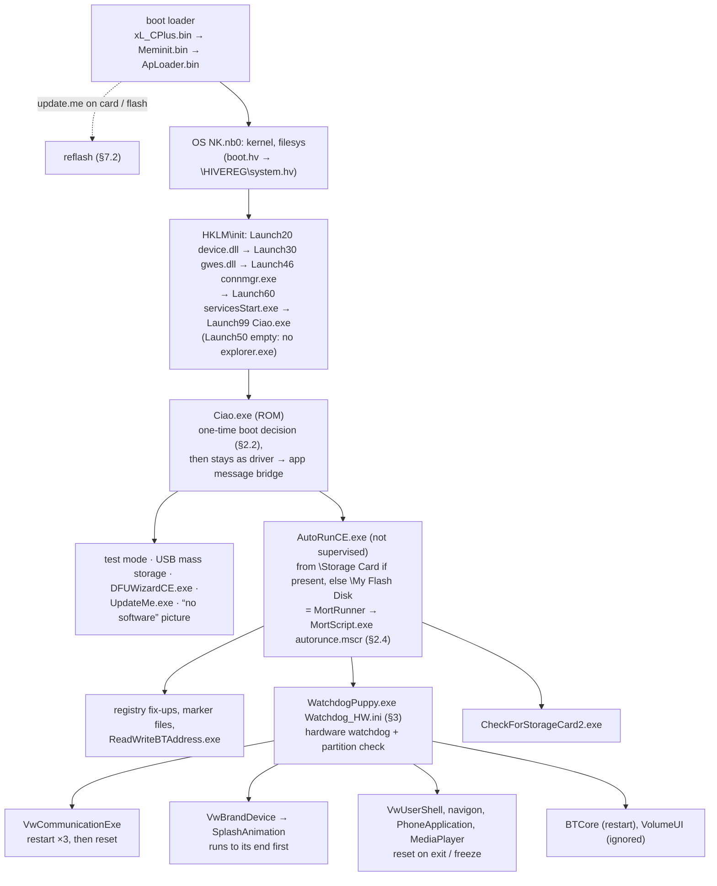

# Boot, supervision, crash handling, shutdown, update

From power-on to running apps on the 4NSF (WinCE 6, SW 7.16.8/7.16.9, ROM 2.33): who starts what, who keeps it alive, what happens on a crash, how the unit is updated. Static analysis only — nothing run on a real unit.

Legend: ✅ seen in disassembly / data / config (binary + VA or file given) · ✅ emulator = observed running in the emulator (CE 7 guest, stubbed hardware) · 🟡 inferred / single source · ❓ unknown.
Addresses = VA, image base `0x10000`. `Ciao` = `firmware/rom/modules/Ciao.exe`.
Related: [hardware-layer.md](hardware-layer.md) (drivers, registry, hardware watchdog) · [user-shell.md](user-shell.md) (standby / shutdown rules, start of MediaPlayer) · [brand-and-pairing.md](brand-and-pairing.md) (`VwBrandDevice`, splash) · [ui-framework.md](ui-framework.md) (heartbeat threads of the UI programs) · [navigation.md](navigation.md) (navigon heartbeat, route resume).

## 1. Overview



- crash: kernel → `HKLM\Debug\JITDebugger` = `\My Flash Disk\ErrorReporter.exe 0x<pid>` → dump → reset or kill (§4)
- off / reset: any process, `SetSystemPowerState(NULL, POWER_STATE_OFF | SUSPEND | RESET, POWER_FORCE)` (§6)

| Question | Short answer | § |
|---|---|---|
| Who starts the unit software? | ROM `Ciao.exe` (`HKLM\init\Launch99`) runs `AutoRunCE.exe` from the **SD card first**, then from flash | 2.2 |
| Who keeps it alive? | `WatchdogPuppy.exe`: named-event heartbeats, exit detection, hardware watchdog | 3 |
| What happens on a crash / hang? | dump in `\My Flash Disk\NAVIGON\ErrorReporter\`, then nearly always a device reset | 3.2, 4 |
| How is it updated? | SD card with its own `AutoRunCE.exe`; OS through boot-loader files (`update.me`, `NK.nb0`, …) | 7 |
| Where can custom code hook in? | SD-card `AutoRunCE.exe`, a line in `autorunce.mscr`, a ninth watchdog child, or a launcher app | 8 |

## 2. OS boot (ROM side)

### 2.1 `HKLM\init` ✅ (`firmware/rom/files/default.hv`, key cell at file offset `0x41708`)

| Value | Data | Depends on | Meaning |
|---|---|---|---|
| `Launch20` | `device.dll` | – | device manager (drivers) |
| `Launch30` | `gwes.dll` | 20 | window / event system |
| `Launch46` | `connmgr.exe` | 30 | connection manager |
| `Launch50` | `""` (empty string) | 20, 30 | slot of `explorer.exe` in a stock image — **emptied: no CE shell at boot** |
| `Launch60` | `servicesStart.exe` | 20 | services |
| `Launch99` | `Ciao.exe` | 20, 30 | Garmin boot manager (below) |

`DependNN` = REG_BINARY list of u16 (`14 00 1e 00` = 20, 30).
`boot.hv` → `HKLM\init\BootVars`: `SystemHive=\HIVEREG\system.hv`, `ProfileDir=HIVEREG`, `DefaultUser=WOLF`, `Flags=3`, `Start DevMgr=1` ✅ → the live registry is hive-based and persistent on the hidden `HIVEREG` volume (user hive `\HIVEREG\WOLF\user.hv`, string in Ciao).
ROM default already has `HKLM\Debug\JITDebugger=\My Flash Disk\ErrorReporter.exe`, `Debugger_Enable=1` ✅ (`default.hv` `0x16a10`); `autorunce.mscr` re-writes the same value.

Hive file format (`EKIM` signature): [hardware-layer.md](hardware-layer.md) §5.5; as text: `tools/hive_dump.py`.

### 2.2 `Ciao.exe` — boot manager ✅

33 KB ROM program ("Ciao Application" 2.5.0.0, built 2014-03-31, PDB `c:\Wolf\Ciao\…`). Two jobs: (a) decide once, at boot, what the unit runs; (b) stay resident as the driver → application message bridge ([hardware-layer.md](hardware-layer.md) §4.3).

Structure: `WinMain` `0x11694` → `0x1150C` registers class `Ciao`, creates the window `Ciao!` (WndProc `0x11474`) and two threads: **boot thread** `0x111A0`, **power-notification thread** `0x11330` (`RequestPowerNotifications`; on resume: `Sleep(3000)`, `GMD1:` IOCTL `0x80522044` "ResetPowerFlag").

Search paths ✅ (pointer table in `.data` `0x191A4…`, decompressed — `cerom.py` leaves it compressed): `[0x191A4] \MN Settings\`, `[0x191A8] \Storage Card\`, `[0x191AC] \My Flash Disk\`. "exists" = `FindFirstFileW`, retried every 100 ms (`0x121B8`); the try count is the only wait for the SD card to mount.

Boot thread, in order ✅:

| # | Step (VA) | Condition | Action |
|---|---|---|---|
| 1 | first boot `0x13C30` | factory block (`HFC1:`, `0x21FF000`) `+0x94 == 0xCDCDCDCD`, or `\Storage Card\FirstBoot.txt` (20 tries = 2 s) | start `BTCore.exe` (`\Storage Card\` else `\Windows\`) and load `Lotus.dll` (BT test API); clock := 2012-01-01; copy `\Windows\bkUSBMode.RGB` → hidden flash `0x217F800`, `\Windows\bkNoSW.RGB` → `0x21BF400`; store OS version (`+0x80`, digits of `SPI_GETPROJECTNAME`) and BT firmware name (`+0x40`); all OK → `+0x94 := 0xFFFFFFFF` |
| 2 | `0x13184` | `\Storage Card\SaveBTAddr.txt` (5 tries) | read BT address from the module, store at factory block `+0xA0` |
| 3 | `0x14060` | factory block `+0x98 == 1` ("IsDevImg") and `\Storage Card\UARTOverUSB.txt` | `GMD1:` `0x80522018` (USB pins → UART), start `Explorer.exe`; **result 1** |
| 4 | `0x11E3C` | `PMC1:` `0x80222018` charger-type code = 5 or 10 (factory fixture 🟡) | start `GarminTestMode.exe`; **result 0** |
| 5 | `0x13B10` | boot-argument word (`GMD1:` `0x80522000`) = `0xBEAF000x` | bit 0: format `MN Settings`; bit 1: format `My Flash Disk`; bit 2 = **factory restore**: format `MN Settings`, clock := 2012-01-01, `TouchCalibrate()`. Then delete the OS-update files from flash root (list in §7.2). Format = `fatutil.dll!FormatVolume` on the dismounted partition |
| 6 | | `\Windows\rndisfn.dll` exists and `RNDIS.reg` in one of the 3 paths | USB function := `RNDIS` (not in this ROM: no `rndisfn.dll` ✅) |
| 7 | | IsDevImg and `ActiveSync.reg` / `WinCE.reg` in one of the 3 paths | USB := `Serial_Class` (ActiveSync) / start `Explorer.exe`, **result 1** |
| 8 | | USB function bus device state ≠ 0 (`IOCTL 0x22001C`; 🟡 = attached to a host) | **USB mode**: backlight 30, blit the "USB mode" picture from hidden flash, USB function := `Mass_Storage_Class` (normal personality: `GarminUSB`; exported disks: [hardware-layer.md](hardware-layer.md) §5.3); **result 3**. No application is started |
| 9 | | `DFUWizardCE.exe` on `\Storage Card\` (5 tries), else on `\My Flash Disk\` | BT-firmware flasher: run + wait (§7.3) |
| 10 | | `UpdateMe.exe` on `\Storage Card\` (5 tries), else on `\My Flash Disk\` | run + wait (§7.3) |
| 11 | `0x12550` | **`\Storage Card\AutoRunCE.exe`** (2 tries = 200 ms), else **`\My Flash Disk\AutoRunCE.exe`** (1 try) | `CreateProcessW(path)` — no arguments, not waited for, not supervised; **result 2** |
| 12 | | none of the above | blit the "no software found" picture (hidden flash `0x21BF400`); **result 4** |

Results 0–2 hide the `Ciao!` window; 3 and 4 leave the picture on screen.

Consequences ✅:

- **An `AutoRunCE.exe` in the root of the SD card wins over the one on flash** — at every boot, without any check (no signature, no version, no `content.md5`). This is the official update entry (§7) and the simplest hook for custom code (§8).
- Step 11 itself gives the SD card only ~200 ms, but the earlier probes of absent SD files already waited: `FirstBoot.txt` 2 s (always, step 1), `SaveBTAddr.txt`, `DFUWizardCE.exe`, `UpdateMe.exe` 0.5 s each → the card has ≈ 3.7 s after Ciao starts to be mounted 🟡 (enough for the official update card; a slow card silently falls back to the flash copy).
- USB mass-storage mode is entered **only at boot**. While an application runs (result 2) or the "no software" picture shows (result 4), plugging USB into a host makes Ciao reboot: `0x1122`/4 with `lParam 1` → `SetSystemPowerState(NULL, POWER_STATE_RESET, POWER_FORCE)` (`0x12D9C`). In USB mode, unplugging (`0x1122`/4 or /5 with `lParam 0`) shows "Unplug USB, countdown 5 sec to reboot" and resets (`0x12B10`).
- In "no software" / battery-low mode (flag `0x1949C`) the power key (`0x1122`/6) switches the unit off; otherwise Ciao ignores the key and the applications handle it (§6).
- The stock CE shell is still in ROM (`explorer.exe`, `control.exe`, `BMQ.exe`, `test_GPS.exe` with `.lnk` files) but only reachable on a development image (IsDevImg) with a marker file.

### 2.3 Other ROM programs

| Program | Role | Evidence |
|---|---|---|
| `explorer.exe`, `control.exe`, `ctlpnl.exe` | stock CE shell / control panel; started only by Ciao steps 3 and 7 | ✅ `Launch50` empty; Ciao `0x14060` |
| `GarminTestMode.exe` | factory test UI, started by Ciao step 4 | ✅ Ciao; details below 🟡 |
| `ShowPassFailDialog.exe` | full-screen PASS/FAIL message for the production line; Ciao runs it with `"BT Update Completed! 1"` when `\Storage Card\wolf.reg` exists after a BT flash | ✅ Ciao `0x14060` |
| `BMQ.exe` | third-party benchmark "BMQ Version 0.31, (C) 2001 Tatsuya Sakamoto" (integer / float / draw / window / memory); desktop link `BMQ.lnk` | ✅ strings; not started by anything |
| `test_GPS.exe` | ST GPS test tool (`HKCU\Software\STM\test_GPS\Config`: `Port=COM3:`); link `test_GPS.lnk` | ✅ `user.hv`; not started by anything |
| `BTCore.exe` (ROM copy) | nFore BT core, used by Ciao on first boot / `SaveBTAddr.txt` to read BT address and firmware version | ✅ Ciao `0x11844` |
| `ErrorReporter.exe` (ROM copy) + `\Windows\ErrorReporter.ini` | older build of the crash reporter (§4); the registry points to the flash copy | ✅ `default.hv`; nothing references the ROM path 🟡 |
| `shell.exe`, `eventrst.exe`, `rapisrv.exe`, `repllog.exe` | stock CE tools (debug shell, event-log reset, ActiveSync services); not in `HKLM\init`, not referenced by Ciao | ✅ registry; role 🟡 by name |
| `startup.ini`, `*.lnk` | stock shell folders / shortcuts; `\Windows\StartUp` is not processed because `explorer.exe` does not run | ✅ |

### 2.4 `autorunce.exe` + `autorunce.mscr` ✅

`autorunce.exe` = "MortRunner" 3.1.0.200 (8 KB, stock MortScript launcher, `0x11000`): takes its own path, expects `MortScript.exe` **in the same directory**, and `ShellExecuteEx("Open")`s it with the script `"<dir>\<own base name>.mscr"` (or `.mortrun`) → `autorunce.mscr`. Arguments `install` / `uninstall` (PocketPC storage-card autorun convention) would select `Autorun.mscr` / `Autoexit.mscr` instead; Ciao passes none.
`MortScript.exe` = MortScript 4.x interpreter (PE subsystem 3.0), licence in `Mortscript.txt`.

Script on flash (`firmware/flash/autorunce.mscr`, the 7.16.9 revision), in execution order:

| # | Step | Effect |
|---|---|---|
| 0 | (7.16.9 only) root certificate | if `HKLM\Comm\Security\SystemCertificates\Root\Certificates\A8985D3A…5436\Blob` is missing: write the DigiCert Global Root CA and **`Run Reset.exe`** (the script continues while the reset is under way) |
| 1 | `InstallDebugger` | `HKLM\Debug\Debugger_Enable=1`, `JITDebugger=\My Flash Disk\ErrorReporter.exe` (same as the ROM default) |
| 2 | `CheckForMarkerFiles` | `\My Flash Disk\CopyMNSettings.txt` → delete marker, `XCopy \MN Settings\*.*` → `\Storage Card\_MNSettings\<YmdHis>\` (flash if no card). `CleanMNSettings.txt` → delete marker, `DelTree \MN Settings\*.*` |
| 3 | `AddFontSkipping` | rewrite `HKLM\Software\Microsoft\FontLink\{SystemLink,SkipTable}` + `SYSTEM\GDI\FontLinkMethods=3`; if `SystemLink\ZYHei_GB18030_c` was missing before → `Run Reset.exe`. ROM 2.33's `boot.hv` already carries these values ✅, so the reset should not fire on this ROM 🟡 |
| 4 | `RunWait BT\ReadWriteBTAddress.exe` | BT address copy, one way: module → hidden-flash factory block, and only while the stored address is blank ([bluetooth.md](bluetooth.md) §6.3) |
| 5 | `SetFileAttribute BrandDevice.reg` | clear read-only, so `VwBrandDevice.exe` can delete it ([brand-and-pairing.md](brand-and-pairing.md)) |
| 6 | `Run WatchdogPuppy.exe Watchdog_HW.ini` | starts everything else (§3); not waited for |
| 7 | `Sleep(5000)`, `Run NAVIGON\CheckForStorageCard2.exe` | SD-card mount fixer (§5) |
| 8 | `CleanupInstallation` | deletes update leftovers from flash root (§7.2), then `Exit` |

The 7.16.8 script seen on a real unit is the same without step 0 (short form: [device.md](device.md) §4).
`ErrorLevel("syntax")` = only syntax errors are reported; missing files etc. are skipped silently.

## 3. `WatchdogPuppy.exe` — process supervisor ✅

`firmware/flash/WatchdogPuppy.exe` ("v4.1.0", 380 KB, ARM code, statically linked C++/STL). One process supervises everything: `main` (`0x1A9D4`) raises its thread to CE priority 248 and, for each command-line argument, loads that ini file (relative names = next to the exe 🟡), builds a `WatchdogPuppyInfo` tree (`0x26DD0`, 0x1A8 bytes per node) and runs it. Shipped call: `WatchdogPuppy.exe Watchdog_HW.ini`.

### 3.1 Ini reference (every key the binary reads)

Booleans: `true` (any case) or `1` = true, anything else = false; defaults in brackets. Getter VAs: bool `0x336F4`, int `0x3385C`, string `0x32968`.

| Section | Key [default] | Meaning |
|---|---|---|
| `[General]` | `ShowMessageBox` [false] | show `MessageBoxW` (title `WatchdogPuppy (<Name>)`, topmost) before acting; reset / restart become Yes/No questions. Shipped: false everywhere |
| | `ShowMessageBoxAlsoForIgnore` [false] | also show a box for action 0 |
| | `ActionAtTimeout` [0] | action when a heartbeat event times out (codes below) |
| | `ActionAtTermination` [0] | action when the process exits |
| | `Debug` [false], `DebugLevel` [0] | log level = max of both; output = `NKDbgPrintfW` (kernel debug stream) only, no file |
| | `Maxdumpfileamount` [100] | max freeze dumps kept in `DumpPath` |
| | `DumpPath` [`\My Flash Disk\NAVIGON\ErrorReporter\`] | where freeze dumps go |
| | `RefreshEventName` [`<Name>RefreshEvent`] | name of this node's own "I am alive" event (§3.4) |
| `[Executable]` | `Name` | label for logs, message boxes and the default event name |
| | `PathtoExe` | program to start. Empty = pure container node (the global watchdog) |
| | `Arguments` | command line |
| | `StartupTime` [1000] ms | grace period: `Sleep` after starting, before the first heartbeat check |
| | `WaitTimeUntilRestart` [0] ms | `Sleep` before a restart (action 2) |
| | `WindowName` | if set: on the **first** start the exe is *not* launched; the watchdog polls `FindWindowW(NULL, WindowName)` every 200 ms and adopts the owning process. Restarts use `PathtoExe` |
| | `WaitTime` [0] ms | max wait for that window (0 = forever) |
| | `WaitForProcessToFinish` [false] | true: supervise this node synchronously — the following siblings start only after its process has ended |
| | `MaximumRestartCounter` [-1] | restarts allowed before action 2 escalates to reset; −1 = unlimited. The counter is never cleared |
| | `PathToResyRouteFile` | "restart-safety" file: see §3.5 |
| | `TerminateAllProcesses` [true if log level > 0, else false] | before each (re)start kill every process with the same exe name (`0x1D3A4`) |
| `[NamedEvent1]`…`[NamedEvent9]` | `Name`, `Timeout` [1000] ms | heartbeat events (§3.3). A section without `Name` or with negative `Timeout` is skipped |
| `[Children]` | `Name1`…`Name9` | ini files of child nodes, started in this order |
| `[AdditionalExecutable]` | `Application1`…`Application98` | other programs whose stack traces are added to a freeze dump of this node ("Additional stack trace for process '…'", `0x36144`). No effect on supervision |
| `[HWWatchdog]` | `UseHWWatchdog` [false] | create a hardware-watchdog object for this node |
| | `HWWatchdogType` | `Wolf` = hardware watchdog only; `WolfSafety` = software deadline in front of the hardware one (§3.4). Other value → none |
| `[PartitionChecker]` | `UsePartitionChecker` [false] | create a `PartitionWatcher` |
| | `CheckPartitions` [true], `RemountPartitions` [false], `CheckDevices` [false], `CheckMemory` [false], `CheckThreadTimes` [0], `LaunchWhenProblemsOccur`, `Debug`, `DebugLevel` | re-check on power / device notifications; diagnostics logging; a program to start once when a problem is seen |
| `[PartitionChecker_Partition<N>]` | `FolderName`, `FolderName2`, `StoreName`, `PartitionName`, `PartitionName2`, `CheckPartitions` [true], `RebootIfCheckFails` [true], `Deletefolder` [false], `OpenStoreTimeout` [5000], `CeGetVolumeInfoTimeout` [5000] | one watched volume (§3.6). Read for N = 1, 2, … until a section has no `FolderName` |

Present in the shipped ini files but **never read** (strings absent from the binary): `ForceInitialScan`, `CheckDisk`.

Action codes (`0x21014`, `0x20C20`, `0x213D8`):

| Code | Action |
|---|---|
| 0 | ignore (the supervision of that node simply ends) |
| 1 | device reset: `SetSystemPowerState(NULL, POWER_STATE_RESET, POWER_FORCE)`, then `Sleep(60000)` |
| 2 | restart the process. As `ActionAtTimeout`: `TerminateProcess` only — whether it comes back is then decided by `ActionAtTermination`. As `ActionAtTermination`: wait `WaitTimeUntilRestart`, start again. If `MaximumRestartCounter` ≥ 0 and the restart counter has reached it → action 1 instead |

### 3.2 Shipped configuration

Global node `Watchdog_HW.ini`: no exe, actions 1/1, `WolfSafety` hardware watchdog, partition checker, 8 children:

| # | ini | Process | Sync | Start grace | Heartbeat events (timeout) | AtTimeout / AtTermination | Restart limit | Notes |
|---|---|---|---|---|---|---|---|---|
| 1 | `Watchdog_VWCom.ini` | `VwUserShell\VwCommunicationExe.exe` | – | 10 s | `VwCommunicationBapThreadAlive`, `VwCommunicationReaderThreadAlive` (30 s) | 2 / 2 | 3, then reset | restart delay 0 |
| 2 | `Watchdog_VWBrandDevice.ini` | `VwBrandDevice\VwBrandDevice.exe` | **yes** | 0 | `VwBrandDevice{App,Command,Event}ThreadAlive` (30 s) | 1 / 0 | – | runs at every boot and exits ([brand-and-pairing.md](brand-and-pairing.md)); children 3–8 wait for it |
| 3 | `Watchdog_VwUserShell.ini` | `VWUserShell\VwUserShell.exe -ShowWindow=1` | – | 30 s | `VwUsh{App,Command,Event}ThreadAlive` (30 s) | 1 / 1 | – | |
| 4 | `Watchdog_MN.ini` | `NAVIGON\navigon.exe` | – | 90 s | `ResyLightMnMainLoop` (90 s) | 1 / 1 | – | `PathToResyRouteFile=\MN Settings\NavigationRoute.resy` |
| 5 | `Watchdog_BTCore.ini` | `BT\BTCore.exe` | – | 0 | none | 2 / 2 | unlimited | restart delay 1 s; no heartbeat → only exit is detected |
| 6 | `Watchdog_PhoneApplication.ini` | `BT\PhoneApplication.exe -TSW_HIDE` | – | 30 s | `ResyLightBtMainLoop` (30 s) | 1 / 1 | – | |
| 7 | `Watchdog_MMP.ini` | `Mediaplayer\MediaPlayer.exe` | – | 30 s | `MMP{App,Command,Event}ThreadAlive` (30 s) | 1 / 1 | – | `WindowName=MMPMediaPlayer` → not launched by the watchdog: it waits (forever) for that window and adopts the process. Launcher ✅ = the **shell**: after navigon's AppCom msg 40 it starts `MediaPlayer.exe` hidden with `-Mode=NOCONN -ShowWindow=0` ([user-shell.md](user-shell.md) §7.3) |
| 8 | `Watchdog_VolumeUI.ini` | `NAVIGON\VolumeUI.exe` | – | 0 | none | 1 / 0 | – | exit is ignored, nothing is checked. The program quits by itself right after start unless the unit is branded as XL1 ([media-audio.md](media-audio.md) §6.3) |

Not supervised: `PictureViewer`, `ManualReader`, `VWPaint`, `ScreenShot`, `SplashAnimation`, `CheckForStorageCard2`, `MultiMediaDominationProcess`, anything under `Apps\`.
Net effect: a crash or hang of the shell, navigation, phone app or media player **reboots the unit**; only the car link (3 times) and `BTCore` are restarted in place.

### 3.3 Heartbeat protocol

- The watchdog creates each event: `CreateEventW(NULL, FALSE /*auto-reset*/, TRUE /*signalled*/, Name)` (`0x115D8`; same call for the refresh events, `0x26DD0`). The application opens the same name and must call **`SetEvent`** at least once per `Timeout`. Auto-reset + sequential waits → a `PulseEvent` can be lost; use `SetEvent`.
- Checking starts `StartupTime` after process start. Per event the remaining time is `max(1, Timeout − (now − lastSignal))`; the watcher blocks in `WaitForMultipleObjects({event, exitEvent})` (`0x28450`), so events are checked one after the other, each with its own deadline.
- On timeout (and `ActionAtTimeout ≠ 0`): a **freeze dump** is written first (`0x25EF4`: stack traces of the process and of every `[AdditionalExecutable]`, type `Freeze`, same writer as `ErrorReporter.exe`, §4), then the action runs.
- Who signals (examples): `VwCommunicationExe` every 51 loop passes ([shared-memory.md](../car/shared-memory.md)); `navigon.exe` / `PhoneApplication.exe` main loop ("ResyLight"; navigon: `SetEvent` on every loop turn, [navigation.md](navigation.md) §1.3); UI apps from their App / Command / Event threads (framework command #701 creates / opens the three events, each thread sets its own on every loop turn, ≤ 1 s: [ui-framework.md](ui-framework.md) §8).

### 3.4 Supervisor logic (pseudo-code)

```c
Start(node):                                   // 0x29088
    if (!node.WaitForProcessToFinish) CreateThread(Supervise, node)   // priority 248
    else { Sleep(0); Supervise(node); }        // blocks the siblings behind it
    for (child in node.Children) Start(child)  // in ini order, no delay between them

Supervise(node):                               // 0x28D80
    do {
        SetEvent(node.refreshEvent); ResetEvent(node.exitEvent)
        UpdateResyCounter(node)                // §3.5
        if (!StartOrFindProcess(node)) return  // 0x214D0: FindWindow (first time, WindowName set)
                                               //   or CreateProcessW(PathtoExe, Arguments), retried every 100 ms for 5 s
        Sleep(node.StartupTime)
        if (node.events || node.hwWatchdog) CreateThread(Checker, node)   // priority 248
        if (!node.hProcess) { wait for Checker forever; return }          // container node
        WaitForSingleObject(node.hProcess, INFINITE)
        stop Checker (SetEvent(exitEvent); wait up to max(event timeouts); TerminateThread)
        action = Decide(node.ActionAtTermination, "Process terminated <exe>")   // also after a kill by the Checker
        if (action == 2) Sleep(node.WaitTimeUntilRestart)
        if (action == 1) { SetSystemPowerState(NULL, POWER_STATE_RESET, POWER_FORCE); Sleep(60000) }
        node.restartCounter++
    } while (action == 2)

Checker(node):                                 // 0x28CCC, one pass = 0x28AC4
    if (node.hwWatchdog) node.hwWatchdog.SetTimeout(max(30000, maxEventTimeout + 5000)), .Start()
    if (node.parent) parent.events.add(node.RefreshEventName, maxEventTimeout + 5000)
    loop {
        t0 = now; nap = node.hwWatchdog ? hwTimeout / 2 : 30000
        for (ev in node.events) {
            nap = min(nap, ev.Timeout)
            r = wait {ev, exitEvent} for max(1, ev.Timeout - (now - ev.last))
            if (r == exitEvent) goto out
            if (r == TIMEOUT) { if (ActionAtTimeout) write freeze dump;
                                action = Decide(ActionAtTimeout, "Timeout while waiting for event <ev>") }
            ev.last = now
            if (action == 1) reset device           // as above
            if (action == 2) { TerminateProcess(node.hProcess); goto out }   // restart then depends on ActionAtTermination
        }
        SetEvent(node.refreshEvent)                 // "this watchdog thread is alive"
        if (wait exitEvent for max(100, nap - (now - t0)) == signalled) goto out
    }
out: hwWatchdog.Stop(); parent.events.remove(node.RefreshEventName)
```

Three levels follow from this ✅:

| Level | Watches | Deadline (shipped values) | Reaction |
|---|---|---|---|
| child checker | the application's named events | 30 s (navigation 90 s) | freeze dump + `ActionAtTimeout` |
| global checker | each child's `<Name>RefreshEvent` (registered only while that child's checker runs) | child's longest timeout + 5 s → 35 s / 95 s | `Watchdog_HW.ini` `ActionAtTimeout=1` → reset (no dump: container node has no exe) |
| `SafetyHWWatchdog` thread (`0x1A5AC`) | the global node's refresh event | `t = max(30 s, longest registered + 5 s)` → 100 s once navigation is being checked | freeze dump type `Watchdog-Freeze` ("Timeout of HW watchdog detected!") then software reset |
| hardware (SP805 via `WolfSpecial.dll`) | `RefreshHWWatchdog()` called by the safety thread on every refresh | programmed to `t + 30 s` (initially 60 s) | hardware reset; real time ≈ 2 × programmed 🟡 ([hardware-layer.md](hardware-layer.md) §6.3) |

`WolfHWWatchdog` (`0x29300`, vtable `0x5E3BC`) = `LoadDriver("WolfSpecial.dll")` + `SetHWWatchdogState(1/0)`, `GetHWWatchdogState`, `SetHWWatchdogTimeout(ms)`, `GetHWWatchdogTimeout`, `RefreshHWWatchdog`. The hardware watchdog is **armed only by WatchdogPuppy** (`SetHWWatchdogState(1)` when the global checker starts) and disarmed (`…(0)`) while a watchdog message box is open, or when the checker ends. During a dump the timeout is raised to ≥ 60 s (`0x25EF4`).

Termination of WatchdogPuppy itself: `main` waits (`0x23960`, polling 100 ms → 30 s) until every node has finished; with the shipped configuration the container node never finishes, so the process lives until reset. Nothing restarts WatchdogPuppy if it dies — but then the hardware watchdog expires.

### 3.5 Restart-safety counter (`PathToResyRouteFile`) ✅ `0x203C4`

Before every (re)start of a node with this key: if the file exists, its size is compared with `<file>.counter` (text `"<size> <count>"`). Same size → `count++`; different → `count = 1`. When `count > 3` both the file and the counter are **deleted** ("to prevent endless resetting"). Shipped use: `\MN Settings\NavigationRoute.resy` — the route that navigation reloads after a restart is dropped after it survived three (re)starts unchanged, so a route that crashes the app cannot cause a reset loop. 🟡 "Resy" = restart-safety. The `.resy` file is written by `navigon.exe` ✅ whenever the guidance state changes and deleted when guidance ends ([navigation.md](navigation.md) §1.7; navigon's own retry counter is switched off, the watchdog's is the one in use).

### 3.6 Partition checker ✅ (`PartitionWatcher`, built at `0x23F40`)

For each configured volume: `CeGetVolumeInfo(\<FolderName>)` (retry until `CeGetVolumeInfoTimeout`), store / partition names taken from the volume info or, if that fails, from `StoreName` / `PartitionName` (`PartitionName2` as fallback).

| Finding | Reaction (`0x19814`, `0x18F30`) |
|---|---|
| path exists but is a plain directory, not a mount point (volume flag `0x40` clear) | `Deletefolder=true`: delete the directory tree (if deletion fails: rename to `<name>Old`); then re-mount |
| volume missing | re-mount: `OpenStore` (wait `OpenStoreTimeout`) → `OpenPartition` → `DismountPartition` if mounted → `MountPartition`; up to 3 rounds |
| still failing and `RebootIfCheckFails=true` | (`ShowMessageBox`: ask "Found severe problem while checking '…'. Reset?") → device reset (`0x1477C`) |

Shipped: `MN Settings` (`DSK1:` `MNSET`/`Part01`; reboot, delete a stray folder), `My Flash Disk` (`DSK1:` `MYFLASH`/`Part00`; reboot), `Storage Card` (`DSK2:`; `CheckPartitions=false` → ignored). Why: if `\MN Settings` is not mounted, applications would silently create a RAM-backed folder of that name and lose all settings at the next reset. The watcher also owns two notification threads (power broadcasts `0x17624`, device arrival/removal `0x1613C`) that log, and re-mount a watched partition when it disappears.

## 4. Crash and freeze handling

### 4.1 `ErrorReporter.exe` — JIT debugger ✅

"ErrorReporter 3.0.0.0" (Garmin Würzburg, 203 KB). Registered in `HKLM\Debug\JITDebugger`; on an unhandled exception in any process the CE kernel starts it with the faulting process id.

| Step | VA | What |
|---|---|---|
| command line | `0x1B398` | `0x<pid hex>` → attach; `Test` → fake exception report for `ErrorReporter.executable` |
| config | `0x1A484` | `<own path without .exe>.ini` → `\My Flash Disk\ErrorReporter.ini` |
| attach | `0x1A214` | `DebugActiveProcess(pid)`, then `WaitForDebugEvent` loop (`0x1A144`); only `EXCEPTION_DEBUG_EVENT` is acted on |
| report | `0x198EC` | text "Exception 0x… at address … in thread 0x…. Trace:" + stack trace → dump (§4.3, type `Exception`) |
| message | | `ShowCrashMessage=1`: window "A crash was detected! The crash happened in … The exception code was 0x… at address 0x…" for `CrashMessageTimeoutSeconds`, optional beep |
| reset? | `0x15894` | `ResetAfterException=1` **and** the crashed exe is not in `[NoResetAfterException]` → `Sleep(ResetTimeoutSeconds)`, `SetSystemPowerState(NULL, POWER_STATE_RESET, POWER_FORCE)` |
| always | | `TerminateProcess(pid, 1)` |

`ErrorReporter.ini` keys (all read; lists accept `Application1`…`Application98`):

| Key | Flash | ROM copy (`\Windows\ErrorReporter.ini`) | Meaning |
|---|---|---|---|
| `Debug` | 0 | 0 | log to the debug stream |
| `ShowCrashMessage` | 0 | 1 | show the crash window |
| `StackTracePath` | `\My Flash Disk\NAVIGON\ErrorReporter` | same | dump root (empty → folder of the crashed exe, or `\My Flash Disk\`) |
| `MaxNumberOfStacktraceFiles` | 15 | 15 | oldest dumps are deleted beyond this |
| `ResetAfterException` | 1 | 1 | see above |
| `CrashMessageTimeoutSeconds` | 10 | 10 | |
| `ResetTimeoutSeconds` | 0 | 1 | delay before the reset |
| `BeepOnCrashMessage` | 0 | 0 | |
| `DumpAllThreads` | 1 | 1 | stack traces of all threads of the process, not only the faulting one |
| `[NoResetAfterException]` | 8 first-party exes (navigon, VwBrandDevice, VwCommunicationExe, VwUserShell, MediaPlayer, PictureViewer, PhoneApplication, BTCore) | – | no reset by ErrorReporter for these |
| `[AdditionalExecutable]` | – | – | extra processes to trace (same meaning as in the watchdog ini) |

Who resets after a crash ✅: for the 8 listed programs ErrorReporter only dumps and kills; the reset (or restart) then comes from WatchdogPuppy's `ActionAtTermination` once the process is gone (§3.2) — so the dump is complete before the reset. `PictureViewer` is unsupervised → no reset at all. **Any other program, including a custom app, reboots the unit when it crashes** (matches the `dumpcoredll.exe` entry in [device.md](device.md) §12).

### 4.2 Freeze detection ✅

Not in ErrorReporter: WatchdogPuppy writes the dump itself when a heartbeat times out (type `Freeze`, §3.3) or when its own safety deadline expires (type `Watchdog-Freeze`), using the same `StackTraceCreator` code, `DumpPath` and `Maxdumpfileamount` [100].

### 4.3 Dump format ✅ / 🟡

`StackTraceCreator` (ErrorReporter `0x2B700` / `0x2BE6C`; WatchdogPuppy `0x38094` / `0x38800`):

1. Delete the oldest entries until fewer than the maximum remain.
2. Create `<root>\<Type>_<YYYYMMDD_HHMMSS>\` (local time), `Type` = `Exception`, `Freeze`, `Watchdog-Freeze`.
3. Four worker threads, total limit 120 s: stack traces (`…Stacktrace….txt`; one more file per additional process: "Additional stack trace for process '…'"), memory and thread times (`…_MemoryThreadTimes…`: free RAM, committed RW memory and user/kernel times per process, sampled twice — suffix `_AfterSleep`), application info (`…_AppInfo…`: version resource, build time, image MD5 of the exe), GPS log (`…_GPS.txt`: raw read from the GPS COM port 🟡).
4. Copy `\MN Settings` into the folder, skipping `*.old`, `device.dat`, `PhoneBook.dat`, `Presets.dat`, `UserSettingsMp3Playlist.xml`, `contacts3.txt`, `gpsData.dat`, `GEDSessionData.dat`, `GD.dat`, `*.route` and the `Backup` folder 🟡 (two name lists in the constructor; read as exclusions).
5. Pack the folder into `<folder>.zip`; on success delete the folder.

Stack traces are raw return addresses per thread (no symbols on the unit). The dumps still contain personal data (settings, destinations) — [device.md](device.md) §13.

## 5. Small executables

| Program | What it does | Evidence |
|---|---|---|
| `Reset.exe` (5 KB) | `SetSystemPowerState(NULL, POWER_STATE_RESET 0x800000, POWER_FORCE 0x1000)`; no arguments | ✅ `0x11000` |
| `PowerOff.exe` (5 KB) | same binary with one constant changed (8 differing bytes): `POWER_STATE_OFF 0x20000` | ✅ |
| `SplashAnimation.exe` | topmost window `SPLASHANIMATION`, plays `SPLASH.RGBFS` from the folder given as argument (default `\My Flash Disk\ChangeStartupScreens\0\`) on a timer through `sgalib.dll`. Started by `VwBrandDevice.exe` at each normal boot, closed by the shell (`WM_QUIT`) — [brand-and-pairing.md](brand-and-pairing.md). Not supervised; the version resource text ("Dumps memory consumptions…") is a copy-paste leftover | ✅ strings + imports |
| `NAVIGON\CheckForStorageCard2.exe` | debug build (TopazSDK). `RequestDeviceNotifications(FATFS_MOUNT_GUID {169E1941-04CE-4690-97AC-776187EB67CC})`; whenever a volume called **`Storage Card2`** is added or removed it re-mounts `DSK2:` / `Part00` (dismount if mounted, mount), then sleeps with a back-off growing by 500 ms; an arriving `Storage Card` resets the back-off. Purpose: get the SD card back under its normal name after a name clash 🟡. Runs for ever, unsupervised | ✅ main loop (pdg line 1248 ff.) |
| `NAVIGON\ScreenShot.exe` | AppCom app `ScreenShotMaker` (no port). Copies the screen (`BitBlt` from the window DC of `Mobile Navigator` / `DesktopExplorerWindow`) to `\Storage card\ScreenShots\ScreenShot_<n>.bmp`, plays `SnapShot.wav`, shows `icon_screenshot.bmp`. Started on demand: navigation dev switch `ScreenShot` ([device.md](device.md) §8), or AppCom msg 52, on which the shell starts the `ScreenShot` app ✅ ([user-shell.md](user-shell.md) §3.3) | ✅ strings + calls |
| `BT\ReadWriteBTAddress.exe` | run-and-wait from the boot script: copies the module's BT address into the hidden-flash factory block while that is still blank | [bluetooth.md](bluetooth.md) §6.3 |

## 6. Power states and shutdown

What these binaries show; signal semantics are in the sibling docs.

| Event | Who reacts | What happens | Evidence |
|---|---|---|---|
| power key (GPIO 25) | `GarminDrv.dll` → broadcast `WM_KEYDOWN/UP VK_SLEEP` + `0x1122`/6 | applications decide through `IHWLPowerButtonListener` ([hardware-layer.md](hardware-layer.md) §4.2–4.3): docked with a radio = HMI-off toggle, otherwise a 3-button good-bye screen, held 5 s = shutdown ([user-shell.md](user-shell.md) §5.1). Ciao acts only in "no software" / battery-low mode: `SetSystemPowerState(NULL, POWER_STATE_OFF, POWER_FORCE)` | ✅ Ciao `0x1109C` |
| power-fail line (GPIO 55) | `GarminDrv.dll`, polled every second | forced `POWER_STATE_SUSPEND` | ✅ [hardware-layer.md](hardware-layer.md) §6.2 |
| idle | nobody | all OS power time-outs are 0 → no automatic suspend | ✅ registry |
| ignition off / key out / undock | `VwUserShell.exe` (data from `VwCommunicationExe` shared memory: `Bsg3`, [can-signals.md](../car/can-signals.md); cradle from the HWL) | the shell's UI workflow issues framework commands **#2009** `ShutdownDevice`, **#2002** `SuspendDevice`, #2001 `ResetDevice` — exactly one call site each (`0xEF2AC`, `0xEF32C`, `0xEF3AC`) → `SetSystemPowerState(NULL, POWER_STATE_OFF / SUSPEND / RESET, POWER_FORCE)`. (#2003 is not suspend: it creates the HWL event bridge. #2001 is never used by the shell's data → the shell never resets.) Rules ✅ decoded in [user-shell.md](user-shell.md) §5.1 (owner): ignition off + (radio not operating or key removed) → 30 s pop-up → suspend, deferred during phone calls; external power lost → 30 s → suspend; battery 10 / 5 / 2 % warnings, then suspend; undocking alone only un-mutes the speaker. Shutdown (off) happens only from the power-key good-bye screen and a declined EULA | ✅ call sites; ✅ rules (data), nothing run |
| other apps | `MediaPlayer.exe` imports Shutdown / Suspend / Reset too 🟡; `navigon.exe`, `PhoneApplication.exe` import `PMPowerOff`, `ResetDevice` (MN7 HWL) | navigon ✅: exit-behaviour codes 5 → `ResetDevice()` (no GPS receiver, USB mode, map selection cancelled), 8 → `PMPowerOff()` ([navigation.md](navigation.md) §2.3, §3.3) | ✅ imports |
| suspend / resume | `VwCommunicationExe` (drops the link state, [shared-memory.md](../car/shared-memory.md)), Ciao (3 s after resume: `GMD1:` `0x80522044`), WatchdogPuppy's `PartitionWatcher` (logs, re-checks volumes) | processes survive suspend; watchdog deadlines are tick-count based 🟡 | ✅ |
| USB host plugged while running | Ciao | **reset**, then USB mode at the next boot (§2.2) | ✅ `0x12D9C` |
| battery low at boot | boot loader sets a flag (boot-args `0x88000234` = `0xEFEFEFEF`); Ciao shows `\Windows\BattLow.rgb` and blocks before running an updater | no update with a weak battery (`nobatt.txt` on the SD card overrides) | ✅ Ciao `0x13E54` |
| watchdog / crash | §3, §4 | `POWER_STATE_RESET` | ✅ |

There is no orderly "terminate all applications" phase: off, suspend and reset are all `SetSystemPowerState(…, POWER_FORCE)` from whichever process decides; applications persist their settings continuously (`.xml` + `.old` pairs in `\MN Settings`).

## 7. Software update and recovery

### 7.1 The official package (SD card) ✅ files, 🟡 run-time flow

Contents of `firmware/package/` = root of the update card:

| File | Role |
|---|---|
| `autorunce.exe`, `MortScript.exe`, `autorunce.mscr` | same launcher as on flash; because Ciao prefers the card (§2.2), **this script runs instead of the unit's own** |
| `ShowBMP.exe`, `Recovery.bmp` | full-screen picture while working |
| `Install_OS.exe` | self-extracting archive → writes the boot-loader update set (§7.2) to the card root |
| `FullInstaller.exe` | MFC wizard: checks platform (`WolfSpecial.dll` present), device-id pattern, charger and battery ≥ 50 % (`"WOLF" "50%"`), OS version `"2.33"` and BT firmware `"h14423-v2r43"`; runs `Install_OS.exe` / `Install_BT.exe` only if a version differs, then `UpdateMeContent.exe` |
| `Install_BT.exe` (+ `BTCore.exe`, `nfBT.dll`, `MFC80U.DLL`, `MSVCR80.DLL`, `MAPBL.dll`, `SyncBL.dll`) | BT module firmware (`*.dfu` + `DFUWizardCE.exe`) and the BT stack needed to query the module from the card |
| `UpdateMeContent.exe` + `UpdateMeContent.content` | Navigon self-extractor "ExtractorCEDlg" (signature `!NAVIGON_SFX!`): checks the device id ("Wrong device for this update-package!"), then **synchronises** `\My Flash Disk` with its table of contents — extract new / changed files, skip files whose MD5 already matches, delete files not listed; finally "Please remove SD card, then press OK to power off" |
| `<Region>.md5` | checksums of the package files, for the PC side |

`FullInstaller.exe` test switches (files it looks for next to itself) ✅ strings: `ForceOS.reg`, `ForceBT.reg` (install even if the version matches), `CheckOnlyForOSBT.reg`, `SkipBatt.reg`, `nobatt.txt`.

Card script (`firmware/package/autorunce.mscr`) ✅:

```
if \My Flash Disk\autorunce.exe exists:           # normal unit
    ask "Charger attached? Start recovery?"       # No → PowerOff.exe
    RunWait Install_OS.exe ; Run \My Flash Disk\Reset.exe      # → boot loader reflashes (§7.2), flash gets formatted
else:                                             # flash empty (after the format)
    delete update leftovers from flash root
    RunWait FullInstaller.exe "WOLF" "50%" "2.33" Install_OS.exe "h14423-v2r43" Install_BT.exe UpdateMeContent.exe
```

### 7.2 Boot-loader update set ✅ strings of `firmware/os/*.bin`, 🟡 flow

Boot chain: `xL_CPlus.bin` (first stage, FAT16 reader, looks for `update.me` / `Meminit.bin`) → `Meminit.bin` (DDR set-up from `config.txt` variants) → `ApLoader.bin` ("SDMMC ApLoader": splash, battery check, update procedure, "Booting OS") → `NK.nb0`. `LPHandle.bin` = low-power / warm-boot handler 🟡 (name + "Warm BOOT" string).

| File (card root or flash root) | Meaning |
|---|---|
| `update.me` (0 bytes) | trigger: "start update". Without it: "OS update files missing, starting OS" |
| `NK.nb0`, `NK.sum`, `NK.ver` | OS image (25 MB), its CRC, `"<version>**<crc>"` = `233**0xD50C2105`. ApLoader checks the CRC against `NK.sum` ("Checksum in NK.ver is not matched in NK.sum!!") and compares the version with the installed OS ("[ApLoader Info]Current OS version is [0x…", "Skipping OS update to v%d.%d%d since v%d.%d%d is already installed") ✅ strings; exact rule 🟡 |
| `xL_CPlus.bin`, `Meminit.bin`, `ApLoader.bin`, `LPHandle.bin` + `.sum` | the boot stages themselves |
| `SPLASH.RGB` + `splash.sum`, `BattLow.RGB` | 480×272 RGB565 boot pictures |
| `config.txt`, `na_cfg.txt`, `sg_cfg.txt`, `fsfg_cfg.txt` | DDR controller register sets (`[config 0..3]`), one per RAM vendor / speed |
| `FlashFor.txt` | "Formats the My Flash Disk" |
| `Hardrst.txt` | "Issues a back to factory settings" |
| `MNFormat.txt` | format `MN Settings` |
| `NoDelete.txt`, `nobatt.txt`, `SkipNew.txt` | keep the update files afterwards / ignore battery / 🟡 part of the version test ("Found SkipNew.txt and Version is greater than the old one!!"); not in the official package |
| `wolf.reg` | production-line marker ("Found wolf.reg in SD card", `writeok.rgb`, "Wait SD card to be removed") |

`.sum` = text `0x%08X` of the plain **CRC-32** (zlib) of the file ✅ (all six files recomputed).
ApLoader passes the format request to the OS as `g_DriverGlobals->FormatType` = boot-args word `0xBEAF000x` 🟡 → Ciao step 5 (§2.2) formats and then deletes these file names from `\My Flash Disk` (`0x13620`); `autorunce.mscr` `CleanupInstallation` deletes the same family again (`DFUWizardCE.exe`, `DFUDebug.txt`, `update.me`, `*.bin`, `*.sum`, `*.nb0`, `*.ver`, `*.rgb`, `config.txt`, `dfu.reg`, `*.dfu`, `*.xdv`, `*.xpv`).

Two levels of "is it conditional?": the card script's first branch runs `Install_OS.exe` and resets **without any check** — the version checks of `FullInstaller.exe` (§7.1) only happen after the flash has been formatted. The boot loader then does its own version comparison for the OS image (strings above) and may skip that one write 🟡; the format and factory-reset markers are separate files and are obeyed regardless 🟡.

**Danger**: an `update.me` plus image files in the root of the card (or of the flash, which is reachable over USB) makes the boot loader rewrite boot stages and OS without asking. Never leave such files there.

### 7.3 Updaters started by Ciao ✅ (`0x14060`)

| Program | Looked for | After exit code 0 |
|---|---|---|
| `DFUWizardCE.exe` (CSR BT firmware flasher, uses `*.dfu`) | `\Storage Card\`, then `\My Flash Disk\` | BT firmware name read from the `.dfu` (offset `0x10`, 64 bytes) and stored in the factory block; exe + `NoDelete.txt` deleted (kept on the card if `NoDelete.txt` is there); "Update completed, countdown 5 sec to reboot" → reset. Card with `wolf.reg`: `ShowPassFailDialog.exe "BT Update Completed! 1"` and wait for ever |
| `UpdateMe.exe` (generic content updater; the package's `UpdateMeContent.exe` is started by `FullInstaller` instead) | same | `limit_charge.txt` on the card → `PMC1:` IOCTL `0x8022202C` first; exe deleted unless `NoDelete.txt`; reset as above |

A non-zero exit code makes Ciao fall through to the next candidate (finally `AutoRunCE.exe`). Before either program: battery-low check (§6).

### 7.4 Other ways in, markers, integrity

| Topic | Fact |
|---|---|
| USB | mass-storage mode at boot when a host is attached (§2.2): internal disk and SD card appear as drives ([hardware-layer.md](hardware-layer.md) §5.3). ActiveSync / RNDIS / UART-over-USB exist only for development images (factory-block flag) with marker files `ActiveSync.reg`, `RNDIS.reg`, `WinCE.reg`, `UARTOverUSB.txt` |
| `CopyMNSettings.txt`, `CleanMNSettings.txt` (flash root) | one-shot: back up / wipe `\MN Settings` at the next boot (§2.4) |
| Factory reset from the UI | `WolfSpecial.dll!BackToFactorySettings` writes boot-args `0xBEAF0004` and resets ([hardware-layer.md](hardware-layer.md) §2) → Ciao step 5: format `MN Settings`, clock to 2012-01-01, touch calibration. Brand / pairing data live in hidden flash and survive ([brand-and-pairing.md](brand-and-pairing.md)) |
| `SaveBTAddr.txt`, `FirstBoot.txt` (card) | production: store BT address / redo the first-boot provisioning (§2.2) |
| `content.md5` | 769 `md5 *Flash\<path>` lines "generated with SCP". ✅ no program on flash, in ROM or in the package references the name — a build artefact; the installer verifies against the table of contents inside `UpdateMeContent.content`. Changing files on flash is not detected by anything at boot |
| `BrandDevice.reg` | marker for branding mode, [brand-and-pairing.md](brand-and-pairing.md) |

## 8. How to reimplement / hook in

### 8.1 Starting your own code at boot (least to most invasive)

| Way | How | Notes |
|---|---|---|
| Launcher app | folder under `\My Flash Disk\Apps\` ([building-apps.md](../apps/building-apps.md)) | started by the user from the menu; nothing at boot changes |
| **SD-card `AutoRunCE.exe`** | card root: `AutoRunCE.exe` (any CE program, or the stock MortRunner + `MortScript.exe` + `autorunce.mscr`) | ✅ Ciao runs it instead of the flash one; nothing on the unit is modified; remove the card → stock boot. To keep the stock system and add to it, end the card script with `Run("\My Flash Disk\autorunce.exe")`. The card must mount within ≈ 3.7 s (§2.2) |
| Extra line in `\My Flash Disk\autorunce.mscr` | `Run("\My Flash Disk\…\my.exe")` after the `WatchdogPuppy` line | persistent; the file is replaced by an official update |
| Extra watchdog child | `[Children] Name9=Watchdog_My.ini` in `Watchdog_HW.ini` (slot 9 is free) | supervised start. Use `ActionAtTermination=0` or `2` and no `[NamedEvent…]` unless the program really signals them — the shipped style (`1`) turns every exit into a reboot |

Rules for custom programs on the stock system:

- An unhandled exception reboots the unit unless the exe is listed in `ErrorReporter.ini` `[NoResetAfterException]` (§4.1). Add it there or catch exceptions.
- The hardware watchdog only runs while `WatchdogPuppy` runs. A card `AutoRunCE.exe` that does not start it has no watchdog at all (🟡 unless the boot loader arms it — no evidence).
- Plugging USB into a computer resets the unit (§2.2).
- Do not create files with update or marker names in a volume root (§7.2, §7.4).
- Emulator note: the guest has no Ciao; `emu up` plays its role by hand ([AGENTS.md](../../AGENTS.md)).

### 8.2 What a replacement supervisor must do

Minimal equivalent of `autorunce.mscr` + `WatchdogPuppy` for the stock applications:

1. Registry once per boot: JIT debugger (or none), font-link tables (§2.4).
2. `ReadWriteBTAddress.exe`, clear the read-only bit of `BrandDevice.reg`.
3. Check that `\MN Settings` and `\My Flash Disk` are real mounted volumes (§3.6) before any application creates files there.
4. Start `VwCommunicationExe.exe` (restart it when it exits), then run `VwBrandDevice.exe` **to completion**, then start shell, navigation, `BTCore`, phone app, `VolumeUI`; let the media player be started by the shell and adopt it.
5. Create the heartbeat events before the applications start if you want to use them: auto-reset, initially signalled, names of §3.2; a missed deadline means the application's thread is stuck. Applications only `SetEvent`; nothing breaks if nobody waits 🟡.
6. Optional: `WolfSpecial.dll` `SetHWWatchdogTimeout(ms)`, `SetHWWatchdogState(1)`, then `RefreshHWWatchdog()` at least every timeout/2.
7. Reset = `SetSystemPowerState(NULL, POWER_STATE_RESET, POWER_FORCE)`.
8. Handle the navigation restart-safety file (§3.5) if navigation is restarted automatically.
9. Start `CheckForStorageCard2.exe` (or equivalent) if the SD card is used.

For a different device (no CE): none of this is needed to talk to the car — the car link is self-contained ([car-link.md](../car/car-link.md), handshake timing included).

## 9. Open questions

- Emulator pass (2026-11-16): supervision and crash handling **cannot** be checked there — no `Ciao.exe`, no `WatchdogPuppy`, no JIT debugger registered. Observed ✅ emulator: an access violation ends only the faulting program (exit code `0xC0000005`, kernel line `Exception 'Data Abort'` on the debug port; e.g. the unit's `SplashAnimation.exe`, which crashes inside `sgalib.dll` there), nothing else reacts; killing and restarting `VwUserShell.exe` or `VwCommunicationExe.exe` by hand works and the other programs carry on; of the heartbeat events, `VwUshAppThreadAlive` exists while the shell runs and the two `VwCommunication…ThreadAlive` events exist once the serial port is open ([shared-memory.md](../car/shared-memory.md) §10). The shell-starts-MediaPlayer claim of §3.2 is confirmed ([user-shell.md](user-shell.md) §7.3).

- ❓ Boot loader: exact search order card vs flash for `update.me`, version rule (`SkipNew.txt`), which stage arms the SP805; only strings were read, no disassembly of `firmware/os/*.bin`.
- ❓ Whether `filesys` / `device.dll` wait for the SD card before `Launch99`; the ≈ 3.7 s figure counts only Ciao's own retries.
- Answered elsewhere: shutdown / standby rules → [user-shell.md](user-shell.md) §5.1; `MediaPlayer.exe` is started by the shell → [user-shell.md](user-shell.md) §7.3.
- ❓ `GMD1:` IOCTL `0x80522044` ("ResetPowerFlag") and the two Ciao guard flags `0x194E4` / `0x194E8` (read, never written in Ciao → always 0 🟡).
- ❓ `PMC1:` charger-type codes 5 / 10 that select `GarminTestMode.exe` (factory cable or fixture 🟡). `GarminTestMode.exe` itself (storage speed / scan tests, battery, backlight, PMIC, BT via `Lotus.dll`) was only string-read.
- ❓ Exact dump file names inside a dump folder and the `_GPS.txt` capture source; the `\MN Settings` name lists are read as exclusions without a run-time check.
- ❓ `UpdateMe.exe` as a stand-alone product (not in this package); `ShowPassFailDialog.exe` arguments beyond text + flag.
- 🟡 `firmware/cerom.py` leaves the writable data section of ROM modules compressed, so `firmware/rom/modules/*.exe` show garbage for initialised globals; values here were taken from a decompressed copy.
- Nothing in this document was run on a unit; in the emulator only what the first item lists.
