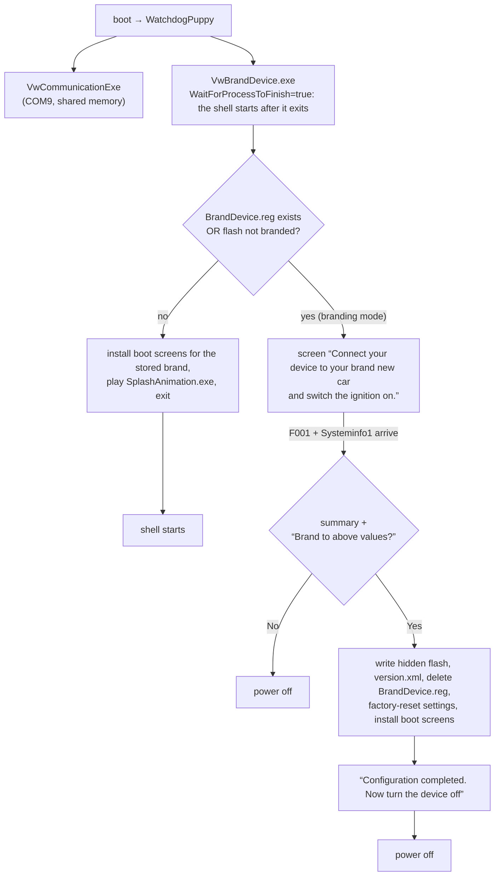

# Brand selection, vehicle pairing and start-up screens

What: `VwBrandDevice.exe` ("branding") decides, on the first contact with a car, which make the unit belongs to (Volkswagen / Seat / Skoda), stores that decision plus the car's VIN and a few equipment codes in the hidden flash, and installs the matching boot screens. Why it matters: every UI program picks its skin from these bytes, and a rewrite, a radio simulator or a replacement device has to know what the unit expects from the car.

Legend: ✅ seen in disassembly / data (binary + VA or file given) · ✅ emulator = observed running in the emulator (CE 7 guest, stubbed hardware) · 🟡 inferred / single source · ❓ unknown. Static analysis; in the emulator only the start of an already branded unit was run (§4.1), plus the observations marked ✅ emulator — not the branding flow itself.
Addresses: VA, image base `0x10000`, `firmware/flash/VwBrandDevice/VwBrandDevice.exe` ("BD") unless another binary is named. BD is ARM code throughout, no RTTI ✅ (`.pdata`: 9004 functions, all 32-bit).

Related: hidden-flash driver and per-binary access matrix → [hardware-layer.md](hardware-layer.md) §3 · shared-memory layout → [shared-memory.md](../car/shared-memory.md) · bit layouts of F001 / Systeminfo1 → [can-signals.md](../car/can-signals.md) §3.12, §3.16 · workflow / `.kbi` data model → [ui-framework.md](ui-framework.md) · link layer and handshake → [car-link.md](../car/car-link.md) §2, §3.

## 1. Overview



Short answers:

| Question | Answer |
|---|---|
| Is the unit bound to one VIN? | **No.** The VIN of the first car is stored (two copies); BD never compares it, the shell and navigon only use it to recognise the "home car" and silently adopt a new one ✅ (§6.1). |
| Unlock code / PIN? | None for branding ✅ (texts §9, workflows §4). Separate, optional and user-set: the Navigon password lock, asked outside the home car (§6.2). |
| Where is the state? | Hidden-flash user block (§2) + `NAVIGON\version.xml` (`platform`, `style`) + presence of `\My Flash Disk\BrandDevice.reg`. No registry access: BD imports no `Reg*` function ✅ (import table). |
| What re-triggers branding? | A `BrandDevice.reg` file in the flash root (any content), or a flash record without `'B'` / with a brand outside {0, 2, 3} ✅ (§4.1). |
| Does the radio check the unit? | Nothing in the unit's software depends on an answer of the radio to F002 ✅ ([shared-memory.md](../car/shared-memory.md) §6.1, §6.3: F002 is sent unsolicited at link-up and repeated up to 6 times while no valid F001 arrived); what the radio does with the device id ❓. |

## 2. Hidden-flash record ✅

2 KB "user block" read / written with `HardwareLayer::ReadFlash(offset, buf, len)` / `WriteFlash` (BD thunks `0x45e78` / `0x45e68`). Driver side: [hardware-layer.md](hardware-layer.md) §3.1.

| Offset | Size | Field | Values | Written (BD) | Source |
|---|---|---|---|---|---|
| 0x10 | 13 | signature | ASCII `123Kuckuck123` | `0x170e8` | constant `0x241bd0` |
| 0x1E | 17 | VIN, copy 1 | ASCII; `FF`×17 = empty | `0x171cc(1, vin)`; cleared by `0x170e8` | F001 (§3) |
| 0x2F | 1 | brand | 0 Volkswagen · 2 Seat · 3 Skoda | `0x115fc` | Systeminfo1 |
| 0x30 | 1 | branded flag | `'B'` (0x42) = done · `' '` (0x20) = not | `0x17224(flag)` | – |
| 0x31 | 1 | fuel bits | `0x20` Petrol · `0x04` Diesel · `0x22` CNG · `0x08` Electro · `0x0C` Hybrid | `0x1eca4` ← `0x17258(fuel)` | F001 |
| 0x32 | 1 | vehicle class | 0 `A000 (XL1)` · 1 `A00 (up, mii, citygo)` · 2 `A0 (Polo, Ibiza, Fabia)` | `0x115fc` | Systeminfo1 |
| 0x33 | 1 | line | 0…5; 1 = "line (cupra)" | `0x115fc` | F001 |
| 0x34 | 1 | sound system | 1 = present (the "Fender" boot screens) | `0x115fc` | F001 |
| 0x35 | 1 | body type | 0 Kurzheck_Multivan · 1 Stufenheck_Nutz · 2 Variant · 3 Fliessheck · 4 Coupe_Sportwagen · 5 Cabrio_Roadster_Spider · 6 Offroad · 7 Cityvan_Pickup · 8 MPV · 9 Sonstige | `0x115fc` | Systeminfo1 |
| 0x36 | 17 | VIN, copy 2 | as 0x1E | `0x171cc(2, vin)`; cleared by `0x170e8` | F001 |

- Field names of 0x32…0x35 follow the summary line BD prints (`0x139a4`: `Class: <0x32> / Line: <0x33> / Type: <0x35> / Sound: <0x34>`) and the tests in `0x47470` (§5); class and body-type value names are the entries of the developer choice lists (`0x14e5c`, `0x15914`: text ↔ value pairs).
- Fuel bits ✅ (disassembly of `0x17258`, packer `0x1ebb0`: flag *i* → bit *i*): bit 1 = gas, bit 2 = diesel, bit 3 = electric, bit 5 = petrol; bit 4 belongs to engine enum 4 (never produced by BD, meaning ❓); bit 0 unused. Readers (`0x1ec3c` → `0x175c4`) map the combination back to the engine enum: only bit 5 → 1 Petrol · only bit 2 → 2 Diesel · bit 1 → 3 CNG · bit 4 → 4 · only bit 3 → 5 Electro · bit 3 + another → 6 Hybrid.
- The two 8-byte records at 0x00 / 0x08 ([hardware-layer.md](hardware-layer.md) §3.1) are **not touched by BD** ✅ (all its `ReadFlash`/`WriteFlash` call sites are in this table and §5). They hold the Navigon **password lock** (§6.2).
- Readers in every UI program: one cached "vehicle configuration" object (BD copy of the loader: `0x4505c`; defaults when a read fails: brand `FF`, class `FF`, body type `0F`, line 0, sound 0; VIN taken from **copy 2**).

## 3. Inputs from the car ✅

BD attaches to `VwSharedMemoryFileMapping` (framework command 20008 → `0x17c40` → `0x17a40`) and gets a listener on notification channel 1 (`0x16ee8`). The event thread `BdVwEventThread` (`0x16f5c`) test-and-clears notification ids 13 (Systeminfo1), 30 (Gateway3) and 18 (Mfa6; names: [shared-memory.md](../car/shared-memory.md) §4.3) and, if one was set, posts the UI event `0x4269` (§4.2).

| Value | Read from (mapping offset → getter) | Raw source | Decoding |
|---|---|---|---|
| "RadioInit valid" | `0x615C` RadioInit, invalid bit 0 (`0x2398c`) | F001 text + version | – |
| VIN | RadioInit data bytes 0…16 (`0x1a3ac` → `0x23998`) | **F001 payload bytes 0x25…0x35** (the 17 bytes after the copyright text and `01 00`) | copied as is |
| fuel | RadioInit data byte 0x11 (`0x1a89c` → `0x239ec` → `0x2381c`) | F001 payload byte 0x36 | one-hot: `01` Petrol · `02` Diesel · `04` CNG · `08` Electro · `10` Hybrid; anything else = invalid |
| line | RadioInit data byte 0x12 without bit 6 (`0x188d8` → `0x23a44` → `0x2387c`) | F001 payload byte 0x37 | one-hot: `01`→0 · `02`→1 (Cupra) · `04`→2 · `08`→3 · `10`→4 · `20`→5 |
| sound system | RadioInit data byte 0x12 bit 6 (`0x1899c` → `0x23a9c`) | F001 payload byte 0x37, mask `0x40` | 1 = present |
| brand | `0x610C` Systeminfo1 byte 0 high nibble (`0x187d0` → `0x24dec`) | CAN 0x651 `VehicleBrand` | 0 VW · 2 Seat · 3 Skoda accepted |
| class | Systeminfo1 byte 0 low nibble (`0x18778` → `0x24dc0`) | CAN 0x651 `VehicleClass` | stored raw |
| body type | Systeminfo1 byte 1 low nibble (`0x18828` → `0x24e18`) | CAN 0x651 derivative | stored raw |

- So the 17-byte string of F001 (layout in [car-link.md](../car/car-link.md) §3 and [can-signals.md](../car/can-signals.md) §3.16) is the **VIN** ✅. `MessageFzgIdent` (CAN 0x65F) is part of the linked library but no branding function reads it ✅ (the VIN getter is vtable slot `+0x50` = `0x1a3ac`, RadioInit block).
- Fuel fallback when F001 carries no fuel byte (frame shorter than 0x39): `0x1a734` derives the six flags from another block (`0x1fa74`, three boolean getters `0x2372c`, `0x2376c`, `0x237ac`; message not identified ❓).
- Fuel code table (`0x241be0`, used by `0x172dc`): engine enum 1→Petrol(0), 2→Diesel(1), 3→CNG(2), 5→Electro(3), 6→Hybrid(4); enum 0 and 4 → unsupported.

## 4. Decision logic

BD is a Navigon "NgGUI" application: the logic is split between C++ command / condition classes and two data files inside `VW_BrandDevice.nfs` (`Startup.kbi` = start sequence, `Workflows.kbi` = two workflows). Both files decode to trees of nodes (`type, key, id, length`; format and executor: [ui-framework.md](ui-framework.md) §2, §3, §5.2; printed by `tools/kbi_extract.py tree`). Branch selection (a follow-up is run when its label equals the result of the command / condition) ✅ ([ui-framework.md](ui-framework.md) §5.2, executor `VwUserShell.exe` `0xf6390`; same library); the class behind every id is ✅.

BD-specific classes (id → `Execute` / `Evaluate`):

| Id | Kind | Function | What it does |
|---|---|---|---|
| 0x4269 | command | `0x1141c` | create the shared-memory listener, keep it in data-store key 0x4269 |
| 0x426a | command | `0x11070` | stop the listener |
| 0x426b | command | `0x119d8` | **commit**: write the hidden flash (§4.3) |
| 0x426c | command | `0x11f4c` | write `platform` + `style` into `version.xml` (§4.4) |
| 0x426d | command | `0x12afc` | **read vehicle data** into the data store (§4.2) |
| 0x426e | command | `0x131c0` | copy the developer VIN setting into data-store key 0x4271 |
| 0x426f | command | `0x13434` | `CreateProcess("\My Flash Disk\SplashAnimation.exe", <parameter 0x65>)` |
| 0x426a | condition | `0x147ac` | **branding needed** = not (`flash[0x30] == 'B'` and `flash[0x2F]` ∈ {0, 2, 3}) |
| 0x426c | condition | `0x1401c` | **vehicle data available** = fuel flags, brand and body type all readable |
| 0x4272 | text | `0x13c60` | summary shown before confirming (§4.2) |
| 0x4271 | text | `0x14a5c` | version line (`/config/software/version`, `build`, `brand`, BT, HW, UUID) |
| 0x426b, 0x426d…0x4270 | lists | `0x14124`, `0x14e5c`, `0x1529c`, `0x155d8`, `0x15914` | choice lists of the developer screen: fuel (`Benzin`, `Diesel`, `Electro`, `Hybrid`), class, line (`no line` 0 / `line (cupra)` 1), sound (`no sound system` 0 / `sound system` 1), body type (values in §2) |

Data-store keys (run-time variables): 0x4270 brand · 0x4271 VIN · 0x426b fuel · 0x426c class · 0x426d line · 0x426e sound · 0x426f body type · 0x4272 bool "branding mode" · 0x426a bool "automatic" (developer screen).

Framework classes used (same library as the shell):

| Id | Function | Meaning |
|---|---|---|
| 3 / 4 | `0xd10c8` / `0xd0f4c` | AND / OR of child conditions ✅ |
| 25 | `0xceb10` | data-store value equals constant ✅ |
| 1016 / 1059 / 1017 | `0x158c24` / `0x1544b8` / `0x158958` | setting equals value / setting key exists / settings file exists (mode 3) ✅; parameter `0x64` = negate 🟡 |
| 1504 | `0x152840` | file `\My Flash Disk\BrandDevice.reg` exists (`GetFileAttributesW` ≠ −1) ✅ |
| 2502 | `0x47470` | change start-up screens from the hidden flash (§5) ✅ |
| 2001 / 2009 / 2003 | `0x48398` / `0x48298` / `0x48218` | `HardwareLayer::ResetDevice` / `ShutdownDevice` ✅ / 🟡 creates the HWL event bridge (that is what class id 2003 does in the shell, [user-shell.md](user-shell.md) §2.1; suspend is 2002, unused here) |
| 20008 | `0x36f14` | attach to the shared memory ✅ |
| 20029 / 20026 / 20039 | `0x38ec8` / `0x391b0` / `0x37e38` | brand / line / "sound system == 1" from the cached flash record (`0x4505c`) ✅ |
| 12 | `0xb3fd8` | begin the shutdown sequence = end the application (✅ call, 🟡 name; [ui-framework.md](ui-framework.md) §5.2) |
| 1053 | `0x148a58` | delete every path listed under a setting key (`0x4f1c8` = delete file / tree) ✅ |
| 23, 29 (27), 22 | – | if / switch · register (unregister) an event handler · raise event ✅ (`Execute` bodies read in the shell's copy of the library, [ui-framework.md](ui-framework.md) §5.2) |
| 44 | – | call `Execute` of the control whose id is `int[100]` ✅ (`VwUserShell.exe` `0x15c210`) — **not** "start workflow". Workflows are started by a workflow-call node (node type 33, `int[100]` = workflow id); "start workflow n" in the pseudo-code below means such a node |
| 45, 1004, 1026 | – | set run-time variable · message box · switch screen 🟡 (from parameters and position) |
| 20003 | `0x377c8` | sends the text `Navigon Mambo Kurt Radio` through the car interface (vtable `+0x304`); in the library, **not referenced** by BD's or the shell's data files ✅ – a test leftover, no role in branding |

### 4.1 Start sequence (`Startup.kbi`, entries 0…16) ✅ structure

```
0-8   framework start: settings, text resources, watchdog events
      (VwBrandDevice{App,Command,Event}ThreadAlive, entry 5), attach shared memory (20008)
1     set bool 0x426a := false, bool 0x4272 := true
9     command 0x4269  (start listener)
11    if not ( exists(BrandDevice.reg)  OR  branding_needed ):          # normal boot
          change_startup_screens()                                      # 2502, §5
          switch (flash.sound==1, flash.brand, flash.line):             # 20039, 20029, 20026
              run SplashAnimation.exe "\My Flash Disk\ChangeStartupScreens\<dir>\"   # 0x426f, table §5
          bool 0x4272 := false
          quit                                                          # → watchdog starts the shell
--- everything below only while bool 0x4272 is true (branding mode) ---
12    if settings file UserSettingsDevMode exists and has no VIN key:
          message "The VIN is missing in configuration file, but needed in manual branding mode!" → OK → shutdown
13    show screen 1
14    on event 0x426b: message text 0xE6 "Configuration completed. Now turn the device off…" → OK → shutdown
15    on event 0x4269: if  ( vehicle_data_available OR (dev VIN exists AND Force019Mode) )
                       AND ( no dev settings file OR bool 0x426a OR Force019Mode ):
                           start workflow 1
16    raise event 0x4269 once
```

- There is **no timeout**: without a car the unit stays on screen 1 for ever (the three heartbeat events keep the watchdog quiet) ✅ (no timer node in either file).
- ✅ emulator (normal boot: flash `'B'`, brand 0, no `BrandDevice.reg`): BD reads the flash, calls `HardwareLayer::ChangeStartupScreen` once, fails to start the animation (the emulator has `SplashAnimation.exe` renamed: it crashes there without the graphics accelerator) and exits about 3 s after its start; the shell, started after it, comes up alone on notification channel 1.
- `BrandDevice.reg` is only tested for existence; BD never reads it ✅. `autorunce.mscr` clears its read-only attribute at every boot so that BD can delete it ([boot-and-supervision.md](boot-and-supervision.md) §2.4 step 5).

### 4.2 Workflow 1 "BrandingRequestWorkflow" — read and confirm

```
if no dev settings file OR bool 0x426a OR Force019Mode:
    ok = read_vehicle_data(allowed brands = {3, 0, 2})          # command 0x426d
    if not ok: message "Problems during reading data from the vehicle, device and process will get
               restarted!" → OK → change_startup_screens → ResetDevice
message  <summary> + text 0xE8 "Brand to above values?"
    "Nein / No / Non"      → ShutdownDevice
    "Ja / Yes / Oui / Sí"  → start workflow 0
```

`read_vehicle_data` (`0x12afc`) ✅:

```c
if (setting Force019Mode || fuel_enum_from_car == 6)        /* 0x1247c, vtable +0xe0 */
    return fixed_values();     /* 0x127b8: brand 0, class 0 (A000), body type 9, line 0, sound 0, fuel "Hybrid",
                                  VIN from the dev setting or from F001 */
if (!shared_memory || !RadioInit.valid) return 0;
brand = Systeminfo1.brand;                                   /* 0x124e0 */
if (brand unreadable || brand not in {3, 0, 2}) brand = 0;   /* unknown make → Volkswagen */
vin = dev setting "VehicleIdentificationNumber" if it has 17 characters, else F001 VIN;   /* 0x12590 */
if (all 17 VIN characters are equal) return 0;               /* 0x12444: rejects blank / FF / 00 VINs */
fuel  = table[fuel_enum];  if (fuel >= 5) return 0;          /* 0x172dc */
class = Systeminfo1.class; type = Systeminfo1.derivative;    /* must be readable */
line  = F001 line (0 if unreadable); sound = F001 sound (0 if unreadable);
return 1;
```

Summary text (`0x13c60`, `0x1376c`, `0x139a4`, `0x138d0`): `Volkswagen / ` | `Seat / ` | `Skoda / ` | `Unsupported manufacturer / ` + `Petrol|Diesel|CNG|Electro|Hybrid|unsupported`, then `Class: n / Line: n / Type: n / Sound: n`, then `VIN: <17 characters>`.

### 4.3 Workflow 0 "BrandDeviceWorkflow" — commit

```
ok = commit()                                      # command 0x426b
if not ok: message "Problems during branding process, device and process will get restarted!"
           → OK → change_startup_screens → ResetDevice
write_version_xml(0xFF, "VW_PID","SKODA_PID","SEAT_PID", auto=1, "VW","SKODA","SEAT")   # command 0x426c
delete_paths(setting "Settings/Remove")   # 1053 → 0x148a58: FactoryResetSettings.default = "/MN Settings" → all user settings wiped ✅
change_startup_screens()           # 2502
raise event 0x426b                 # → "Configuration completed…" → OK → ShutdownDevice
```

`commit` (`0x119d8`) ✅:

```c
if (!signature_ok()) init_flash();           /* 0x17310; 0x170e8: FF×17 → 0x1E and 0x36, signature → 0x10 */
if (write_fields()) {                        /* 0x115fc, stops at the first failure:
                                                brand→0x2F, VIN→0x1E and 0x36, fuel bits→0x31,
                                                class→0x32, line→0x33, body type→0x35, sound→0x34 */
    delete_file(app_dir + ".\..\BrandDevice.reg");      /* 0x4f1c8 → DeleteFileW, clears read-only first */
    version_xml_remove("/config/software/productid", "…/id", "…/romimage", "…/bluetooth", "…/gts");  /* 0x17378 🟡 "remove" */
    flash[0x30] = 'B';                       /* 0x17224(1) */
    return 1;
}
init_flash(); flash[0x30] = ' ';             /* failed: back to "not branded" */
return 0;
```

### 4.4 `version.xml` ✅

Command 0x426c (`0x11f4c`), file from setting `VersionInfoSection` = `/My Flash Disk/NAVIGON/version.xml`, suffix from `VersionInfoPlatformSuffix` = `_V2` (`VwBrandDevice/Settings/SettingsVersionXML.default`):

| Brand | `/config/software/platform` | `/config/software/style` |
|---|---|---|
| 0 (and any other value) | `VW_PID_V2` | `VW` |
| 2 | `SEAT_PID_V2` | `SEAT` |
| 3 | `SKODA_PID_V2` | `SKODA` |

Both strings are upper-cased (`0x11ac4`). With parameter `0x69` = 1 the brand comes from the car (`Systeminfo1`, vtable `+0xac`), not from the data store.

### 4.5 Developer mode ✅ settings, 🟡 behaviour

`Datastorage.nfs` declares an optional settings file `UserSettingsDevMode.default` (looked up in `/MN Settings/BD/`, `./Settings/`, `/MN Settings/Backup/BD/`; **not shipped**) with keys `/Settings/Active`, `/Settings/VehicleIdentificationNumber`, `/Settings/Force019Mode`.

- File present → screen 1 shows buttons `VW` (brand 0), `SEAT` (2), `SKODA` (3), `AUTOMATIC` (sets bool 0x426a → use car data) and the version line; a brand button stores the brand, takes the VIN from the file (command 0x426e) and goes to the confirmation without reading the car.
- ✅ emulator (an earlier build of the emulator created an empty `BrandDevice.reg` and this settings file with `Active` and a VIN, and did not wait for BD): `VwBrandDevice.exe` stayed on screen 1 behind the shell, with the four languages of the "Connect your device…" text, the buttons `VW` `SKODA` `SEAT` `AUTOMATIC` and the version line `OS: 2.33 / BT: 1.0 / HW: 1.0 / UUID: <device id>` · `SW: v7.16.9 (build-314) / NAVIGON_EU`. It did not react to a valid F001 written into the shared memory with only id 11 raised (ids 13, 18, 30 were not all supplied); it shared notification channel 1 with the shell there, which the unit never does.
- `Force019Mode` = 1 → fixed values of `0x127b8` without any car: class 0 = `A000 (XL1)`, body type 9 = `Sonstige`, Hybrid ✅ → a mode for the XL1 (🟡 "019" = its project code).
- Today's emulator build creates neither file: its hidden flash says "branded", BD takes the normal path (§4.1) and `launch.exe` waits for it like the watchdog does.

## 5. Brand → skins and start-up screens

### 5.1 What each program derives from the flash record ✅

| Consumer | Rule | Evidence |
|---|---|---|
| Shell skin file | brand 2 and class == 2 and line == 1 → `VW_UserShell_SeatCupraSkin.nfs`; brand 2 → `…SeatSkin.nfs`; brand 3 → `…SkodaSkin.nfs`; anything else → `…VwSkin.nfs` | `VwUserShell.exe` `0x915f4` (reads 0x2F, 0x32, 0x33) |
| Command line of started apps | ` language=<lc>` + ` skin=VW` (brand < 2) / ` skin=Seat` (2) / ` skin=Skoda` (3) | `VwUserShell.exe` `0x1c15c`, `0x1cb04` |
| MediaPlayer, PictureViewer | `MultiMediaPlayer_{Vw,Seat,Skoda}Skin.nfs`, `PictureViewer_{Vw,Seat,Skoda}Skin.nfs` | string tables; they read 0x2F themselves ([hardware-layer.md](hardware-layer.md) §3.1) |
| navigon | `ReadFlash(0x2F)`: 2 → `skin_SEAT\MobileNavigator.res`, 3 → `skin_SKODA\MobileNavigator.res`, anything else → `MobileNavigator.res` (VW); map icons `map\MapDrawer_{VW,Seat,Skoda}.nfs` | ✅ `navigon.exe` `0x5701c` ([navigation.md](navigation.md) §1.5) |
| PhoneApplication | `PhoneApplication.res` + `skin_SEAT` / `skin_SKODA` variants; `version.xml` `style` (§4.4) | file names; selection code not traced 🟡 (reads 0x2F, [hardware-layer.md](hardware-layer.md) §3.1) |
| VolumeUI | runs only when brand 0, class 0, body type 9 (XL1), else quits | ✅ [media-audio.md](media-audio.md) §6.3 |
| Boot-loader images | framework command 2502, below | BD `0x47470` |
| Boot animation | start sequence entry 11, below | `Startup.kbi` |

The brand is therefore **not** passed around at run time (no AppCom "brand" message, BD does not even import AppCom): every process reads the hidden flash; `skin=` on the command line is the only hand-over, and third-party apps may ignore it ([building-apps.md](../apps/building-apps.md)).

### 5.2 `ChangeStartupScreens\<dir>\`

Two independent users of the same folder tree:

| | Boot-loader images (command 2502, `0x47470`) | Animation (start sequence, command 0x426f) |
|---|---|---|
| When | after branding, after a failed branding, and on **every** normal boot | every normal boot |
| Directory | `\My Flash Disk\ChangeStartupScreens\` + `%d\` (brand) + [`Cupra\` if brand 2, class 2, line 1] + [`Fender\` if sound 1 and brand ∈ {0, 2, 3}] | same tree; brand 0 or `FF` → `0\`, 3 → `3\`, 2 → `2\` or `2\Cupra\` (line == 1 only), + `Fender\` if sound == 1; other brands: no animation |
| Action | `HardwareLayer::ChangeStartupScreen(dir)`: `wallpaper.bmp` → splash, `usb.bmp` → USB-mode image, `nosw.bmp` → "no software" image, each converted to 480×272 RGB565 and written to raw flash; loader text colour (100,100,100) ([hardware-layer.md](hardware-layer.md) §3, §4) | `CreateProcess("\My Flash Disk\SplashAnimation.exe", dir)` → plays `dir\SPLASH.RGBFS` |

Files ✅ (md5 groups over the 40 files):

| Dir | `wallpaper.bmp` (boot splash) | `SPLASH.RGBFS` | `usb.bmp` |
|---|---|---|---|
| `0\` Volkswagen | VW picture | 18 + 6 frames, "Welcome to Volkswagen" | VW |
| `0\Fender\` | own picture | own animation | common "Fender" set |
| `1\`, `1\Fender\` (never selected by BD: brand 1 is not accepted) | black | empty (header only) | as `3\` / Fender set |
| `2\` Seat | black | 2 + 4 frames (cross-fade black → Seat logo) | Fender set |
| `2\Fender\` | black | own animation | Fender set |
| `2\Cupra\`, `2\Cupra\Fender\` | black | one shared animation | Fender set |
| `3\`, `3\Fender\` Skoda | one shared picture | one shared animation | `3\`: as `1\`; Fender: Fender set |

`NOSW.BMP` is the same file everywhere ("Garmin Software cannot be started. Contact the Garmin Service Center.", 7 languages). All BMPs: 480×272, 24 bpp, 391 734 bytes. ROM fall-backs `\Windows\bk*.RGB`: [hardware-layer.md](hardware-layer.md) §2.

### 5.3 `SplashAnimation.exe` and the `.RGBFS` format ✅

Program (`firmware/flash/SplashAnimation.exe`, 15 KB, ARM, imports `sgalib.dll` = ST 2D accelerator + COREDLL): takes the directory as command line (quotes stripped, `\` appended; default `\My Flash Disk\ChangeStartupScreens\0\`, `0x11394`), loads `SPLASH.RGBFS` completely, creates one SGA bitmap per frame, shows a top-most full-screen window of class `SPLASHANIMATION`, title `SplashAnimation`, and steps through the frames on a `WM_TIMER`.

```c
struct RgbfsHeader {            /* 32 bytes, little endian; check at 0x118ac */
    uint32_t header_size;       /* 0x20 */
    char     magic[2];          /* "SA" */
    uint8_t  version;           /* 1 */
    uint8_t  compression;       /* 0 = raw, 1 = RLE */
    uint32_t intro_frames;      /* played once            (VW 18, Seat 2, Skoda 1) */
    uint32_t intro_ms;          /* duration of the whole intro (2000) */
    uint32_t intro_fade_steps;  /* cross-fade steps between two frames (Seat 100, others 0) */
    uint32_t loop_frames;       /* repeated until the window is closed (6 / 4 / 4) */
    uint32_t loop_ms;           /* duration of one loop pass (500) */
    uint32_t loop_fade_steps;   /* 0 */
};
/* then intro_frames + loop_frames times: */
struct RgbfsFrame { char tag[2]; /* "IM" */ uint32_t words; /* payload length in 16-bit words */ uint16_t payload[]; };
```

- Pixel format: 480×272 RGB565, row by row from the top; a decoded frame is always 130 560 pixels (`0x11458` checks `0x1FE00`).
- RLE (`0x11458`): word `0x3412` (bytes `12 34`) = escape, followed by `count`, `pixel`; every other word is one literal pixel. A literal pixel of value `0x3412` cannot be stored.
- Timing (`0x11a1c`, `0x11164`): timer period = `ms / ((fade_steps + 1) × frames)`; with fade steps the two neighbouring frames are alpha-blended (`STBitBltAlpha`, alpha = step / (steps + 1)). VW: 111 ms per intro frame, 83 ms per loop frame.
- End: the loop runs until the window gets `WM_QUIT` (message 0x12); the shell posts it with `FindWindow("SPLASHANIMATION","SplashAnimation")` when it is ready (`VwUserShell.exe` `0x165cc`; same strings in `navigon.exe`). With 0 loop frames the program quits after the intro.
- Verified with `tools/rgbfs_extract.py` (`list FILE…` checks, `extract FILE OUTDIR` writes one PNG per frame): all ten `SPLASH.RGBFS` files decode (the two of brand folder `1` hold no frames); every frame yields exactly 130 560 pixels, the parser ends exactly at the end of file, frames look right (VW frame 17, Seat frame 1, Skoda frame 0 checked as PNG).

## 6. Pairing and anti-theft

### 6.1 What the VIN is used for ✅

| Program | Function | Behaviour |
|---|---|---|
| BD | §4 | writes both VIN copies once, at branding; never compares |
| Shell | `0x1ddf8` op 16001 | "same car": F001 VIN (ignored if all 17 bytes are `0x88`) == `flash[0x1E]` |
| Shell | `0x1ddf8` op 16000 | if different: **overwrite `flash[0x1E]`** with the car's VIN (copy 2 at 0x36 keeps the first car). ✅ emulator: an F001 with another VIN (no password set) → one `WriteFlash`; afterwards 0x1E holds the new VIN, 0x36 the old one |
| navigon | `0x3bdcd8` | same "adopt the new VIN" code; `0x43c16c`: re-initialise the block when the signature is missing |
| Shell workflow 25 `USH_ThinkBlueVINChangedWorkflow` | – | resets car-related statistics after a VIN change 🟡 (name only) |

So a branded unit **works in any car of any of the three makes**: nothing refuses to run on a VIN mismatch, the skin simply stays that of the first car. The VIN is only an input of the password lock.

### 6.2 Password lock (the records at 0x00 / 0x08) ✅ storage, 🟡 flow

This is the standard Navigon "Password lock" (texts in `NAVIGON/language_files/*.lng`: "New password", "Enter password", "Forgotten your password? Call our hotline. Please have the following security code at hand:"). It is optional and off by default (no valid record).

| Item | Detail | Evidence |
|---|---|---|
| Record at 0x00 | 8 bytes = Blowfish-encrypted block of { 4 password characters, 4 pseudo-random bytes (LCG `x·0x19660D + 0x3C6EF35F`) } | `VwUserShell.exe` `0x17a10` op 16000; cipher `0x1ded34` / `0x1de90c` / `0x1deb18` (P-array `243F6A88…` at `0x34f418`), fixed 8-byte key at `0x350484` (not reproduced here) |
| Check copy at 0x08 | byte `7−i` = `i` for even *i*, = record byte *i* for odd *i*; record is valid only if it matches | `0xa78a0` |
| "No password" | 0x08 overwritten with a constant that fails the check | op 16002, constant at `0x2f48b8` |
| Verify | decrypt, compare the first 4 bytes; an invalid record counts as "correct" | op 16001 |
| Same code in | `navigon.exe` `0x57656c` / `0x530ba8` (settings UI), `PhoneApplication.exe` `0x12a9c4` / `0xe7ef0` | [hardware-layer.md](hardware-layer.md) §3.1 |

When it is asked (shell workflow 15 `USH_PinProtectionWorkflow`, entries decoded from `VW_UserShell.nfs`):

```
if RadioInit valid (condition 20001):                 # docked, radio answered
    if car VIN == flash[0x1E]:  close the password dialog if open          # home car: no question
    elif password set:          open dialog 1204 ("PIN Protection WF in connected case")
    else:                       flash[0x1E] := car VIN                     # silently adopt the new car
else:
    if password set:            open dialog 1204 ("PIN Protection WF in not connected case")
```

- No retry counter and no lock-out were found in the shell handler ✅ (`0x17a10` has six operations: set, clear, verify, is-set, remember first entry, compare repeat). How the "security code" for the hotline is derived ❓ (navigon side not traced).
- Re-branding does not touch the password: `init_flash` (§4.3) rewrites only the signature and the two VINs ✅.

### 6.3 Scenarios

| Situation | What happens |
|---|---|
| Factory-fresh unit (`BrandDevice.reg` present, flash not branded), no car | Screen 1 "Connect your device to your brand new car and switch the ignition on." for ever; shell never starts (watchdog waits for BD) ✅ |
| Same, docked, ignition on | F001 + Systeminfo1 → summary → Yes → flash written → "Configuration completed" → power off; next boot is normal ✅ |
| Branded unit, bench (no radio) | BD: boot images + animation, exits; shell starts with the stored skin ✅ emulator. Password asked only if the owner set one ✅/🟡 |
| Branded unit, other car (any make) | Works with the old skin. `flash[0x1E]` follows the new car (after the password, if set) ✅ |
| Re-brand to another make | Needs a `BrandDevice.reg` file in the flash root (the official update package ships a 0-byte one → every software update re-opens branding 🟡) or a cleared `flash[0x30]`. No counter, no limit ✅ |
| Car sends an unknown make | Branded as Volkswagen (brand forced to 0) ✅ |
| F001 VIN blank (all characters equal) | "Problems during reading data from the vehicle…" → OK → reset; repeats at every boot until a real VIN arrives ✅ |

## 7. What a radio simulator must send

Link layer, F002 answer and frame formats: [car-link.md](../car/car-link.md) §2–§3, [can-signals.md](../car/can-signals.md) §7. For branding only two messages matter:

```
F001 (id 0xF001), length ≥ 0x39:
  0x00  "VW BCR copyright 2009 Volkswagen AG"   35 bytes
  0x23  01 00                                    version
  0x25  VIN                                      17 ASCII bytes, not all equal, not all 0x88
  0x36  fuel      01 petrol | 02 diesel | 04 CNG | 08 electric | 10 hybrid (→ fixed "019" values, §4.2)
  0x37  flags     one line bit (01 = standard … 02 = Cupra, 04, 08, 10, 20)  |  40 = sound system ("Fender")
  0x38  (present so that the length check passes; content not read by BD)

CAN 0x651 Systeminfo1 (id + 4 data bytes): VehicleClass (bits 8…11), VehicleBrand (bits 12…15), derivative (bits 16…19)
```

| Wanted result | Systeminfo1 brand | class | F001 byte 0x37 |
|---|---|---|---|
| Volkswagen | 0 (or any value except 2, 3) | any | `01` |
| Volkswagen + Fender screens | 0 | any | `41` |
| Seat | 2 | any | `01` |
| Seat Cupra skin | 2 | 2 (`A0`, i.e. Ibiza; a Mii is class 1 and never gets it) | `02` |
| Skoda | 3 | any | `01` |

- Order: BD reacts to notification ids 13 (Systeminfo1), 30 and 18 ✅; F001 must already be valid when Systeminfo1 arrives, or Systeminfo1 must be repeated (it is cyclic in a car).
- On an **already branded** unit none of this changes the skin; F001's VIN only feeds §6.
- A line byte with no or several line bits leaves line = 0; a fuel byte that is not one-hot makes BD fall back to the secondary source (§3) and, failing that, branding never starts 🟡.

## 8. What a replacement device needs to know

- The radio's part of "pairing" visible from the unit: it sends the car's VIN and two equipment bytes in F001 and forwards CAN. There is **no challenge, no key, no code** in the handshake ✅: F002 = fixed text + version + the unit's device id ([car-link.md](../car/car-link.md) §3). The unit's software never waits for an acknowledgement of that id ([shared-memory.md](../car/shared-memory.md): F002 is sent unsolicited and repeated 6 times). Whether the radio stores or checks the id (VW component protection) ❓ — not decidable from this side; needs a capture with a second device.
- A replacement can ignore branding completely: read brand / class from CAN 0x651 and VIN / fuel / line / sound from F001 at every start.
- To keep the original unit usable next to it: do not write the hidden flash, do not create `BrandDevice.reg`.
- Emulator: the stand-in `WolfSpecial.dll` keeps the flash in one file for all processes ([hardware-layer.md](hardware-layer.md) §7.1), so a branding done by BD would reach the shell. A full branding run there (flag cleared or a `BrandDevice.reg`, plus F001 and Systeminfo1 from `emulator/radio.py`) has not been tried.

## 9. Screens and texts ✅

`VwBrandDevice/TextResources.nfs`: 34 language entries, 33 byte-identical (all texts are multilingual strings), `chi-CHN` shorter.

| Id | Text (English part) | Used |
|---|---|---|
| 1 | "Connect your device to your brand new car and switch the ignition on." | screen 1 |
| 2 / 3 / 4 / 5 | `VW` / `SEAT` / `SKODA` / `AUTOMATIC` | developer buttons |
| 0x0A | "DEV I am a CAR as well." | developer screen |
| 0x0B…0x0F | `Petrol`, `Diesel`, `CNG`, `Electro`, `Hybrid` | – |
| 0xE4 / 0xE5 | "Nein / No / Non" / "Ja / Yes / Oui / Sí" | confirmation |
| 0xE6 | "Configuration completed. Now turn the device off by tapping on 'OK / Aceptar'." | after commit |
| 0xE7 | "OK / Aceptar" | buttons |
| 0xE8 | "Brand to above values?" | confirmation |
| literals in the workflow files | "Problems during branding process, device and process will get restarted!" · "Problems during reading data from the vehicle, device and process will get restarted!" · "The VIN is missing in configuration file, but needed in manual branding mode!" | errors |

No "wrong vehicle" text, no code entry screen exists in BD.

## 10. How to reimplement

```c
/* boot-time brand program, equivalent to VwBrandDevice.exe */
bool branded = flash[0x30] == 'B' && (flash[0x2F] == 0 || flash[0x2F] == 2 || flash[0x2F] == 3);
if (!file_exists("\\My Flash Disk\\BrandDevice.reg") && branded) {
    install_boot_images(dir_for(flash));            /* §5.2 left column  */
    play_animation(dir_for_animation(flash));       /* §5.2 right column */
    return;                                         /* shell starts */
}
show("Connect your device …");
wait until F001 valid && Systeminfo1 valid;         /* no timeout */
v = read_vehicle();                                 /* §3, §4.2 */
if (!confirm(summary(v))) shutdown();
if (memcmp(flash + 0x10, "123Kuckuck123", 13)) { memset(flash + 0x1E, 0xFF, 17); memset(flash + 0x36, 0xFF, 17); put signature; }
flash[0x2F] = v.brand; memcpy(flash + 0x1E, v.vin, 17); memcpy(flash + 0x36, v.vin, 17);
flash[0x31] = fuel_bits(v.fuel); flash[0x32] = v.cls; flash[0x33] = v.line; flash[0x35] = v.type; flash[0x34] = v.sound;
delete("\\My Flash Disk\\BrandDevice.reg"); flash[0x30] = 'B';
version_xml.platform = {"VW_PID","SEAT_PID","SKODA_PID"}[…] + "_V2"; version_xml.style = "VW" | "SEAT" | "SKODA";
delete_tree("\\MN Settings"); install_boot_images(dir_for(flash));
show("Configuration completed …"); shutdown();
```

To make the existing software believe it is branded (emulator, bench): signature at 0x10, `'B'` at 0x30, brand at 0x2F, a VIN at 0x1E and 0x36, **no** `BrandDevice.reg`. Fields 0x31…0x35 only select equipment-dependent screens (fuel type pages, Cupra skin, Fender images).

## 11. Open questions

1. Does the radio (RCD 215) store or validate the unit's device id from F002? (needs a capture; §8)
2. Meaning of line codes 2…5 and of engine enum 4 / fuel bit 4.
3. The secondary fuel source `0x1fa74` (which CAN message) and notification ids 30 / 18 as branding triggers.
4. Password lock: derivation of the hotline "security code", character set of the 4 password bytes, what the shell does after a correct entry in a foreign car (adopt VIN?).
5. Framework commands 45 and 1026 are still read from structure only 🟡 (22 / 23 / 27 / 29 / 44 and the follow-up labels are answered in [ui-framework.md](ui-framework.md) §5.2).
6. `version_xml_remove` (`0x17378` → `0x126078`): remove vs. reset of `productid`, `id`, `romimage`, `bluetooth`, `gts`.
7. A complete branding run in the emulator (§8) — the branded start and the dev-mode screen are answered (§4.1, §4.5).
