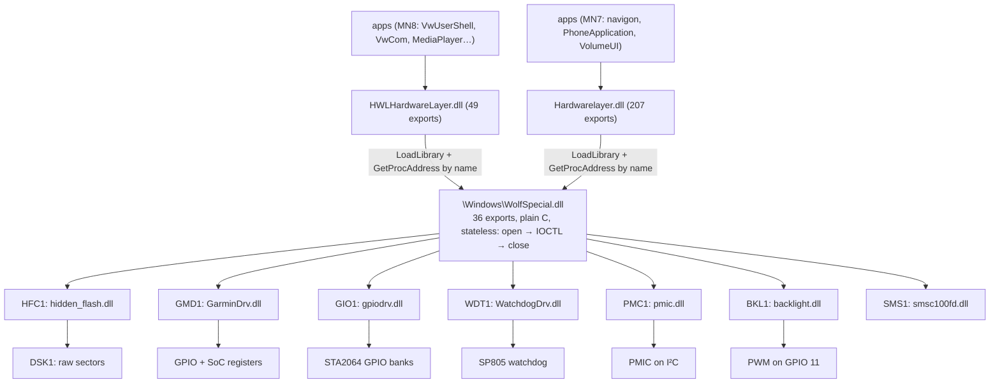

# Hardware layer — `WolfSpecial.dll`, HWL wrappers, drivers, ROM registry

What sits between the apps and the board: two C++ wrapper DLLs on flash, one OEM board-support DLL in ROM, a handful of stream drivers, and the registry that wires them together. Needed to (a) write a correct stand-in for the emulator, (b) call the hardware from custom apps, (c) know what a replacement device must mimic.

Static analysis only (r2 + r2ghidra). Nothing tested on a real unit. Legend: ✅ seen in code/data (binary + VA given) · 🟡 inferred · ❓ unknown.
VAs: `WolfSpecial.dll` image base `0x10000000`; ROM modules are XIP-relocated (`0xC0xxxxxx`).
Related: [brand-and-pairing.md](brand-and-pairing.md) (meaning of the hidden-flash fields) · [boot-and-supervision.md](boot-and-supervision.md) (`Ciao.exe`, watchdog) · [media-audio.md](media-audio.md) (speaker / mute policy) · [bluetooth.md](bluetooth.md) (`COM0:`, BT reset) · [navigation.md](navigation.md) (GPS, TMC tuner).

## 1. Overview



Events go the other way: GarminDrv / pmic → (message `0x1122` / registered message) → `Ciao.exe` → (registered window messages) → HWL listeners.

| Layer | File | Notes |
|---|---|---|
| OEM BSP DLL | `firmware/rom/files/WolfSpecial.dll` | ✅ 25 KB, ARM (not Thumb), **debug build** (PDB `c:\Wolf\WolfSpecialAPI\WolfSDK (ARMV4I)\Debug\WolfSpecialAPI.pdb`), version resource "WolfSpec 1.3.0.0", built 2014-03-31. Imports only COREDLL. |
| Drivers | `firmware/rom/modules/*.dll` | ✅ loaded by `device.dll` from `HKLM\Drivers\BuiltIn` (§5) |
| Registry | `firmware/rom/files/{boot,default,user}.hv` | ✅ decoded (§5.1) |

## 2. `WolfSpecial.dll` — every export

✅ All 36 exports decompiled. Every function opens the stream device, issues one `DeviceIoControl`, closes it. No global state except one saved brightness value and a "D" suffix flag (below). No threads, no callbacks.

**✅ There is no `RegisterCallBack` export** (the export table has exactly the 36 names below) and neither HWL DLL asks for one. The `RegisterCallBack` string seen in the MN7 DLL belongs to `nfVR.dll` (§4). Hardware events reach apps as window messages (§4.3).

Calling convention: plain C (`__cdecl` = ARM AAPCS). `BOOL`-like results are 0/1 unless noted.

### 2.1 Identification (read from the "generic" hidden-flash block, §3.2)

| Export (VA) | Prototype | Behaviour |
|---|---|---|
| `GetDeviceID` (`0x10002638`) | `DWORD GetDeviceID(wchar_t *out, DWORD cch)` | ✅ needs `cch ≥ 10`. `wsprintfW(out, L"%u", *(uint32*)(blk+0x88))`. Returns **10** on success (constant, not the length), 0 on failure. |
| `GetOSVersion` (`0x1000235c`) | `DWORD GetOSVersion(wchar_t *out, DWORD cch)` | ✅ needs `cch ≥ 8`. `wsprintfW(out, L"%.2f", (double)*(uint32*)(blk+0x80) / 100.0)` → e.g. 233 → "2.33". Returns `wcslen`. |
| `GetBootLoaderVersion` (`0x10002214`) | `DWORD (wchar_t *out, DWORD cch)` | ✅ needs `cch ≥ 0x40`. ASCII string at `blk+0x00` → UTF-16. Returns `wcslen`. |
| `GetBTVersion` (`0x100024ec`) | `DWORD (wchar_t *out, DWORD cch)` | ✅ needs `cch ≥ 0x40`. ASCII string at `blk+0x40` → UTF-16. |
| `GetHWVersion` (`0x100042e0`) | `DWORD GetHWVersion(DWORD what, wchar_t *out, DWORD cch)` | ✅ needs `cch ≥ 0x14`; `GMD1:`. `what` 0 = RAM vendor (`0x80522048` → "Nanya" / "Samsung F-die" / "Samsung G-die" / "Unknown DDR"); 1 = PMIC vendor (`0x80522034` board rev: `< 12` → "STE", else "TI"); 2 = CPU (`0x8052204C` clock Hz + `0x80522050` variant → "STA2064N2/P2/Z2 %dMHz" or "STA2064 %dMHz"); 3 = `L"PCB V%d"` (`0x80522034`). Returns `wcslen`. |
| `ReadBTAddressFromHF` (`0x10003d6c`) | `BOOL (BYTE *addr, DWORD len)` | ✅ `len` must be 6. Reads 0x200 bytes at flash offset `0x21FF000`, copies 6 bytes from `blk+0xA0`. |
| `WriteBTAddressToHF` (`0x10003f5c`) | `BOOL (const BYTE *addr, DWORD len)` | ✅ `len` must be 6. Reads the 2 KB block, stores the address **byte-reversed** (`blk[0xA0+i] = addr[5-i]`), writes the block back. `ReadBTAddressFromHF` does not reverse → it returns the bytes in the opposite order of what `Write…` was given. |

"D" suffix ✅: `DllMain` (`0x10001998`) calls `GMD1:` IOCTL `0x80522038` and stores the result at `0x100070A8`; when non-zero, `L"D"` is appended to the three version strings. `GarminDrv` always answers 0 (`GMD_IOControl`), so the suffix never appears on this ROM.

### 2.2 Hidden flash (user block, §3.1)

| Export | Prototype | Behaviour |
|---|---|---|
| `ReadHiddenFlash` (`0x10002094`) | `DWORD ReadHiddenFlash(BYTE *buf, DWORD len, DWORD offset)` | ✅ rejects `len > 0x800`, `offset > 0x800`, `offset+len > 0x800`. `HFC1:` IOCTL `0xFFFF3F34` reads the whole 2 KB, copies the slice. Returns `len`, or 0. |
| `WriteHiddenFlash` (`0x10001f08`) | `DWORD WriteHiddenFlash(const BYTE *buf, DWORD len, DWORD offset)` | ✅ same limits. Read-modify-write of the whole 2 KB (`0xFFFF3F38`). Returns `len`, or 0. Not atomic, no checksum. |

### 2.3 Display, backlight, boot images

| Export | Prototype | Behaviour |
|---|---|---|
| `GetDeviceBrightness` (`0x10002b10`) | `int (void)` | ✅ `BKL1:` IOCTL `0xFFF64004` → DWORD 0…100; −1 on failure. |
| `SetDeviceBrightness` (`0x10002a0c`) | `BOOL (DWORD percent)` | ✅ clamps to 100; `BKL1:` IOCTL `0xFFF64008`. |
| `GetDisplayState` (`0x10002900`) | `BOOL (void)` | ✅ `GMD1:` `0x80522024` → 1 when LCD controller is on. |
| `SetDisplayState` (`0x10002724`) | `BOOL (BOOL on)` | ✅ no-op if already in that state. Off: remember brightness, set brightness 0, `GMD1:` `0x80522020`(0). On: `0x80522020`(1), `Sleep(100)`, restore brightness. |
| `TouchCalibration` (`0x10002c00`) | `BOOL (void)` | ✅ tail-calls COREDLL `TouchCalibrate()` (ordinal 877) → standard CE calibration UI. |
| `SetSplashImagePath` (`0x10002c0c`) | `BOOL (const wchar_t *bmp)` | ✅ NULL → copy `\Windows\bkSPLASH.RGB` to `\Temp\SPLASH.RGB`; else convert the BMP (must be **480×272, 24 bpp**) to RGB565 in `\Temp\SPLASH.RGB`. Then write 0x3FC00 bytes to flash offset `0x54000`. |
| `SetUSBModeImagePath` (`0x10002d2c`) | same | ✅ same, default `\Windows\bkUSBMode.RGB`, flash offset `0x217F800`. |
| `SetNoSWFoundImagePath` (`0x10002df0`) | same | ✅ same, default `\Windows\bkNOSW.RGB`, flash offset `0x21BF400`. |
| `SetLoaderTextColor` (`0x10002eb4`) | `BOOL (DWORD r, DWORD g, DWORD b)` | ✅ packs RGB565 into `blk+0x8C` of the generic block and writes it back. |

### 2.4 Audio routing, cradle, power

| Export | Prototype | Behaviour |
|---|---|---|
| `IsCradleStatusConnected` (`0x1000329c`) | `BOOL (void)` | ✅ `GIO1:` read (`0x80012008`) of **GPIO 18**; returns `level == 0` → **cradle detect is active-low**. |
| `SetExternalAudioMutePin` (`0x10003458`) | `BOOL (BOOL mute)` | ✅ `GIO1:` on **GPIO 19**: `mute == 1` → drive **low** (`0x80012010`), anything else → drive **high** (`0x8001200C`). |
| `GetExternalAudioMutePin` (`0x100035a4`) | `BOOL (void)` | ✅ reads GPIO 19; returns `level == 0` (TRUE = muted). |
| `SetSpeakerMode` (`0x10003078`) | `BOOL (BOOL mute)` | ✅ `GMD1:` `0x80522030` with `mute != 0`. TRUE = internal speaker amplifier **off**; FALSE = on, but only outside the cradle (§6.2). The name is misleading: the HWL calls it from `SetMuteDeviceSpeakers(mute)`. |
| `GetSpeakerMode` (`0x100031a8`) | `BOOL (void)` | ✅ reads **GPIO 22**; returns `level == 0` (TRUE = amplifier off). |
| `GetPowerSource` (`0x10003384`) | `int (void)` | ✅ `PMC1:` IOCTL `0x80222014` → DWORD; −1 on failure. Values: §6.4. |
| `Gpio_control` (`0x10003a28`) | `BOOL (DWORD pin, BOOL level)` | ✅ **always returns 0**: the guard is `if (pin != 0x16 \|\| pin != 0xD) return 0` (bug, `0x10003a3c`). Dead code behind it would drive the pin with `0x8001200C` / `0x80012010`. |
| `BackToFactorySettings` (`0x100019d4`) | `void (void)` | ✅ `GMD1:` `0x80522028` (writes the 4-byte marker `04 00 AF BE` to the boot-args page), then `SetSystemPowerState(NULL, POWER_STATE_RESET, POWER_FORCE)` → reboot; the boot loader does the wipe 🟡. |

### 2.5 Watchdog, modem, BT, network

| Export | Prototype | Behaviour |
|---|---|---|
| `SetHWWatchdogState` (`0x10001a80`) | `BOOL (BOOL on)` | ✅ `WDT1:` `0x80532000`. |
| `GetHWWatchdogState` (`0x10001b90`) | `BOOL (void)` | ✅ `0x80532004`. |
| `SetHWWatchdogTimeout` (`0x10001c7c`) | `BOOL (DWORD ms)` | ✅ `0x80532008`. |
| `GetHWWatchdogTimeout` (`0x10001d64`) | `DWORD (void)` | ✅ `0x8053200C`; 0 if the driver cannot be opened. |
| `RefreshHWWatchdog` (`0x10001e28`) | `BOOL (void)` | ✅ `0x80532010`. |
| `ResetBTChip` (`0x10003b74`) | `void (void)` | ✅ `GMD1:` `0x8052203C` → pin 20 pulsed for 10 ms (§6.2). Caller: `BTCore.exe` resolves it itself (`LoadLibrary` + `GetProcAddress`, `BTCore.exe` `0x19094`; [bluetooth.md](bluetooth.md) §5.1). |
| `Get/SetGPRSModemPowerState`, `ResetGPRSModemState` | `BOOL (void)` / `BOOL (BOOL)` / `BOOL (void)` | ✅ `GMD1:` `0x80522004` / `0x80522008` (on) + `0x8052200C` (off) / `0x80522010`. `GarminDrv` on this ROM implements **none** of these codes → always fail. Leftover from a modem-equipped sibling product. |
| `SetTCPWindowSize` (`0x10003c3c`) | `BOOL (void)` | ✅ `SMS1:` (`smsc100fd.dll`) IOCTL `0x80132000` with a 2-byte value 300. |

### 2.6 IOCTL summary

| Device | Code | In | Out | Meaning |
|---|---|---|---|---|
| `HFC1:` | `0xFFFF3F34` | – | 0x800 bytes | read user block |
| | `0xFFFF3F38` | 0x800 bytes | – | write user block |
| | `0xFFFF3F3C` | – | `{DWORD offset, DWORD len, BYTE *buf}` (12 bytes, passed as *out* buffer) | read generic (`IOCTL_HFC_READ_GENERIC`) |
| | `0xFFFF3F40` | same struct as *in* buffer | – | write generic |
| `GIO1:` | `0x80012004` | 20-byte config | DWORD | configure pin (§6.1) |
| | `0x80012008` | DWORD pin | 8 bytes: `[0]` = level, `[1]` = status | read pin |
| | `0x8001200C` | DWORD pin | DWORD | drive pin **high** |
| | `0x80012010` | DWORD pin | DWORD | drive pin **low** |
| | `0x80012014` / `18` | DWORD group | DWORD | enable / disable the alternate-function pins of peripheral group *n* |
| | `0x80012020` | `{DWORD pin, wchar_t *eventName}` | DWORD | bind a named event to the pin interrupt |
| `WDT1:` | `0x80532000…10` | see §2.5 | | |
| `GMD1:` | `0x805220xx` | see §6.2 | | |
| `PMC1:` | `0x80222014` | – | DWORD | power source |
| `BKL1:` | `0xFFF64004` / `8` | – / DWORD | DWORD / – | get / set brightness % |

## 3. Hidden flash

✅ Not a separate chip and not a partition: `hidden_flash.dll` (`HFC_IOControl`, `0xC0A51194`) opens **`DSK1:`** (the internal MMC, same disk that holds `My Flash Disk`) and reads/writes **raw sectors at fixed byte offsets** (absolute on the disk, outside the file systems 🟡), with two vendor IOCTLs of the MMC driver: `0x91C84` (read) / `0x91C88` (write), argument = CE `SG_REQ` (0x1C bytes: start sector, sector count, 1 buffer). Sector size comes from `IOCTL_DISK_GETINFO` (`0x71C00`).

| Byte offset on `DSK1:` | Size | Content | Access |
|---|---|---|---|
| `0x0005_4000` | 0x3FC00 (480×272 RGB565) | splash image | `SetSplashImagePath` |
| `0x0217_F800` | 0x3FC00 | "USB mode" image | `SetUSBModeImagePath` |
| `0x021B_F400` | 0x3FC00 | "no software found" image | `SetNoSWFoundImagePath` |
| `0x021F_F000` | 0x800 | **generic block** (factory data, §3.2) | generic IOCTLs |
| `0x021F_F800` | 0x800 | **user block** (brand/pairing, §3.1) | `Read/WriteHiddenFlash` |

✅ Generic IOCTLs accept any range with `offset + len ≤ 0x21FF800` — i.e. everything below the user block, including boot loader and OS image areas 🟡. A stand-in must never forward these to a real disk.

### 3.1 User block (2 KB at `0x21FF800`) — `ReadHiddenFlash` / `WriteHiddenFlash`

✅ `WolfSpecial.dll` and the driver treat it as an opaque 2 KB array; the layout is application convention. Offsets and lengths below are the constant arguments at every `ReadFlash` / `WriteFlash` call site of every importer (function VAs given). Field meanings and values ✅ from the branding program: [brand-and-pairing.md](brand-and-pairing.md) §2 (owner).

| Offset | Size | Field | Written by | Read by |
|---|---|---|---|---|
| 0x00 | 8 | Navigon **password lock** record: Blowfish-encrypted { 4 password characters + 4 pseudo-random bytes } ([brand-and-pairing.md](brand-and-pairing.md) §6.2) | `VwUserShell.exe` `0x17a10`, `PhoneApplication.exe` `0x12a9c4`, `navigon.exe` `0x57656c` | same three (`0xa78a0`, `0xe7ef0`, `0x530ba8`) |
| 0x08 | 8 | check copy of 0x00: byte `7−i` = `i` (even *i*) or value byte *i* (odd *i*) | same | same |
| 0x10 | 13 | signature `"123Kuckuck123"` | `VwBrandDevice.exe` `0x170e8`, `navigon.exe` `0x34e82c` | `VwBrandDevice.exe` `0x17310`, `navigon.exe` `0x35b558` |
| 0x1E | 17 | VIN | `VwBrandDevice.exe` `0x170e8`, `VwUserShell.exe` `0xa9d48`, `navigon.exe` `0x34e82c`, `0x3bdcd8` | `VwUserShell.exe` `0xaa2e8`, `navigon.exe` `0x35b5cc` |
| 0x2F | 1 | brand (0 VW, 2 Seat, 3 Skoda) | `VwBrandDevice.exe` `0x115fc` | every UI app (shell, MediaPlayer, PictureViewer, PhoneApplication, navigon, VwBrandDevice) |
| 0x30 | 1 | `'B'` = branded (`' '` = not) | `VwBrandDevice.exe` `0x17224` | `VwBrandDevice.exe` `0x171e0` |
| 0x31 | 1 | fuel bits (`0x20` petrol, `0x04` diesel, `0x22` CNG, `0x08` electric, `0x0C` hybrid) | `VwBrandDevice.exe` `0x1eca4` | all of the above + `VwCommunicationExe.exe` `0x3e844`, `VolumeUI.exe` `0x1fbd4` |
| 0x32 | 1 | vehicle **class** (0 A000 / XL1, 1 A00, 2 A0) | `VwBrandDevice.exe` `0x115fc` | UI apps (skin selection: Cupra needs class 2) |
| 0x33 | 1 | equipment **line** (1 = Cupra) | `VwBrandDevice.exe` `0x115fc` | UI apps |
| 0x34 | 1 | **sound system** (1 = present, "Fender" screens) | `VwBrandDevice.exe` `0x115fc` | UI apps |
| 0x35 | 1 | **body type** (0…9, 9 = other) | `VwBrandDevice.exe` `0x115fc` | UI apps |
| 0x36 | 17 | VIN, second copy (keeps the first car; 0x1E follows the current car) | `VwBrandDevice.exe` `0x170e8`, `0x171cc`, `navigon.exe` `0x34e82c` | UI apps |
| rest | | never addressed by any binary on flash ✅ | | |

`VolumeUI.exe` additionally reads 0x2F, 0x32 and 0x35 through `WolfSpecial!ReadHiddenFlash` directly and quits unless they say "XL1" (0 / 0 / 9) ([media-audio.md](media-audio.md) §6.3).

### 3.2 Generic block (2 KB at `0x21FF000`) — factory data

✅ Offsets from `WolfSpecial.dll` (helper `0x100014BC` reads the block).

```c
struct WolfFactoryBlock {          /* DSK1: byte offset 0x21FF000 */
    char     bootloader_version[0x40]; /* 0x00  ASCII, NUL-terminated            GetBootLoaderVersion */
    char     bt_version[0x40];         /* 0x40  ASCII                            GetBTVersion         */
    uint32_t os_version_x100;          /* 0x80  233 = "2.33"                     GetOSVersion         */
    uint32_t _84;                      /* 0x84  ❓                                                    */
    uint32_t device_id;                /* 0x88  printed "%u"                     GetDeviceID          */
    uint16_t loader_text_rgb565;       /* 0x8C                                   SetLoaderTextColor   */
    uint8_t  _8e[0x12];                /* 0x8E  ❓                                                    */
    uint8_t  bt_address[6];            /* 0xA0  as returned by ReadBTAddressFromHF (Write reverses)   */
    /* … up to 0x800: ❓ */
};
```

## 4. HWL wrapper DLLs

| | `HWLHardwareLayer.dll` (MN8) | `Hardwarelayer.dll` (MN7) |
|---|---|---|
| Copies (byte-identical) | `VwUserShell/`, `VwBrandDevice/`, `MediaPlayer/`, `PictureViewer/` | `NAVIGON/`, `BT/` |
| Users | shell, VwCom, VwBrandDevice, MediaPlayer, PictureViewer | navigon, PhoneApplication, VolumeUI |
| Exports | 49 free functions, `namespace HardwareLayer` | 207: 122 global free functions + `CNavTime` / `CNavTimeSpan` / `CNavTimeZone` classes |
| Device class (debug strings; no RTTI) | `CHWLWolf`, 0x238 bytes, vtable `0x10017510` | `CWolfDevice`, vtable `0x10025E88`, singleton getter `0x10015438` |
| Code | ARM, image base `0x10000000` | same |

Common design ✅ (constructors `0x100038E0` MN8, `0x10014724` MN7 — same source, the MN8 build still prints "CWolfDevice::Contructor (MN7)"):

1. The singleton is created **lazily on the first exported call** (MN8 `0x10003850`); no init call is needed.
2. `LoadLibraryW(L"WolfSpecial.dll")`, fallback `L"WolfSpecialAPI.dll"`; then `GetProcAddressW` for 31 names (MN7: 32, adds `SetTCPWindowSize`). A missing name only logs; the wrapper then returns `false`.
3. `RegisterWindowMessageW` × 3 (§4.3).
4. Never looked up by either DLL: `GetExternalAudioMutePin`, `Gpio_control`, `ResetBTChip`, `WriteBTAddressToHF`. The last two are resolved directly in `WolfSpecial.dll` by their only users: `ResetBTChip` by `BTCore.exe` (`0x19094`), `ReadBTAddressFromHF` / `WriteBTAddressToHF` by `ReadWriteBTAddress.exe` ([bluetooth.md](bluetooth.md) §5.1, §6.3). There is **no `RegisterCallBack` lookup in WolfSpecial**: MN7 resolves `RegisterCallBack`, `VRState` and `MicVol` in **`nfVR.dll`** (nFore voice path, see [bluetooth.md](bluetooth.md)).
5. Every wrapper logs `"[%d] CHWLWolf::<name> (MN8)!"` with `NKDbgPrintfW` (tick count) — visible on the debug serial port.

### 4.1 `HWLHardwareLayer.dll` — all 49 exports

All `__cdecl`, return `bool` unless noted. "WS" = WolfSpecial function called. Slot = offset in the `CHWLWolf` vtable.

| Export (`HardwareLayer::`) | Slot → impl | Behaviour ✅ |
|---|---|---|
| `ReadFlash(DWORD offset, BYTE *buf, DWORD len)` | 0x70 → `0x100040B8` | WS `ReadHiddenFlash(buf, len, offset)`; true iff it returns `len` |
| `WriteFlash(DWORD offset, const BYTE *buf, DWORD len)` | 0x74 → `0x10004120` | WS `WriteHiddenFlash(buf, len, offset)` |
| `GetDeviceID(wchar_t *out, unsigned cch)` | 0x5C → `0x10004188` | WS `GetDeviceID` |
| `GetBtMACAddr(wchar_t *out, int cch)` | 0x60 → `0x100041F0` | WS `ReadBTAddressFromHF(mac, 6)` → `"%02X-%02X-%02X-%02X-%02X-%02X"` |
| `GetCeVersion(wchar_t *out)` | 0xB4 → `0x100042B8` | WS `GetOSVersion(out, 0x40)` → "2.33" |
| `GetBTVersion(String &)` | 0xB8 → `0x100053EC` | WS `GetBTVersion` (Navigon `String` class out-parameter) |
| `GetHWVersion(DWORD what, String &)` | 0xBC → `0x100054CC` | WS `GetHWVersion(what, buf, 0xFF)` |
| `IsCradleStatusConnected()` | 0x94 → `0x10004AA4` | WS `IsCradleStatusConnected` |
| `SetMuteDeviceSpeakers(const bool &mute)` | 0x84 → `0x10004384` | WS `SetSpeakerMode(mute)` |
| `GetMuteDeviceSpeakers(bool &)` | 0x88 → `0x100043D0` | WS `GetSpeakerMode()` |
| `IsNavigonChargerConnected()` | 0x6C → `0x1000431C` | WS `GetPowerSource()` ∈ {2, 3} |
| `IsUSBPowerConnected()` | 0xD4 → `0x10004E74` | WS `GetPowerSource()` ∈ {1, 2} |
| `SetBrightness(const float &percent)` | 0x44 → `0x10006F84` | 0…100 → WS `SetDeviceBrightness`, clamped to ≥ 13 |
| `GetBrightness(BYTE &)` | 0x40 → `0x10006F70` | **stub, returns false** |
| `ChangeStartupScreen(const wchar_t *dir)` | 0x98 → `0x10004AC8` | `dir + "wallpaper.bmp"` → WS `SetSplashImagePath`; `"usb.bmp"` → `SetUSBModeImagePath`; `"nosw.bmp"` → `SetNoSWFoundImagePath`; then `SetLoaderTextColor(100,100,100)`. Used with `\My Flash Disk\ChangeStartupScreens\<n>\` |
| `ResetToFactorySettings()` | 0xD8 → `0x10004EDC` | WS `BackToFactorySettings` (reboots) |
| `ResetDevice()` / `ShutdownDevice()` / `SuspendDevice()` | 0x54 / 0x50 / 0x58 | `SetSystemPowerState(NULL, POWER_STATE_RESET / _OFF / _SUSPEND, POWER_FORCE)` — no WS call |
| `GetPowerInfo(CHWLPowerInfo &)` | 0x48 → `0x10006EBC` | `GetSystemPowerStatusEx` → struct below |
| `CalibrateTouchscreen()` | 0x64 → `0x10006D40` | `TouchCalibrate()`, then reads `HKLM\HARDWARE\DEVICEMAP\TOUCH\CalibrationData` and stores it with `KernelIoControl(0x01012014, "U\xAAU\xAA" + text)` (OAL keeps it across registry resets 🟡) |
| `MountPartition(store, part)` / `DismountPartition(store, part)` | 0xA0 / 0x9C | `OpenStore` + `OpenPartition` + `MountPartition` / `DismountPartition` |
| `GetDriveFromPath(path, out, cb)` | 0x4C → `0x100047BC` | walks stores/partitions, returns the mount folder that prefixes `path` |
| `GetStorageCardId(device, out, const unsigned &cb)` | 0xD0 → `0x10004D5C` | `IOCTL_DISK_GET_STORAGEID` (`0x71C24`) on the device, serial number → wide string |
| `ActivateMic(const bool &)`, `SetMicVolume(const unsigned &)` | 0x78 / 0x7C | look up `VRState` / `MicVol` in a second module handle that this build never loads → **no effect, return false** |
| `GetMicVolume(unsigned &)` | 0x80 | returns a cached value |
| `EnableAutoSwitchOn`, `Set/GetCradleDetectAutomaticSwitchOffInternalSpeakers`, `SetProximitySensorState/Sensitivity/Rate/Combo` | 0x68, 0x8C/0x90, 0xC0…0xCC | **stubs, return false** |
| `Connect(IHWL…Listener *)` × 7, `Disconnect(…)` × 7 | 0x08…0x3C | add / remove a listener (§4.2) |

```c
struct CHWLPowerInfo {          /* GetPowerInfo, IHWLPowerListener */
    BYTE  batteryPercent;       /* SYSTEM_POWER_STATUS_EX.BatteryLifePercent */
    DWORD state;                /* 0 on battery · 2 charging · 4 external power, battery < 15 % and not charging · 3 otherwise */
    DWORD transition;           /* listener only: 1 = battery → external, 2 = external → battery, 0 = other change */
};
```

WolfSpecial functions resolved but **never called by MN8**: all watchdog functions, `Get/SetDisplayState`, `SetExternalAudioMutePin`, `GetBootLoaderVersion`, `TouchCalibration`, the GPRS trio ✅. The watchdog is fed by `WatchdogPuppy.exe` directly. The external-mute pin is driven by **nobody** ✅: the MN7 DLL has a live wrapper (§4.4), but `navigon.exe`, `PhoneApplication.exe` and `VolumeUI.exe` do not import it and no other file on flash names it ([media-audio.md](media-audio.md) §7).

### 4.2 Listener interfaces (MN8) ✅

Abstract classes implemented by the app; the HWL keeps one vector per kind (object offsets `+0x28…+0x58`) and calls virtual slot 1 (slot 0 = destructor 🟡). Callbacks arrive on HWL-owned threads.

| Interface | Callback (vtable slot) | Fired by |
|---|---|---|
| `IHWLCradleListener` | [1] `(const bool &docked)` | registered message `CRADLE_DETECTION_STATE_CHANGED_MESSAGE`, `wParam == 1` = docked (`0x10005390`). Also called once from `Connect()` with the current state (`0x10005294`) |
| `IHWLPowerButtonListener` | [1] `()` pressed · [2] `(const DWORD &heldMs)` released | broadcast `WM_KEYDOWN` / `WM_KEYUP` (`0x100052E4`, `0x10005334`; the key code is not checked) |
| `IHWLPowerListener` | [1] `(const CHWLPowerInfo &)` | `RequestPowerNotifications(PBT_POWERSTATUSCHANGE \| PBT_POWERINFOCHANGE)`, only when state or percent changed (`0x1000812C`) |
| `IHWLSuspendResumeDeviceListener` | [1] `(const bool &suspending)` | `RequestPowerNotifications(PBT_TRANSITION \| PBT_RESUME)`: `true` on `POWER_STATE_SUSPEND`, `false` on `POWER_STATE_ON` (`0x10008AB8`) |
| `IHWLCardListener` | [1] `(const {String name; bool removed} &)` | `RequestDeviceNotifications(FSD_MOUNT_GUID {169E1941-04CE-4690-97AC-776187EB67CC})` (`0x10007EEC`) |
| `IHWLUSBListener` | [1] `()` | named event `EVENT_NAME_USB_CONNECT` — **no binary in ROM or on flash ever sets it** ✅ |
| `IHWLProximityListener` | [1] `(…)` | never (no proximity hardware support in this build) |

The messages are received by a hidden top-level window (class `WinThreadMessageWindow`) on its own thread; handlers are registered in `0x100055AC`.

Known subscribers: `VwCommunicationExe.exe` registers a suspend/resume listener and a cradle listener whose handler is empty ([shared-memory.md](../car/shared-memory.md)). `VwUserShell.exe` bridges power, card, suspend / resume, power-key and cradle callbacks into UI events 2001…2015 and builds the whole standby policy on them ([user-shell.md](user-shell.md) §3.2, §5.1).

### 4.3 Event path: driver → `Ciao.exe` → apps ✅

`Ciao.exe` (ROM, started by `HKLM\init\Launch99`) owns a window whose procedure (`0x11474`) translates the drivers' private message `0x1122` into registered window messages, broadcast with `PostMessageW(HWND_BROADCAST, id, value, 0)`:

| `0x1122` `wParam` | Posted by | `Ciao.exe` action |
|---|---|---|
| 1 | – (power source goes directly, below) | re-broadcast `EXTERNAL_POWER_SOURCE_CHANGED_MESSAGE`, `wParam` = `lParam` |
| 2 | – | re-broadcast `GPRS_MODEM_POWER_STATE_CHANGED_MESSAGE` |
| 3 | `GarminDrv.dll` cradle thread | re-broadcast **`CRADLE_DETECTION_STATE_CHANGED_MESSAGE`**, `wParam` = 1 docked / 0 removed |
| 4 | USB function driver 🟡 | USB connect status. `lParam` 1 (attached to a host) while an application runs or the "no software" picture shows → **device reset** (`Ciao.exe` `0x12D9C`); USB mass-storage mode is then entered at the next boot. In USB mode, `lParam` 0 → 5 s countdown, reset ([boot-and-supervision.md](boot-and-supervision.md) §2.2) |
| 5 | USB mass-storage function 🟡 | mass-storage status (`lParam` 0 in USB mode → same countdown + reset) |
| 6 | `GarminDrv.dll` power key released | only in "no software" / battery-low mode (Ciao flag `0x1949C`): `SetSystemPowerState(POWER_STATE_OFF)`; otherwise ignored, the applications handle the key |

Power source: at start `Ciao.exe` registers `EXTERNAL_POWER_SOURCE_CHANGED_MESSAGE` and hands the id to the PMIC driver (`PMC1:` IOCTL `0x80222024`, `0x12DAC`); `pmic.dll` then broadcasts it itself with `wParam` = power source (§6.4). Neither HWL DLL installs a handler for it or for the GPRS message (MN8: only cradle + key messages, `0x100055AC`).

```
GPIO 18 edge ─ gpiodrv event "CRADLE EVENT NAME" ─ GarminDrv thread ─ PostMessage(0x1122, 3, docked)
   ─ Ciao.exe ─ PostMessage(HWND_BROADCAST, RegisterWindowMessage("CRADLE_DETECTION_STATE_CHANGED_MESSAGE"), docked, 0)
   ─ HWL hidden window ─ IHWLCradleListener::[1](docked)
GPIO 25 edge ─ GarminDrv thread ─ PostMessage(HWND_BROADCAST, WM_KEYDOWN/WM_KEYUP, VK_SLEEP) ─ HWL ─ IHWLPowerButtonListener
```

### 4.4 `Hardwarelayer.dll` (MN7)

Global `__cdecl` functions (no namespace), same singleton pattern; `InitHAL()` / `FreeDLL()` exist, but any call creates the singleton (`0x10015438`). The API is the union of all Navigon device families; on this unit most of it is empty.

| Group | Live on this unit ✅ | Stubs (return false / do nothing) ✅ |
|---|---|---|
| Hidden flash, ids | `ReadFlash`, `WriteFlash`, `GetDeviceID`, `GetBtMACAddr` (prefix `"MAC: "` in the log only), `GetBTVersion`, `GetHWVersion`, `GetDeviceInfo(eDeviceInfoID, …)` (WS `GetOSVersion`, `SystemParametersInfo`, `KernelIoControl`) | `GetSecretAreaSize` |
| Audio routing | `EnableExternalAudioSpeaker()` → WS `SetSpeakerMode(1)`; `DisableExternalAudioSpeaker()` → `SetSpeakerMode(0)`; `IsExternalAudioSpeakerEnabled()` → `GetSpeakerMode()`; **`SetExternalAudioMutePin(const bool &)`** → WS same name (working wrapper, but imported by no program → never called); `IsCradleStatusConnected()` | `Enable/Disable/IsExternalAudioEarphone…`, `AudioMute`, `IsMuted`, `Set/GetCradleDetectAutomaticSwitchOffInternalSpeakers` (log only) |
| Volume | `SetVolume`, `GetVolume`, `Mute(bool)` → `waveOutSetVolume(0, …)` / `waveOutGetVolume` (software volume of `WAV1:`) | |
| Microphone | `SetMicVolume` → `nfVR.dll!MicVol`; `ActivateSRAudio` → `nfVR.dll!VRState` | `GetMicVolume` |
| Display | `SetBrightness(unsigned %)`, `GetBrightness`, `PMDisplayOn/Off` → WS `SetDisplayState`, `GetScreenOrientation`, `ChangeStartupScreen`, `CalibrateTouchscreen` | `SetScreenOrientation`, `EnableVideo`, `StartTCPMPVideo` |
| Power | `PMPowerOff`, `ResetDevice`, `SuspendDevice` (`SetSystemPowerState`), `PMGetPowerInfo` (`GetSystemPowerStatusEx`), `SetPowerRequirement`, `SetSuspendTimeout` (writes `HKLM\System\CurrentControlSet\Control\Power\Timeouts` and signals the power manager), `BackToFactorySettings` (WS `SetDisplayState` + `BackToFactorySettings`), `EnableKeyPressForSuspend` | `SetCPUState`, `AutoSwitchOn`, `SetMemorySplit`, `RestoreMemorySplit` |
| Network | `SetTCPWindowSize` → WS same name | |
| Storage | `GetDriveFromPath` | `SearchStorageCard` |
| Misc | `OpenContacts` (starts `\Windows\poutlook.exe`, absent), time zone / `CNavTime` helpers | all FM-transmitter (`SetFM…`, `ActivateFMTransmitter`, `MuteFM`…), DVB-T, LED, remote control, proximity, `SetTMCPower`, `SetSystemLanguage`, `LanguageChanged` |
| Listeners | `Connect` / `Disconnect` × 14: `ICradleStatusListener`, `IPowerKeyListener`, `IPMPowerListener`, `ISuspendResumeDeviceListener`, `ICardListener`, `IUSBListener`, `IVolumeListener`, `IMicVolumeListener`, `IBrightnessListener`, `IDisplayEventListener`, `IHardwareKeyListener`, `IHardwareKeyRecordListener`, `IDVBTListener`, `IProximityListener` | |

Naming trap ✅: MN7 "external audio speaker **enabled**" = `SetSpeakerMode(1)` = MN8 "device speakers **muted**" = internal amplifier off. Both mean "sound goes to the dock, not to the built-in speaker".

### 4.5 Calling the HWL from your own program

See [building-apps.md](../apps/building-apps.md) for the build side. Minimal C use of the MN8 DLL (copy `HWLHardwareLayer.dll` + `NgAlloc.dll` next to the exe, or load them from `\My Flash Disk\VwUserShell\`):

```c
typedef BOOL (*ReadFlashFn)(DWORD offset, BYTE *buf, DWORD len);     /* C++ bool = low byte of r0 */
typedef BOOL (*BoolRefFn)(const unsigned char *value);               /* "const bool &" = pointer   */

HMODULE h = LoadLibraryW(L"HWLHardwareLayer.dll");
ReadFlashFn readFlash = (ReadFlashFn)GetProcAddressW(h, L"?ReadFlash@HardwareLayer@@YA_NKPAEK@Z");
BoolRefFn   mute      = (BoolRefFn)  GetProcAddressW(h, L"?SetMuteDeviceSpeakers@HardwareLayer@@YA_NAB_N@Z");
BYTE brand;  if (readFlash(0x2F, &brand, 1) & 0xFF) { /* 0 VW, 2 Seat, 3 Skoda */ }
unsigned char on = 1;  mute(&on);
```

- Reference parameters are pointers; `bool` results are valid only in the low byte.
- ✅ emulator (2026-11-16, against an earlier build of the stand-in `WolfSpecial.dll`): `WolfSpecial.dll`, `NgAlloc.dll`, `cestub.dll` and `HWLHardwareLayer.dll` loaded by full path from `\My Flash Disk\VwUserShell\` into a CeGCC program, and `ReadHiddenFlash(buf, 0x60, 0)` (signature, brand `0x2F` = 0, `'B'` at `0x30`), `ReadFlash(0x2F, buf, 4)`, `GetDeviceID` and `IsCradleStatusConnected` called through the mangled names above. This proves the calling convention, not the real DLL's behaviour.
- Listeners need a C++-compatible object: first word = pointer to a table `{dtor, callback, …}`; the callback gets `this` in `r0` and the argument pointer in `r1`.
- Or skip the HWL: call `WolfSpecial.dll` directly (plain C names, §2), and get events with `RegisterWindowMessageW(L"CRADLE_DETECTION_STATE_CHANGED_MESSAGE")` in your own window procedure (`wParam` 1 = docked).

## 5. Registry and device map

### 5.1 Hive files

✅ Three CE 6 hives in ROM, magic `EKIM` at offset 8. As text: `.venv/bin/python tools/hive_dump.py firmware/rom/files/default.hv` (format: §5.5).

| File | Role | Content |
|---|---|---|
| `boot.hv` | boot hive (before the system hive is mounted) | storage manager, MMC profiles, SD host controllers, GPIO, I²C, `init\BootVars` |
| `default.hv` | default **system** hive (HKLM + HKCR) | all drivers, `HKLM\init`, power, GDI |
| `user.hv` | default **user** hive (HKCU) | control-panel defaults, RAS entries |

✅ `HKLM\init\BootVars`: `SystemHive = \HIVEREG\system.hv`, `ProfileDir = HIVEREG`, `DefaultUser = WOLF`, `Flags = 3` → hive-based registry persisted on a hidden MMC partition mounted as `\HIVEREG` (`Profiles\MMC\HIVE`: `MountHidden=1`, `MountAsBootable=1`). The ROM hives are only the factory defaults; the live registry of a unit can differ (e.g. `HKLM\Debug`, FontLink written by `autorunce.mscr`).

### 5.2 Boot sequence keys (`HKLM\init`) ✅

| Value | Program | Depends on |
|---|---|---|
| `Launch20` | `device.dll` | – |
| `Launch30` | `gwes.dll` | 20 |
| `Launch46` | `connmgr.exe` | 30 |
| `Launch50` | *(empty — no `explorer.exe`)* | 20, 30 |
| `Launch60` | `servicesStart.exe` | 20 |
| `Launch99` | **`Ciao.exe`** | 20, 30 |

`Ciao.exe` (ROM) is the OEM start program → see [boot-and-supervision.md](boot-and-supervision.md).

### 5.3 Stream drivers (`HKLM\Drivers\BuiltIn`) ✅

| Device | Key | DLL | Notable values |
|---|---|---|---|
| `GIO1:` | `Gpiodrv` | `gpiodrv.dll` | `InterruptPins = "11,12,13,16,28,29,43,54,62,67"`, Order 0 |
| `DSS0:` | `DSS` | `DMA_driver.dll` | DMA service, Order 0 |
| `IIC2:` | `I2C1` | `i2cinfc.dll` | `Emulation=1` (bit-banged), `eClock=0x35` (GPIO 53), `eData=0x36` (GPIO 54) |
| `IIC3:` | `I2C2` | `i2cinfc.dll` | `Emulation=0` (hardware I²C), `eClock=0x1D` (29), `eData=0x1C` (28) |
| `MSS2:` | `MSP2` | `msp_driver.dll` | multi-channel serial port = digital audio (I²S) link to the codec |
| `PMC?:` | `pmic` | `pmic.dll` | no `Index` value → `PMC1:` |
| `BAT?:` | `Battery` | `battdrvr.dll` | `PollInterval = 1000` ms |
| `BKL1:` | `Backlight` | `backlight.dll` | |
| `WAV1:` | `WAVEDEV2` | `wavedev2.dll` | |
| `HFC1:` | `HiddenFlash` | `hidden_flash.dll` | Order 0x17 |
| `GMD1:` | `GarminDrv` | `GarminDrv.dll` | Order 0x21 |
| `WDT1:` | `WatchdogDrv` | `WatchdogDrv.dll` | Order 0x22 |
| `SMS1:` | `MiniportDrv` | `smsc100fd.dll` | NDIS miniport `GRM_Miniport` (network over USB 🟡) |
| `SDH0:` | `SDHC0` | `sdhc.dll` | internal MMC: `MemBase 101F6000`, 8-bit, 52 MHz, IRQ 0x16 |
| `SDH1:` | `SDHC1` | `sdhc.dll` | microSD slot: `MemBase 101F5000`, 4-bit, 48 MHz, `DetectGpio = 0x15` (GPIO 21) |
| `UFN1:` | `Usbfn1` | `usbfn1.dll` | USB device controller `MemBase 10200000`, high speed |

Serial ports (`Prefix = "COM"`):

| Port | Key | DLL | Hardware | Used for |
|---|---|---|---|---|
| `COM0:` | `Serial` | `uart_driver.dll` | `IoBase 0xA21FD000` (UART @ phys `0x101FD000`), SysIntr 0x11, DMA | ✅ Bluetooth module: opened by `BTCore.exe`, CSR BCSP at 921600 8E1 ([bluetooth.md](bluetooth.md) §5.1) |
| `COM2:` | `GPS` | `GPS.dll` | virtual: ST GPS library inside the driver; backup `\MN Settings\gpsData.dat` every 0x60 s | NMEA to apps; navigon opens it at 57600 8N1 (`$GPGGA` + `$GPRMC`, [navigation.md](navigation.md) §3.2). Exclusive: one reader ✅ |
| `COM4:` | `GPS_DEBUG_COM` | `LoopbackCOM.dll` | message queues `TX_NMEA`/`RX_NMEA` | GPS debug loopback: reads `TX_NMEA`, where `GPS.dll` copies every sentence it gives `COM2:` ✅ → a second GPS reader next to navigon ([navit.md](../apps/navit.md#the-gps-why-com4)) |
| `COM7:` | `USB\FunctionDrivers\GarminUSB` | `GarminUSBFn.dll` | USB function, VID `0x091E` PID `0x0003`, "Garmin" / "Wolf" | default USB client (`DefaultClientDriver = GarminUSB`) |
| `COM6:` | – (no registry key) | `ADynamics4706.dll` | registered at run time: `TmcHal.dll`, inside `navigon.exe`, calls `RegisterDevice("COM", 6, "\My Flash Disk\NAVIGON\AmarylloDynamics\ADynamics4706.dll")` | **TMC tuner** (Si4706), [navigation.md](navigation.md) §4.2 |
| `COM9:` | `Serial3` | `uart_driver.dll` | `IoBase 0xA21FE000` (UART @ phys `0x101FE000`), SysIntr 0x20, DMA | **car link**, 19200 8N1 (`VwCommunicationManager.ini: ComPort=9`) |

The TMC tuner has no `BuiltIn` key and is **not** `RDS5:` ✅: navigon's settings say `RDS` / port 5 / 115200, but `TmcHal.dll` ignores them and always registers and opens `COM6:` (§6.5, [navigation.md](navigation.md) §4.2). The touch driver is loaded by GWES (`HARDWARE\DEVICEMAP\TOUCH\DriverName`), not as a stream device.

Other USB function profiles present ✅: `Mass_Storage_Class` (`usbmsfn.dll`, exposes `DSK1:` as "NAVIGON" and the SD card as "NAVIGONSD"), `Serial_Class` / `USBSER_Class` (`serialusbfn.dll`, ActiveSync-style serial, "NavigonWolf").

### 5.4 Storage, display, touch, power ✅

| Topic | Registry facts |
|---|---|
| Partitions (`StorageManager\PartitionTable`) | type `0x13` → `MNSET`; `0x20` BOOT, `0x21` BINFS, `0x22`/`0x23` RAWFS, `0x25` IMGFS, `0x26` BINARY; FAT types → FATFS; `0x07` → exFAT |
| `Profiles\MMC` (internal) | `MYFLASH` → `\My Flash Disk`; `MNSET` → `\MN Settings` (FAT, `FormatTFat=1`, `ForceWritethrough=1`, auto-format); `HIVE` → `\HIVEREG` (hidden) |
| `Profiles\SDMemory` | `\Storage Card` |
| USB host disk | `\USB Disk` (`usbdisk6.dll`) |
| File system | both `FATFS` and `EXFAT` handled by `exfat.dll` with `diskcache.dll` |
| Display | `System\GDI\Drivers\Display = ddi_stlcd.dll` |
| Touch | `HARDWARE\DEVICEMAP\TOUCH`: `DriverName = touch.dll`, default `CalibrationData = "2061,2059 891,2878 886,1235 3220,1234 3192,2835"` (12-bit ADC values), `MaxCalError = 16` |
| Platform | `HKLM\Platform\Name = "Microsoft Windows CE for STA2064 CartesioPlus"` |
| Power timeouts | all six `Power\Timeouts` (`AC/Batt` × `UserIdle/SystemIdle/Suspend`) = 0 → **the OS never idles or suspends by itself**; `BattPowerOff = 180`, `ExtPowerOff = 0`, `DisableGwesPowerOff = 1` |
| Power states | `On`, `UserIdle`, `SystemIdle` (display stays D0), `Suspend` (D3; NDIS D4), `Reboot`, `ColdReboot` |
| Backlight defaults (HKCU) | `ControlPanel\BackLight`: `BackLightLevel = 100`, `ACTimeout = 600`, `BatteryTimeout = 60`, `AdvancedCPL = AdvBacklight` |
| JIT debugger | `HKLM\Debug`: `Debugger_Enable = 1`, `JITDebugger = \My Flash Disk\ErrorReporter.exe` (already in ROM defaults) |

### 5.5 Hive file format (reverse-engineered) ✅

```
0x0000  header: +0x08 "EKIM", +0x20 file size; rest = runtime pointers
0x5000  cells, contiguous to end of file:
        u32 hdr   = type << 28 | payload_bytes
        u32 0
        u32 id
        payload
  type 0x2  id table (1025 × u32 offset|1, relative to 0x5000) — not needed when walking cells
  type 0xB  root:  u32 HKCR_first_key, u32 HKCU_first_key, u32 HKLM_first_key
  type 0xC  key:   u32 next_sibling, u32 first_child, u32 first_value, u32 name_chars, UTF-16 name
  type 0xD  value: u32 next_value, u16 reg_type, u16 data_bytes, u16 name_chars, UTF-16 name, data
  references = 0x20000000 | id   (0 = none)
```

## 6. Drivers and hardware facts

### 6.1 `gpiodrv.dll` (`GIO1:`) ✅

Pin argument = SoC GPIO number 0…159 (`GIO_IOControl` `0xC0A11244`, helpers `0xC0A138FC`/`0xC0A13930`/`0xC0A13894`). Five banks of 32 with the ST Nomadik register layout: pins 0–31 at `0xA21E4000`, 32–63 `0xA21E5000`, 64–95 `0xA21E6000`, 96–127 `0xA21E7000`, 128–159 `0xA21EA000` (virtual = physical `0x101Exxxx` + `0x92000000`).

| Register | Offset | Used by |
|---|---|---|
| DAT / DATS / DATC | `0x00` / `0x04` / `0x08` | read (`0x80012008`) / set high (`0x8001200C`) / set low (`0x80012010`) |
| PDIS | `0x0C` | pull disable |
| DIR / DIRS / DIRC | `0x10` / `0x14` / `0x18` | direction: output / input |
| AFSLA / AFSLB | `0x20` / `0x24` | alternate function A / B (both = C) |
| RIMSC / FIMSC | `0x40` / `0x44` | rising / falling edge interrupt enable |

```c
struct GioPinConfig {        /* IOCTL 0x80012004, 20 bytes */
    DWORD pin;
    DWORD mode;      /* 0 keep, 1 GPIO, 2 alt A, 3 alt B, 4 alt C */
    DWORD trigger;   /* 1 none, 2 rising, 3 falling, 4 both edges (7 = 0 = keep) */
    DWORD direction; /* 0 keep, 1 input, 2 output (only with mode 1) */
    DWORD unknown;   /* 0…2 ❓ */
};
```

An interrupt on a pin sets the named event bound with `0x80012020`. `InterruptPins` in the registry lists 11, 12, 13, 16, 28, 29, 43, 54, 62, 67; drivers also bind pins 18 and 25 at run time.

GPIO assignments recovered so far:

| GPIO | Dir | Function | Evidence |
|---|---|---|---|
| 11 | out (alt C) | backlight PWM | `backlight.dll` `0xC0A621E4` |
| 12 | in, falling | PMIC interrupt | `pmic.dll` `.data` + `0xC0A7361C` |
| 13 | out | speaker amplifier enable 🟡 (high = on) | `GarminDrv.dll` `0xC0B91630` |
| 18 | in, both edges | **cradle detect**, low = docked | `WolfSpecial.dll`, `GarminDrv.dll` |
| 19 | out | **external audio mute** ("audio enable" on the dock 🟡), low = muted. No shipped program ever drives it ([media-audio.md](media-audio.md) §7) → level = whatever boot loader / driver leave ❓ | `WolfSpecial.dll` |
| 20 | out | Bluetooth chip reset (pulse high 10 ms, then low) | `GarminDrv.dll` `0xC0B91504` |
| 21 | in | microSD card detect | registry `SDHC1\DetectGpio` |
| 22 | out | speaker amplifier control (pulse train; low = off) | `GarminDrv.dll` |
| 25 | in, both edges | power key, low = pressed | `GarminDrv.dll` `.data` `0xC0B934E4` |
| 28 / 29 | I²C | `IIC3:` SDA / SCL (hardware I²C) | registry `I2C2` |
| 53 / 54 | I²C | `IIC2:` SCL / SDA (bit-banged) | registry `I2C1` |
| 55 | in | power-fail / shutdown request 🟡 (polled every second → forced suspend) | `GarminDrv.dll` `0xC0B92410` |
| 57 | out, low at init | ❓ (PMIC related) | `pmic.dll` `0xC0A7361C` |

### 6.2 `GarminDrv.dll` (`GMD1:`) ✅

Board glue: cradle and power-key interrupts, speaker amplifier, BT reset, USB mode, boot arguments. `GMD_IOControl` at `0xC0B91A04`, `GMD_Init` `0xC0B918B0`.

| IOCTL | Meaning |
|---|---|
| `0x80522000` | out DWORD: boot-argument word saved at init from `0x88000224` |
| `0x80522014` | in buffer → copied to a physical RAM window (`VirtualCopy` page-frame `0x6C110`, 16 MB). `Ciao.exe` sends 0x3FC00 bytes of RGB565 here ("ShowRGB") → direct blit to the LCD frame buffer 🟡 |
| `0x80522018` | switch USB to "mode 0": deactivate `UFN1:`, reprogram USB PHY registers (`0xA2200204 = 0xC129`) |
| `0x8052201C` | re-activate `Drivers\BuiltIn\Usbfn1` (USB function back on) |
| `0x80522020` | in BYTE: LCD controller on/off (`0xA212001C` bits `0x801`) |
| `0x80522024` | out DWORD: LCD on? |
| `0x80522028` | write `04 00 AF BE` to `0x88000224` = "factory reset on next boot" marker |
| `0x8052202C` | in DWORD pin → out DWORD pin state flags (bit0/bit1 alt-function A/B, bit8 direction, bit16 level) |
| `0x80522030` | in BOOL: speaker mode (below) |
| `0x80522034` | out DWORD: board revision (from `0x88000228`) |
| `0x80522038` | out DWORD: always 0 |
| `0x8052203C` | BT chip reset: GPIO 20 high, `Sleep(10)`, GPIO 20 low |
| `0x80522040` / `48` / `50` | out DWORD from boot-args page `0x88000234` / `…240` (RAM vendor) / `…244` (CPU variant) |
| `0x8052204C` | out 8 bytes: CPU clock in Hz, computed from PLL register `0xA21E0014` (26 MHz reference) |

`0x88000224…` = boot-arguments page shared with the boot loader ✅ (also `0x88000230` = `0x12341234` written in `GMD_PowerDown`, cleared in `GMD_PowerUp`).

Speaker amplifier ✅ (`0xC0B91630`):

| Request | Condition | Pin sequence |
|---|---|---|
| un-mute (`SetSpeakerMode(0)`) | GPIO 18 high (not docked) | GPIO 13 high; 30 × (GPIO 22 high ≈930 µs, low ≈685 µs 🟡 units); GPIO 22 left high |
| un-mute | GPIO 18 low (docked) | same as mute → **in the cradle the internal speaker cannot be switched on** |
| mute (`SetSpeakerMode(1)`) | – | GPIO 22 low, GPIO 13 low |

The pulse train looks like a single-wire gain/enable protocol of a class-D amplifier 🟡 (chip ❓). At driver init and after every resume the driver un-mutes by itself.

Threads ✅ (`GMD_Init`):

| Thread | Trigger | Action |
|---|---|---|
| cradle `0xC0B92108` | event `"CRADLE EVENT NAME"` = GPIO 18, both edges | `PostMessageW(HWND_BROADCAST, 0x1122, 3, docked)` with `docked = 1` when the pin is low |
| power key `0xC0B92410` | event `"POWER KEY EVENT NAME"` = GPIO 25 | pin low → `PostMessageW(HWND_BROADCAST, WM_KEYDOWN, 0x5F /*VK_SLEEP*/, 0x40000001)`; pin high → `WM_KEYUP` (`lParam 0xC0000001`) **and** `0x1122, 6, 0` |
| same thread, every 1000 ms | GPIO 55 high (board rev ≥ 12) or low (rev < 12) | `SetSystemPowerState(NULL, POWER_STATE_SUSPEND, POWER_FORCE)` |
| resume `0xC0B9187C` | `CeSetPowerOnEvent` from `GMD_PowerUp` | re-post `0x1122, 3` if the cradle level changed while asleep; mute, then un-mute the speaker |

Private window message **`0x1122`** ✅ is the driver → `Ciao.exe` channel; `Ciao.exe` turns it into the registered messages the apps listen to (§4.3).

### 6.3 `WatchdogDrv.dll` (`WDT1:`) ✅

ARM SP805 watchdog at `0xA21E1000` (lock register `+0xC00`, key `0x1ACCE551`), 32.768 kHz clock.

| IOCTL | Action |
|---|---|
| `0x80532000` (in DWORD 0/1) | 1: `WdogControl \|= 3` (interrupt + reset enable), load; 0: `WdogControl = 0` |
| `0x80532004` | out DWORD: reset-enable bit |
| `0x80532008` (in DWORD ms) | store timeout (0 = keep), reload |
| `0x8053200C` | out DWORD: stored timeout in ms |
| `0x80532010` | reload = `(ms / 1000 + 1) × 0x7FFF` |

Because the counter must expire twice before reset (SP805), the real time to reset is about twice the programmed value 🟡. Who feeds it: `WatchdogPuppy.exe` (`[HWWatchdog] WolfSafety`), see [boot-and-supervision.md](boot-and-supervision.md).

### 6.4 PMIC, battery, backlight ✅

`pmic.dll` (`PMC1:`; export name inside the file is `stmpe2401.dll`; `PMC_IOControl` `0xC0A71D2C`). I²C bus `IIC3:`; two hardware variants chosen by the board revision in the boot arguments (`0x88000228`):

| Board rev | PMIC | I²C address | Evidence |
|---|---|---|---|
| < 12 | ST **STw4210** ("STE") | `0x5D` | event name `"STW4210G INTERRUPT PIN"`, `0xC0A72354` |
| ≥ 12 | TI (model ❓) | `0x49` | `GetHWVersion(1)` prints "TI" |

| IOCTL (`PMC1:`) | Meaning |
|---|---|
| `0x80222004` | program regulator registers (prepare low-power) |
| `0x80222008` | program regulators, then `SetSystemPowerState(NULL, POWER_STATE_OFF, POWER_FORCE)` |
| `0x8022200C` / `10` / `18` / `1C` | out DWORD: ADC / charger readings (`0x80222018` = charger type code) |
| `0x80222014` | out DWORD: **power source** (table below) |
| `0x80222024` | in DWORD: window-message id the driver must broadcast on a power-source change (default −1 = none) |
| `0x80222028` | dump all PMIC registers to the debug port |
| `0x8022202C` | in DWORD: start / stop a monitor thread |

Power source ✅ (`0xC0A73124`, thread `0xC0A731FC`); names 🟡 from how the HWL uses them:

| Value | Driver condition | HWL: `IsUSBPowerConnected` | HWL: `IsNavigonChargerConnected` |
|---|---|---|---|
| 0 | no external supply | no | no |
| 1 | supply on the USB input, charger type not recognised (PC port 🟡) | **yes** | no |
| 2 | USB input, charger type 1, 4 or 9 (dedicated charger 🟡) | **yes** | **yes** |
| 3 | second supply input present (cradle pogo pins 🟡) | no | **yes** |
| 4 | USB input, charger type 5 or 8 | no | no |

The PMIC interrupt (GPIO 12) is bound to the event `"POWER SOURCE EVENT NAME"`. On every change of the source the driver calls `PostMessageW(HWND_BROADCAST, <registered id>, source, 0)` (`0xC0A72EC0`) and sets the event `"STW4210G INTERRUPT PIN"` (also opened by `battdrvr.dll` 🟡).

`battdrvr.dll`: standard CE battery driver; reads the PMIC ADC over `IIC3:` under the mutex `"PMIC ADC MUTEX"`, polls every 1000 ms. Apps see it through `GetSystemPowerStatusEx`.

`backlight.dll` (`BKL1:`): PWM from the SoC timer at physical `0x1018B000`, output on GPIO 11 (alt C). Percent → duty through a 12-point table (two tables, by board revision).

| IOCTL | Meaning |
|---|---|
| `0xFFF64004` | get brightness % |
| `0xFFF64008` | set brightness % **and persist** it: `HKCU\ControlPanel\Backlight\BackLightLevel` + boot-argument word `0x8800022C` (boot loader shows the splash with the same level) |
| `0xFFF64018` | set brightness % without persisting |
| `0xFFF64010` / `14` | re-apply the stored level |

### 6.5 Other drivers (string / register level only)

| Driver | Facts |
|---|---|
| `uart_driver.dll` (`COM0:`, `COM9:`) | ✅ ARM PrimeCell UART driver ("Windows CE 6.0 UART Device Driver"), DMA through `DSS0:`, pin muxing through `GIO1:`. Baud rate, parity etc. come from the application (`SetCommState`); nothing about the car link is fixed in the registry. |
| `wavedev2.dll` (`WAV1:`) + `audevman.dll` | ✅ PCM over the SoC serial audio port `MSS2:` (`msp_driver.dll`) with DMA; native rate 44 100 Hz; software mixer (`HKLM\Audio\SoftwareMixer` values `SampleRate`, `BufferSize`, `Buffers`, `EnableLowPassFilter`). 🟡 No I²C codec control found → volume is software only (`waveOutSetVolume`); speaker vs dock selection is done only by the amplifier / mute GPIOs of §6.2. Events `PLAY_START_EVENT` / `PLAY_STOP_EVENT`. |
| `touch.dll` | ✅ 4-wire resistive touch on the SoC ADC block (registers at physical `0x1018C000`), calibration in `HKLM\HARDWARE\DEVICEMAP\TOUCH`. |
| `ddi_stlcd.dll` | ✅ display driver (ST CLCD controller), opens `BKL1:`. Not analysed further. |
| `GPS.dll` (`COM2:`) | ✅ 462 KB: ST GPS engine inside the stream driver (the SoC has the GPS baseband); apps just read NMEA from `COM2:`. `COM_Open` (`0xc0a8bea8`) is Microsoft's serial MDD: a second open with read or write access fails (`ERROR_INVALID_ACCESS`) while another handle owns the port, and `COM_Read` (`0xc0a8a904`) refuses handles opened without read access ✅. Every sentence is also written, without waiting, to the message queue `TX_NMEA` (created unconditionally at init, `0xc0a8d8c4`, 100 messages × 1518 B, write side; written by the NMEA output function `0xc0a8cfc0` right after the `COM2:` readers get it) ✅, which `COM4:` (loopback, `test_GPS.exe`) serves. Same filter for both: only `$GPGGA` + `$GPRMC`, unless a flag lets every sentence through (🟡 set by the `fullnmea` files the driver looks for). Use: [navit.md](../apps/navit.md#the-gps-why-com4). |
| `ADynamics4706.dll` (`COM6:`) | ✅ Silicon Labs **Si4706** FM/RDS receiver ("47XX io2w_write", "4706 io2w_read") over I²C (`IIC3:` 🟡), reset = GPIO 16, GPO2/IRQ = GPIO 17, power enable = GPIO 43. No `BuiltIn` key: `TmcHal.dll` loads `\My Flash Disk\NAVIGON\AmarylloDynamics\ADynamics4706.dll` at run time with `RegisterDevice("COM", 6, …)` ✅ (`TmcHal.dll` `0x10001a50`; protocol and API: [navigation.md](navigation.md) §4). A second, different build sits in ROM (`\Windows`); it is not the one loaded. |
| `GarminUSBFn.dll` (`COM7:`) | ✅ Garmin USB protocol function; USB serial number = device id from the factory block (`"%010u"`, reads `HFC1:`). |
| `usbmsfn.dll`, `serialusbfn.dll`, `smsc100fd.dll` | ✅ all three open `HFC1:` (serial number / MAC from the factory block 🟡). `Ciao.exe` switches the USB personality (`GarminUSB`, `Mass_Storage_Class`, `Serial_Class`, `RNDIS`). |
| Bluetooth | ✅ reset line GPIO 20; UART `COM0:` (921600 8E1, BCSP); the module owns its address — the factory-block copy (§3.2) is written once from the module by `ReadWriteBTAddress.exe`, only while it is blank ([bluetooth.md](bluetooth.md) §5.1, §6.3). |
| e-compass, proximity sensor | ❓ no driver, registry key or string in ROM; all proximity API functions are stubs. |

## 7. How to reimplement / interoperate

### 7.1 A stand-in for `WolfSpecial.dll` (emulator, or a port)

`emulator/stubs/WolfSpecial.c` exports the 36 names with the prototypes and return values of §2 and answers like a unit docked in a petrol VW up!. How it compares (✅ emulator = seen working there: boot to the menu, branded start of `VwBrandDevice`, F002 with the device id):

| Topic | Real behaviour | Emulator stand-in |
|---|---|---|
| Hidden flash | raw disk sectors, whole 2 KB read / rewritten per call | a 2 KB file on the flash disk (`\My Flash Disk\dev\hidden-flash.bin`), same read-modify-write per call under a named mutex → shared by all processes, survives restarts; defaults (§3.1 fields for a branded petrol up!: `0x31` = `20`, `0x32` = 1, `0x33`…`0x35` = 0) while the file does not exist ✅ emulator: the shell's write of a new car's VIN created the file, and after a restart `VwBrandDevice` and the shell read it back |
| `GetPowerSource` | 0 none · 1 USB port · 2 USB charger · 3 second input (cradle) · 4 other | 3: docked and charging (`IsNavigonChargerConnected` true, `IsUSBPowerConnected` false); no battery or standby pop-up appears ✅ emulator |
| `IsCradleStatusConnected` | GPIO 18 low | TRUE; the shell mutes the device speaker at start (`SetMuteDeviceSpeakers(1)` in the debug output) ✅ emulator |
| Cradle / power events, power key | registered window messages broadcast by `Ciao.exe` / `pmic.dll` (§4.3); broadcast `WM_KEYDOWN` / `WM_KEYUP` `VK_SLEEP` | none (no `Ciao.exe` in the emulator). To fake one: `PostMessageW(HWND_BROADCAST, RegisterWindowMessageW(L"CRADLE_DETECTION_STATE_CHANGED_MESSAGE"), 1, 0)` from any guest program |
| `GetDeviceID` | decimal `uint32`, returns 10 | made-up `1234567890`, returns 10 ✅ emulator (F002 carries it, [car-link.md](../car/car-link.md) §10) |
| `GetOSVersion` and the other version strings | text, returns its length; buffer-size checks | `"2.33"`, `"1.0"`, `"QEMU"` / `"PCB V0"`; same checks and return values |
| `ReadBTAddressFromHF` | 6 bytes from the factory block | a fixed, locally administered address (`GetBtMACAddr` works) |
| Brightness, display state, speaker mode, mute pin, watchdog state / timeout | driver state | remembered per process; defaults 80 %, on, amplifier off, not muted, watchdog off / 5000 ms |
| `Gpio_control`, GPRS functions | always fail | FALSE |
| `SetSplashImagePath` & co., `SetLoaderTextColor` | write raw disk sectors | TRUE, no effect ✅ emulator (`ChangeStartupScreen` of the branded start) |
| `BackToFactorySettings` | marks the unit for a wipe and reboots | no effect |
| Hidden-flash records 0x00 / 0x08 | 2 × 8 bytes used by shell, phone and navigation | zero (apps treat a failed check as "not set") |

Also absent in the emulator (generic CE 7 kernel): `HFC1:`, `GMD1:`, `GIO1:`, `WDT1:`, `PMC1:`, `BKL1:` devices — only programs that bypass WolfSpecial (`Ciao.exe`, `GarminTestMode.exe`) need them — and the OAL calls `KernelIoControl(0x01012014 / 0x01012018)` used by `CalibrateTouchscreen`.

### 7.2 What the software expects from the dock (for a replacement device)

| Signal | Software view ✅ | Electrical meaning |
|---|---|---|
| Cradle detect | GPIO 18, input, **low = docked**, edge-triggered both ways | 🟡 a dock pin pulled to ground by the cradle; ❓ which pogo pin |
| External audio mute | GPIO 19, output; `SetExternalAudioMutePin(1)` = **low**, `(0)` = **high** | 🟡 the "audio enable" pogo pin of [car-link.md](../car/car-link.md). ✅ The stock software never calls the setter ([media-audio.md](media-audio.md) §7), so the pin keeps its reset level; ❓ that level, the polarity at the pin and whether the radio uses it at all — the radio-side source switch is negotiated over BAP ([bap-functions.md](../car/bap-functions.md), LSG 0x2D / 0x31) |
| Line-out | always driven by the codec; internal amplifier forced off while docked | analog L/R on the dock |
| Supply | PMIC "second input" → power source 3 | 5 V on the dock pins |
| UART | `COM9:` = SoC UART at `0x101FE000` | car link, see [car-link.md](../car/car-link.md) |

A different device that plugs into the dock needs no cradle-detect or mute logic of its own; a device that *emulates the radio side* should ground the detect pin and can ignore the mute pin 🟡.

### 7.3 Rewriting the unit software

- Brand, VIN and pairing state live in the user block: read with one IOCTL (`HFC1:` `0xFFFF3F34`), or through either wrapper.
- Factory data (device id, BT address, versions) is in the generic block; never write it.
- Feed the hardware watchdog (`WDT1:` `0x80532010`) at least every `timeout` ms once it is enabled; default 5000 ms.
- Suspend is never automatic (all power timeouts are 0): software decides (`SetSystemPowerState`), except the driver-forced suspend on GPIO 55.

## 8. Open questions

- Which pogo pin carries cradle detect (GPIO 18) and the mute line (GPIO 19); polarity at the connector; whether GPIO 19 is really the dock's "audio enable".
- `wavedev2.dll` (`0xC0B76CBC`, port set-up path) can switch GPIO 18 to alternate function A when a flag in its device context is 0 — conflicts with GPIO 18 = cradle detect; flag origin ❓.
- GPIO 55 (forced suspend) and GPIO 57: exact signals. TI PMIC model at I²C `0x49`. Speaker amplifier chip and its pulse protocol. Audio codec/DAC part.
- Factory-block bytes 0x84, 0x8E…0x9F, 0xA6… (`Ciao.exe` uses `+0x94` first-boot marker, `+0x98` "IsDevImg": [boot-and-supervision.md](boot-and-supervision.md) §2.2). The 8-byte records at user-block offsets 0x00 / 0x08 are answered: password lock ([brand-and-pairing.md](brand-and-pairing.md) §6.2).
- Who posts `0x1122` with `wParam` 4 / 5; who (if anyone) listens to `EXTERNAL_POWER_SOURCE_CHANGED_MESSAGE`.
- Answered: the tuner port is `COM6:`, registered by `TmcHal.dll` ([navigation.md](navigation.md) §4.2); the BT UART is `COM0:` ([bluetooth.md](bluetooth.md) §5.1). Still open: e-compass (no driver in ROM; navigon's settings for it are leftovers, [navigation.md](navigation.md) §3.4).
- MMC vendor IOCTLs `0x91C84` / `0x91C88` (in `sdmemory.dll` 🟡): confirmed only from the caller side.
- Boot-argument page `0x88000224…0x88000244`: full layout (owned by the boot loader).
- Answered: `firmware/cerom.py` now writes the compressed sections of ROM modules (initialised data, resources: 319 sections in 173 of the 195 modules) decompressed, so the initial values quoted here can be read straight from `firmware/rom/modules/`.
