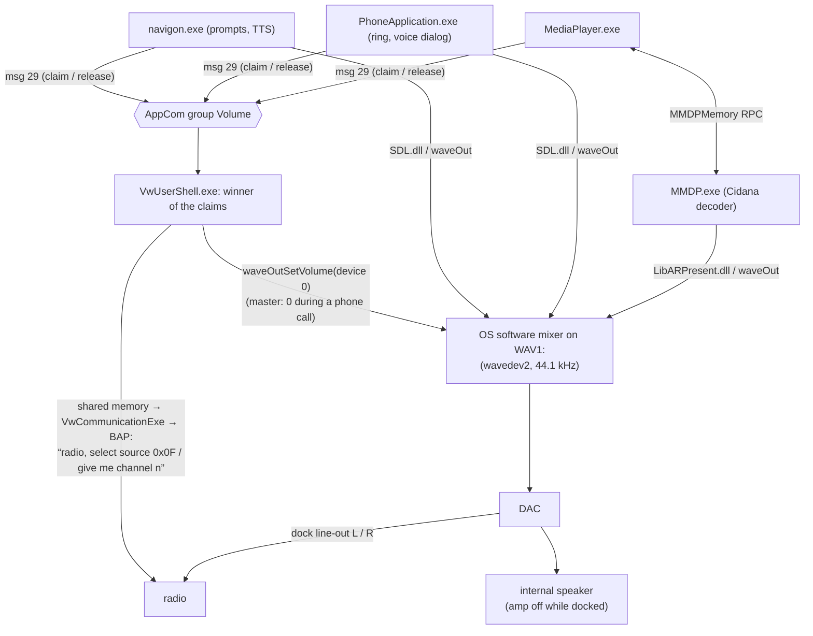

# Media player, picture viewer, volume UI and audio policy

What plays sound on the 4NSF, who decides what is audible, and how the unit shares the car speakers with the radio.
Static analysis only (r2 + r2ghidra on `firmware/flash/`, UI data from the `.nfs` stores); nothing run on a unit.

Legend: ✅ seen in disassembly / data / config (binary + VA or file given) · 🟡 inferred / single source · ❓ unknown.
VAs: image base `0x10000` for exes, `0x10000000` for DLLs; all code is ARM (every `.pdata` entry has the 32-bit flag). `MP` = `MediaPlayer.exe`, `S:` = `VwUserShell.exe`. `cmd #n` / `prov #n` / `ev n` / `W n` = command / provider class id, event id, workflow record of the UI data ([ui-framework.md](ui-framework.md)).
Related: [appcom.md](../apps/appcom.md) (wire format), [shared-memory.md](../car/shared-memory.md) (car-data client library, "slot" = vtable offset of its interface), [bap-functions.md](../car/bap-functions.md) (radio side of LSG 0x31 / 0x2D), [hardware-layer.md](hardware-layer.md) (speaker / mute GPIOs, wave driver), [user-shell.md](user-shell.md) (priority manager, speaker rules), [navigation.md](navigation.md) (prompt volume). Bluetooth audio internals are out of scope here → [bluetooth.md](bluetooth.md) §7.

## 1. Overview



| Binary | Role | Evidence |
|---|---|---|
| `MediaPlayer/MediaPlayer.exe` (3.2 MB, MN8 GUI framework, AppCom port 27018, shared-memory channel 2) | "Media" front end. Plays SD-card files and Bluetooth audio **and** is the remote control of the car radio (FM / AM / DAB, CD, AUX, sound setup, traffic announcements) | ✅ screens `MMP_Dia_MP3`, `_Video`, `_Radio`, `_Radio_Manual_Tuning`, `_Cd`, `_Aux`, `_BT`, `_NoConnection` in `MultiMediaPlayer.nfs` |
| `MediaPlayer/MultiMediaDominationProcess.exe` ("MMDP", 749 KB) | Separate decode process around one Cidana player instance; driven through a shared-memory RPC (§2) | ✅ imports only `ci_playback_sdk_wince6_r.dll`, COREDLL, NgAlloc |
| `ci_playback_sdk_wince6_r.dll` (1.3 MB, built 2013-05-28) | Cidana playback SDK: demuxers, decoders, tag reader | ✅ 22 exports `CI_Player_*`, `CI_Get_ID3DataFromFile`, `CI_Get_MediaFilePreview` |
| `LibARPresent.dll` (36 KB) | Cidana audio renderer; the only `waveOut*` user of the media chain | ✅ 13 exports `CiAr_*` |
| `PictureViewer/PictureViewer.exe` (3.7 MB, port 27019, channel 3) | Picture browser / slide show (§9); same framework and "MMC" component library as the media player | ✅ |
| `NAVIGON/VolumeUI.exe` (544 KB, port 27021, channel 6) | Radio-volume overlay. MFC 9.0 **statically linked** dialog app (class strings `CWinApp`, `CDialog`, `AfxWnd90su`; no MFC DLL import). **Exits at start unless the unit is branded for the XL1** (§6.3) | ✅ `0x1111c`, `0x11054` |
| `NAVIGON/SDL.dll`, `BT/SDL.dll` | SDL 1.2, audio only: `waveOutOpen(WAVE_MAPPER, …, CALLBACK_FUNCTION)` (`0x10008cec`) | ✅ |

Headline findings:

1. No audio server and no hardware mixer control: every program opens its own `waveOut` stream; the OS mixes; volumes are per-stream software gains. Exception: Bluetooth call and music audio never enter the host at all — the BT module decodes and outputs them itself, behind the wave device ([bluetooth.md](bluetooth.md) §7).
2. Arbitration is a broadcast protocol (AppCom msg 29, §5). The shell converts the winner into BAP requests to the radio (source 0x0F + audio channel 4 / 8 / 9 / 10).
3. `SetExternalAudioMutePin` (GPIO 19, the presumed "audio enable" dock pin) is **never called** by any shipped program (§7).
4. Video cannot work (renderer DLL not shipped); the picture viewer is locked from 6 km/h while docked (§9).

## 2. `MediaPlayer.exe` ↔ MMDP: shared-memory RPC ✅

All addresses in this section: `MultiMediaDominationProcess.exe`.

### 2.1 Kernel objects

| Object | Name | Created by | Use |
|---|---|---|---|
| Mutex | `MMDPAppMutex` | MMDP `WinMain 0x150cc`: `CreateMutexW(0, TRUE, …)`; exits at once if `GetLastError()==ERROR_ALREADY_EXISTS` | single instance |
| File mapping | `MMDPMemory`, `PAGE_READWRITE`, size **`0x401CA8`** (4.2 MB), backed by the page file | both sides (`0x11b88`: `CreateFileMappingW(INVALID_HANDLE_VALUE,0,4,0,0x401CA8,name)` + `MapViewOfFile(FILE_MAP_WRITE)`); the side that creates it first zero-fills it and sets `cmd = -1` (`0x1114c`) | request / reply block |
| Mutex | `MMDPMemory` + `Mtx` 🟡 (name built by string concatenation in `0x11a64`) | both | guards every single field access (lock → read/write one field → unlock) |
| Event (auto-reset) | `MMDPExecuteEvent` | both (`0x115c8`: `CreateEventW(0,FALSE,FALSE,name)`) | UI → MMDP "command is in the block" |
| Event (auto-reset) | `MMDPReturnEvent` | both | MMDP → UI "reply is in the block" |

Same four names appear in `MediaPlayer.exe` (UTF-16 at file `0x2c5274…`, `0x2ad728`); its proxy runs on the thread `MMCCidanaMmManagerImplThread` and starts MMDP itself (§8.1).

### 2.2 Call sequence

```
UI : lock; write arguments; write cmd at +0x401CA4; unlock; SetEvent(MMDPExecuteEvent)
MMDP main loop 0x142d0:
     WaitForSingleObject(MMDPExecuteEvent, INFINITE)
     cmd = block[+0x401CA4]; switch(cmd) … write results + per-command "ok" flag …
     SetEvent(MMDPReturnEvent)
UI : WaitForSingleObject(MMDPReturnEvent, …); read results
```

Inside MMDP the main thread forwards most commands to one worker thread (`0x13ad4`) that owns the Cidana handle; it waits **3500 ms** (`0xDAC`, worker field `+0xAC`) for the worker. On timeout it sets a sticky "player hung" flag that command `0x68` reports — the UI then kills and restarts MMDP (§8.1). 🟡 Reason for the process split: a decoder hang or crash cannot take the UI (and its watchdog heartbeat) down.

### 2.3 Block layout

```c
struct MMDPMemory {                 // size 0x401CA8, little endian, wchar_t = UTF-16
  wchar_t  open_path[0x400];        // +0x000000  cmd 0 in
  int      open_ok;                 // +0x000800  cmd 0 out
  int      play_ok, resume_ok, pause_ok, stop_ok;   // +0x804 +0x808 +0x80C +0x810   cmd 1..4 out
  int      state;                   // +0x000814  cmd 100 out   (enum below)
  int      state_ok;                // +0x000818
  wchar_t  tag_path[0x400];         // +0x00081C  cmd 5 in
  struct {                          // +0x00101C  cmd 5 out (tag data)
    uint8_t  flag;                  // +0x00101C  ❓
    uint32_t value;                 // +0x001020  ❓
    wchar_t  text[6][0x100];        // +0x001024 … +0x001A24  six tag strings (title/artist/album/… order ❓)
    uint8_t  cover[0x400000];       // +0x001C24  cover-art bytes (only if tag_want_cover and it fits)
    uint32_t cover_len;             // +0x401C24
    uint32_t cover_a, cover_b, cover_c;   // +0x401C28 … ❓ (width / height / format)
    uint8_t  cover_flag;            // +0x401C34  0 = bytes copied
  } tag;
  int      tag_want_cover;          // +0x401C38  cmd 5 in
  int      tag_ok;                  // +0x401C3C  cmd 5 out
  int      duration_ms, position_ms, times_ok;      // +0x401C40 +0x401C44 +0x401C48   cmd 0x65 out
  int      seek_ms;   int seek_ok;  // +0x401C4C +0x401C50   cmd 6
  int      volume;    int volume_ok;// +0x401C54 +0x401C58   cmd 8 in (0..100)
  int      _pad[2];
  int      cur_volume; int cur_volume_ok;           // +0x401C64 +0x401C68   cmd 0x66 out (0..100)
  int      _pad2[2];
  int      mute;      int mute_ok;  // +0x401C74 +0x401C78   cmd 7 in
  int      cur_mute;  int cur_mute_ok;              // +0x401C7C +0x401C80   cmd 0x67 out
  int      position2_ms; int position2_ok;          // +0x401C84 +0x401C88   cmd 9 out
  int      sdk_status; int sdk_status_ok;           // +0x401C8C +0x401C90   cmd 10 out
  int      rate;      int rate_ok;  // +0x401C94 +0x401C98   cmd 11 in (clamped to -2..+2)
  int      _pad3;
  int      hung;                    // +0x401CA0  cmd 0x68 out
  int      cmd;                     // +0x401CA4  -1 = idle
};
```

### 2.4 Commands

| cmd | Meaning | Cidana call made by the worker (`0x13ad4`) |
|---|---|---|
| 0 | open file | `CI_Player_Open(h, path)` → `CI_Player_SetConfig(h, 8, &volume)` → `CI_Player_GetClipInfo(h, 0, &info)`; duration = `info[0]` |
| 1 | play | `CI_Player_Play(h)` → state 0 |
| 2 | resume (only from state 2 / 4) | `CI_Player_Resume(h)` → state 0 |
| 3 | pause (only from state 0) | `CI_Player_Pause(h)` → state 2 |
| 4 | stop | `CI_Player_Stop(h)` → state 1, position 0 |
| 5 | read tags (+ cover) | `CI_Get_ID3DataFromFile(path, &data, 0x100000, wantCover)`; result bit 1 / 2 / 4 = three tag flavours 🟡 (ID3v1 / ID3v2 / other container tags), then `CI_ID3_Close` |
| 6 | seek (ignored if < 2000 ms from current position) | `CI_Player_SetPosition(h, ms)` |
| 7 | mute on / off | `CI_Player_SetConfig(h, 0x36, &flag)` |
| 8 | set volume 0…100 (scaled to 0…0xFFFF; not sent while stopped) | `CI_Player_SetConfig(h, 8, &vol16)` |
| 9 | get position | `CI_Player_GetPosition(h, &ms)` |
| 10 | get SDK playback status | `CI_Player_GetPlaybackStatus(h, &st)` |
| 11 | set playback rate −2…+2 (fast forward / backward) 🟡 | `CI_Player_SetConfig(h, 0x20, &rate)` |
| 100 | get state (no SDK call) | — |
| 0x65 | get duration + cached position | — |
| 0x66 | get volume | — |
| 0x67 | get mute | — |
| 0x68 | "worker timed out" flag | — |
| 0x69 | quit | `TerminateProcess(GetCurrentProcess(), 0)` |

State enum returned by cmd 100 (`0x11d40`); the names are the ones the UI workflows log (`Workflows.kbi`: `State MMS_PLAYED / MMS_PAUSED / MMS_PAUSED_CAUSE_OF_MUTE_OR_VOLUME_ZERO / MMS_STOPPED`):

| Value | Name | Condition |
|---|---|---|
| 0 | playing (name ❓) | after play / resume |
| 1 | `MMS_STOPPED` | after stop |
| 2 | `MMS_PAUSED` | paused, volume ≠ 0 and not muted |
| 3 | `MMS_PLAYED` (track finished → UI plays the next file) | playing or paused and `position ≥ duration` |
| 4 | `MMS_PAUSED_CAUSE_OF_MUTE_OR_VOLUME_ZERO` | paused and (volume == 0 or mute set) |
| −1 | no file opened yet | initial |

## 3. Decode chain and wave output ✅

| Item | Finding | Evidence |
|---|---|---|
| Renderer loading | the SDK loads `./LibARPresent` and asks it for `CiAr_GetFunctionList` | SDK strings (UTF-16 `0xf7138`, `0xf70e8`) |
| Demuxers | MPEG audio, WAV, ASF (WMA), 3GP / MP4 (M4A), AVI, FLV, raw elementary streams | SDK log strings `[DemuxXxx] … Opened.` |
| Audio decoders | MP3, AAC, WMA, PCM, FLAC, Ogg Vorbis, AC3, AMR (`#!AMR`) | SDK log strings `[AudioDecoderXxx]` |
| Extensions offered by the UI | `mp3 wav aac m4a wma flac ogg oga` | `UserSettingsMp3: SFE` |
| Playlists | `m3u`, `pls` (`[playlist]`, `File`, `NumberOfEntries`, `Version`), `wpl` (`smil` / `media src`); own list saved in `UserSettingsMp3Playlist.xml` (folder `StorePlaylist = ../../Storage Card`) | MP UTF-16 strings `0x2acba4…0x2accd4` |
| Tags, cover art | MMDP cmd 5: six text fields + embedded picture (≤ 4 MB) copied through the shared block; the UI scales it with its own image code (`MaxPictureWidth/Height` keys) 🟡 | §2 |
| Video | FourCC tables exist (`H264 H263 XVID DX50 DIV4 DIVX WMV1…3`), but the SDK loads its video presenter from **`./LibVRPresent.dll`, which is not shipped** (not on flash, not in ROM); no video decoder log strings; no video extension list. The UI still has `MMP_Dia_Video`, `-Mode=VIDEO`, `UserSettingsVideo*` → dead feature. No speed condition is attached to it in the data (the car-speed providers `#20020`, `#20022`, `#20036` have 0 uses in `MultiMediaPlayer.nfs`) | SDK strings `Load "LibVRPresent.dll" FAILED`; class-use count |
| Wave device | `waveOutOpen(&h, 0, &fmt, cb, this, CALLBACK_FUNCTION)`: device 0 (`WAV1:`), PCM, **channels and sample rate of the track** (the OS mixer resamples to 44.1 kHz), 8 or 16 bit | `LibARPresent.dll` `0x10003210` |
| Media volume | `waveOutSetVolume(h, v \| v << 16)` on the **stream handle**, `v` = 0…0xFFFF, both channels equal | `LibARPresent.dll` `0x1000280c`; MMDP cmd 8 scales 0…100 → 0…0xFFFF |
| Other programs | navigon: prompts / TTS through `SDL_OpenAudio` (`0x74a888`: source rate, S16 or U8, 4096-sample buffer), WAV effects through one `waveOutOpen` per file with per-stream `waveOutSetVolume(h, level << 12)` (`0x5b9120`, `0x5a7930`), `PlaySoundW`. Phone app: same shared code | ✅ |

## 4. Sources and the radio

`MediaPlayer.exe` handles seven "data sources" (`prov #19023`). Local ones are decoded on the unit; the others are only remote-controlled on the radio.

| Screen (`Controls` record) | `-Mode=` | Data source id | Audio comes from | Source code in msg 23 / msg 29 |
|---|---|---|---|---|
| 1 `MMP_Dia_MP3` | `LAST_KNOWN` | 0 ✅ | SD card file → MMDP → `WAV1:` | 0 |
| 8 `MMP_Dia_NoConnection` | `NOCONN` | 1 🟡 | – | (none sent) |
| 5 `MMP_Dia_Aux` | – | 2 ✅ | radio's AUX-in | 2 |
| 2 `MMP_Dia_Video` | `VIDEO` | 3 ✅ (uses `UserSettingsVideo`) | dead (§3) | −1 |
| 4 `MMP_Dia_BT` | – | 4 ✅ | phone → A2DP sink **inside the BT module** → the module's own audio output, mixed after the SoC's wave device; **not** a host `waveOut` stream and not through `WAV1:` ✅ ([bluetooth.md](bluetooth.md) §7; wiring 🟡); control through the phone app (msgs 24 / 25 / 32, §10) | 4 |
| 7 `MMP_Dia_Cd` | – | 5 ✅ | radio's CD | 5 |
| 3 `MMP_Dia_Radio`, 6 `…_Manual_Tuning` | `RADIO` | 6 ✅ | radio tuner | 6 FM · 7 AM · 8 DAB (0x61 when flag 2 of fct 0x13 is set ❓) · 13 AM-TI |

(`cmd #18010`, `0x12efc`: maps data source + active radio source to the code and sends msg 23 `[I code]` to group `StatusIndicators` = media icon of every status bar.)

Radio source types (BAP LSG 0x31 fct 0x10 byte 0, `prov #20010`) — names are the log texts of `W 42 MMPSwitchToSourceDefinedByRadioWorkflow` ✅:

| Value | Name in the data | Screen opened |
|---|---|---|
| 1 / 2 / 3 | `VWST_FM` / `VWST_AM` / `VWST_DAB` | Radio |
| 0x13 | `VWST_AM_TI` (AM band, traffic information) | Radio |
| 6 | `VWST_CD` | CD |
| 0x0E | `VWST_AUX_IN` | Aux |
| 0x0F | `VWST_PORTABLE_DEVICE` = this unit | last local source (`W 115`): MP3 or BT |

The radio is the master of the source: whenever it reports a new active source (data id 82 / event 19022), the media player follows (opens the matching screen, re-announces msg 29 with the matching source code). Selecting a source on the unit only *asks* the radio (§5.1).

## 5. Who may be heard: the AppCom "sound manager" (msg 29) ✅

There is no audio server. Every program that plays sound announces it with AppCom message **29** to group `Volume` (navigon also to `StatusIndicators`); every MN8 program keeps the same small table and derives the winner; the **Shell** turns the winner into requests to the radio. Wire format: [appcom.md](../apps/appcom.md).

```
msg 29 = [ I prio, I soundType, I released, I audioSource, I extra ]
```

| Field | Meaning | Evidence |
|---|---|---|
| `prio` | value of the sender's `/Settings/SoundPrio/<kind>` key (table below). **Lower number wins** | MP cmd `#10010` (`0x1b4090`, logged in the data as `ACCSetSoundManagerPrioCmd`) reads settings file 19011 key 18002 = `SoundPrio/MultiMedia`; `PhoneApplication.exe` `0x1fbd0` / `0x21570` read `SoundPrio/Bluetooth` / `SoundPrio/Voice` |
| `soundType` | 0…3 = kind of sound (table below); 4 = "nobody" (receiver default) | call sites below |
| `released` | 0 = claim (sound starts), 1 = release (sound ended) | MP param 101; navigon / phone send the pair around each prompt |
| `audioSource` | only for multimedia: source code of §4 (0 SD, 2 AUX, 4 BT, 5 CD, 6 FM, 7 AM, 8 DAB, 13 AM-TI); −1 otherwise | MP param 103 |
| `extra` | −1 from every sender seen; receivers store it and treat a change as "re-evaluate" ❓ | MP `0x1b0748`, shell `0x94c68` |

| `soundType` | Kind | `SoundPrio` key (default) | Sender (evidence) |
|---|---|---|---|
| 0 | phone call | `Bluetooth` (1) | `PhoneApplication.exe` `0x1fbd0` (release), shared MN7 code `0x14a11c` / navigon `0x597940` |
| 1 | voice dialog: speech recognition, spoken feedback | `Voice` (3) | `PhoneApplication.exe` `0x21570` (`CBTAVoiceInputJumpCmd - SR_JUMP_TO_RESUME`), shared MN7 code (navigon `0x4c8cc8`, `0x594004`, `0x596090`) |
| 2 | navigation advice | `Advice` (4) 🟡 key by elimination | `navigon.exe` `0x370798` (claim, then release) |
| 3 | multimedia | `MultiMedia` (5) | `MediaPlayer.exe` `#10010` (always type 3); PictureViewer links the same command, its data never uses it |
| – | `CarInfo` (0) | no sender found ❓ (key exists in every settings file) | |

Receiver (same code in each MN8 program: MP `0x1b0748` → `0x1b0120`, shell `0x94c68` → `0x945e4`): map `prio → { released, soundType, audioSource }`; after every message the **claimed entry with the lowest prio** is the winner. When the winner changes, listeners get `(oldType, newType)`.

### 5.1 Shell: winner → radio request + wave master ✅

`VwUserShell.exe` `0x94c68` (on every msg 29 that changes the winner) and cmd `#16029` (`0x1dc2c`, on priority-manager changes, only if radio connected and LSG 0x2D operation state ∈ {0, 1, 2}):

```c
waveOutSetVolume(0 /*device*/, winnerType == 0 ? 0x00000000 : 0xFFFFFFFF);   // master of WAV1:
(source, channel) = map(winnerType, winnerAudioSource);                       // 0x942b4; if it yields source 0xFF, the source of the previous winner is used
car->RequestAudio(source, channel, flag);                                     // client slot 0x2FC → state machine of bap-functions.md §4.5
```

| Winner | Radio source wanted (LSG 0x31 fct 0x23) | Audio channel wanted (LSG 0x2D fct 0x11) | Wave master |
|---|---|---|---|
| 0 phone call | 0x0F (this unit) | **9** | **0** → every `waveOut` stream of the unit is silenced; call audio is not a `waveOut` stream: it stays inside the BT module and bypasses the host wave path ✅ ([bluetooth.md](bluetooth.md) §7) |
| 1 voice dialog | 0x0F | **10** | max |
| 2 navigation advice | source of the previous winner (normally no change) | **8** | max |
| 3 multimedia, source SD (0) or BT (4) | 0x0F | **4** | max |
| 3 multimedia, source FM / AM / DAB / AM-TI / AUX / CD | 1 / 2 / 3 / 0x13 / 0x0E / 6 | none (0xFF) | max |
| 4 nobody | source of the previous winner | 0xFF (release) | max |

→ names for the channel values of [bap-functions.md](../car/bap-functions.md) §5: 4 = entertainment from the unit, 8 = navigation announcement (the radio keeps its own source and mixes / ducks 🟡), 9 = phone, 10 = voice dialog, 0xFF = none.
So a navigation prompt does **not** switch the radio to the unit as a source; it only claims channel 8.

### 5.2 MediaPlayer: reaction to the winner ✅

Listener `0x1b07c`; the commands were handed over by start-up record 22 (cmd `#18001`, keys 105 / 106 / 107 / 108 / 110):

| Winner type old → new | Action |
|---|---|
| 3 → 2 (advice over media) | workflow 44 `MMPStartupSetSoundPrioFadeDownCmd` → `ChangeVolumeWorkflow`: fade the media stream down |
| 2 → 3 (advice ended) | workflow 45 `…FadeUpCmd` |
| 2 → 0 / 1 | event 19061, then fade up |
| 0 → 2 | fade down, event 19061 after 3000 ms (`0x3007bc`) |
| 1 → 2 | fade down, event 19061 at once |
| 0 → 3, 1 → 3 | event 19061 after 3000 ms (resume is delayed after a call / dialog) |
| 3 → 1, 1 → 0 | event 19061 at once |
| 3 → 0 | nothing here (a call reaches the pause rule through the shell priority, msg 31 → `0x18cd4`) |
| anything with 4 | ignored (other unexpected pairs log `OnSoundPrioChanged: ACST_INVALID (MN8)!`) |

Event 19061 → workflow 52 `MMPCheckForPauseResumeCmd` (only for local sources): **play only if all of these hold, else pause** (workflows 119 docked / 120 not docked, log texts `CheckForPRConnected: …`):

| # | Condition | Docked (radio connected) | Not docked |
|---|---|---|---|
| 1 | no suspend countdown running; not handled by the after-resume check | ✓ | ✓ |
| 2 | radio's audio FSG operation state known (`prov #20021`, slot 0x1F8) | ✓ | – |
| 3 | Shell priority winner (msg 31, var 10501; names in [user-shell.md](user-shell.md) §4) is one of | 13 `P_AO`, 10 `P_WM`, 9 `P_FE`, 8 `P_HMI`, 5 `P_CAR`, 4 `P_OPS` | 13, 10, 9 |
| 4 | sound-manager winner type is 2 (advice) or 3 (media) | ✓ | ✓ |
| 5 | not muted | radio not muted (`prov #20012`, slot 0x224) | device not muted and volume ≠ 0 |

So media is **paused** (not just ducked) during phone calls (shell priority 1 / 6, sound type 0), voice dialogs (type 1), traffic announcements (`P_TA`), the PIN dialog, radio off (`P_RHM`), radio mute; it is only **ducked** for navigation advice. Resume restores play only if the pause was automatic (data-store flags `…LAST_STATE_WAS_PAUSED`, user story "WI-731" in the log texts).

Fade parameters (`SoundSettings`): `FadeTime 200` ms, target `FadeToPercentageSd 40` % (SD) / `FadeToPercentageBt 20` % (BT audio) of the current media volume 🟡 (details §6.1).

## 6. Volume, mute, sound setup

### 6.1 Where a volume lives ✅

| Volume | Owner / storage | Applied by |
|---|---|---|
| Loudness in the car (5 types) | the **radio**. It reports level + type with BAP LSG 0x31 fct 0x12 ([bap-functions.md](../car/bap-functions.md)); the unit never sets it. Types (texts shown by VolumeUI): 0 Media · 1 Traffic program (TP) · 2 Phone calls · 3 Navigation · 4 Voice operation; level 0…30 🟡 (bar = `level × width / 30`, `VolumeUI.exe` `0x12f7c`) | radio's own knob / steering-wheel keys |
| Media stream (SD, BT audio) | `\MN Settings\MMP\UserSettingsMp3.xml` / `UserSettingsBt.xml` `Volume` (0…100; defaults 40 / 80) | SD: MMDP cmd 8 → per-stream `waveOutSetVolume`. BT audio has no host stream: 🟡 the value goes through the phone app to the module's A2DP volume ([bluetooth.md](bluetooth.md) §7). `cmd #19014` (`0x141a0c`) modes: 0 / 1 = step up / down to the next multiple of 10 (roll-menu volume bar), 2 / 3 = fade down / up, 4 = load from a settings key, 5 = set |
| – docked | forced to `SoundSettings: MaxConnectionVolumeSd / Bt / Video` (80) on connection (`W 133`); the user then uses the radio's volume | |
| – undocked | the saved `Volume` (`W 134`); manual resume while the volume is 0: `DefaultResumeVolume` (50) and unmute (`W 74`, `W 130`) | |
| Duck depth during navigation advice | `FadeToPercentageSd` 40 % / `FadeToPercentageBt` 20 %, `FadeTime` 200 ms. Docked, the target is also scaled by `min(1, 10^(0.2 × (radioMediaLevel − radioNavLevel)))` (slot 0x214 types 0 and 3; fallback for the nav level: `/Settings/Radio/LastAdviceVolume`, default 10, stored on data id 86) | `cmd #19014` mode 2 (`0x141a0c`, constants `0x2bd44c` = 0.2, `0x2bd450` = 10.0) |
| Wave master of `WAV1:` | not stored. The shell sets it to 0 while a phone call is the sound winner, else to maximum (§5.1) | `S:0x94c68` |
| navigon prompts | `\MN Settings\UserSettings.xml` `/Settings/Sound/Volume` (step 0…10, default 9), `Mute`, `SpeedDependent` (+ table `SpeedDependent@ID`), `RadioMute` (prompt delay), `VoiceRecognition/TTSVolume` (7); step → percent table `VolumeStep@step` | per-stream software gain inside navigon ✅ `navigon.exe` `0x45439c` ([navigation.md](navigation.md) §5.1): **docked (radio connected) the step is fixed** at `MaxConnectionVolumeAdvice` = 9 → 85 %, the user's `Sound/Volume` applies only on the internal speaker; the speed-dependent rule uses the GPS speed (navigon reads no car speed) |
| Phone | `BT/Settings/ApplicationSettings.xml`: `Sound/VolumeStep` 0…10 → 0…100 %, `HFPVolumeVWConnected` 10 | call volume = module command (HFP volume), mic gain / mute likewise ✅ [bluetooth.md](bluetooth.md) §7; `HFPVolumeVWConnected` 🟡 fixed HFP volume while docked |

Steering-wheel **volume** keys never reach the unit's software: `MflTasten` is consumed only for the arrow keys (§8.4); the radio changes its volume itself and reports the result (fct 0x12).

### 6.2 Mute ✅

| What | Mechanism |
|---|---|
| Radio mute state | LSG 0x31 fct 0x13 = three flags (slot 0x224). `prov #20012` "BCR muted" = any flag set (log text `Check for RadioMute: Radio IS muted`). `cmd #20004 {101: on}` rewrites **flag 1** and keeps the other two (slot 0x228 → SetGet fct 0x13) → flag 1 = mute that the unit may set / clear; flags 2, 3 = mutes owned by the radio 🟡. The capture's `SetGet fct 0x13 = 00` ([car-link.md](../car/car-link.md) §6) = "unmute" at start |
| Local player | manual mute `cmd #19013` → MMDP cmd 7 (`CI_Player_SetConfig(0x36)`); a paused player with mute or volume 0 reports state 4 (§2.4). Radio mutes → local playback is paused (`W 64 MMCEnableAutomaticMute`), radio unmutes → resumed (`W 63`, `W 80`) |
| Device speaker | `HardwareLayer::SetMuteDeviceSpeakers` — by the shell on cradle events only (§7) |

### 6.3 `VolumeUI.exe` ✅

| Aspect | Finding |
|---|---|
| Start condition | `WolfSpecial!ReadHiddenFlash`: byte 0x2F (brand) == 0, 0x32 (class) == 0, 0x35 (body type) == 9 → the "019" = XL1 branding of [brand-and-pairing.md](brand-and-pairing.md). Otherwise `VolumeUI: No 019 branding, Volume UI will quit!` and `return` (`0x1111c`, `0x11054`). On an up! / Mii / Citigo the process ends right after start; `Watchdog_VolumeUI.ini` has `ActionAtTermination = 0` (ignore) |
| Trigger | listener thread on shared-memory channel 6 (`0x12938`): data id 153 = "show" bit of fct 0x12 (test-and-clear), then slot 0x210 = level of the current type, slot 0x220 = current type (`0x12658`) |
| Display | `ShowWindow(SW_SHOW)`: bar bitmap + type text (text ids 0xA7F, 0xA7B, 0xA7C, 0xA7E, 0xA7D for types 0…4 from `language_files/<locale>_480_272.lng`, font "Neo Tech VWNG Medium"); hidden again after **1750 ms** without a new event (`0x6D6`) |
| AppCom | registers msg 2 (language change → reload `.lng`) and msg 40 (answers with msg 21); sends nothing else; not in group `Volume` |
| Elsewhere | on all other cars nothing on the unit shows the radio volume. The media player's `MMP_RollMenu_{MP3,BT,AUX}_Volumebar` are bars for its own per-source `Volume` settings (step 10, §6.1) 🟡 |

### 6.4 Sound setup pop-up (`MMP_PopUp_SettingsSound`, record 28) ✅

Values are the radio's (LSG 0x2D), signed −108…+108 in steps of 12; the pop-up only reads and writes them.

| Control | Read slot / write slot | BAP function | Evidence |
|---|---|---|---|
| slider under label "Treble" (id 32) | 0x2E0 / 0x2DC | **fct 0x1B = treble** | `cmd #18016` / `#18018`, label text 33 at the slider's x |
| slider under label "Bass" (id 31) | 0x2D8 / 0x2D4 | **fct 0x19 = bass** | `cmd #18017` / `#18019`, text 34 |
| 2-D pad, X axis (ids 29 / 30) | 0x2F0 / 0x2EC | **fct 0x17 = balance** | `cmd #18013` (`0x11164`): `x` → `round((x·217/100 − 108) / 12) · 12` |
| 2-D pad, Y axis (id 30 only) | 0x2E8 / 0x2E4 | **fct 0x18 = fader** 🟡 (axis order from the code, name by elimination) | same; only when slot 0x2C8 (function list of LSG 0x2D) says the function exists → "4 boxes" variant, else the "2 boxes" pad (texts `DEV Sound-Setting 2 Boxes / 4 Boxes`) |
| + / − buttons | `cmd #20002 {101: 0 treble / 1 bass, 103: 2 up / 3 down, 102: 12}` | | record 28 |

fct 0x1A is not used by any program ❓.

## 7. Speaker routing and the "audio enable" pin

| Topic | Finding |
|---|---|
| Internal speaker | amplifier GPIOs 13 / 22; cannot be switched on while docked (driver rule, [hardware-layer.md](hardware-layer.md) §6.2). MN8 programs call only `SetMuteDeviceSpeakers`; the shell mutes on cradle connect and unmutes 3.1 s after disconnect if no radio answers ([user-shell.md](user-shell.md) §5.1) ✅ |
| `Set/GetCradleDetectAutomaticSwitchOffInternalSpeakers` | imported by MediaPlayer / PictureViewer, but the HWL functions are stubs returning false ([hardware-layer.md](hardware-layer.md)) ✅ |
| Dock line-out | always driven (same DAC); what the car plays is decided by the radio after the BAP requests of §5.1 ✅ |
| `SetExternalAudioMutePin` (GPIO 19) | exported by `WolfSpecial.dll` and wrapped by both HWL DLLs, but: not imported by `navigon.exe`, `PhoneApplication.exe`, `VolumeUI.exe` (import tables), never called by the MN8 programs, and the MN7 wrapper (`Hardwarelayer.dll` `0x100040d8`) is reachable only through its export. The string exists in no other file on flash → **no shipped program ever drives this pin** ✅. Its level is whatever the boot loader / GPIO driver leaves ❓ |
| `PLAY_START_EVENT` / `PLAY_STOP_EVENT` (wavedev2) | created by the wave driver; no other module opens them → not an "audio enable" mechanism ✅ |
| `<ExternCradle><AudioViaCradle>`, `<PopupAudioViaCradle>` | keys in `NAVIGON/Settings/UserSettings.default` only; neither `navigon.exe` nor `PhoneApplication.exe` contains the strings → leftovers of another product ✅ |
| Timing toward the radio | all in the shared-memory state machine ([bap-functions.md](../car/bap-functions.md) §4.5: 500 ms timer, retries); no fixed delay between claim and first sample was found on the application side. navigon's "Delayed voice output" setting (`Sound/RadioMute`) exists for radios that react slowly 🟡 |

## 8. MediaPlayer details

### 8.1 Life cycle ✅

| Step | Detail |
|---|---|
| Start | by the shell, hidden: `-Mode=NOCONN -ShowWindow=0` after navigation's msg 40 ([user-shell.md](user-shell.md) §7.3); adopted by the watchdog through `WindowName=MMPMediaPlayer` ([boot-and-supervision.md](boot-and-supervision.md)); heartbeat events `MMPApp/Command/EventThreadAlive` (`cmd #701`) |
| Show | Shell menu → `StartApplication("MMPMediaPlayer", "-Mode=RADIO" \| "-Mode=LAST_KNOWN")`; modes parsed from the command line: `VIDEO`, `RADIO`, `NOCONN`, `LAST_KNOWN` (`Startup.kbi`) |
| MMDP start / restart | `0x15be6c`: if the proxy reports "hung" (§2.2): ask MMDP to quit 🟡, wait up to 10 × 500 ms for `MMDPAppMutex` to disappear, else `TerminateProcess`; `CreateProcessW("/My Flash Disk/MediaPlayer/MultiMediaDominationProcess.exe")`; re-send volume and mute; if the source is SD, raise ev 19032 ("next track") → a file that hangs the decoder is skipped |
| Suspend / resume | `W 59`, `W 123 MMPCheckAfterSuspendResume`: after resume the SD card is probed up to 3 times (`DSK2:`), its id compared (`GetStorageCardId`), playlist re-checked, then the pause / resume rule of §5.2 |
| No radio | `MMP_Dia_NoConnection` ("No connection to the car radio."); radio screens need a valid F001 (data id 11) |

### 8.2 Shared-memory consumption (listener `0x1be30`, channel 2) ✅

| Data id (meaning: [shared-memory.md](../car/shared-memory.md), [bap-functions.md](../car/bap-functions.md)) | Reaction |
|---|---|
| 11 radio connected | ev 18001 |
| 38 link down | ev 20002 |
| 49 audio FSG operation state (slot 0x1F8) | ev 20001 when 0 or 2; ev 20012 when 2 |
| 82 source-change machine done | active source (slot 0x1FC) → data source: 1, 2, 3, 0x13 → radio · 6 → CD · 0x0E → AUX · 0x0F → last local source; ev 19021 / 19022, 19013 |
| 83 source change failed | ev 19041 |
| 86 volume (fct 0x12) | ev 19005; navigation level (type 3, slot 0x214 / 0x21C) changed without "show" → ev 19063 → saved as `LastAdviceVolume` |
| 87 mute flags (fct 0x13) | ev 19030 / 19031 (automatic mute / unmute), 19055, 19065 |
| 88 (fct 0x14, slot 0x23C) | ev 19008…19010, 19023 (scan / seek state) 🟡 |
| 84, 89…95 texts, lists, seek result, play modes | ev 19013 (refresh), 19066, 19038, 19039, 19046, 19014 |
| 52 announcement (fct 0x1A, slot 0x27C) | ev 20009…20011 → `MMP_PopUp_TA` ("Traffic announcement", "Deactivate TP" → slot 0x284) |
| 96 (fct 0x1C, slot 0x28C) | one of ev 20003…20007, 20014 by value → radio info pop-ups ("Please check CD.", "No CD available.", "The radio is locked. Please enter the code on the device.") 🟡 |
| 100 (fct 0x25, slot 0x2B4) | ev 19042 → station logo (§8.5) |
| 111…115 sound values | ev 19058…19060, 19015 |
| 79 steering-wheel keys | §8.4 |

Client slots used by MediaPlayer at all: 0x004, 0x1C8, 0x1F8…0x294 (most of LSG 0x31), 0x2A4, 0x2B4…0x2BC, 0x2C8, 0x2D0 (read audio channel), 0x2D4…0x2F0. **Never called**: 0x2FC (source / channel request), 0x2A8 / 0x2AC (activate source), 0x29C (request source list), 0x2CC (set audio channel) — the only caller of 0x2FC in the firmware is the shell (`S:0x94458`).

### 8.3 Radio remote control (slot 0x25C → LSG 0x31 fct 0x17) ✅ codes, 🟡 names

| `cmd` passed to slot 0x25C | Caller | Meaning |
|---|---|---|
| 1 / 2 | `0x1533b4` / `0x153430` (`cmd #19001` / `#19002`, `W 16 MMP_Radio_Next` / `W 14 …_Previous`) | next / previous station or track |
| 3 / 4, then 0xFF | `0x151ff0` | start fast forward / backward while held; 0xFF = stop (BAP Abort) |
| 5 / 6 | `0x1534ac` | single step in two directions (manual tuning) |
| 7, then 0xFF | `0x153648(on)` | scan on; 0xFF = scan off |
| 0 + position | `0x1587c4` | select an entry of the station / track list |

Play-mode flags (Scan, Mix, Repeat): slots 0x268 / 0x26C (fct 0x18), `cmd #20001`.

### 8.4 Steering-wheel keys ✅

Data id 79 → slot 0x1C8 `(up, down, other)`; only acted on for the local sources 0 (SD) and 4 (BT) — for radio sources the radio handles the keys itself.

| Value | Event → workflow |
|---|---|
| up / down pressed | ev 19032 / 19033 → `W 70 MMP_Mfl_Next` / `W 71 MMP_Mfl_Previous` (closes the browse list first) |
| up / down = 0xFF (held) | ev 19044 / 19045 (first) and 19047 / 19048 (repeats within 1 s) → fast forward / backward (`W 90…92`; 3000 ms jumps 🟡) |
| third value odd | ev 19034 → `W 58 MMP_Mfl_Scan` |

### 8.5 Station logos ✅

`logos.afs` = NgFs container ([file-formats.md](file-formats.md)) with 3,421 stored PNGs named `PI_<ECC>_<PI>.png` — RDS extended country code (`E0`…`E4`) and programme identification (4 hex digits); plus `PI_E0_noPI.png`. Lookup `0x1543c0`: PI from slot 0x2B4 (LSG 0x31 fct 0x25: `u16` = **PI code**, byte = flag 🟡); the ECC comes from the country reported by the navigation (msg 22 text → data-store record 19019 `CountryToEcc`) when the radio gives none. Setting `RadioStationLogos = ./logos` is the unpacked alternative.

### 8.6 Settings (seeds `MediaPlayer/Settings/*.default` → `\MN Settings\MMP\*.xml`, backup `\MN Settings\Backup\MMP\`) ✅

| File (data-store id) | Keys (default) |
|---|---|
| `SoundSettings` (19011) | `SoundPrio/{Advice 4, Voice 3, Bluetooth 1, MultiMedia 5, CarInfo 0}`, `FadeTime 200`, `FadeToPercentageSd 40`, `FadeToPercentageBt 20`, `DefaultResumeVolume 50`, `MaxConnectionVolume{Sd,Bt,Video} 80`, `Radio/LastAdviceVolume` |
| `UserSettingsMp3` (19004) | `DefaultFolder ../../Storage Card`, `ShowTimeLeft 1`, `Volume 40`, `ThreadPrio -1`, `MaxNumFilesNotLoaded 100`, `MemThresholdGreyOutFile 3000000`, `SFE` ×8 |
| `UserSettingsBt` (19009), `UserSettingsAux`, `UserSettingsVideo` (19006) | `Volume 80` (+ `DefaultFolder ../MyMediafiles`, `ShowTimeLeft` for video) |
| `UserSettingsSoundSetup` | `Balance`, `Fader`, `Bass`, `Treble`: `Min -108`, `Max 108` |
| `ApplicationSettings` | `OUB` ×17 = folders hidden in the browser, `StorePlaylist`, `RadioStationLogos ./logos`, `Partitions`, `NoManualTuningScreen 0`, `NoTPOption 0` |
| `UserSettingsDs`, `UserSettingsRb` | `DS 0` / `DS 1` ❓ (last data source / radio band) |
| `UserSettingsMp3Playlist`, `UserSettingsVideoPlaylist` | `Entry` list; also scope, file type, shuffle, repeat, `SourceState`, `TimePlayed` (resume position) |
| `UserSettingsMmpSpace` | `LastTimeFreeSpaceHigh/Low` (detects changed card content) |
| `UserSettingsDevMode` (not shipped) | `Active`, `IgnorePidStatus` |
| `FactoryReset` | `Del` = files removed on factory reset |

## 9. Picture viewer ✅

| Aspect | Finding |
|---|---|
| Formats | `jpg jpeg png tif tiff gif bmp` (`UserSettingsPicture: SFE`); decoders linked in: IJG libjpeg, libpng + zlib 1.2.3, libtiff (error strings); GIF / BMP readers 🟡 |
| Limits | `MaxPictureWidth 2048`, `MaxPictureHeight 1536`; size limits `FSL`: JPG / JPEG / BMP 4096, other 1024 (kB 🟡; message "…restricted to %d×%b pixels and must not have more than %c MB") |
| Screens | `PV_Dia_Picture`, `PV_PopUp_Picture_Fullscreen`, `PV_PopUp_BrowseTitels`, option roll menu; started by the shell with `-Mode=PICTURE` (needs a card); no watchdog |
| Slide show | "Slide show" / "Slide show mix" = play-all / shuffle over the browse scope (`W 4`, `W 5`); playlist `UserSettingsPicturePlaylist.xml`. Not related to the shell's own demo slide show ([user-shell.md](user-shell.md)) |
| Standby picture | "Select picture for standby" / "Reset…": writes `HmiOffBackground.bmp` into `HmiOffPath = ../VwUserShell/HmiOff` → picture of the shell's HMI-off screen |
| **Driving lock** | listener (`0x14974`, channel 3) on data id 145 (speed, CAN 0x527 `GwKombi`): slot 0x74 ≥ 600 (= 6.00 km/h) sets variable 21006 and raises ev 21009; the picture controls are enabled only if **not** (radio connected ∧ speed ≥ 6 km/h) (`prov #20001`, `#20020 {201: 6}`) |
| Sound | listens to the sound manager: `W 10 / 11 StartupSetSoundPrioPause / ResumeCmd` pause / resume the show 🟡; never claims (no `#10010` in its data) |

## 10. AppCom messages of the three programs (ids ✅, payload layout in [appcom.md](../apps/appcom.md))

| Id | Direction | Payload | Meaning |
|---|---|---|---|
| 29 | MP, PV, shell, navigon, phone → group `Volume` | `[prio, soundType, released, audioSource, extra]` | sound-manager claim / release (§5) ✅ |
| 23 | MP → `StatusIndicators` | `[I code]` | media status icon: source code of §4, −1 = none ✅ (`0x12efc`) |
| 31 | Shell → `Settings` | `[I winner]` | Shell priority winner; MP stores it in var 10501 for the pause rule ✅ |
| 38 | Shell → `Settings` | `[I, I, I]` | suspend countdown state → vars 18018…18020; any value ≠ 1 in the 2nd field re-runs the pause / resume check ✅ (`0x1a528`) |
| 36 / 37 | Shell → `Settings` | | suspend / resume phases: MP answers the sender and raises ev 1501 / 1502, 1503 ✅ (`0x19a7c`, `0x19bc0`) |
| 4 | phone → all | `[I state, …]` | phone state (values: [bluetooth.md](bluetooth.md) §8.3) → var 18002, ev 18007; state 11 → ev 18021 |
| 22, 48, 34 | navigon / Shell → groups | | GPS status + country text (used for the logo ECC), status value, outside temperature for the status bar |
| 32 | phone → MP | `[S ×8]` | BT audio track texts → vars 19009…19016, ev 18016 ✅ structure |
| 25 | phone → MP | `[I, I, S, I]` | BT player state / metadata update → same vars + 19017, 18003…18005; ev 18010 🟡 |
| 33 | phone → MP | `[I, I, S]` | BT device info → vars 19021…19024, ev 19043 🟡 |
| 24 | MP → phone (`cmd #10005`) | `[I, I]` | BT audio control from `W 38 SwitchBtDeviceWorkflow` / `W 83 EnterBtWorkflow` 🟡 |
| 26 | Shell, navigon → MP | `[I]` (4, 6, 0x62 handled) | player command ❓ |
| 28 | MP, PV → all | `[I]` | power key seen by the foreground app (shell: HMI off); MP handles value 0 as ev 10001 |
| 21 / 20 | all | | "app is up" / Shell's answer |
| 2 | `Settings` | `[I setting, (S)]` | setting changed; VolumeUI: language |
| 40 | navigon → all | | VolumeUI answers with 21 |
| 1001…1004 | MP, PV, shell | | shared lists of the GUI framework |

Message 3 (`[value, flag, type 0…5]`, group `Volume`) is registered only by navigon and the phone app; not handled by any of the three programs here ❓.

## 11. How to reimplement / interoperate

### 11.1 A replacement device on the dock that wants its audio played

What the original software does, in order (✅ = seen in code; the electrical side is not derivable):

1. Link + copyright handshake ([car-link.md](../car/car-link.md)), BAP start, `GetAll` of LSG 0x31 and 0x2D.
2. Read the source list (LSG 0x31 fct 0x22) and find the entry of type **0x0F** (the dock device) → its handle.
3. Entertainment audio: `StartResult fct 0x23 (handle)`; wait for Status fct 0x10 with source 0x0F; then LSG 0x2D `SetGet fct 0x11 = 00 00 01 04` (channel 4) and wait for the same value back. Order, timers and retries: state machine of [bap-functions.md](../car/bap-functions.md) §4.5.
4. Short announcement over the radio's own programme: only `SetGet fct 0x11 = … 08`; when done `… FF`.
5. Phone call: source 0x0F + channel 9. Voice dialog: source 0x0F + channel 10.
6. Release: channel `FF`; the radio returns to its previous source by itself 🟡.
7. Put line-level audio on the dock L / R pins. Loudness is the radio's (it tells you level and type with fct 0x12). There is no software evidence that the "audio enable" pin must be toggled (§7) — measure it on a real unit before relying on either level.
8. React to the radio: mute flags (fct 0x13) → pause; source changed away from 0x0F (fct 0x10) → stop; operation state (fct 0x0F) not 0 / 2 → radio off.
9. Optional remote control: fct 0x17 commands of §8.3, lists fct 0x16 / 0x22, texts fct 0x15, sound fct 0x17…0x1B of LSG 0x2D (−108…+108, step 12).

### 11.2 A custom app on the original unit that wants to play sound politely

```c
// 1. own stream; any PCM format (the OS mixer resamples). Never touch the device master.
waveOutOpen(&h, WAVE_MAPPER, &fmt, 0, 0, 0);
waveOutSetVolume(h, v | v << 16);          // stream handle, not device id 0 — the Shell rewrites the master on every sound change

// 2. docked: nothing is heard until somebody claims the radio. Announce yourself like the media player:
//    msg 29 to group "Volume" (appcom.md): [prio, soundType, released, audioSource, -1]
send29(5, 3, 0, 0, -1);    // long-running audio: "multimedia from SD" → Shell requests source 0x0F + channel 4
send29(4, 2, 0, -1, -1);   // or a short prompt: "advice" → channel 8, media players duck to 40 % / 20 %
...play...
send29(5, 3, 1, 0, -1);    // release with the same prio / type

// 3. be a good citizen: register msg 29 yourself, keep the prio → {released, type} map,
//    pause while the winner type is 0 (phone) or 1 (voice dialog), duck while it is 2.
```

- A claim with a prio that another program already uses overwrites that program's entry in every receiver (the map key is the prio) → pick the kind you really are, and expect MediaPlayer to announce its own claim again when its source changes.
- Undocked, the internal speaker is on; nothing to claim, but the pause rules still apply.
- The radio's volume / mute / source can be read from shared memory without AppCom ([shared-memory.md](../car/shared-memory.md) §8.2): slots 0x210…0x224, data ids 86, 87, 82.
- Compressed audio: a second MMDP cannot be started (single-instance mutex) and the block of §2 has no client id, so driving the running MMDP collides with MediaPlayer; use `ci_playback_sdk_wince6_r.dll` directly (`CI_Player_Initialize / Open / Play …`, as MMDP does) or an own decoder.

## 12. Open questions

1. Electrical: is GPIO 19 wired to the dock's "audio enable" pin, what level does it rest at, does the radio look at it? (No software drives it.)
2. `extra` field of msg 29; meaning of `CarInfo` priority 0 (no sender found); msg 3 and msg 26 semantics.
3. Which two radio conditions set mute flags 2 and 3 of fct 0x13; meaning of code 0x61 (DAB + flag 2) in msg 23.
4. navigon side: exact prompt timing relative to the msg 29 claim, `Sound/RadioMute` delay values, fields of the speed-dependent strategy (the volume function itself is located: `0x45439c`, [navigation.md](navigation.md) §5.1).
5. Answered: phone-call and BT music audio bypass the host wave path entirely ([bluetooth.md](bluetooth.md) §7). Still open: where the module's audio is mixed with the SoC's output (hardware question, [bluetooth.md](bluetooth.md) §10).
6. Tag block: order of the six text fields, meaning of the three numbers after the cover length; names of Cidana config ids 8 / 0x20 / 0x36 are from behaviour only.
7. Radio volume range (0…30 assumed from VolumeUI's bar), fct 0x1A of LSG 0x2D, source type 0x0C.
8. Media-player class ids 18001…18023 / 19001…19065: only the audio-relevant ones were read.
