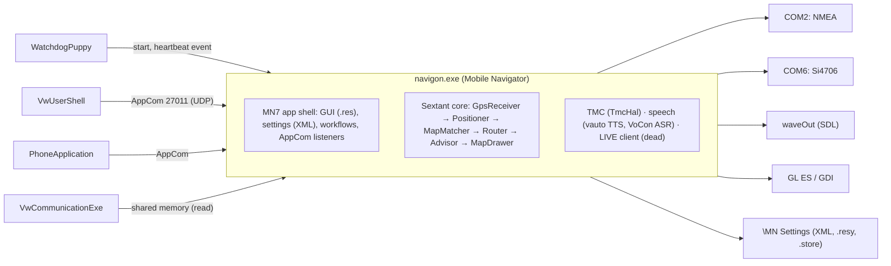
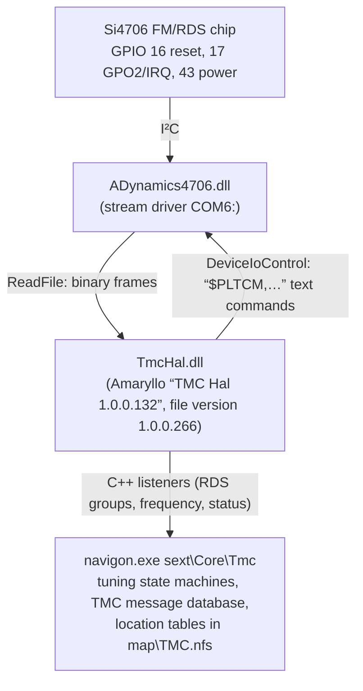

# Navigation app (`navigon.exe`) and add-on apps — interfaces

What the navigation application needs from the unit, what it offers to the other programs, and what a substitute must do. The routing/map engine itself ("Sextant" core) is out of scope.
Static analysis only (strings, PE tables, r2 + r2ghidra). Nothing run on a real unit.

Legend: ✅ seen in disassembly / data / config (binary + VA or file given) · 🟡 inferred / single source · ❓ unknown.
Addresses = VA in `firmware/flash/NAVIGON/navigon.exe` (image base `0x10000`, **ARM** code, not Thumb) unless stated. `\My Flash Disk\NAVIGON\` = `firmware/flash/NAVIGON/`.
Related: [appcom.md](../apps/appcom.md) (message catalogue) · [media-audio.md](media-audio.md) (sound manager, radio channel) · [shared-memory.md](../car/shared-memory.md) (car data) · [boot-and-supervision.md](boot-and-supervision.md) (watchdog, route-resume counter) · [hardware-layer.md](hardware-layer.md) (GPS / tuner hardware, hidden flash).

## 0. Overview



| Question | Short answer | § |
|---|---|---|
| How is it started / kept alive? | by the watchdog, no arguments; `SetEvent("ResyLightMnMainLoop")` every loop turn; exit = device reset | 1 |
| Window / single instance | class = title = `Mobile Navigator`; second instance only foregrounds the first | 1 |
| Where are the settings? | seeds in `NAVIGON\Settings`, live copies in `\MN Settings`; path map `ApplicationSettingsPathes.xml` | 2 |
| Position source | NMEA from `COM2:` 57600 only; no car speed, no dead reckoning | 3, 8.2 |
| Why does a unit without GPS reset? | `NoGpsCheckTime` 300 s → reopen port → `NoGPSExitBehaviour` 5 = reset | 3.3 |
| TMC | own Si4706 tuner; `TmcHal.dll` loads the driver as `COM6:` (the `RDS5:` setting is ignored) | 4 |
| Speech | Nuance Vocalizer (TTS) + VoCon 3200 (ASR), output via SDL audio → `waveOut`; docked volume fixed at step 9 | 5 |
| Map renderer | OpenGL ES 1.x (`openGL_ES_STA2065.dll`) or software (`OldMapDrawer` = 1) | 6 |
| Licence checks | key store `device.xml` (class + expiry date per code) gates optional content; `mis.txt` / `expirationdate` belong to the dead LIVE service | 7 |
| Talks to the car? | reads fuel / range / ignition / VIN from shared memory; **sends nothing** (no cluster display) | 8.2 |
| Replace it? | heartbeat + window + AppCom msg 40; maps are the hard part (table formats opaque) | 10 |

## 1. Process interface

| Item | Value | Evidence |
|---|---|---|
| Binary | `navigon.exe`, 10.5 MB, PDB `MobileNavigator.pdb`, build tree `T1_Sheldor_KW4514_Seat`, built 2014-11-14 | ✅ PE header, strings |
| Framework | "MN7" app shell + "Sextant" core (`sext\Core\{GpsReceiver,Positioner,MapMatcher,MapDrawer,Tmc,Advisor,OnboardServer,…}`) statically linked | ✅ source paths in `.rdata` |
| Window | class **`Mobile Navigator`**, title **`Mobile Navigator`**, `WS_VISIBLE`, full screen | ✅ `RegisterClassW` `0x56ab4`, `CreateWindowExW` `0x56b34` |
| Single instance | `FindWindowW(class, title)` + process snapshot of own exe name; if found → `SetForegroundWindow(hwnd \| 1)` and exit | ✅ `0x5701c`, `0x2eef4` |
| Watchdog heartbeat | named event **`ResyLightMnMainLoop`**: created in `WinMain`, `SetEvent` on every main-loop turn | ✅ `0x3aab4`, `0x5be0b0` |
| AppCom identity | application `MobileNavigator`, UDP port 27011 (`NgAppCom.xml`) | ✅ |

### 1.1 `WinMain` (`0x3aab4`) ✅

```
WinMain(hInst, hPrev, lpCmdLine, nShow):
    if !ParseCommandLine(lpCmdLine):  wprintf("GET_COMMAND_LINE_HANDLER.ParseCommandLine failed."); return 1
    app = new CMNApplication(…, GetSystemMetrics(SM_CXSCREEN), GetSystemMetrics(SM_CYSCREEN), …)   // 0x18890, 0x168 bytes
    if app->Init():                                           // vtbl+0xd8 = 0x5701c
        h = CreateEventW(NULL, FALSE, FALSE, L"ResyLightMnMainLoop")
        app->SetHeartbeatEvent(h)                             // 0x5a08d0: stores at app+0xdc, ResetEvent
        app->Run()                                            // vtbl+0xe0 = 0x5be0b0
    app->Exit()                                               // vtbl+0xc0 = 0x15ea8
```

### 1.2 Command line ✅

Parser `0x39dac` → splits on spaces (quotes respected, `0x33928`) → per argument `0x18428`: only arguments starting with `-` and one of four letters are kept; the rest of the argument is the value (quotes stripped).

| Option | Stored at | Meaning |
|---|---|---|
| `-T<value>` | `0x9cd810` | ❓ a string turned into a queued UI command at start (`0x41a3f0`) and again when a `WM_COPYDATA` arrives (§1.4); 🟡 "target" |
| `-S<value>` | `0x9cd818` | ❓ |
| `-F<value>` | `0x9cd820` | ❓ |
| `-P<value>` | `0x9cd828` | ❓ |

The watchdog starts it with **no arguments** (`Watchdog_MN.ini: Arguments=`).

### 1.3 Main loop and heartbeat (`0x5be0b0`) ✅

```
while app.running:
    SetEvent(hHeartbeat)
    if !app.paused:
        cmd = commandQueue.pop();  if cmd: execute(cmd); SetEvent(hHeartbeat); delete cmd
        timers.tick()
        SetEvent(hHeartbeat)
        if app->PumpMessages(): redraw(); SetEvent(hHeartbeat)       // vtbl+0xf4
        app->Idle()                                                   // vtbl+0xe4
```

Contract with `WatchdogPuppy` (`Watchdog_MN.ini`): first signal within 90 s of start, then at least one every 90 s; on timeout or process exit → device reset (`ActionAtTimeout=1`, `ActionAtTermination=1`). Details of the watchdog side: [boot-and-supervision.md](boot-and-supervision.md).

### 1.4 Window procedure (`0x560c8`) ✅

| Message | Behaviour |
|---|---|
| `WM_ACTIVATE` | activate / deactivate the shared hardware-key map (`Hardwarelayer!ActivateSharedHardwareKeyMap`) |
| `WM_SETFOCUS` / `WM_KILLFOCUS` | forwarded to the GUI manager |
| `WM_PAINT` | repaints only when it is the foreground window |
| `WM_SETTINGCHANGE` wParam `0x3002` | re-layout (screen rotation) |
| `WM_WINDOWPOSCHANGED` | if the window it is placed behind has the title `Desktop` → posts `WM_DESTROY` to itself (→ `PostQuitMessage`) 🟡 "sent to back behind the CE desktop = quit" |
| `WM_COPYDATA`, `dwData == 1` | payload = UTF-16 string; handed to the app (vtbl+0x60), then the `-T` value is turned into a queued UI command |
| `0x8009`, `0x800A` | each queues a fixed UI command (`0x411710`, `0x411758`) ❓ which |
| `0x800B`, wParam = requester `HWND` | status query: answers with `PostMessage(requester, 0x800C…0x8011, …)` and one `WM_COPYDATA` per loaded map ❓ consumer (not the watchdog) |
| `WM_DESTROY` | `PostQuitMessage(0)` |

### 1.5 Start-up sequence (`CMNApplication::Init`, `0x5701c`) ✅

1. Single-instance check (above).
2. Load settings (path map `Settings/ApplicationSettingsPathes.xml`, §2).
3. `ChangeDisplaySettingsEx`, create the window, `ShowWindow(nShow)`.
4. Pick the GUI resource archive by **brand byte** `ReadFlash(0x2F, 1 byte)` (hidden flash, `Hardwarelayer.dll`): `2` → `skin_SEAT\MobileNavigator.res`, `3` → `skin_SKODA\MobileNavigator.res`, anything else → `MobileNavigator.res` (VW).
5. Language files from `language_files\`, fallback `eng-USA_480_272.lng`; resolution string `%dx%d`.
6. `GlobalMemoryStatus`: > 64 MB total → cache profile `0x80`, else `0x40`.
7. `PlaySoundW("./Startup.wav")` if the file exists (not shipped).
8. Queue the start-up workflow (disclaimer / first-start wizard / map load).

### 1.6 Exit (`0x15ea8`) ✅

Sends AppCom msg 10 with value 3 to application `Bluetooth` (§8.1), stops timers and sound, destroys the window. Because of `ActionAtTermination=1` a normal exit of `navigon.exe` resets the unit.

### 1.7 Route resume after a reset (`NavigationRoute.resy`) ✅

| Step | Code |
|---|---|
| Path = `<RESY>` (`/MN Settings`) + `\NavigationRoute.resy` | `0x3e4dfc` |
| Save: whenever the guidance state changes, the current target list is serialized to the file (old file deleted first) | `0x3e4eb4` → `0x62bd6c`, from the guidance listener `0x4da6b0` |
| Delete: when guidance ends normally | `0x3e4fb0` |
| Load at start: file (or `.bak` twin) is read; it must give ≥ 2 targets; then the "resume route?" workflow runs | `0x49fcb4`, `0x4a7220` |
| Loop protection, internal variant: counts restarts with an unchanged file size in `RESYHandling/FileSize` + `RetryCount`, deletes the file above `PossibleRetryCount` (3) | `0x3ef7a0` — **off** here (`ActivateInternalHandling` = 0) |
| Loop protection, shipped variant: `WatchdogPuppy` does the same counting in `NavigationRoute.resy.counter` before each start | [boot-and-supervision.md](boot-and-supervision.md) §3.5 |

File content: the route serializer also used for `.route` files (binary, starts `FF FF 00 00 01 00 00 00`, date string `R<yyyymmdd-hh:mm:ss>`, then typed target records with UTF-8 names and coordinates as doubles) 🟡 not decoded field by field.

### 1.8 How the other programs start, show and hide it

- Process start: only by `WatchdogPuppy` (`Watchdog_MN.ini`), no arguments ✅. A normal process exit or a heartbeat time-out resets the unit.
- At start navigon broadcasts AppCom msg 40 (`0x1bc84`); the shell then runs its EULA / password workflow, starts the autostart apps and starts MediaPlayer hidden ([user-shell.md](user-shell.md) §7.3). Its window is created visible; the shell brings itself to the front.
- Show: the shell's navigation tile calls `AppCom::StartApplication("MobileNavigator")` → `FindWindow("Mobile Navigator", "Mobile Navigator")` + show / foreground ([appcom.md](../apps/appcom.md) §7). Nothing navigation-specific is sent.
- Hide: "back to menu" inside navigon = `ExitBehaviour` 3 = `ShowWindow(SW_HIDE)` (§2.3); guidance, GPS, TMC and prompts keep running in the background.
- Suspend / resume: listeners on `Hardwarelayer.dll` (`ISuspendResumeDeviceListener`, `IPMPowerListener`, `IUSBListener`, `ICardListener`); sound, GPS and the map drawer are stopped and restarted with the `SuspendMgr/*` time-outs (200…1000 ms) 🟡 sequence not traced. `AutoSuspend` (4) = user's auto-off choice; power-off itself is `PMPowerOff()` ([boot-and-supervision.md](boot-and-supervision.md) §6).
- navigon starts others through AppCom: `Bluetooth` (phone screen, + msg 13), `MMPMediaPlayer`, `ScreenShot`, `ManualReader` (with ` language=<lc>`; that registry entry points to a path that does not exist on this product), and leftovers `TCPMP`, `MP3Player`, `MultimediaPlayer` (no such apps).

### 1.9 Files and DLLs it needs ✅ (import table + start-up code)

| Kind | Items |
|---|---|
| Static imports (next to the exe) | `NgAlloc`, `Png`, `Hardwarelayer` (69), `NgAppCom` (38), `fl_core` (31) + `vocon3200_*`, `vocon_ext_audioin`, `vocon_ext_heap`, `TmcHal` (19), `SDL` (9), `vautov5`, `vauto_postproc`, `vauto_crossmapping` |
| Static imports (ROM `\Windows`) | `COREDLL` (316 ordinals), `toolhelp`, `WS2`, `WININET`, `iphlpapi`, **`openGL_ES_STA2065`** (55) → the process does not load without it, even with the software renderer |
| Loaded by helpers | `WolfSpecial.dll` (by `Hardwarelayer`), `ADynamics4706.dll` (by `TmcHal`) |
| Files at start | `NgAppCom.xml`, `Settings/*` (§2), `version.xml`, `device.xml`, `mis.txt`, `MobileNavigator.res` (or brand variant), `language_files/<lc>_480_272.lng`, `map/*.map` + `*.nfs`, `sounds/*.nfs`, `\MN Settings\` writable |
| First start (no `\MN Settings\UserSettingsLanguage.xml` language yet) | wizard: language → voice → `StartupAvailableCountries` (ESP PRT DEU FRA ITA GBR) → disclaimer (`Settings/Disclaimer.txt`; cancel = `DisclaimerExitBehaviour`) ✅ wizard seen in the emulator ([AGENTS.md](../../AGENTS.md)), 🟡 step order |

## 2. Settings system

### 2.1 Files ✅

All settings are XML, read through XPath keys (`/Settings/...`). One manager object holds numbered files; a call is `Get(fileId, key, &value)` (`0x58fc20` int, `0x58feb4` bool, `0x58fa94` string/path; `0x58fb18` set). 671 distinct keys are compiled into the exe (pointer table in `.data` `0x9c19xx…0x9c2axx`).

| Id | File | Seed → live copy | Content |
|---|---|---|---|
| 6 | `Settings/ApplicationSettingsPathes.xml` | read-only, loaded first (`0x5701c`) | path map (§2.2) |
| 5 | `Settings/ApplicationSettings.xml` | read-only | product behaviour: exit behaviours, timers, routing profile map, sound steps, VR tuning, cache sizes |
| 7 | `Settings/ApplicationSettingsCountryInfo.xml` | read-only | per-country speed limits / mandatory equipment |
| 10 | `Settings/EcoSettings.xml` | read-only | vehicle energy model |
| 2 | `UserSettings.xml` | `Settings/UserSettings.default` → `\MN Settings\UserSettings.xml` (+ `.old` = previous version) | everything the user or the device variant can change (§2.4) |
| 3 | `UserSettingsLanguage.xml` | `.default` → `\MN Settings\` (+ `.old`) | language, voice |
| 0 | `UserData.xml` | created in `\MN Settings\` | last position, home, last search |
| 1 | `UserDataLocalSearch.xml` | `\MN Settings\` | LIVE local-search history |
| 🟡 | `UserSettingsOrientation.xml`, `RouteProfilesSettings.xml` (`.default`/`.old`), `ReportSettings.xml`, `FactoryReset.xml`, `version.xml` (`.default`/`.old`) | names in the same table (`0x9c2814…0x9c2860`); ids not read | |

Registration: `0x49b2cc` (`Register({xml, old, default}, id, readOnly, …)` = `0x59c668`). Folder of the seeds = `<FactorySettings>` (`./Settings`), of the live copies = `<UserSettings>` / `<UserData>` (`/MN Settings`). `.` = folder of `navigon.exe`.

Other configuration (not XML): `Settings/Core/CoreConfig.ini` (Sextant core: positioning chain, GPS parser, thread priorities, TMC tuner state machines, eco car model), `Settings/Routing/{RT,SP}_*.ini` (route type × vehicle profile weights), `Settings/autozoom.ini`, `Settings/Core/{Advisor,DrawSettings}.nfs`, `Settings/Connectivity/` (LIVE, §8.4), `Settings/DD_*.default` (driving-dynamics ETA tables).

`Settings/FactoryReset.xml` lists what a factory reset deletes: `./Contacts`, `./LogBook`, `/MN Settings`, `./Settings/UserDataLocalSearch.xml`.

### 2.2 `ApplicationSettingsPathes.xml` (path map) ✅

| Key | Value |
|---|---|
| `FactorySettings`, `EcoSettings` | `./Settings` |
| `UserSettings`, `UserData`, `RESY`, `VoiceRecognition/SessionPath` | `/MN Settings` |
| `SextantConfigFiles` | `./Settings/Core` |
| `DataFiles`, `ETA` | `./Dat` (created at run time; not in the package) |
| `Language@ID='CE'` | `./language_files/` |
| `Map/Path` | `./map`, then `./map_US`, `_TUR`, `_SAC`, `_PAC`, `_GCC`, `_APC`, `_SAM` (only `./map` exists) |
| `GCM/DB` (city models) | `./map/GCM`, `/Storage Card/NAVIGON/map/GCM` |
| `Overmap/Path` (POI) | `./POI` |
| `Sound/Path` | `./Sounds` |
| `VoiceRecognition/Path` | `./VoiceRecognition` |
| `Routes/Path` | `/MN Settings/Routes` (writable), `/Storage Card/NAVIGON/Routes`, `/My Flash Disk/NAVIGON/Routes`, `./ExampleRoutes` |
| `Favorites`, `RecentTargets` | `/MN Settings/Favorites.store`, `/MN Settings/RecentTargets.store` |
| `VersionInfo`, `KeyStorage` | `./` (→ `version.xml`, `device.xml`, §7) |
| `Connectivity/InputPath`, `OutputPath` | `./Settings/Connectivity`, `/MN Settings/Connectivity` |
| `LogPath/GPS` | `/Storage Card/Navigon/SimulationFiles/GPS`, `/MN Settings/Logs/GPS`, `/My Flash Disk/Navigon/SimulationFiles/GPS` |
| `LogPath/TMC`, `Live`, `Tuner`, `ECompass`, `SextantErrorReport` | same three roots: `…/SimulationFiles/{TMC,LIVE,TMCuner}`, `/MN Settings/Logs/{TMC,LIVE,TMCTuner}`; e-compass only on flash |
| `BTCoreExe@ID='CE'` | `./../BT/BTCore.exe` |
| `FreshUpdateInformation/Path` | `/My Flash Disk/NAVIGON/Fresh`, `/Storage Card/NAVIGON/Fresh` |
| `MapStyles`, `Skin`, `ScenicRoutesData`, `Breadcrumb`, `UserPois/MyPois`, `LogBook`, `DemoPlayer`, `OutloookContacts` | folders that do not exist on this product (features of other MN7 devices) |

A list with several entries is a search order (first existing wins) 🟡.

### 2.3 Important keys

`ApplicationSettings.xml` (id 5) ✅ values from the file, meaning from code where an address is given:

| Key | Value | Meaning |
|---|---|---|
| `ExitBehaviour` | 3 | what "leave navigation" does (codes below) |
| `DisclaimerExitBehaviour` | 3 | disclaimer declined |
| `USBModeExitBehaviour` | 5 | USB cable to a PC detected |
| `MAPSelectionCancelBehaviour` | 5 | map selection cancelled at start |
| `NoGPSExitBehaviour` / `NoGpsCheckTime` | 5 / 300 s | GPS receiver silent (§3.3) |
| `SDCardRemovedExitBehaviour`, `SDCardInsertBehaviour` | 6 | 6 has no case in the handler → nothing happens |
| `Time/SetOnFirstGPS`, `TimeZone/AutoDetection` | 1, 1 | system clock from GPS |
| `ResetGps`, `ResetGpsWaitTime` | 1, 0 | 🟡 restart the receiver when the port is re-opened |
| `Sound/VolumeStep@step` | 0,5,10,15,20,30,40,55,70,85,100 | volume step 0…10 → percent |
| `SoundPrio/{Advice,Voice,Bluetooth,MultiMedia,CarInfo}` | 4, 3, 1, 5, 0 | sound-manager priorities (→ [media-audio.md](media-audio.md) §5) |
| `MaxConnectionVolumeAdvice`, `…VrTts` | 9, 9 | volume step cap while docked 🟡 |
| `RESYHandling/ActivateInternalHandling`, `PossibleRetryCount` | 0, 3 | route-resume retry counting is left to the watchdog (§1.7) |
| `SuspendMgr/*` | 200/800/200/1000 ms | suspend / resume handshake time-outs |
| `CacheSize/CoreKB`, `MapDrawerKB` | 80000, 40000 | memory budget |
| `SwitchOffTimeout` | 5 | |
| `ProductDefaultPrefix` | `N7` | |
| `StartupAvailableCountries/Tag` | ESP PRT DEU FRA ITA GBR | first-start country choice |
| `Tethering/*`, `FMTransmitter/*`, `Proximity/*`, `GSensor/*` | | hardware this unit does not have |

Exit-behaviour codes ✅ (`CMPCCheckExitBehaviourCmd`, `0x5952ac`; debug text `[%d] CMPCCheckExitBehaviourCmd -> %s`):

| Code | Action | Code |
|---|---|---|
| 0 | orderly quit ("Quitting application.") | `0x545a60` |
| 3 | `ShowWindow(SW_HIDE)` – keep running in the background | `0x515f64` |
| 4 | close `ScreenShotMaker`, `TerminateProcess(self)` | `0x516008` |
| 5 | `Hardwarelayer!ResetDevice()` ("Resetting device.") | `0x528c08` |
| 8 | `Hardwarelayer!PMPowerOff()` ("Power off device.") | `0x528bf8` |

Reasons (command argument): 0 SD card removed · 1 USB mode · 2 disclaimer cancelled · 3 map selection cancelled · 4 no GPS receiver. With `DevModeState` = 1 a message box `ExitBehaviourInfo` is shown first.

Developer switches in `UserSettings.xml` (id 2) ✅ keys exist in the exe; shipped defaults in brackets:

| Key | Default | Effect |
|---|---|---|
| `DevModeState` | – (absent = 0) | master switch: extra rows in settings dialogs (`0x3ae3d0`), exit-behaviour message box. Can be set at run time by AppCom msg 52 (§8.1) |
| `DevModeSimGps` | **1** | replay a GPS log instead of the serial port 🟡 only when a log file is chosen / `GPS/AutoStartSimulation` names one (`0x45d564`) |
| `DevModeRecGps`, `DevModeRecTmc`, `DevModeSimTmc`, `TMC/RdsLogging`, `TMC/TunerLogging` | – | record / replay GPS, TMC and tuner streams (§3.5) |
| `DevModeLogUserSettingChanges` | 0 | log every settings write |
| `ShowFrameRate` | **1** | frame counter 🟡 shown only with `DevModeState` |
| `ScreenShot` | 0 | start `ScreenShot.exe`; also settable by msg 52 |
| `OldMapDrawer` | 0 | 1 = software map renderer (§6) |
| `LogSplitInterval` | 0 | split log files (`_<n>` suffix) |
| `VoiceRecognition/LogPath`, `LogLevel` | `.\VR_LOG`, 0 | ASR logging |
| `Sextant/SextantLogging`, `SextErrorLog/*` | – | core error log `ErrorLog.txt` |

### 2.4 `UserSettings.xml` structure ✅ (seed file; no personal data)

```
Settings
├ Product=MN, Version=7.0
├ GPS        Type, DeviceType, GPSPort, Baudrate, DRVPrefix               (§3)
├ TMC        RadioStationScan, AutoRecalculation, TMCPort, TMCBaudrate, DRVPrefix   (§4)
├ ECompass   Active, HWConfig{Type,Manufacturer,DeviceType,RefreshInterval,AverageFactor}, SWConfig, AngleConfig, Calibration
├ Sound      Volume (0…10), Mute, SpeedDependent
├ Display    StandardView, DayNightMode, BrightnessDay/Night, Day{Dawn,Day,Delay}, Night{…}, …
├ Routing    RoutingOption (vehicle), RouteType, Highway/Tollroad/Ferry, ConsiderTMC, Allow*Toll*, vehicle dimensions
├ POI/HidePOI…, FavoritePOIs, POIsAlongTheRoute, FuelStations, CNGFuelStations, ChargingFuelStations*   (serialized category objects)
├ Map        Orientation, Landmarks, CityModelsTextured3D, GCM, Spiegelei
├ HWKeys/Key {Function HK_*, Keycode, Shared}   (hardware-key map for Hardwarelayer!SetHardwareKeyMap)
├ VoiceRecognition  LogPath, LogLevel, MicroGain, TTSVolume, VcMode, …
├ TTS        SpeakStreetNames, SpeakTMCMessages
├ Live       UseLiveServices, TMCMode, SubmitFCD, …   (§8.4)
├ warners    POIWarner, CurveWarner, EnhancedRoadSignWarner, TrafficSignsWarner, EducatedDriving, LaneInfo
├ dev        ShowFrameRate, DevModeSimGps, DevModeLogUserSettingChanges, ScreenShot, OldMapDrawer, LogSplitInterval
└ misc       AutoSuspend, FirstGpsFix, InputMode, TimeFormat, Clock, MapUpdateFlag, ExternCradle, ProximitySensor, GSensor, …
```

Run-time additions seen as keys in the exe: `LastGpsPosition`, `Bluetooth/*` (last phone), `StartupSelectedCountry`, `MsrInfoShown`, `*/InfoShown` flags, `RepairCount`, `TemperatureUnit`.

## 3. Positioning

### 3.1 Chain ✅ (`CoreConfig.ini [PosSys]`)


One sensor only: `Sensor1=Default Sensor Gps`. No gyro, no odometer, no car-speed input is configured, and the car-data client inside `navigon.exe` never reads speed, distance or reverse gear (§8.2) → **GPS-only positioning, no dead reckoning** ✅. In tunnels the core extrapolates along the route (`GcmMaxPredictionTime`, "TunnelView") 🟡.

### 3.2 Serial input ✅

| Item | Value | Evidence |
|---|---|---|
| Settings read | `UserSettings.xml`: `GPS/Type` (0), `GPS/DeviceType` (1), `GPS/GPSPort` (**2**), `GPS/Baudrate` (**57600**), `GPS/DRVPrefix` (empty → `COM`) | `0x44e218`; code defaults: type 1, baud 4800 |
| Device name | `<DRVPrefix><port>:` → **`COM2:`** | `0x82d36c` |
| Open | `CreateFileW(GENERIC_READ\|GENERIC_WRITE, OPEN_EXISTING, FILE_FLAG_OVERLAPPED)` | `0x82d36c` |
| Line | 8 data bits, no parity, 1 stop bit; allowed rates 1200…115200; `fBinary`, optional RTS handshake flag | `0x82cbf0` |
| Read | `SetCommMask(EV_RXCHAR)` + `WaitCommEvent` thread ("GpsReceiver", priority normal) | `0x82cadc`, `CoreConfig.ini [ThreadPriorities]` |
| `CoreConfig.ini [Default Sensor Gps Serial]` | `Port=7`, `BaudRate=38400` | generic defaults, overridden by the two settings above |

On the unit `COM2:` is not a UART but the ST GPS engine driver (`GPS.dll`, → [hardware-layer.md](hardware-layer.md) §5); it emits plain NMEA. In the emulator `GPSPort` is patched to 1 (`emulator/build.sh`).

NMEA parser (`CoreConfig.ini`, field names = variables filled):

| Format | Sentences | Fields used |
|---|---|---|
| `GGA_RMC` (preferred) | `$GPGGA` | utctime, latitude, ns, longitude, ew, quality, satellites, hdop, altitude |
| | `$GPRMC` | speed_knots, course, utcdate |
| `GGA_VTG` | `$GPGGA` + `$GPVTG` | course, speed_knots / speed_kmh |

- `AutoDetectEnabled=1`: the receiver tries the configured formats until one parses; built-in fallbacks exist (`GPRMC`-only with position, `0x9828b0`). Port / baud auto-detection lists exist (`AutoDetectPorts 0,1,2`, `AutoDetectBaudRates 1200…115200`) but the time-outs are `-1` (off).
- **Minimum a GPS source must send**: `$GPGGA` (fix quality ≠ 0, position, satellites, HDOP) and `$GPRMC` (speed, course, date), once per second, with NMEA checksum (`ChecksumDelimiter`). `$GPGSV`/`$GPGSA` are not parsed (no such strings) 🟡 so the satellite page shows counts only.
- Commands written to the receiver ✅ strings: ST `$PSTMCOLD*1E`, `$PSTMWARM*13`, `$PSTMHOT*49`, `$PSTMWALKINGONOFF,1*18` / `,0*19` (pedestrian mode), `$PSTMSTAGPSSETSEED,…` (assisted-GPS seed from the LIVE "InstantFix" service, answers `…SEEDOK` / `…SEEDERROR`); SiRF `$PSRF101,…` (cold / warm / hot / factory), `$PSRF207`. `GPS/DeviceType` selects the set 🟡.
- First fix: `FirstGpsFix` flag in user settings; the system clock is set from GPS (`SetSystemTime`, `Time/SetOnFirstGPS`); the fix state is announced with AppCom msg 22 (§8.1).

Navigon keeps `COM2:` open and the port admits one reader ✅; another program can read the same sentences from `COM4:` ([hardware-layer.md](hardware-layer.md) §6.5, [navit.md](../apps/navit.md#the-gps-why-com4)).

### 3.3 No-GPS supervision ✅ (the logic the emulator defuses)

Started together with the receiver (`0x459110`): if `NoGpsCheckTime` > 0, a repeating timer of that many seconds runs command `0x459878`:

```
every NoGpsCheckTime s (300):
    if core.gpsDataSeen || core.simulationRunning:  retried = false; return          // 0x3a6f14 (core flags +0x2e4 / +0x2f4)
    stop timer; stop receiver, clear flags                                            // 0x44e66c(0)
    h = CreateFile("COM<GPSPort>:"); Sleep(1000); SetCommState(baud, 8 data bits)     // 0x35b14c, 0x34bd84
    if h == INVALID || retried:
        queue CMPCCheckExitBehaviourCmd(reason 4 "No GPS Receiver detected.")         // → NoGPSExitBehaviour = 5 → ResetDevice()
    else:
        CloseHandle(h); retried = true; restart receiver                              // 0x44e66c(1)
    restart timer
```

So a unit whose GPS driver delivers no data resets itself after 5 min if the port cannot be opened, otherwise after 10 min (one reopen attempt in between) 🟡 exact meaning of the two "seen" flags. A missing fix alone (data flowing, quality 0) does not trigger it 🟡. `emulator/build.sh` sets `NoGpsCheckTime` to 86400.

### 3.4 E-compass, G-sensor

`UserSettings.xml <ECompass>` describes an AKM `eCompassAKD8973B` with declination compensation and smoothing; `LogPath/ECompass` and the `ECompass_log*.log` recorder exist ✅. No e-compass driver exists in the ROM ([hardware-layer.md](hardware-layer.md) §6) → 🟡 configuration leftover of a handheld MN7 device; heading comes from the GPS course. Same for `GSensor`, `ProximitySensor`, `FMTransmitter`.

### 3.5 Recording and replay ✅ names (`0x426ea4`), 🟡 content

| Stream | File name | Folder key (`LogPath/…`) |
|---|---|---|
| GPS | `Gps_log…[_n].gps` | `GPS` |
| TMC messages | `Tmc_log….tmc` | `TMC` |
| TMC HAL (raw RDS groups) | `Hal_log….thl` | `TMC` |
| Tuner state | `Tuner_log….csml` | `Tuner` |
| E-compass | `ECompass_log….log` | `ECompass` |
| LIVE traffic | `CF_log….txt` | `Live` |

- Replay source = `FileGpsHal` (`sext\Core\GpsReceiver`): parameters "Name of simulation file" (default `default.log`) and a loop count ✅ strings `0x985aec…`. It feeds the same NMEA parser, so a `.gps` file is 🟡 a plain NMEA text capture (no sample on the unit to confirm; no timestamp format string next to the code).
- Third HAL: `SimGpsHal` = route simulation ("demo drive", `Default Simulation Speed=1.0`).
- Choosing a file: dev-mode dialog lists the `LogPath/GPS` folders; `GPS/AutoStartSimulation` (string key) names a file to start automatically (`0x45d564`).
- A `GpsLog.txt` / `MapMatcherLog.txt` debug log (KML export strings `GpsTrack`) exists in the core ✅ `0x9800c4`.

## 4. TMC (traffic over FM/RDS)

### 4.1 Data flow ✅



The tuner is inside the unit; nothing comes from the car radio. `TmcHal.dll` is ARM code, image base `0x10000000` ("TH:" below); the driver likewise ("AD:").

### 4.2 The port is `COM6:`, not `RDS5:` ✅

- `UserSettings.xml`: `TMC/TMCPort` 5, `TMC/TMCBaudrate` 115200, `TMC/DRVPrefix` `RDS` → navigon calls `TmcOpen(L"RDS5:", 115200)` 🟡 (string built like the GPS one).
- `TmcOpen` (TH:`0x10004488`) **ignores both arguments**: it formats `"COM%d:"` with the constant 6 and calls `AmarylloDyn_Config(NULL, "COM6:", 38400, 3, 0x10, 0, 0)` then `AmarylloDyn_Start()`.
- `AmarylloDyn_Start` (TH:`0x100040f8`) starts a thread (TH:`0x10001a9c`) that runs `AmarylloDyn_LoadKernelDriver` = **`RegisterDevice(L"COM", 6, L"\My Flash Disk\NAVIGON\AmarylloDynamics\ADynamics4706.dll", 0x1000)`** (TH:`0x10001a50`). So the driver is loaded from flash by `TmcHal.dll`, inside the `navigon.exe` process, as `COM6:`. No registry entry is needed. (A second build of the driver sits in the ROM, `\Windows\ADynamics4706.dll`; it is not the one loaded.)
- Reader thread (TH:`0x10003e8c`, priority 251): waits ≤ 10 s for the driver, `CreateFileW("COM6:")`, sends `$PLTCM,V,0,0` and `$PLTCM,+`, then polls `ReadFile` (32…224 bytes) every 20…300 ms (back-off while idle).

### 4.3 `TmcHal.dll` API ✅ (exports; prototypes from the mangled names)

| Function | Behaviour |
|---|---|
| `bool TmcOpen(const wchar_t* port, unsigned baud)` | see 4.2 |
| `bool TmcClose()`, `bool TmcReopen()`, `bool TmcIsOpen()` | stop / stop + start / state |
| `bool TmcControlTuner(TmcControlCmd cmd, int arg)` | TH:`0x10003650`. `0` tune: `arg` in 100 kHz → `$PLTCM,H2,<arg·10>` · `1`/`2` step up / down 100 kHz (wraps 87.5 ↔ 108.0 MHz) · `3`…`6` seek up / down 🟡 two sensitivity modes (`$PLTCM,F,501` or `F,469`, then `$PLTCM,+` / `-`) · `9` stop search |
| `TmcStatus TmcGetStatus()`, `bool TmcGetRdsHealth(int&)`, `bool TmcGetTunerFrequency(int&)` | cached state |
| `bool TmcGetRdsStation(unsigned long& pi, wchar_t* name, int n)`, `TmcGetRdsAF(int[])`, `TmcGetRadioText(wchar_t*, int)`, `TmcGetRdsTime(TmcRdsTime&)` | PI code, PS name, AF list, radio text, CT time |
| `bool Connect(ITmcRdsListener*)`, `…(ITmcRawDataListener*)`, `…(ITmcFrequencyListener*)`, `…(ITmcStatusListener*)` + `Disconnect(…)` | callback interfaces (one virtual method each 🟡) |
| `ConnectCompleteBandscanListener`, `DisconnectCompleteBandscanListener`, `TmcControlTunerEx`, `TmcGetCapabilities`, `TmcGetHint` | C exports, not imported by `navigon.exe` |
| `TmcSendCommand`, `TmcStartLogging`, `TmcStopLogging`, `TmcStartSimulation`, `TmcStopSimulation` | **stubs** (all = TH:`0x1000204c`, return only) → HAL-level record / replay does nothing on this unit; navigon's own `.tmc` / `.thl` recorder sits above the HAL |
| `AmarylloDyn_*` (42 exports) | vendor layer: `Config`, `Start`, `Stop`, `Setfreq`, `Search`, `SearchStop`, `Tunermode`, `filter_M/RFA/RFB`, `GetRSSI`, `GetRDSStatus`, `Map…Updated(callback)`, `Decryptlocation`, `DefServiceKey(Table)`, `GetEncryptionID`, `GetCAStatus` (encrypted "pay TMC" support) |

navigon imports only the 19 `Tmc*` / `Connect` / `Disconnect` functions listed in the first six rows.

### 4.4 HAL ↔ driver protocol ✅

Commands (HAL → driver): ASCII lines, queued (≤ 16), each sent with `DeviceIoControl(h, 0x88B82F08, text, strlen(text), …)` (TH:`0x10001818`).

| Command | Meaning |
|---|---|
| `$PLTCM,V,0,0` | version query (driver identifies as `$PLTV,"ST V1.0.0.262 HS (C)2011 Amaryllo MMG BV"`) |
| `$PLTCM,H2,<f>` | tune to `f` × 10 kHz (8750…10800) |
| `$PLTCM,+` / `$PLTCM,-` | seek up / down |
| `$PLTCM,F,<n>` (501, 469), `$PLTCM,RFA,<n>`, `$PLTCM,RFB,<n>`, `$PLTCM,A<n>`, `$PLTCM,SD,<a>,<b>` | search / filter parameters 🟡 |
| `$PLTCM,X` | stop |

Data (driver → HAL, `ReadFile`), byte parser TH:`0x10003d60`:

```
C0 C2  len_lo len_hi  payload[len] (1…127)  chk_lo chk_hi  D0
payload[0] = record type:
  0x10  tuner status (20 B: frequency, signal level, flags)        → frequency / status listeners
  0x20  RDS group    (20 B: 4 × u32 = blocks A…D)                  → raw-data / RDS listeners (TMC = group 8A)
  0x21  12 B record  (🟡 encryption / service info)
  0x30  PS name (8 chars)      0x31, 0x32  PI / programme info 🟡
```

Checksum algorithm: TH:`0x10001610` (not transcribed ❓).

### 4.5 `ADynamics4706.dll` stream driver ✅

| Item | Value |
|---|---|
| Exports | `COM_Init`, `COM_Deinit`, `COM_Open` (returns the constant `0x5678`), `COM_Close`, `COM_Read` (≤ 72 bytes from a ring buffer), `COM_Write`, `COM_Seek`, `COM_IOControl`, `COM_PowerUp`, `COM_PowerDown` |
| IOCTLs | serial-port codes `0x1B0004…0x1B005C` are accepted (it poses as a COM port: `GET_COMMSTATUS`, `GET_DCB`, … answered with zeroed structs); vendor codes `0x88B82F08` (command line in), `0x88B83F08`, `0x88B84F08`, `0x88B85F08`, `0x1000` ❓ |
| Chip | Silicon Labs Si4706 (log strings `47XX io2w_write`, `4706 io2w_read`), 2-wire mode |
| Bus | I²C through the OS driver (`IIC3:` in this build; messages mention `IIC1`/`IIC2`), `IOCTL_I2C_MASTER_RECEIVE` / multi-write |
| GPIO (driver `GIO1:`, `IOCTL_GIO_SET_PORT`) | 16 = reset, 17 = GPO2 / interrupt (driven low during reset), 43 = power enable (a message also names pin 52) |
| Threads | "4706 Serial Handler" (chip polling), tuning init; suspend / resume re-initialises reset + power |

Hardware view: [hardware-layer.md](hardware-layer.md).

### 4.6 Tuning logic and configuration ✅ `CoreConfig.ini [Tmc]`

| Key | Value | Meaning |
|---|---|---|
| `FreqBandBegin` / `FreqBandEnd` | 875 / 1080 | band in 100 kHz |
| `ScanModeLoopCount` | `SHALLOW:3,DEEP:1` | passes per scan mode |
| `WaitTmcStationTimeout` | 30000 ms | give up on a station without TMC |
| `AutoTunerSM`, `ManualTunerSM`, `AutoTunerTE`, `ManualTunerTE`, `TmcMessageCacheTE` | `SMScheduler1` / `TEScheduler1` | state-machine and timer schedulers |
| `ForceDeepScan`, `ForceOwnCBSSource`, `ForceEmulatedHealthSource`, `IgnoreHALRadioStationTimeout` | 0 | debug overrides |

User side: `TMC/RadioStationScan` (0 automatic / manual), `TMC/AutoRecalculation`, `TMC/PiCode`, `TMC/History`, `Routing/ConsiderTMC`; display `Map/TMCDrawer/Severity`. Source code areas named in the exe: `Tmc\Code\Tuning` (+ `Searches`), `Database`, `ProviderDatabase`, `MapUpdate`, `ConnectedRdsTmc` (TMC over the LIVE data link). Location tables: `map\TMC.nfs` and per-map `Tmc.LocationTableNumbers`. Icons: `tmc\*.bmp`. The debug dump `TMCMessage.dump` (`TMCMessageDump` path) exists as a key.

## 5. Speech

### 5.1 Output: prompts and TTS

| Item | Value | Evidence |
|---|---|---|
| TTS engine | Nuance "Vocalizer for Automotive" 5: `vautov5.dll` (`vauto_ttsInitialize`, `vauto_ttsOpen`, `vauto_ttsSetParamList`, `vauto_ttsSetOutDevice`, `vauto_ttsClose`, `vauto_ttsUnInitialize`), `vauto_postproc.dll` (output post-processing, callback `CbOutNotifyPostProc`), `vauto_crossmapping.dll` (text normalisation, `vauto_crossmappingProcessText2Speech`; contains a PCRE) | ✅ imports |
| TTS voices | `sounds\<lc>_<Name>_tts.nfs` (14): NgFs info `SoundFileType=tts_nuance`, `Locale`, `SpeakerName`, `VolumeFactor`; entries = engine data (`apdb_*.dat`, `clmpackeddata.dat`, `Properties.ini`, …) plus the recorded fixed prompts | ✅ `tools/nfs_extract.py list` |
| Recorded-only voices | `sounds\<lc>_<Name>_def_sound.nfs` (12 languages without TTS): `SoundFileType=ogg`, 425…681 Ogg Vorbis phrases, concatenated at run time | ✅ |
| What is spoken | decided by the Advisor tables `Settings/Core/Advisor.nfs` (`*.csv.comp`); street names / signposts / TMC messages only with a TTS voice (`TTS/SpeakStreetNames`, `SpeakTMCMessages`, `ApplicationSettings <TTS>`); phonemes from `map\PhonemeV3_EU.nfs` | ✅ files, 🟡 logic |
| Audio path | PCM → `SDL.dll` (`SDL_OpenAudio`, `SDL_MixAudio`, `SDL_BuildAudioCVT`: SDL 1.2 audio only) → `waveOut` device 0. Beeps and effects: one `waveOutOpen` per WAV, `PlaySoundW` | ✅ imports; details [media-audio.md](media-audio.md) §3 |
| Threads | `PlayerStream_0/1`, "SVOX Synth-Thread" (name kept from an older TTS) at above-normal priority | ✅ `CoreConfig.ini [ThreadPriorities]` |

Volume ✅ (`0x45439c`):

```
step = radioConnected ? ApplicationSettings.MaxConnectionVolumeAdvice (9)      // car-data client slot 0x04, §8.2
                      : UserSettings.Sound/Volume (0…10)
percent = ApplicationSettings.Sound/VolumeStep[step]                           // 0,5,10,15,20,30,40,55,70,85,100
play(prompt, percent, mute = UserSettings.Sound/Mute)                          // per-stream software gain, waveOutSetVolume
```

So in the dock the prompt level is fixed (85 %) and the loudness is set on the radio; the user's volume step applies only on the internal speaker. Speed-dependent volume: `Sound/SpeedDependent` (0 = off, default) selects a serialized `BDefaultAutoVolumeStrategy` from `ApplicationSettings` (`{2.0 | 1.0, 20 km/h → +10, 50 km/h → +60}` 🟡 field meaning); the speed is the GPS speed (no car speed is read, §8.2). `Sound/RadioMute` = "delayed voice output" for slow radios 🟡.

Before and after every prompt navigon claims and releases the sound channel with AppCom msg 29 (type 2 = advice; `0x370798`, sender `0x5f8c9c`) so that the shell asks the radio for the announcement channel → [media-audio.md](media-audio.md) §5.

### 5.2 Input: voice control

| Item | Value | Evidence |
|---|---|---|
| Engine | Nuance VoCon 3200 through the "FL" wrapper `fl_core.dll` (`FL_GlobalsCreate`, `FL_AsrCreate`, `FL_CtxCreate`, `FL_CtxAddTerminals`, `FL_CtxMerge`, `FL_RecogGeneric`, `FL_PronGuessChain*`, `FL_AsrSaveSessionData`, logging calls) → `vocon3200_asr/base/pron/platform.dll` | ✅ imports |
| Microphone | `vocon_ext_audioin.dll` (`audioin_Open`, `Start`, `GetSamples`, `HasFrame`, `SetVolume`, `Stop`, `Close`) = wave-in; gain `VoiceRecognition/MicroGain` (15, range 10…31, automatic level control); `Hardwarelayer!ActivateSRAudio`, `Get/SetMicVolume` | ✅ |
| Data | `VoiceRecognition\`: acoustic models `acmod3_800_<lc>_gen_car_f16.dat`, grapheme-to-phoneme `ddg2p_<lc>_vadvde_ttsasr_large.dat`, `clc_<lc>_vadvde.dat`, context templates `Template_<lc>_{String,ID_Phonebook,ID_Favorites,ID_Contacts}.ctx`, command grammars `<XXX>_MN_Control_Context.kbi` | ✅ file names + format strings `0x94fa98…` |
| Run-time files | `\MN Settings\<lc>SessionData.dat` (speaker adaptation), `Favorites.ctx`, `PhoneBook.ctx`; logs `VR-EngineLog.txt`, `VR-ManagerLog.txt` when `VoiceRecognition/LogLevel` > 0 | ✅ strings |
| Tuning | `ApplicationSettings <VoiceRecognition>`: per dialog type (City-Street, HouseNumber, Command, Contact) silence time-outs, n-best sizes, rejection thresholds | ✅ file |
| Feedback sounds | `BEEP.WAV`, `BEEPREADY.WAV`, `BEEPRECOGNIZED.WAV`, `BEEPFAIL.WAV` | ✅ |
| Coordination | sound-manager type 1 (voice dialog, msg 29); the phone application shares the dialog state with navigon through AppCom msgs 14 / 43 (§8.1) | ✅ ids, 🟡 semantics |

## 6. Rendering

| Layer | What | Evidence |
|---|---|---|
| GUI (menus, lists, keyboard) | MN7 toolkit, statically linked; resources in **`MobileNavigator.res`** (11 MB; `images/480x272/Sheldor/*.pnx`, dialog definitions, fonts `Neo Tech VWNG`, fallback `Arial`); texts in `language_files\<lc>_480_272.lng`. Formats: [ui-framework.md](ui-framework.md) §10 | ✅ `0x5701c` |
| Brand skin | hidden-flash byte `0x2F` read at start: 0 → VW (`MobileNavigator.res`), 2 → `skin_SEAT\MobileNavigator.res`, 3 → `skin_SKODA\MobileNavigator.res`; map icons `map\MapDrawer_{VW,Seat,Skoda}.nfs` (PNG) | ✅ `0x5701c`; byte table [hardware-layer.md](hardware-layer.md) §3 |
| `BinaryConfig.xml`, `BinaryDialogFilenames.xml`, `CacheConfig.xml` | resolution → resource-path table of the generic MN7 build (`ini_files/…` paths do not exist; the content is inside the `.res`) | ✅ files |
| Map, hardware path | OpenGL ES 1.x fixed-function + EGL from ROM **`openGL_ES_STA2065.dll`** (STMicroelectronics, on top of the SGA accelerator and `DDRAW`): 55 imports — `eglGetDisplay/Initialize/ChooseConfig/CreateContext/CreateWindowSurface/CreatePixmapSurface/CreatePbufferFromClientBuffer/SwapBuffers`, vertex arrays, textures, fog, lighting, `glReadPixels` | ✅ imports, `0x6ab3f0`, `0x6aaf70` |
| Map, software path | Sextant "eGML" drawing surface (`DrawingSurfaceImplEGML.cpp`, semaphore `GfxWrapeGMLSemaphore`) blitted with GDI | ✅ strings |
| Switch | `UserSettings.xml` **`OldMapDrawer`**: 0 = OpenGL ES map (3-D terrain, city models, `PanoramaView`), 1 = older software map drawer. Editable in the dev-mode settings page (`0x3ae3d0`). The emulator sets 1 because it has no SGA accelerator: the ROM's `openGL_ES_STA2065.dll` is copied next to the exe so that the import resolves, `ddraw.dll` is a stub (`emulator/build.sh`, `emulator/stubs/`) | ✅ key + UI code; ❓ where the core reads it (indexed table access not resolved) |
| Other switches | `ShowFrameRate`, `Map/CityModelsTextured3D`, `Map/Landmarks`, `MenuAnimation`, `CacheSize/*`; `GlobalMemoryStatus` > 64 MB selects the larger cache profile | ✅ |
| Day / night | `Display/DayNightMode`, `BrightnessDay/Night`, dawn / dusk offsets; computed from GPS position and time; brightness through `Hardwarelayer!SetBrightness`; 🟡 result broadcast with AppCom msg 38 — not certain, see the note on msg 38 in §8.1 | ✅ keys, 🟡 flow |

A replacement that must keep `navigon.exe` running without the ST GPU needs a stand-in DLL exporting those 55 symbols (the import is static) and `OldMapDrawer` = 1.

## 7. Licensing / activation

No part of this blocks the basic function "navigate on the installed maps" on a unit whose clock is wrong or whose subscription date has passed: the checks below gate optional content and online services. What is checked and where:

| Item | What the code does | Effect | Evidence |
|---|---|---|---|
| `device.xml` (`<KeyStorage>` = `./`) | Key store. Each child of `/device/` is `name = code`. A name is `C<class>P<product>` (class 0…23 = one "codec" object each, product = number, −1 = any; name builder `0x3f71ac`). To use a class, navigon enumerates the stored codes of that class, decodes each (`0x827168`, base-32-like alphabets at `0x9614b4`) and accepts it if the decoded class equals the requested class **and the date packed in the code is not before today** (`0x42548c`; default date 2038-12 = "never expires") | accepted codes = list of unlocked products of that class | ✅ |
| – class 1 | list of valid TMC provider ids (debug box `ValidProviders`, switch `SHOWTMC`) | which (pay-)TMC services are decoded (`0x4790f8`) | ✅ |
| – classes 5, 7 | checked before loading "JunctionView" style content (`0x48afc8`) | RealityView / lane images on or off | ✅ call, 🟡 scope |
| – class 3 (`C3P1…C3P19`), others | further content sets (maps, POI warner, …) | ❓ exact product ↔ feature table | 🟡 |
| Binding | the shipped codes are identical on every unit ([device.md](device.md) §11) and no device id enters the acceptance test above | product-level keys, not unit keys | ✅ / 🟡 (codec internals not read) |
| `RC`, `RC-CE` in `device.xml` | registration code of the unit: created by the software and stored with codec prefix `H4:` (`0x3a346c`: `RC` for classes < 24, else `RC-CE`); shown as part of the product id on the info page as `N7` + prefix + code (`0x4fe794`) | identification towards the (discontinued) Navigon Fresh / LIVE back end; nothing local depends on it | ✅ |
| `mis.txt` | read line by line at start and handed, with `brand`, `platform`, `version`, `gts` from `version.xml` and the literal `trial`, to the LIVE request manager object (`0x4e9e4` → `0x5c0714`) | payload of the LIVE login / activation request (🟡 "map identification strings"); **not a local check** | ✅ |
| `version.xml` `/config/software/expirationdate` | compared with / overwritten by the date in LIVE server replies (reply types 13, 100, 402; `0x374b60`); `CCFRequestManager::CheckForValidSubscription → CFFRS_REGISTRATION_EXPIRED` | LIVE subscription state only | ✅ |
| "Expired! please update", "Expire date/time" | info page of the assisted-GPS ("InstantFix") ephemeris file (`0x59ec78`) | none | ✅ |
| `LIVE_TRIAL`, `LIVE_BUNDLE`, `FRESH_MAPS_LIVE` | feature names of the LIVE product variants | none without the back end | ✅ strings |
| `MapUpdateFlag` | reminder "new maps available" after `TimeSpan` | message only | ✅ file |
| Password lock | optional user PIN stored in hidden flash, asked outside the "home car" | → [brand-and-pairing.md](brand-and-pairing.md) §6.2 | – |
| `content.md5` | not referenced by `navigon.exe` | none | ✅ no string |

Maps themselves: `.map` files are plain NgFs containers (no crypto, [file-formats.md](file-formats.md)); whether a map needs a class-3 key to be listed was not verified ❓ (the shipped `device.xml` covers the shipped maps).

## 8. Integration with the rest of the unit

### 8.1 AppCom (application `MobileNavigator`, port 27011)

Wire format, registry and the full catalogue: [appcom.md](../apps/appcom.md). navigon has three listeners: the main one (`0x4dba94`, entered through `0x4f5210`; a `switch` on the id that turns messages into UI events), a synchronous one (`0x371b84`, ids 14 and 43) and the sound manager's (`0x5f8d64`, id 29). Registered ids: `0x381e1c`. Payload shapes are in [appcom.md](../apps/appcom.md) §9; the meanings below are from navigon's handlers ✅ unless tagged.

Received:

| Id | From | Handling in navigon |
|---|---|---|
| 0, 1, 7 | – | raise UI events `0x7FD`, `0x7FE`, `0x7FF` ❓ |
| 2 | group `Settings` | "setting n changed" → reload (`0x438ad0`) |
| 3 | group `Volume` | volume request `[value, flag, type 0…3]` (`0x438744`) |
| 4, 30 | phone | phone state / two texts → stored for the status area, UI events |
| 8 | ScreenShot (8 / 9), others | command number → UI event (`0x344644`) |
| 11 | – | "show application": 0 = navigation, 1 = `MP3Player` (`0x344560`) |
| 12 | phone | contact address → navigate-to workflow (`0x4370a8`) |
| 14 | phone (also sync) | voice-dialog coordination; sync sub-types 2, 4, 6, 16 return a value / text from the speech manager 🟡 |
| 43 | phone (sync) | answers 0 while navigon's speech manager is in one of nine busy states, else 1 → 🟡 "may the phone start a voice dialog?" |
| 18 | shell | low-fuel flag changed: if the car-data flag (slot 0xEC) is set, queue the "search filling station?" command after 1 s |
| 19 | shell | 0 = ignition changed (reads slot 0x0C → UI event `0x85E` / `0x8A1`), 1…3 → UI events `0x85D`, `0x85B`, `0x85C` (2 = gear change per [user-shell.md](user-shell.md)) |
| 20 | shell | radio connected / lost: event `0x87B`, re-read volume (docked cap, §5.1) |
| 21 | any | "app X is up" → re-send own state (`0x3b86e4`: msgs 2, 22, 48 …) |
| 23, 31 | media / group | status values stored, UI events `0x30`, `0x3C`. 23 = media source icon code ([media-audio.md](media-audio.md) §4); 31 = shell overlay state, index of the winning shell priority flag ([user-shell.md](user-shell.md) §4) |
| 34 | shell (group `Temperature`) | outside temperature value + text for the status bar, event `0x887` |
| 39 | shell | remaining range (−1 = invalid) → range-warner object, event `0x89E`; then compares with the car's range values (slots 0x10C, 0x124, unit flags 0x110 / 0x114) and may queue the refuel prompt |
| 41 | shell | e-up! battery warning → event `0x8A6` or range-warner update |
| 44, 49 | shell | 16-bit / 32-bit energy values stored in the same range-warner object (`+0x14`, `+0x10`); 44 → event `0x8A2` |
| 45 | shell | 12 values → a 15-byte vehicle-status record (`{u8, u16, u8 ×6, u16, 3 flags}`) for the core (`+0x670`) 🟡 e-vehicle consumption / charging data for range calculation |
| 46 | phone | `[I, I, I, S]` record → core, event `0x8A7` ❓ |
| 51 | shell | request "give me a text": navigon answers with msg 51 to the asking app (current position / destination description by mode 0…3) 🟡 used for the ThinkBlue trip name |
| 52 | – | developer switches `[devMode, screenshot, liveLog]`: sets `DevModeState`, `ScreenShot`, and `[Logging] LogEnabled` in `ConConf.ini` |
| 29 | group `Volume` | sound-manager table update (`0x5f8bd4`) |

Sent:

| Id | To | When / content |
|---|---|---|
| 40 | broadcast | navigon is up (`0x1bc84`, `0x3c9690`) → shell start-up workflow, VolumeUI answers 21 |
| 21 | group `Settings` | own name "MobileNavigator" (`0x584e14`) |
| 2 | group `Settings`, `Bluetooth`, broadcast | a setting changed (language, units, day / night, …) |
| 38 | broadcast | triple built from three fields of one object (`0x345500`: `+0x38`, `+0x3c`, `+0x40`; no direct caller found). Read here as display mode / day-night 🟡, but the shell uses the same id for its standby countdown `(0, phase, 0)` ✅ ([user-shell.md](user-shell.md) §5.1) and MediaPlayer treats it as that ([media-audio.md](media-audio.md) §10) → what navigon reports with it ❓ |
| 22 | group `StatusIndicators` | `[state, text, flag]` (`0x3c571c`): state 0…2 = GPS receiver state from the positioner (🟡 2 = fix), text = country code of the current position (`***` = unknown), flag = "GPS data seen" (same predicate as §3.3). The shell uses state 2 to push GPS time to the car clock |
| 48 | group `StatusIndicators` | LIVE status (`0x37ab88`): 0 off, 1 enabled, 2 / 3 connected (two connection types), 4 / 5 transfer active 🟡 |
| 16 | `VwUserShell` | on / off pairs that set / clear shell priority flags (0/1 password dialog, 2/3, 4/5 warning message, 6/7 start-up wizard, 8/9 traffic announcement; [user-shell.md](user-shell.md) §3.3, §4) — not status-bar icons |
| 27 | `VwUserShell` | clears shell priority flag 9 `P_FE` = the low-fuel prompt was answered ([user-shell.md](user-shell.md) §3.3) |
| 29 | groups `Volume`, `StatusIndicators` | sound claim / release around prompts and voice dialogs |
| 3 | group `Volume` | volume request |
| 10, 13, 14, 47, 50 | `Bluetooth` | phone requests (dial, show screen, voice dialog); 10 with value 3 at exit (`0x15ea8`) |
| 26, 35 | `MMPMediaPlayer` | player commands |
| 8 | `UserShell` (no such app) | dropped |
| 11011 | group `SpeedInfoGps` | `[I, I, I, I, S]` 🟡 GPS speed info; no receiver on this product |
| 11012 | group `PositionInfo` | position list 🟡; no receiver on this product |

### 8.2 Car data

- navigon links the same shared-memory client library as the shell (`VwSharedMemoryFileMapping`, [shared-memory.md](../car/shared-memory.md) §7; it also reads `VwCommunicationManager.ini`). Accessor of the client object: `0x600834`; it has **no change listener** (reads on demand).
- Census of all 84 call sites (virtual calls on the client singleton), slot names from the shell's interface ([can-signals.md](../car/can-signals.md), 🟡 same vtable layout assumed; consistent with the arithmetic at the call sites):

| Slot | Data | Used for |
|---|---|---|
| 0x04 | valid F001 = radio connected | 21 sites: docked volume, range features, VIN logic |
| 0x0C | ignition on | reaction to msg 19 |
| 0x50 | 17-byte string of F001 = VIN | compare / adopt "home car" VIN (`0x3bdcd8`, [brand-and-pairing.md](brand-and-pairing.md) §6.1) |
| 0xDC, 0xE4 | fuel type enum 1…6 (0xE4, shell getter `S:0xad5a4`; [can-signals.md](../car/can-signals.md) §3.16) and ❓ (0xDC) | CNG / electric specific POI and range logic |
| 0xEC | low-fuel flag (KombiK1) | refuel prompt |
| 0xF4 | current consumption (Mfa1) | range warner |
| 0x10C, 0x110, 0x114, 0x124 | range, unit flags, secondary-fuel range (Mfa1) | range warner, "reachable area" map |
| 0x1D8 | secondary range (Reichweite2) | same |
| 0x30C, 0x310, 0x314 | electric range + flags (Mfa6) | same |
| 0x3CC | MotorEv1 value | e-up! energy |

- **Not read**: vehicle speed, distance, wheel ticks, reverse gear, steering, lights → nothing feeds positioning or the day/night switch from the car ✅.
- **Nothing is sent to the car** by navigon: it never calls a BAP / command slot of the client, has no serial code for `COM9:`, and no turn-arrow / compass / distance-to-turn message exists. The instrument cluster shows no navigation data on this platform ✅ (by absence). The only car-side effects of navigation are indirect: the shell switches the radio to the announcement channel on msg 29 and sets the car clock from GPS on msg 22.

### 8.3 Other processes

`VolumeUI.exe` (volume overlay), `ScreenShot.exe`, `CheckForStorageCard2.exe` live in `NAVIGON\` but are separate programs ([media-audio.md](media-audio.md) §6, [boot-and-supervision.md](boot-and-supervision.md) §5). The Bluetooth core path `BTCoreExe` (`./../BT/BTCore.exe`) is in navigon's path map; BT itself is driven by `PhoneApplication.exe` ([bluetooth.md](bluetooth.md)).

### 8.4 Connectivity / LIVE leftovers ✅

The product is built from the "connected" variant (`…VW_SHELDOR_CONNECTED_WOLF`); the unit has no modem.

| Item | Content |
|---|---|
| `Settings/Connectivity/ConConf.ini` | GPRS dial-up profile: `COMPORT=COM4:`, 115200, RAS entry `NavConn`, dial `*99#`, APN host `navigon.ic.t-mobile`, `[Modem] Internal=0`, HTTP time-out 40 s, log `\Storage Card\CF_Log.txt` (off) |
| `ConnectionConfigurationFile.bin` | binary server configuration ("Crypted path" string in the reader) ❓ format; host names are not readable in the exe or the files |
| `Query_*.xml` / `Reply_*.xml` (11 services) | request / reply templates: Administration (login, activation), Tmc, Fcd (floating car data upload), Fuel, Weather, Parking, SpeedCam, LocalSearch, EventSearch, InstantFix (assisted-GPS seed), OtaPoiHandling |
| Transport | `WININET` HTTP(S) (`REQUEST: http%s://%s:%d/%s`, cookie `JSESSIONID`, gzip bodies), RAS dial-up or Bluetooth tethering (`Tethering/*`, `iphlpapi` DHCP renew, `SetTCPWindowSize`), SPP data reader; `WS2` listen / accept socket ❓ purpose |
| Request manager | `Connectivity::CCFRequestManager` (login → activation → feature requests, retry / redial counters, `fcdcounter.ini` in `\MN Settings\Connectivity`) |
| Simulation | `\SimFiles\Weather.sim`, `Parking.sim`; replies can be replayed from `LogPath/Live` |
| State | `UserSettings <Live>` (`UseLiveServices` 1, `ConnectedStatus` 0, …); status icon via msg 48 |

Without a data link every request fails silently; nothing else depends on it.

## 9. `ManualReader.exe` and the `Apps\` plug-in mechanism

Plug-in mechanism (details: [building-apps.md](../apps/building-apps.md), [appcom.md](../apps/appcom.md) §6): a folder `\My Flash Disk\Apps\<Name>\` with `NgAppInfo.xml` (exe path, window class / title, port, icon, names file); the shell lists it and starts it with ` language=<lc> skin=<brand>`. `ManualReader` is the only shipped one.

| Item | Value | Evidence |
|---|---|---|
| Program | 1.3 MB, **wxWidgets (wxWinCE, © 1995-2008) + own "wxSkin" widgets**, HTML viewer; not an MN7 / MN8 framework app; imports `Png`, `ole32`, `commctrl`, `commdlg` | ✅ strings, imports |
| Window | class `ManualReaderClassNameNR`, title `Manual_Reader` (second frame `Manual_Content`) | ✅ |
| AppCom | none (no AppCom import); the port 27103 in `NgAppInfo.xml` is never opened. On exit it looks for the window `VwUserShell` 🟡 to give the focus back | ✅ / 🟡 |
| Unused files in the folder | `SDL.dll`, `NgAlloc.dll`, `vauto*.dll` are not imported (leftovers of a "read aloud" plan 🟡) | ✅ |
| `DocReaderConfig.xml` | `default_language` `eng-GBR`; `<skins>`: name → zip in `skin_272x470_zip\` (`List`, `Content`, `VW`, `Seat`, `Skoda`); `<language><file>language_definition.xml`; `<documents><path>manuals` + 160 `<manual skin= lang= path= zipfile= zippath=>` rows = (brand skin × language) → archive + folder inside it | ✅ file |
| Manuals | `manuals\MAN_{VW,SEAT,SKODA}.zip` (config names `MAN.zip`, `MAN_Seat.zip`, …): one folder per language (`ITA/`, `DEU/`, … 46 files each) with **`content.xml`** (`<document><chapters number=…><chapter><order/><title/><file/>`) and one `.htm` per chapter + `.gif` pictures; opened in place through a `#zip:` virtual file system | ✅ `unzip -l` |
| Skins | zip with `skin.xml` (frames, buttons, sliders: `BUTTON`, `GAUGE`, `SLIDER`, `PANEL`, placement, fonts) + PNGs; portrait-style name `272x470` | ✅ |
| `language_definition.xml` | `<language type="lc"><string key="LOC" value="Table of Contents"/>` | ✅ |
| `ManualReaderNames.lng` | UTF-16LE `lc=Name` lines for the menu tile | ✅ |
| Selection of language / skin | from the command line passed by the shell 🟡 (config attributes `lang`, `skin`; parser `ManualReader.exe` `0x14764`) | 🟡 |

To add or change a manual: put HTML + `content.xml` in a zip folder and add a `<manual>` row; no signing, no index binary.

## 10. How to replace the navigation app

What the rest of the unit expects from the process behind "Navigation":

| Requirement | Detail | If missing |
|---|---|---|
| Executable at `\My Flash Disk\NAVIGON\navigon.exe` (or edit `Watchdog_MN.ini`) | started without arguments | – |
| Heartbeat | `CreateEvent(NULL, FALSE, FALSE, L"ResyLightMnMainLoop")`, `SetEvent` at least every 90 s, first within 90 s | device reset |
| Never exit | process end = reset (`ActionAtTermination=1`) | device reset |
| Window | top-level, class and title `Mobile Navigator` (as in `NgAppCom.xml`); show when asked, hide (do not close) on "back" | shell's tile cannot bring it to front |
| AppCom | port 27011 through `NgAppCom.dll` (or the Python / C codec of [appcom.md](../apps/appcom.md)): send **40** once at start (shell start-up workflow and autostart apps wait for it) and **21** (own name) to group `Settings`; optional: **22** `[2, "<country>", 1]` when a fix exists (car clock from GPS), **29** claim / release around audio (radio announcement channel), **2** on language change. Accept and ignore everything else | shell stays in its start phase 🟡; no radio ducking; car clock not set |
| GPS | open `COM2:` 57600 8N1, parse `$GPGGA` + `$GPRMC` | – |
| Audio | `waveOut` device 0, own software volume; fixed level when docked | – |
| Brand | hidden-flash byte `0x2F` through `Hardwarelayer!ReadFlash` | wrong skin only |
| Car data (optional) | shared-memory client ([shared-memory.md](../car/shared-memory.md) §8) or the shell's messages 18, 19, 39, 41, 44, 45, 49 | no range features |
| Not needed | TMC tuner, `device.xml`, `mis.txt`, LIVE, `NavigationRoute.resy` (if the file is never created the watchdog's counter logic is idle) | – |

Alternative without any navigation process: the shell's `NoNavigation` = 1 mode ([user-shell.md](user-shell.md) §7.9) plus removing the `MN` child from `Watchdog_HW.ini` 🟡 untested.

Simplest custom navigation today: a normal add-on under `Apps\` (own window, listed under "more"), leaving `navigon.exe` in place and hidden.

Data formats a re-implementation could reuse:

| Data | Status |
|---|---|
| NgFs container (`.map`, `.nfs`) | documented ([file-formats.md](file-formats.md)), extractor exists |
| Inside `.map`: `*.tbi` / `*.kbi` / `*.nbx` / `*.idx` tables (`network.tbi`, `shape.tbi`, `coords.tbi`, `nodecosts.tbi`, `signpost.tbi`, `laneinfo.tbi`, `stn.nbx`, `poi.tbi`, …; names in the exe, format version string `5.40.6`) | **opaque** – table layouts not reversed; this is the Sextant map compiler's output |
| `MapDrawer_*.nfs` icons | plain PNG |
| Voices `_def_sound.nfs` | Ogg Vorbis phrases – reusable; phrase ↔ id table ❓ |
| Voices `_tts.nfs` | Nuance engine data – usable only with `vautov5.dll` |
| ASR data (`acmod3`, `ddg2p`, `.ctx`) | Nuance VoCon – usable only with the VoCon DLLs |
| `.res` GUI archive, `.pnx` images | documented ([ui-framework.md](ui-framework.md) §10, §6) |
| `.lng` texts | plain UTF-8 `key=value` |
| `.route`, `.resy`, `.store` | binary serializer, not decoded |
| `poi\*.pom` | ❓ |
| TMC location tables `map\TMC.nfs` | NgFs container; inner format ❓ |
| Settings XML / ini | plain text (§2) |

So an own navigation has to bring its own maps (e.g. OSM-based, as the Navit port on the sister unit does) unless the `.tbi` family is reversed. This kit's Navit app with OpenStreetMap maps: [navit.md](../apps/navit.md).

## Open questions

1. Meaning of the command-line options `-T -S -F -P` and of the window messages `0x8009`…`0x8011` / `WM_COPYDATA` (a remote-control or test interface; no sender found on the unit).
2. `.gps` / `.tmc` / `.thl` log formats (assumed raw NMEA / RDS groups), and the exact conditions under which `DevModeSimGps` = 1 replaces the serial port.
3. Where the core consumes `OldMapDrawer`; whether the software drawer supports everything (terrain, city models).
4. Key store: product ↔ feature table for `CxPy`, codec internals (alphabet, checksum), whether a map file needs a class-3 key to be listed.
5. AppCom: field meanings of msgs 14, 45, 46, 11011, 11012, the 40 values of the settings enum (msg 2), UI event numbers.
6. TMC: checksum of the driver frames (`TmcHal` `0x10001610`), layout of the 0x10 status record, vendor IOCTLs `0x88B83F08`…`0x88B85F08`, I²C bus actually used (`IIC3:` string vs. `iic1` messages).
7. Exact suspend / resume sequence (`SuspendMgr`) and what navigon does on cradle removal.
8. Meaning of the two "GPS seen" core flags in the no-GPS check; behaviour with data but no fix.
9. LIVE server names (`ConnectionConfigurationFile.bin` is not readable text) and the purpose of the `WS2` listening socket.
10. Nothing here was run on a real unit; emulator-verified items are only: window / wizard appears, software renderer setting, no-GPS reset timer.

## Method

Static analysis of `navigon.exe` and its DLLs. `tools/decompile.py` gives the decompiled function at any address quoted here (function starts from `.pdata`, COREDLL ordinals named, literal-pool strings filled in); `tools/peinfo.py` the imports and exports; `sdk/run arm-mingw32ce-strings -e l -t x FILE` the strings with their file offsets. From a string or a settings key to the code that uses it: search the code for the 4-byte address of the string (it sits in a literal pool), take the function around it (`decompile.py FILE list` prints start and size of every function), then follow the `BL` calls to that function.
