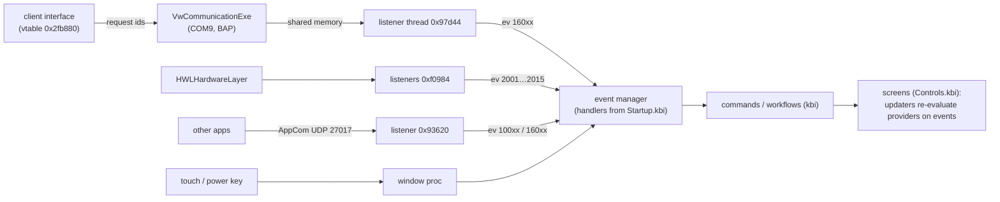

# `VwUserShell.exe` — VW main menu / car-information application

Functional + technical spec of the launcher that owns the "maps + more" home screen: main menu, car info, trip computer, gauges, eco trainer, e-up! / XL1 screens, Cupra sport pages, parking-sensor overlay, and the unit's standby / shutdown logic.
Why: it is the program a replacement shell has to imitate, and the only consumer of most car signals.

Static analysis (r2 + r2ghidra, kbi trees, settings seeds), plus runs in the emulator (2026-11-16) in which the shell was fed car data — first written into the shared memory by hand, later from the simulated radio `emulator/radio.py` — and AppCom messages by hand ([shared-memory.md](../car/shared-memory.md) §10, [appcom.md](../apps/appcom.md) §13). Nothing was run on a unit.
Legend: ✅ seen in disassembly / data / config (VA or record given) · ✅ emulator = observed running in the emulator (CE 7 guest, stubbed hardware) · 🟡 inferred / single source · ❓ unknown.
Addresses = VA in `firmware/flash/VwUserShell/VwUserShell.exe` (image base `0x10000`, ARM code only: all 12 364 `.pdata` entries carry the 32-bit flag ✅).
Related (not repeated here): kbi format, node trees, command executor, threads → [ui-framework.md](ui-framework.md) · mapping + data ids → [shared-memory.md](../car/shared-memory.md) · signal layouts and getter slots → [can-signals.md](../car/can-signals.md) · BAP payloads → [bap-functions.md](../car/bap-functions.md), [bap.md](../car/bap.md) · datagrams → [appcom.md](../apps/appcom.md) · HWL / hidden flash → [hardware-layer.md](hardware-layer.md) · VIN, password lock, skins → [brand-and-pairing.md](brand-and-pairing.md) · watchdog → [boot-and-supervision.md](boot-and-supervision.md).

Notation: `cmd #n` / `prov #n` = command / provider class id ([ui-framework.md](ui-framework.md) §4) · `ev n` = UI event id · `var n` = run-time variable · `W n` / `S n` / `C n` = record n of `Workflows.kbi` / `Startup.kbi` / `Controls_480x272.kbi` · "slot 0x…" = getter of the car-data client interface ([can-signals.md](../car/can-signals.md) §1).

## 1. Overview

| Item | Value | Evidence |
|---|---|---|
| Binary | 3.8 MB, `8.0.0 (build-314)`, built 2014-11-14, PDB `…\VW_UserShell\RelWithDebInfo\VwUserShell.pdb` | ✅ version resource, file `0x36f6b0` |
| Class names | **no RTTI**. Only 37 UTF-16 state names survive (`CVWUShProfiles*`, `CVWUShNightRates*`, `CVWCMatic*`) | ✅ file `0x2e8f3a…` |
| Start | watchdog: `VwUserShell.exe -ShowWindow=1`; window class = title = `VwUserShell` | ✅ `Watchdog_VwUserShell.ini`, `0x915f4` |
| Imports | `HWLHardwareLayer.dll` (35), `ACAppCom.dll` (58), `MMTimer.dll` (4), `WINSOCK.dll` (TCP listener of the GUI remote control), `Png.dll`, `NgAlloc.dll`, COREDLL | ✅ import table |
| Data | `VW_UserShell.nfs` (153 screens, 39 workflows, 110 start steps, empty shutdown list), `VW_UserShell_{Vw,Seat,SeatCupra,Skoda}Skin.nfs`, `TextResources.nfs` (35 languages × 956 texts), `Datastorage.nfs`, `Settings/*.default`, `EULA*.ini` | ✅ |
| Shell-specific code | 126 commands + 172 providers (ids 16001…16198), 10 + 40 car-data classes (20001…20040), 13 + 10 device classes (2001…2013, 2501…2503) | ✅ factories `0x2f9fd0`, `0x2fd668`, `0x3238a8` |

Everything visible is data: C++ supplies numbered commands (actions) and providers (conditions / values); `Startup.kbi` wires events to workflows; screens bind providers to controls. A replacement can therefore be specified as the tables below.

## 2. Process architecture

### 2.1 Start-up ✅

Application init `0x915f4`: register fonts (`ZYHei_GB18030_c.ttf`, `Arial.ttf`), read `-ShowWindow`, create the window, pick the skin from the hidden flash ([brand-and-pairing.md](brand-and-pairing.md) §5.1), open the four containers, then run `Startup.kbi` steps 0…109 in order:

| Steps | What | Notes |
|---|---|---|
| 0…7 | framework: root screen, settings files, text resources | `cmd #11, #19, #1024, #1020, #1022, #1040` 🟡 |
| 1, 2 | attach car data: `cmd #20009`, `#20008` (client interface + listener thread, channel 1) | ✅ `0xc9090`, `0xc9140` |
| 8 | create heartbeat events `VwUshAppThreadAlive`, `VwUshCommandThreadAlive`, `VwUshEventThreadAlive` (`cmd #701`) | ✅ |
| 9, 10, 68 | AppCom: connect listener, register 20 message prototypes (`cmd #16002` → `0x29e60`), announce the app (msg 21) | ✅ |
| 11 | create the priority manager (§4), set state 13 | ✅ `0x2a648` |
| 15…21, 26, 103, 105, 108, 109 | only when `NoNavigation` = 1: own brightness / day-night handling, clock from GPS, start-up wizard | §7.9 |
| 22…67, 69…72, 77…102, 104, 106, 107 | register event handlers (§3, §5) | ✅ |
| 24 | create the device-event bridge (HWL listeners, `cmd #2003` → `0xf0db8`, `0xf0984`) | ✅ |
| 28 | open `VW_Dia_MainMenu`; `var 16065 := F`, `var 16067 := T`; battery / version helpers | ✅ |
| 73…75 | developer option `ProcessSharing`: thread monitor (`cmd #1503`, 1 s timer `#1504`) | ✅ data |

### 2.2 Threads and timers

App / command / event / draw threads are the framework's ([ui-framework.md](ui-framework.md) §8). Shell additions:

| Thread / timer | Role | Evidence |
|---|---|---|
| car-data listener | waits on `CAN_DATA_EVENT1`, test-and-clears 52 data ids, raises UI events (§3.1) | ✅ `0x97d44`, ctor `0x97cb8` |
| AppCom receive | DLL thread → `IACMessageListener` `0x93620` | ✅ |
| HWL callbacks | HWL-owned threads → `0xf0ea0…0xf1328` | ✅ |
| MMTimer | `timeSetEvent` wrappers `0x17da9c / 0x17dae4 / 0x17db2c` (period from `timeGetDevCaps`): handler timers of the command thread, gauge animation | ✅ imports; users 🟡 |
| serial receiver | optional own NMEA reader (`UserSettingsSerialPortReceiver`: `COM2`, 57600; parses `GPRMC`, `GPGGA`) for clock / sunrise in `NoNavigation` mode and the Cupra G-meter "No GPS available" | ✅ strings `0x2e8f10`, settings; 🟡 use |

### 2.3 Managers (singletons; names are descriptive)

| Accessor | Object | Role |
|---|---|---|
| `0xad9b0` | car-data client interface (vtable `0x2fb880`, ~285 slots) | every signal / BAP getter and setter |
| `0xc3d8c` | vehicle configuration (hidden-flash cache: brand, class, line, sound, body type, VINs) | variant gating (§8) |
| `0x97974` | priority manager, 14 flags | which overlay owns the screen (§4) |
| `0xf46b0` | event manager | `raise(id)` = vtable `+0xc` |
| `0xf1fd8` (+`0x148`) | window + run-time variable store (int / bool / string by id) | `0xf5784` get, `0xf5fd4` set |
| `0x1c9e80` | settings store (file id, key id) | `0x1cb06c` int, `0x1cb46c` float, `0x1cb86c` vectors |
| `0x48650` | charging manager (e-up! timers, profiles, night rates; state machines `CVWUShProfiles*`, `CVWUShNightRates*`) | [bap-functions.md](../car/bap-functions.md) §8 |
| `0x36470` / `0x35844` | eco-trainer parameters (load / defaults) | §7.5 |

### 2.4 Settings persistence ✅ (`Datastorage.kbi` record 1001)

User file `\MN Settings\VwUSh\<Name>.xml`, seed `.\Settings\<Name>.default`, previous version `\MN Settings\Backup\VwUSh\<Name>.old`. A setting = (file id, key id → XPath); 23 files, 282 keys. Files and keys: §9.

## 3. Events

### 3.1 Car data → events ✅ (`0x97d44`; data ids: [shared-memory.md](../car/shared-memory.md) §4.3)

| Data id (source) | ev | Extra action in the listener |
|---|---|---|
| 1 doors (BsgKombi) | 16001 | |
| 2 engine speed · 7 gear (GwAnt2) | 16002 · 16006 | 7: AppCom msg 19 (value 2) → MobileNavigator |
| 3 ignition, terminal 15 (Bsg3) | 16004 | broadcast msg 19 (value 0) |
| 4 key contact, terminal S (Bsg3) | 16046 (now 0) / 16047 (now 1) | |
| 8 KombiK1 | 16009 | |
| 11 valid F001 (radio connected) | 16008, 20013 | msg 20 → MMPMediaPlayer, MobileNavigator, Bluetooth; temperature msg 34 |
| 38 link down / suspend | 16011, 20013, 16072 | same messages |
| 13 Systeminfo1 · 30 Gateway3 | 16054 · 16055 | |
| 14, 18, 32, 33 (Mfa1, Mfa6, Reichweite1/2) | 16024 | current consumption / range |
| 15, 19 (Mfa2, Mfa7) · 16, 20 (Mfa3, Mfa8) | 16025 · 16026 | since start · long-term |
| 21 speed | 16041; 16072 at most once per second | |
| 22 outside temperature, 82 | 20013 | msg 34 → group Temperature (`0xab3cc`) |
| 24 oil · 25 coolant · 35 boost · 36 / 37 acceleration | 16029 · 16028 · 16103 · 16104 / 16105 | |
| 28 / 29 engine flags | 16090 / 16136 | |
| 26, 27 MotorEv1 · 34 Hvem2 | 16079, 16074 · 16099 | |
| 31 steering-wheel key | 16075 | msg 42 → Bluetooth (phone key) |
| 41 · 42, 43 (OPS, LSG 0x0A) | 16017 · 16003 | |
| 49, 52 · 85 (audio, LSG 0x31) | 16033 · 16036 | |
| 54, 55, 56, 58, 59 (LSG 0x1D) | 16089, 16076, 16052, 16053, 16086 | |
| 61…63 (clock, LSG 0x11) | 16073 | |
| 67, 68, 72, 73 · 70, 71 (charging, LSG 0x25) | 16080, 16066, 16069, 16081 · 16083 | 60…66, 70…73 also feed the profile / night-rate / timer state machines (`0xc6604`) |

### 3.2 Device → events ✅ (bridge `0xf0984`; HWL listeners: [hardware-layer.md](hardware-layer.md) §4.2)

| ev | Source | ev | Source |
|---|---|---|---|
| 2001 (+2011, 2015) | power status changed (`0xf0ea0`) | 2007 / 2008 | power key pressed / released (`0xf1248`, `0xf12b8`) |
| 2002 / 2003 | storage card removed / inserted 🟡 order (`0xf0f74`) | 2009 / 2010 | cradle connected / disconnected (`0xf10a4`) |
| 2005 / 2006 | suspending / resumed (`0xf11a8`) | 2012…2014 | proximity (never fires) |

### 3.3 AppCom → events ✅ (`0x93620`; ids as in [appcom.md](../apps/appcom.md) §9, meanings added here)

| Msg | Meaning revealed by the shell | Reaction |
|---|---|---|
| 28 `[I 1]` | **power key pressed** (whoever is in front forwards it; the shell broadcasts 28 with 0 then 1 itself on ev 2007) | ev 10001 → `W 3` |
| 40 | navigation announces itself after its start | ev 10006 → `S 104`: password check, EULA, autostart apps, start MediaPlayer hidden (§7.3) |
| 21 `[S name]` | app is up | answer msg 20 to media / nav / phone |
| 2 | setting changed (2 = language) | `0x92ff8` → ev 10002, 10005, 16019, 16020, 16030 |
| 4 `[I state,…]` | phone call state: 7 → flag `P_IC` on; 4, 5, 8, 9 → flag `P_OC` on; else both off | var + ev 16021 |
| 16 `[I n]` | other apps set / clear shell priority flags: 0/1 `P_PIN`, 2/3 `P_IS`, 4/5 `P_WM`, 6/7 `P_ISI`, 8/9 `P_TA` (even = on) | §4 |
| 27 | clear flag `P_FE` (fuel prompt answered in the navigation) | |
| 22 `[I state, S, I flag]` | navigation / GPS status; state 2 = time valid | vars + ev 16018; state 2: `GetSystemTime` → slots 0x404 / 0x40C = **push GPS time and date to the car** (BAP LSG 0x11) |
| 23, 48 | media / navigation status values for the status bar | vars + ev 16022 / 16094 |
| 30 `[S, S]` | Bluetooth core + firmware version strings | ev 16132 → product-info texts (`cmd #16118`) |
| 36 / 37 | another MN8 app is suspending / has resumed | ev 1501 / 1502, 1503 → flag `P_SRH` on / off |
| 51 `[S, S, I]` | text entered in the navigation's keyboard (answer to the shell's own msg 51) | ev 16127 → open `VW_Popup_BlueTrainer2_SaveTrip` 🟡 |
| 52 | screenshot switches: start `ScreenShot` / close window `ScreenShotMaker` | |
| 29 `[prio, soundType, released, audioSource, extra]` | sound-manager claim / release of any program ([media-audio.md](media-audio.md) §5) | listener `0x94c68` → winner table `0x945e4`; on a winner change: wave master + radio request (§4.1) |

Messages the shell sends: §6.

## 4. Priority manager ("who owns the screen") ✅

14 boolean flags; the **lowest set index wins** (`0x979d4`). Names from the debug page `0x55958`:

| # | Name | Set by | Meaning |
|---|---|---|---|
| 0 | `P_ISI` | `S 108`, msg 16 (6/7) | start-up wizard 🟡 |
| 1 | `P_IC` | msg 4 state 7 | incoming call |
| 2 | `P_PIN` | `W 15`, msg 16 (0/1) | password dialog |
| 3 | `P_SRH` | ev 1501 / 1503, resume | suspend cover |
| 4 | `P_OPS` | OPS pop-up | parking sensors |
| 5 | `P_CAR` | car-outline pop-up | open door picture |
| 6 | `P_OC` | msg 4 states 4, 5, 8, 9 | call in progress |
| 7 | `P_IS` | msg 16 (2/3) | ❓ |
| 8 | `P_HMI` | `W 29` / `W 20` | HMI off |
| 9 | `P_FE` | KombiK1 bit 1 (`cmd #16014`) | low-fuel prompt |
| 10 | `P_WM` | battery pop-ups, msg 16 (4/5) | warning message |
| 11 | `P_RHM` | `S 39`: radio connected ∧ operation state known ∧ not 0 / 2 | radio not in normal operation (off / stand-by) 🟡 |
| 12 | `P_TA` | msg 16 (8/9) | traffic announcement |
| 13 | `P_AO` | `S 11` (always) | default |

✅ emulator: the winner index is what the shell sends in AppCom message 31; seen 13 at rest, 0 while navigon's first-start wizard is up (so `P_ISI` = start-up wizard), 1 and 6 after hand-made phone states 7 and 5, 5 with the door overlay, 8 with HMI off, 12 after message 16 value 8.

`cmd #16013 {101: index, 102: on}` (`0x19a58` → `0x97bd4`) sets a flag. On every change of the winner (`0x97a2c`): store it in var 10501, **send msg 31 `[I winner]` to group `Settings`**, raise ev 16037; entering 4 / 5 / 9 / 12 also raises ev 16003 / 16001 / 16009 / 20010. → msg 31 = "shell overlay state" for the other apps.

Foreground hand-over: `cmd #16016` (`0x146c0`) remembers the current foreground app (var 16010, nesting counter var 16003) and brings the shell to front (`StartApplication("VwUserShell", 0, true)`); `cmd #16017` (`0x13ebc`) decrements and, at zero, restarts the remembered app (PictureViewer with `-Mode=PICTURE`).

### 4.1 Sound manager → radio ✅ (policy owner: [media-audio.md](media-audio.md) §5)

The shell is the only program that asks the radio for an audio source / channel. Two entry points, same action:

- AppCom msg 29 listener `0x94c68` (→ `0x945e4`): keeps the table prio → {released, soundType, audioSource}; the claimed entry with the lowest prio wins.
- `cmd #16029` (`0x1dc2c`), run on priority-manager changes, only if the radio is connected and the LSG 0x2D operation state is 0, 1 or 2.

Action: `waveOutSetVolume(device 0, …)` = wave master 0 while a phone call is the winner, else maximum; then client slot 0x2FC (`0x94458`, the only caller in the firmware) with the (radio source, audio channel) pair for the winner — table in [media-audio.md](media-audio.md) §5.1, state machine in [bap-functions.md](../car/bap-functions.md) §4.5. The `SoundPrio` keys of `ApplicationSettings` (§9) are these priorities, so they **are** used.

## 5. Power, standby and input behaviour

Device commands ✅: `#2001` ResetDevice (`0xef3ac`, **unused in the data**) · `#2002` SuspendDevice (`0xef32c`) · `#2009` ShutdownDevice (`0xef2ac`) · `#2010 {101: mute}` SetMuteDeviceSpeakers (`0xeec6c`) · `#2013` ResetToFactorySettings (`0xeeacc`) · `#2012` CalibrateTouchscreen · `#2005 / #2006` dismount / mount partition.
Device providers ✅: `#2001` battery symbol 0…6 (> 66 %, > 33 %, > 0, 0 on battery; 4 charging, 5 external, 6 external + weak; `0xefc44`) · `#2003` power source: 0 battery, 1 external, 2 battery and never external since start (`0xf03b8`) · `#2004` external but not the Navigon charger · `#2005` power key held 🟡 (`0xf0590`) · `#2502` storage card present · `#2503` cradle **dis**connected (`0xefa48`; with `100=T`: connected).
Car providers ✅: `#20001` valid F001 = "radio connected" (slot 0x04) · `#20002` ignition on (slot 0x0C) · `#20037` key in, terminal S (slot 0x08) · `#20007` audio FSG operation state (LSG 0x31 fct 0x0F, slot 0x1F8) is 0 or 2 = "radio operating" (`0xcce70`; 🟡 radio switched on) · `#20021` that state is known at all (`0xcb62c`) · `#20018` central-locking bit (slot 0xC8).

### 5.1 Rules (decoded from `Startup.kbi` + `Workflows.kbi`) ✅ data, 🟡 wording

✅ emulator for three rows: (1) radio connected, then ignition and key off → standby pop-up "The device will switch to standby mode in a few seconds" with a countdown; ignition back on closes it; left alone it ends in message 38 `(0, 2, 0)` + message 36 and a suspend request (the emulator just carries on). (2) Message 28 `[1]` with radio connected → HMI-off screen with logo, clock, date and the injected outside temperature; a tap ends it. (3) The resume row's pair message 37 (0), 1 s, message 37 (4) — also seen after the EULA box and after HMI off.

| Trigger | Condition | Result |
|---|---|---|
| Ignition / key / radio change (ev 16004, 16046, 16047, 16008, 16011, 16033 → `S 34` → `W 14`) | ignition off ∧ (radio not operating ∨ key removed) ∧ not yet shown for this stop (`var 16067`) ∧ no standby countdown running (`var 16065`) ∧ no phone call (`P_IC`, `P_OC`; else retried on the next phone-state change, `S 29`) | **Good-bye pop-up**, 30 s countdown, text 836 "The device will switch to standby mode in a few seconds." (`Popup_MessageBox_2Btn_NoTimed_CountDown`; e-up! with a programmed departure timer: `…_Timed_CountDown` showing it, `prov #16181`). Cancel → stay on; OK or time-out → **suspend**. Shell comes to front; msg 38 `(0, 0, 0)` sent |
| same | ignition on ∨ radio operating | pop-up closed, previous app restored, `var 16067 := F` (re-armed), msg 38 `(0, 1, 0)` |
| External power lost (ev 2001 → `S 30` → `W 17`) | on battery ∧ has been on external power since start (`var 16087`) ∧ no other power pop-up | **Standby pop-up** (`Popup_MessageBox_2Btn_CountDown`, text 836, 30 s) → suspend. External power back → pop-up closed |
| Battery level (ev 2001 → `cmd #16114` `0x1bea8` → `W 16`), thresholds `BatteryWarningThresholds` = 10 / 5 / 2 %, only on battery | ≤ 10 % · ≤ 5 % · ≤ 2 % | `Popup_Battery_Warning_Low` · `…_Nearly_Critical` (each once) · 30 s countdown, text 840 "The battery is nearly flat…" → **suspend** |
| Power key (ev 2007, or msg 28 from the app in front → `W 3`) | radio connected, no OPS / door overlay | toggle **HMI off** (`W 29` / `W 20`): `VW_PopUp_HMI_OFF` = picture + clock + date + outside temperature (§7.8); any tap or key ends it |
| Power key | not connected to a radio | **Good-bye screen** (`W 30`, `Popup_MessageBox_3Btn_CountDown`, 4 s): buttons quit / "Standby" (838) / "Switch off" (839 → `#2009` **shutdown**); time-out → suspend. Key still held after 5 s → shutdown (timer + `prov #2005`; released, ev 2008 → timer removed) |
| Suspend (`W 31`) | – | freeze the window (`cmd #48 F`), msg 38 `(0, 2, 0)`, msg 36 → `Settings`, show `VW_PopUp_SuspendCover` (`…_Fender` if the sound-system flag is set), 800 ms later `#2002` |
| Resume (ev 2006: `S 33, 35, 36, 100`) | – | msg 37 (0), after 1 s unfreeze + msg 37 (4) + close the cover; end HMI off; speaker rule below; password check (`W 15`) |
| Cradle connected (ev 2009 → `W 13`) | – | mute the device speaker; `var 16036 := T` |
| Cradle disconnected (ev 2010 → `W 22`) / resume (`W 19`) | after 3.1 s / 0.7 s still no radio connection | unmute the device speaker (audio no longer goes to the radio) |
| Undocked or ignition off (ev 2010, 16004, 16008: `S 57, 58`) | Cupra: sport screens open · e-up!: charging pop-ups open | back to main menu, stopwatch stopped · back to `VW_Dia_Charging_Main` |
| Card removed (ev 2002 → `W 23`) | Cupra stopwatch screens | back to `VW_Dia_CupraSport_Main` |

- ✅ emulator, radio link: every loss of the link (data id 38) starts the good-bye countdown — message 38 `(0, 0, 0)` — and the handshake plus ignition, arriving 0.1 s later, cancel it with `(0, 1, 0)`; too short to see on screen. At rest (stand-in hardware: in the cradle, cradle supply, battery full) no power pop-up appears, with or without radio.
- No reset rule exists in the data; resets come from the watchdog / factory reset only. No orderly shutdown sequence either (`Shutdown.kbi` holds 15 empty steps).
- **No speed-dependent lock-out** was found: `prov #20020 / #20022` (speed thresholds) exist in the code but are unused in the data ✅; standstill is only checked by the eco trainer (pop-ups closed when moving, `W 24`) and the Cupra stopwatch.
- msg 38 `(0, phase, 0)`: 0 = countdown shown, 1 = cancelled / normal, 2 = suspending. msg 36 / 37 = suspend / resume notice (§3.3).

### 5.2 Steering-wheel keys ✅ / 🟡

VwCom turns `0x5C1` into press counters ([can-signals.md](../car/can-signals.md) §3.10). The shell only relays: data id 31 → msg 42 to `Bluetooth` + ev 16075 ✅ (`0x97d44`); no handler for ev 16075 exists in the shell data, and the arrow counters (slot 0x1C8) are not read by any shell class used in the data: that is the media player's job ✅ (data id 79 → slot 0x1C8, [media-audio.md](media-audio.md) §8.4). `UseRightArrowAsPhoneButton` is VwCom's ini key ([shared-memory.md](../car/shared-memory.md)); the shell has no key map of its own.

### 5.3 Touch

Framework ([ui-framework.md](ui-framework.md) §5.1). Hidden input: none found — no key sequence, no hot corner; developer items are plain menu rows gated by a variable (§7.10).

## 6. Messages the shell sends ✅ (call sites; payload shapes in [appcom.md](../apps/appcom.md))

| Msg | To | When / meaning |
|---|---|---|
| 31 `[I]` | group Settings | priority winner changed (§4) |
| 38 `[I, I, I]`, 36, 37 | group Settings | standby countdown / suspend / resume (§5) |
| 28 `[I]` | broadcast | power key (0, then 1) |
| 19 `[I]` | broadcast (0) · MobileNavigator (2) | ignition changed · gear changed |
| 20 | MMPMediaPlayer, MobileNavigator, Bluetooth | radio connected / lost; answer to 21 |
| 34 `[I, S]` | group Temperature | outside temperature (slot 0x7C) as number + text |
| 2 | group Settings | own settings changed (language, units, display mode…) |
| 18 | MobileNavigator | low-fuel flag changed (`cmd #16014`, KombiK1 bit 1) → the navigation offers the filling-station search ("Please refuel… search now?") ✅ handler in navigon ([navigation.md](navigation.md) §8.1) |
| 41 | MobileNavigator | e-up! battery warning (`cmd #16068`: SOC slot 0x3D0, flag 0x3DC, ranges) |
| 39 `[I]` | MobileNavigator | remaining range (`cmd #16057`, ev 16024) |
| 49 `[I]` | MobileNavigator | HV power (`cmd #16084`, slot 0x3E0) 🟡 |
| 44 `[I]` | MobileNavigator | `0x1890c`: MotorEv1 value × 3600 🟡 |
| 45 `[I ×12]` | MobileNavigator | on ignition change (`cmd #16071`); navigon packs it into a 15-byte vehicle-status record for its core 🟡 ([navigation.md](navigation.md) §8.1); field meaning ❓ |
| 51 | MobileNavigator | ask for a text (trip name) (`cmd #16106`) 🟡; navigon answers with msg 51 (position / destination description) |
| 29 | group Volume | sound-manager claim / release (shared MN8 code; §4.1) |
| 42 | Bluetooth | steering-wheel phone key |
| 11013 `[I, I, I]` | group `SpeedInfoCan` (no member) | speed, ≤ 1/s (`cmd #16066`) |
| 24 / 25 / 26 | MMPMediaPlayer | `cmd #10004…#10006`: player mode before showing it |

## 7. Screens and features

Screen ids = `Controls` record numbers. Every screen carries the same status bar: clock / date (tap toggles), outside temperature, GPS (var 16005), battery (`prov #2001`), phone (var 16006), media (var 16007).

### 7.1 Main menu (`C 1`) ✅

| Tile | Action |
|---|---|
| Car info (text 14) | roll menu: `C 537` (eco trainer present), `C 539` (none), `C 535` (Seat Cupra) |
| Media (13) | roll menu `C 542`: Radio → `MMPMediaPlayer -Mode=RADIO`; Media Player → `-Mode=LAST_KNOWN`; Pictures → `MMPPictureViewer -Mode=PICTURE` (needs a card). Radio / media rows need radio connected + operating (or `IgnorePidStatus`); refused during a call (text 92) |
| Navigation (216) | `cmd #10001 "MobileNavigator"` (`StartApplication`). With `NoNavigation` = 1 this tile is Phone and the fourth is General → `VW_Dia_SettingsMenu` |
| Phone (78) | `cmd #10001 "Bluetooth"` |
| bottom-left button | power-key function (`W 3`) |
| "more" bar (139 / 446 "Apps") | `VW_PopUp_Browse_Apps` (`C 548`): list from the AppCom registry (`cmd #16039` `0x1c15c`: visible apps, icon, translated name), tap → start with ` language=… skin=…` |
| options roll menu (`C 1361`) | Manual (136 → `cmd #16035` starts ManualReader) · more · developer rows (§7.10) |

Car roll menu rows: Trip computer (`C 2`) · Think Blue. Trainer / ECOTRAINER (Seat) (§7.5) · slide show (if enabled in `UserSettingsSlideShow`) · Status = gauges (`C 3`) · EV interface (e-up!) / Hybrid (XL1) → `W 10` picks energy monitor `C 5`, recuperation `C 7` or charging `C 6` from the last tab (var 16014) · Performance Display (Cupra, needs docked + ignition).

### 7.2 Car outline and parking sensors ✅

- **Doors** (`cmd #16001`, `0x1edfc`; slots 0x90…0xA4): on ev 16001 / 16008 / 16011 opens `VW_PopUp_CarOutline` (`W 11`) when a door, hood or boot is open and closes it (`W 6`) when all are shut. Gate (`S 41`): (navigation has started ∨ `NoNavigation`) ∧ (central-locking bit ∨ `IgnoreCentralLocking` ∨ `NoNavigation`). Picture set by vehicle: `VW_CarOutline_{019_2doors, 120_3doors, 120_5doors, 250_5doors, 253_5doors, 254_3doors, 254_3doors_cupra}` chosen by `prov #20027…#20030` (body type, door count, brand, class).
- **OPS** (`cmd #16011`, `0x28e08`; BAP LSG 0x0A, slots 0x54…0x60, 0x1E4): on ev 16003 / 16008 opens `VW_PopUp_OPS` (`W 12`) while the car reports the display request, closes it (`W 8`, `cmd #16030` = slot 0x1E0 "user closed") otherwise; variants `VW_OPS_{019, 120_3doors, 120_5doors, 250_3doors, 250_5doors, 250_8Sensor, 253, 253_8Sensor, 254_8Sensor, 254_Cupra}`. Details: [bap-functions.md](../car/bap-functions.md) §3.
- Both overlays set priority flags 5 / 4 and are suppressed while the power-key logic runs.
- ✅ emulator (doors, also with the simulated radio: picture in [can-signals.md](../car/can-signals.md) §9): the overlay is (re)evaluated on a door change or a radio connect, not when message 40 arrives, and not while navigon's first-start wizard holds priority flag 0. With the central-locking bit set and a door bit raised nothing happened until message 40 had arrived; then the outline opened with the right door / boot / hood drawn and closed when all bits were 0 ([can-signals.md](../car/can-signals.md) §9).

### 7.3 Start of other programs ✅

- `S 104` on ev 10006 (navigation's msg 40; in `NoNavigation` mode raised by the shell itself): password workflow; EULA box when `SHOW_EULA` = 1 (text of section `[EULA]`, key = `LanguageLocale`, from `EULA.ini`, or from `EULA_TM.ini` when `NoNavigation` = 1 ✅ `0xac5e0`; Cancel → `#2009` shutdown; OK → `cmd #16111` 🟡 stores the acceptance); `cmd #10504` starts every registry app with `<Autostart>`; **`cmd #16021 {'-Mode=NOCONN -ShowWindow=0'}` starts `MediaPlayer.exe` hidden** (`0x1cffc`: `StartApplication("MMPMediaPlayer", " -Language=\"<lc>\" …")`). → answers [boot-and-supervision.md](boot-and-supervision.md): the watchdog only adopts the media player; the shell creates it. ✅ emulator: on message 40 (navigon's real one, and a hand-made one) the shell logged `CreateProcess '…\MediaPlayer\MediaPlayer.exe' with arguments '-Mode=NOCONN -ShowWindow=0 -Language="eng-GBR"'`, the window `MMPMediaPlayer` existed hidden, and the EULA box came up; password workflow and autostart apps not exercised.
- Navigation and phone are started by the watchdog; the shell only brings them to front. ✅ emulator (no watchdog there): tapping Navigation made the shell start `navigon.exe` through `StartApplication`, and navigon in turn started `PhoneApplication.exe -T"SW_HIDE"` — the AppCom start path works as a fallback.
- `-ShowWindow=0` ✅ emulator: the shell runs with its window created but hidden.

### 7.4 Trip computer (`C 2`) ✅ data, values via [can-signals.md](../car/can-signals.md) §3.6

Three data sets chosen with the roll menu `VW_RollMenu_TripModes` and stored in `ActiveTrip` (0 long-term, 1 since start, 2 since refuel; the code uses mode ids 0x3E81…0x3E83): average consumption, distance, driving time, average speed from Mfa2 / Mfa3 / Mfa4 (electric: Mfa6…8), plus current consumption and range from Mfa1 (ev 16024…16026). Display rules come from `UserSettingsTrip`: clamp to Min / Max per unit, integer display above `DisplayIntegerWiseFrom`, and current consumption switches to the per-hour unit below 3 km/h (back above 5 km/h, `VelocityRange`). Units follow the car's unit flags. `VW_PopUp_CruisingRange` shows total / primary / secondary range (CNG, hybrid). ✅ emulator (petrol car, VW skin): the mode menu offered two entries, "Since start" (showed the Mfa2 values) and "Long term" (Mfa3); range and current consumption came from Mfa1; units followed the unit code and flags ([can-signals.md](../car/can-signals.md) §3.6). Refuel detection for "since refuel" on cars without that data set: SOC jump ≥ `RefuelDetectionBatterySocDelta` (25 %) or CNG range jump ≥ `RefuelDetectionCngRangeDelta` (100) 🟡.

### 7.5 Think Blue. Trainer / ECOTRAINER ✅ parameters, 🟡 algorithm

Screens: status (`C 8`; variants `…019`, `…Seat12X3 / 12X5 / 253 / 2503 / 2505` picked by `W 4` from class, body type, doors), analysis (`C 9`: blue-score and consumption history, trip list / save / compare), training (`C 10`: 15 exercises in 5 levels, `Datastorage` record 16056), energy-saving tips. Only in the car the unit was first branded in (VIN check `prov #20035`, text 761), unless `DriveAssistDevMode`.

Inputs ✅: speed (0x74), distance integrator (0x78), engine speed (0x10), engine flags (0x20 / 0x24: overrun cut-off / clutch 🟡), gear + recommended gear (0x2C / 0x30), longitudinal acceleration (0x1BC), current / average consumption, electric drive state (LSG 0x1D), ignition. Driving states (debug texts `0x2e73e0…`): STANDSTILL, CORRECT GEAR (+ TIMEOUT), WRONG GEAR, FREE WHEEL (± brake, ± clutch, D / N), OVERRUN FUEL CUTOFF (± brake), RECUPERATION (± brake), BOOST. Gearbox classes: MSG (manual), ASG, ASG Tiptronic (± gear recommendation), Electro.

Score 🟡 (from parameter names and consumers `0x38408`, `0x395ec`, `0x38ba8`, `0x36150`, `0x3c324`): every `TBBestimmungMs` the state is classified; a gear-shift rating (shift within `SchaltPruefZeitMs` of the recommendation) and an anticipation rating (acceleration against `AGrenz±`, braking / coasting share) are mapped through the `VecYRating*` curves and combined with the `VecYWeightSchalten*` / `VecYWeightVorauss*` weights of the gearbox class into 0…100 "blue points"; points are averaged per `TSegmentSekunde`, 5-minute blocks and trip, and stored in `UserSettingsThinkBlueStorage` (history, trips, exercises, VIN). Exact formulas ❓.

Compiled defaults ✅ (`0x35844`; overridable by `UserSettingsThinkBlueMain.xml`, for which no seed file is shipped):

| Key (`/Settings/ThinkBlue…`) | Default | Key | Default |
|---|---|---|---|
| `AGrenzNegative` / `AGrenzPositive` | −1.5 / +1.5 🟡 (m/s²) | `TBBestimmungMs` | 200 |
| `LWechselAnzahl` | 3 | `TFadeInMs` / `TFadeOutMs` | 150 / 150 |
| `PmBremsen` / `PmKickdown` / `PmRekup` / `PmSegeln` | 340 / 3400 / 1020 / 950 | `TIconAnzeigeS` | 2 |
| `RedBp` | 4 | `TLastIntervallS` | 30 |
| `SDifferenzKm` / `SFahrtLaengeKm` | 2 / 2 | `TSegmentSekunde` | 5 |
| `SchaltAnzahlMin` / `SchaltPruefZeitMs` | 0 / 500 | `TStillstandS` | 2 |
| `TripMaxAnzahl` | 15 | `TVKonstantMinutes` | 5 |
| `VAnfahrenKmh` / `VBremsenKmh` | 25 / 25 | `TZeitGeschwIconS` / `…OffS` | 10 / 180 |
| `VGeschwIconKmh` (electric: `VemGeschwIconKmh`) | 105 (83) | `TZeitVorausschauIconS` | 10 |
| `VGeschwredKmh` / `VStandKmh` | 30 / 6 | `TZeitintervallVoraussMS` | 1200 |
| `VecVXKmh`, `VecVGXKmh` (electric) | 83, 123, 143 (33, 83, 123) | `XBlauGrenz` / `XGrauGrenz` | 100 / 20 |
| `VerbrMaxL100Km` / `Mpg` / `Kml` (`KmlSam`) | 15 / 120 / 50 (25) | `VerbrMaxKg100Km` / `MiKg` / `Kwh100Km` / `MpKwh` / `KmKwh` | 10 / 60 / 30 / 10 / 15 |

### 7.6 Gauges ("Tubes", `C 3`; Cupra `C 14`) ✅

Two slots, each one of: 1 RPM (slot 0x10, ev 16002), 2 coolant (0x18 / 0x1C, ev 16028), 3 oil temperature (0x1B4, ev 16029), 4 gear-shift indication (0x2C…0x38, ev 16006), 5 outside temperature (0x7C, ev 20013); Cupra adds boost pressure (0x1B8, bar / psi) and average consumption. Choice in `VW_PopUp_TubeSelection` → `TubeLeft` / `TubeRight` (`cmd #16024`, `#16027`). The needle is a pre-rendered frame strip (control class 16001, 401 frames). Values are blanked without ignition / radio (ev 16004, 16008, 16011). ✅ emulator: RPM, coolant and outside-temperature needles follow the values written into the shared memory or sent by the simulated radio (scales in [can-signals.md](../car/can-signals.md) §9); the selection list offered only these three gauges; needles rest at the minimum without data, and a needle blanked by a link restart comes back only when its value changes. The dial artwork follows the hidden-flash record: white-on-black dials "1/min x1000" for class 1 / line 0 (up!), a blue-grey set "x1000 rpm" for the class 2 / line 1 record an earlier emulator build used 🟡 which of the two fields decides.

### 7.7 e-up! (fuel type 5) and XL1 (hybrid) ✅ data, BAP side in [bap-functions.md](../car/bap-functions.md) §6…§8

| Screen | Content | Feeds |
|---|---|---|
| `VW_Dia_Hybrid_EnergyMonitor` (`C 5`) | power-flow animation, level bar | LSG 0x1D (ev 16052, 16053, 16076, 16089), `prov #20031 / #20032` |
| `VW_Dia_Electro_Rekuperation` (`C 7`) | recuperation history chart, Y scale 100 / 200 / 500 (`RECUPERATION_Y_AXIS_MAXIMUM_VALUES`) | LSG 0x1D fct 0x13 filter `0x34364` (ev 16087, 16088) |
| `VW_Dia_Charging_Main` (`C 6`) + 14 pop-ups | 3 departure timers, charging locations ("profiles": name, charge current, target / minimum charge, climatisation, night rate), messages (plug, charge and climate state) | LSG 0x25 through the charging manager; clock sync LSG 0x11 first; `TIME_OFFSET_MINUTES` = 30 |
| good-bye pop-up | shows the next departure time | `prov #16181` |

### 7.8 Other features

| Feature | Facts |
|---|---|
| Cupra "Performance Display" (`C 11…22`) | welcome / disclaimer; G-force plot from lateral / longitudinal acceleration (slots 0x1C0 / 0x1BC, smoothing per `UserSettingsCupraSportMain`); two gauges; stopwatch with speed goals (0-80…0-200 km/h) and distance goals, start on movement or start lights, compare with best / average; results in `\Storage Card\Cupra\{Speed,Distance}Challenge.xml`; needs a card and a GPS fix 🟡 |
| HMI off (`C 1137`) | background bitmap 13 or the user picture `<HmiOffPath>\HmiOffBackground.bmp` (`prov #16049`); clock if `ShowClock`, date if `ShowDate`, outside temperature; 1 s refresh (`cmd #16020`) |
| Slide show (`C 4`) | plays numbered images from `SlideShowIcon/Path` (`.\MyUp`, not shipped) with frame-skipping modes; demo leftover ("Blue Trainer 2.0 Demo") |
| Clock / date | from the navigation (msg 22) or own GPS reader; formats `%H:%M` / `%I:%M`, `DateFormat` 0…6; pushed to the car (§3.3) |
| Units / language | consumption, distance and temperature units follow the car's unit flags (Mfa unit bits, Gateway3 → ev 16055); language = `LanguageLocale`, changed by msg 2 (setting 2) from the navigation or the own settings screen |
| Settings (`C 24`, `NoNavigation` only) | brightness day / night, display mode, time / date format, temperature unit, language, time zone, touch calibration (`#2012`), factory reset (`#2013` after deleting the `FactoryReset` list), password lock (`cmd #16122 / #16123`), product info (`C 559`: versions from `..\NAVIGON\Version.xml`, CE / hardware / BT via HWL) |
| Password lock | `W 15` ([brand-and-pairing.md](brand-and-pairing.md) §6.2) |
| Radio / media texts from the radio | not shown by the shell; the media player reads LSG 0x31 itself. The shell only uses the operation state and the announcement flag |

### 7.9 `NoNavigation` mode (`ApplicationSettings/NoNavigation` = 1) ✅ data

Variant without `navigon.exe` (language list `eng-JPN`, `chi-CHN` → 🟡 Japan / China units). The shell then does what the navigation normally does: start-up wizard (`C 1325`, language + EULA), day / night switching (display mode 16001 day / 16002 night / 16003 automatic; automatic = sunrise / sunset from the GPS position with `Dawn` / `Dusk` offsets, smooth brightness steps every `NoNavBrightnessUpdateTime`; `W 9`, `cmd #16125…#16129`, `SetBrightness`), temperature broadcast, own settings menu, phone tile instead of navigation.

### 7.10 Developer / test features ✅ data

No hidden gesture. Everything hangs on `\MN Settings\VwUSh\UserSettingsDevMode.xml` (file id 1001, **no seed shipped** → all off) and var 1009 (= developer mode on 🟡, from `/Settings/Active`):

| Key | Effect |
|---|---|
| `Active` | shows the DEV rows of the options menu: "DEV Show Car Outline" (`W 11`), "DEV Show OPS" (`W 12`), "DEV Send TA Event" (`cmd #20003`), status-bar debug cells (radio connected / radio on / ignition, priority name `P_…`) |
| `IgnorePidStatus` | radio / media menu rows usable without a radio |
| `IgnoreCentralLocking` | door overlay without the locking bit |
| `DriveAssistDevMode` | eco trainer / Cupra pages without the VIN check |
| `ConsumptionSimulation`, `RpmSimulation`, `OpsSimulation` (value lists) | simulated inputs 🟡 |
| `ProcessSharing` | thread monitor ("ProcessMonitor") |
| `WriteBrandDeviceReg` | 🟡 by name: creates the `BrandDevice.reg` marker that re-opens branding at the next boot ([brand-and-pairing.md](brand-and-pairing.md) §4.1) |

Debug text pages exist in the code (gear `0x70714`, device info `0x5a6cc`, priority `0x55958`); the "simulation" texts ("DEV Start Simulation", "DEV Instrumententafel", "DEV Quit") have no control in the shipped data. The framework's remote control (TCP listener `0x234448…`, script verbs `MouseDown / MouseUp / MouseMove / Sleep`) is separate ([ui-framework.md](ui-framework.md)).

## 8. Variants at run time ✅

All from the hidden-flash record written by `VwBrandDevice` ([brand-and-pairing.md](brand-and-pairing.md) §2), read through `0xc3d8c`:

| Provider | Field | Used for |
|---|---|---|
| `#20029` | brand (0 VW, 2 Seat, 3 Skoda) | texts "more" / "Apps", skin, `skin=` argument |
| `#20030` | vehicle class (0 A000, 1 A00, 2 A0) | car pictures, eco-trainer screen |
| `#20027` · `#20028` | body type · door count (FourDoor / derivative) | car pictures |
| `#20034` | brand 2 ∧ line 1 = **Seat Cupra** | Cupra menu, sport pages, Cupra skin |
| `#20038` | brand 0 ∧ class 0 ∧ body type 9 = **"019" = XL1** 🟡 | hybrid monitor, `…019` screens, `MaxVW019` limits |
| `#20039` | sound-system flag | Fender suspend cover |
| `#20033` / `#20024`, slot 0xE4 | fuel type 1 petrol, 2 diesel, 3 CNG, 4 LPG, 5 electric, 6 hybrid | units, e-up! screens, tips, warnings |
| `#20040`, `#16195` | eco trainer generation / availability 🟡 | which trainer row |

Picture codes: 120 = up! / Mii / Citigo, 250 / 253 / 254 = A0 models (Polo, Ibiza…), 019 = XL1 🟡.

## 9. Settings files ✅ (`Settings/*.default`; file id, key id from `Datastorage`)

| File (id) | Keys: default — meaning |
|---|---|
| `ApplicationSettings` (16006) | `SoundPrio/{Advice 4, Voice 3, Bluetooth 1, MultiMedia 5, CarInfo 0}` · `DisableButtonOn019` 0 · `RefuelDetectionBatterySocDelta` 25.0 · `RefuelDetectionCngRangeDelta` 100 · `ChargingManagerNoRealGPSCheck` 0 · `SHOW_EULA` 1 · `NoNavigation` 0 · `BatteryWarningThresholds` 10, 5, 2 · `LanguageLocale` eng-GBR · `IsSouthAmericaVersion` 0 |
| `ApplicationPerformance` (1004, read-only) | `ImageCacheSize` 3600 |
| `FactoryReset` (16009) | `Del` list: `./HmiOff/HmiOffBackground.bmp`, `./HmiOff` |
| `FolderCreationBlacklist` (1501, read-only) | `\MN Settings`, `\My Flash Disk`, `\Storage Card` — never created when missing (late mounts) |
| `UserData` (16010), `UserSettingsEcoStorage` (16007), `UserSettingsElectroStorage` (16011), `UserSettingsCupraSportChallenge` (16016 / 16017 on the card) | empty stores: run-time data (recuperation history, charger timers / profiles, challenges) |
| `UserSettingsCar` (16001) | `Product` MN · `Version` 7.0 · `Car/Vendor` 0 · `Car/Gear` 2 · `Car/Doors` 5 (+ run-time `LastVehicleType`, `LastFuelType`) |
| `UserSettingsCupraSportMain` (16015) | `GForceHaloSize` 15 · `AccelerationXFactor` 0.9 g · `AccelerationYFactor` 10.0 / `…Negative` 15.96875 m/s² · smoothing weights 0.5 / 0.95 over distance 1.0 · straight / smooth interpolation 0 / 1 (50 ms steps) · `ChronoStart` 0 (0 countdown, 1 on movement) · `ChronoCompare` 0 (0 best, 1 average) · speed goals 80…200 km/h, 50…125 mph · challenge file names |
| `UserSettingsElectroMain` (16012) | `TIME_OFFSET_MINUTES` 30 · `RECUPERATION_Y_AXIS_MAXIMUM_VALUES` 100, 200, 500 |
| `UserSettingsHmiOff` (16004) | `ShowClock` 1 · `ShowDate` 1 · `HmiOffPath` ./HmiOff |
| `UserSettingsLocale` (1003) | `DateFormat` 0…6 (`%Y-%m-%d`, `%d.%m.%Y`, `%d-%m-%Y`, `%d/%m/%Y`, `%m.%d.%Y`, `%m/%d/%Y`, `%Y.%m.%d`) · `DateFormatActive` 1 |
| `UserSettingsNoNavigation` (16019) | brightness day 8 / night 1 · display mode 16003 (auto) · show time + temperature 1 · time format 16001 · date format 16002 · temperature unit 16001 · language eng-GBR · `Dawn` / `Dusk` −30, `Day` 4, `Night` 3, `Delay` 30 · start phase 0 (day) · update time 300 000 ms · time zone 16001 · wizard complete 0 · language list eng-JPN, chi-CHN |
| `UserSettingsSerialPortReceiver` (16018) | port 2 · 57600 baud · prefix `COM` · log off (`/Storage Card/GpsLog.txt`) |
| `UserSettingsSlideShow` (16008) | slide show 0: enabled, "Blue Trainer 2.0 Demo", frame handling 0 (0 all, 1 skip late, 2 skip short), long frame 500 ms, path `.\MyUp`, max 1024 images |
| `UserSettingsThinkBlueStorage` (16014) | VIN, history arrays, 15 exercises `0|0`, 3 exercises per level, current level 0, trip counter 1 |
| `UserSettingsThinkBlueMain` (16013) | no seed; defaults compiled in (§7.5) |
| `UserSettingsTrip` (16003) | `ActiveTrip` 0 · per unit Min / Max / `DisplayIntegerWiseFrom` (×10): l/100 km 0…499; mpg 43…2000 (XL1 4000), integer from 1000; km/l 20…850, from 200; kg, kWh, kW units; `VelocityRange` 300…500 (km/h × 100) · range 0…3000 km / 0…2000 mi |
| `UserSettingsTubes` (16002) | `TubeLeft` 1 · `TubeRight` 2 (1 RPM, 2 coolant, 3 oil, 4 gear shift, 5 outside temp) · `TubeInvalidSpeed` −0.09 · `TemperatureUnit` 0 · `PressureUnit` 1 (bar) · `ConsumptionUnit` 0 (l/100 km) · `TubePerformance` 1 (1 rpm, 2 pressure) |
| `UserSettingsDevMode` (1001) | no seed (§7.10) |
| `../NAVIGON/Version.xml` (1006, read-only) | `/config/software/{version, build, platform, copyright, id, productid, romimage/version, bluetooth/core/version, bluetooth/firmware/version, productprefix}` for the product-info page |

## 10. How to reimplement / interoperate

Minimal replacement shell (same dock, original `VwCommunicationExe` or an own link layer):

1. **Inputs**: ignition (Bsg3 bit 1), key contact (bit 0), "radio connected" (valid F001), radio operation state (LSG 0x31 fct 0x0F), doors, OPS request, external power, cradle, power key.
2. **State**: the 14 priority flags (§4) + four booleans (`goodbyeShown`, `standbyRunning`, `wasOnExternalPower`, `hmiOff`).
3. **Rules**: the table in §5.1 — they are the complete power policy; nothing else suspends or switches the unit off.
4. **Outputs to other programs** (only if the original apps stay): msg 31 on every overlay change, 38 / 36 / 37 around suspend, 28 for the power key, 20 on radio connect, 34 for the temperature; start MediaPlayer hidden after the navigation's msg 40. Also the sound manager of §4.1: without it nobody asks the radio to play the unit's audio.
5. **Car services worth keeping**: push the GPS time to the car (LSG 0x11) before using charging timers; answer the OPS display handshake (slot 0x1E0 on close).
6. **Screens**: draw from the kbi data ([ui-framework.md](ui-framework.md) §11) or re-create: tiles (§7.1), trip values with the clamping rules of `UserSettingsTrip`, gauges, door / OPS pictures.

Hooks for the original shell: own programs under `Apps\` appear in "more" (§7.1); `UserSettingsDevMode.xml` enables the test rows; `ApplicationSettings.xml` `NoNavigation` = 1 gives a shell that runs without `navigon.exe` 🟡 (untested).

## 11. Open questions

- Eco-trainer formulas (rating curves, exact state machine `0x3b94c`, exercise evaluation); meaning of the `Pm*` thresholds' unit.
- Meaning of flags `P_IS`, `P_ISI`, `P_AO`; what the audio operation-state values 0 / 1 / 2 mean on the radio side (`P_RHM`, "radio operating").
- `cmd #1` keys as used by the shell data: `101` = control id, `100` = 0 show / 1 hide (default 2 = toggle, ctor `0x160760`) — [ui-framework.md](ui-framework.md) §5.2 now says the same.
- Field meaning of msg 45 (12 integers) and the units of 44 / 49 (receiver side: [navigation.md](navigation.md) §8.1; msg 51 is answered by navigon).
- Which model is "019" (XL1 is inferred from class `A000` + hybrid texts); codes 250 / 253 / 254.
- How var 1009 (developer mode) is derived; effect of the three `*Simulation` lists. (`SoundPrio` is used: §4.1.)
- `cmd #48` (window method `+0xc8`: freeze / unfreeze 🟡), `cmd #16050`, `#16056` (charging-screen selection), and ~150 of the 298 shell class ids not read individually.
- Nothing here was observed on a running unit; timings are the values stored in the data.
